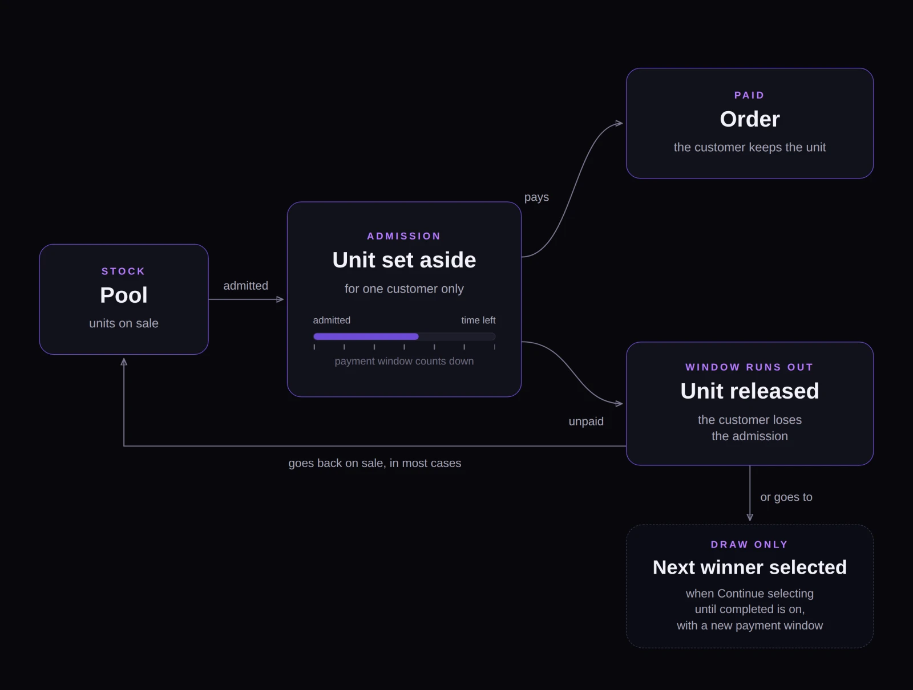

When a customer makes it through a distribution, they receive an **admission**—the right to buy one unit within a limited **payment window**. Whenever Fanfare tracks your sequence's stock, a unit is held exclusively for that customer while the timer runs.

If they complete payment in time, the order is confirmed. If the window expires, they lose the admission and, in most cases, the unit returns to sale. For queues and draws using Fanfare checkout, you can also choose whether customers pay after admission or pre-authorize their card when they join.

<Frame caption="An admission grants a timed right to buy one unit: it ends in an order or, if the window expires, releases the unit.">
  
</Frame>

## When each distribution grants an admission

Each release format grants admissions at a different point:

- **Queue:** When the shopper reaches the front and is let in at the queue's **Admit rate**.
- **Draw:** When the entrant is selected as a winner.
- **Auction:** When the bidder wins—at settlement in an English auction, or the moment they accept the current price in a Dutch auction.
- **Timed release:** The moment the shopper enters. When the sequence counts stock, each entry holds a unit—see [Timed release](/concepts/distributions/timed-release).
- **Appointment:** Never. Appointments book a time slot and don't take payment.

## Payment window lengths

| Distribution | Payment window | Configurable? |
| --- | --- | --- |
| **Queue** | 30 minutes | No |
| **Draw** | **Admission expiration** (in seconds); defaults to 60 minutes if left blank when creating the draw | Yes—remains editable even after the draw opens |
| **Timed release** | 30 minutes | No |
| **Auction** | 30 minutes from the win | No |
| **Appointment** | None (unpaid booking) | — |

A few timing rules to keep in mind:

- **Clearing Admission expiration on a draw:** If you edit an existing draw and clear the **Admission expiration** field, Fanfare resets the window to **30 minutes** (not 60 minutes). Enter `3600` to keep a 60-minute window. See [Set up a draw](/guide/create/draw).
- **Changing a draw's window mid-selection:** Updating **Admission expiration** while winners are being selected applies only to winners picked afterward. Winners already selected keep their original deadline.
- **Short windows on Customer Picks draws:** If winners need to pick a product or size, give them at least 5 minutes—the draw editor warns you if you enter a shorter window, though you can still save.
- **Auctions near close:** An auction winner always gets a full 30 minutes from their win, even if that deadline extends past the auction's **Closes** time.

## During the payment window

While the timer runs, Fanfare holds the unit for that customer whenever Fanfare counts the sequence's stock. If you use an external store checkout, that hold exists only inside Fanfare's count, not in your store's inventory—see [Checkout options](/concepts/checkout-options) and [Stock](/concepts/stock).

Customers see a live countdown of their remaining time. On Fanfare checkout, the countdown pauses while their bank confirms payment (such as 3D Secure verification).

Once a shopper submits payment through Fanfare checkout, their order appears in **Orders** as **Draft** (it can't be canceled while in Draft). Shoppers who haven't attempted payment don't have an order yet. See [Orders and refunds](/guide/learn/orders).

## When a payment window expires

If a customer doesn't pay before their deadline, they lose the admission and the held unit is released. What happens next depends on the distribution type:

| Distribution | What the customer can do | What happens to the unit |
| --- | --- | --- |
| **Queue** | Rejoin using **Rejoin queue** while the queue is still open. | Returns to sale. |
| **Timed release** | Re-enter using **Re-enter release** while the release is still open. | Returns to sale. |
| **Draw** | Can't win again—each person can win only once per draw. | A replacement winner is selected only if **Continue selecting until completed** is enabled (on by default; locks when the draw opens). See [Draw](/concepts/distributions/draw). |
| **English auction** | Nothing. | Remains unsold; it isn't offered to another bidder. See [Auction](/concepts/distributions/auction). |
| **Dutch auction** | Bid again while the auction is still running (repeated unpaid wins can block further bids). | Returns to the auction at the current price. See [Auction](/concepts/distributions/auction). |

Signed-in customers receive notifications when their payment window opens (or when they win a draw or auction, with their checkout link and deadline) and again if it expires. Guests don't receive notifications—so a guest who closes the page can miss their window without realizing it. See [Customers and identity](/concepts/customers) and [What your customers see](/guide/drop/what-customers-see).

## Payment collection: pay after vs. pre-authorize

For queues and draws using **Fanfare checkout**, you choose when to collect payment under **Payment collection**:

| Distribution | Pay after admission (default) | Pre-authorize on entry |
| --- | --- | --- |
| **Queue** | **Pay when admitted** | **Pre-authorise on joining** |
| **Draw** | **Pay after the win** | **Pre-authorise on entry** |

Auctions and timed releases always collect payment after winning or entering, and appointments never charge.

- **Pay after admission:** Shoppers enter without a card and complete checkout during their payment window.
- **Pre-authorize:** Fanfare places a hold on the shopper's card when they join the queue or enter the draw. If they're admitted or selected as a winner, Fanfare captures the hold and creates their order automatically—no checkout step required. If they aren't selected, the hold is released automatically.

<Frame caption="Pre-authorization is available only with Fanfare checkout and a connected payment provider.">
  
</Frame>

Pre-authorization requires **Fanfare checkout** and a connected Stripe account. If your organization uses your own external checkout, customers pay directly in your store and Fanfare collects no payment—so **Payment collection** isn't shown. When Stripe is connected on Fanfare checkout, the Payment section also displays your plan's Fanfare fee for that distribution. See [Checkout options](/concepts/checkout-options) and [Payments and fees](/guide/account/payments).

<Warning>
  **Payment collection** and **Authorization amount** lock shortly before customers can join (about five and a half minutes before a queue opens, and right before a draw opens) and can't be changed afterward. See [What locks, and when](/concepts/what-locks-when).
</Warning>

## Pre-authorization rules and limits

Because pre-authorization places a real card hold up front, three constraints apply:

- **One uniform price:** **Authorization amount** is a single amount in your organization's currency. Every product and variant offered in the drop must cost that exact amount.
- **No product selection in pre-authorized queues:** A queue can't pre-authorize while customers still choose between multiple products or variants. Either run the drop as a draw, or limit the sequence to a single product and variant.
- **7-day card hold limit:** Card holds expire after about 7 days from the moment a shopper enters.

<Note>
  **Keep pre-authorized schedules under 6 days.** Plan the gap from when entry opens to the final selection (or **Closes** on a queue), plus the payment window, to stay under six days:

  - If a hold placed at opening would expire before the first draw selection (or a queue's **Closes** time) plus the payment window, Fanfare blocks the schedule until you shorten it.
  - On draws where entry stays open after the first draw time, holds can survive the first selection but expire before later rounds. Fanfare warns you when saving, and shows the earliest entry date whose holds will still be live at selection. If an early entrant's hold has already expired when they're picked, their allocation is released (and reassigned only if **Continue selecting until completed** is on).

  See [Set up a draw](/guide/create/draw) and [Set up a queue](/guide/create/queue) for schedule validation details.
</Note>

## Automatic entry

By default, visitors select a button to join a queue, draw, or timed release. Turning on **Automatic entry** (off by default) automatically enters every eligible visitor who reaches the distribution—even if they leave right away.

A few distribution-specific rules still apply when **Automatic entry** is on:

- **Queues:** Everyone waiting when **Opens** hits is still randomized.
- **Pre-authorized drops:** Shoppers are still prompted to authorize their card before entry completes.
- **Timed releases with tracked stock:** Shoppers still select **Enter** themselves whenever the sequence counts a stock limit that can sell out. See [Timed release](/concepts/distributions/timed-release).
- **Auctions:** Always require an explicit bid.

## On Shopify

The Fanfare app in Shopify routes shoppers to Shopify's checkout—Fanfare checkout (Stripe under **Settings → Payments**) is marked "Coming soon." Because Shopify handles payment directly, Fanfare collects no payment and **Payment collection** isn't shown.

In Shopify checkout, a customer's reservation expires at their payment deadline: Shopify checkout blocks late purchases, and Fanfare releases the held unit after a brief buffer. Auction winners must check out the reserved item at quantity `1`, at its winning price, with no discounts applied. See [Checkout protection](/guide/shopify/checkout-protection).

## Related

<CardGroup>
  <Card title="Checkout options" href="/concepts/checkout-options">
    Compare Fanfare checkout, your external checkout, and Shopify checkout.
  </Card>
  <Card title="What locks, and when" href="/concepts/what-locks-when">
    See when payment collection and other drop settings lock.
  </Card>
  <Card title="Set up a draw" href="/guide/create/draw">
    Configure admission expiration, payment collection, and winner selection step by step.
  </Card>
  <Card title="What your customers see" href="/guide/drop/what-customers-see">
    Preview the payment countdown, notifications, and expiration screens.
  </Card>
</CardGroup>
