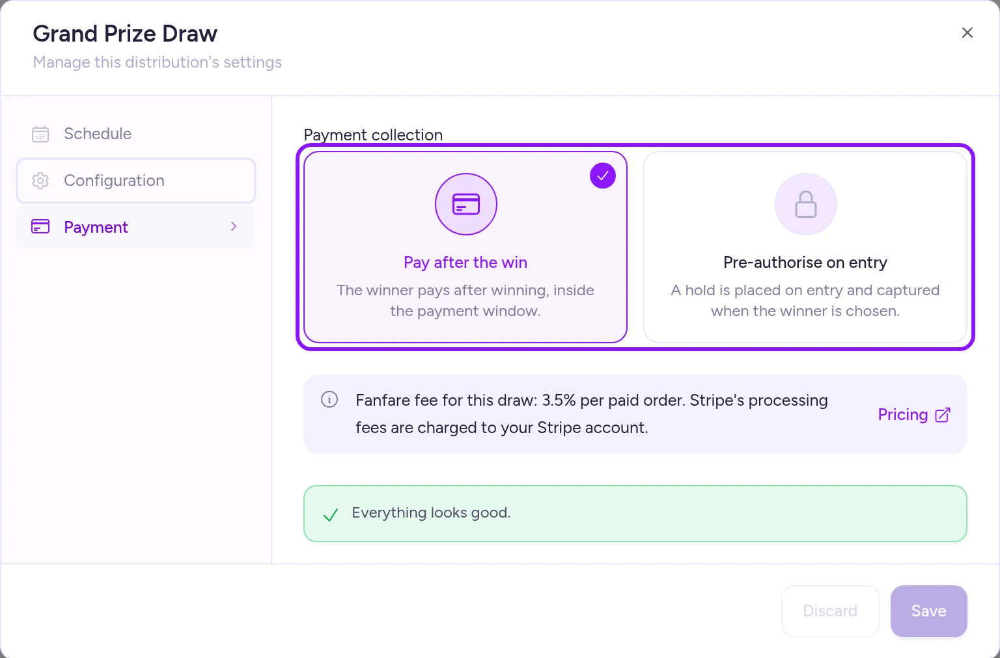

When a customer gets through a distribution, they get an admission: the right to buy one unit, for a limited time. That time limit is the payment window. Where Fanfare counts the sequence's stock, a unit is held for them inside it. If they pay, they get an order. If the window runs out, they lose the unit, and in most cases it goes back on sale. For queues and draws that use Fanfare checkout, you also choose when Fanfare takes the money: after the customer gets through, or as a hold on their card when they join.

<Frame caption="An admission is a timed right to buy one unit: it ends in an order or, when the window runs out, the unit is released.">
  
</Frame>

## How each distribution grants an admission

A sequence is one way in to an experience, and each sequence runs one or more distributions. Each distribution type grants admissions at a different moment:

- **Queue:** when the customer reaches the front and is admitted at the queue's **Admit rate**.
- **Draw:** when the customer is selected as a winner.
- **Auction:** when the customer wins: as the auction settles in an English auction, or the moment they accept the current price in a Dutch auction.
- **Timed release:** when the customer enters. Where the sequence counts stock, each entry holds a unit: see [Timed release](/concepts/distributions/timed-release).
- **Appointment:** never. An appointment books a slot and never charges.

## How long the window is

| Distribution | Payment window | Can you change it? |
| --- | --- | --- |
| Queue | 30 minutes | No. The admin offers no field for it. |
| Draw | **Admission expiration**, in seconds. 60 minutes if you leave it blank when you create the draw. | Yes. It is not one of the settings that lock when the draw opens. |
| Timed release | 30 minutes | No |
| Auction | 30 minutes from the win | No |
| Appointment | No window: nothing is sold | — |

On a draw where customers choose their product, the draw's Edit and Add distribution dialogues warn you if **Admission expiration** is under 5 minutes, because that leaves little time to pick. It is a warning only; you can still save. The new-experience setup does not show this warning.

Clearing **Admission expiration** when you edit a draw does not bring back the 60-minute default. A cleared field gives winners 30 minutes. To get 60 minutes, enter 3600. [Set up a draw](/guide/create/draw) covers the field step by step.

If you change **Admission expiration** while a draw is selecting, the new length applies only to winners selected after the change. Winners already selected keep the deadline they were given.

An auction winner's 30 minutes run from the win, even when they end after the auction's **Closes** time.

## While the window runs

When Fanfare counts the sequence's stock, the unit is held for that customer. On your own checkout that hold exists only in Fanfare's count, not in your store's inventory: see [Checkout options](/concepts/checkout-options). [Stock](/concepts/stock) explains how held units are counted.

The customer sees a countdown of the time they have left. With Fanfare checkout, the countdown pauses while their bank is confirming the payment.

Once a customer submits payment with Fanfare checkout, their order appears in **Orders** as Draft, and you cannot cancel it while it is Draft. A customer who has not tried to pay has no order yet. See [Orders and refunds](/guide/learn/orders).

## When the window runs out

The customer loses the admission and the unit is released. What happens next depends on the distribution:

| Distribution | What the customer can do | What happens to the unit |
| --- | --- | --- |
| Queue | Rejoin the queue with "Rejoin queue" while it is still open. | Goes back on sale. |
| Timed release | Enter again with "Re-enter release" while it is still open. | Goes back on sale. |
| Draw | Nothing. "Each person can win once in this draw." | Another entrant is selected only when **Continue selecting until completed** is on. It is on by default, and it locks when the draw opens. See [Draw](/concepts/distributions/draw). |
| English auction | Nothing. | Stays unsold. No one else is offered it. See [Auction](/concepts/distributions/auction). |
| Dutch auction | Bid again while the auction is still running. A bidder who lets wins lapse can have further bids refused. | Goes back into the auction, and another bidder can buy it at the current price. See [Auction](/concepts/distributions/auction). |

Signed-in customers get a message from Fanfare when their window opens and another when it closes. Queue and timed release customers get the opening message; draw and auction winners get their win message instead, which carries the same link and deadline. Guests get no messages, so a guest who closes the page can miss their window without knowing: see [Customers and identity](/concepts/customers). The wording of every message is on [What your customers see](/guide/drop/what-customers-see).

## Payment collection

For queues and draws that use Fanfare checkout, you choose when Fanfare takes the money, under **Payment collection**:

| Distribution | Pay afterwards (default) | Pre-authorise |
| --- | --- | --- |
| Queue | "Pay when admitted" | "Pre-authorise on joining" |
| Draw | "Pay after the win" | "Pre-authorise on entry" |

Auctions and timed releases always take payment after the customer wins or enters. Appointments never charge.

Paying afterwards means the customer pays at checkout, inside the payment window. Pre-authorising places a hold on the customer's card when they join or enter. If they are admitted or win, Fanfare captures the hold and creates their order, so they do not check out; if they are not, the hold is released. The exception is an early entrant whose hold has expired by then, covered below.

<Frame caption="Pre-authorisation is offered only with Fanfare checkout and a connected payment provider.">
  
</Frame>

Pre-authorisation needs Fanfare checkout and a connected payment provider. Without a provider the admin shows "Connect a payment provider to collect payments through Fanfare; until then only external checkout is available." If your customers pay in your own checkout, there is no choice to make: "Customers pay in your own checkout, so Fanfare collects no payment for this queue" (or draw). Which checkout takes the payment is explained on [Checkout options](/concepts/checkout-options).

With Fanfare checkout and a fully set-up Stripe account, the Payment section shows the Fanfare fee for the distribution. The rate depends on your plan: see [Payments and fees](/guide/account/payments).

**Payment collection** and **Authorization amount** lock shortly before customers can first join, which on a queue is about five minutes before it opens. They cannot be changed afterwards. See [What locks, and when](/concepts/what-locks-when).

## What makes pre-authorisation refuse or fail

<Note>
  Card holds last about a week. A hold is placed when the customer enters, so the earliest entrants' holds expire first. Fanfare checks your schedule against this when you save:

  - If a hold placed when entry opens would not last comfortably past the first selection on a draw, or past **Closes** on a queue, plus the payment window, the admin refuses the schedule: "Card authorizations last about a week, so this schedule would leave every entrant's authorization expired before selection. Move the selection time earlier or open entry later."
  - On a draw whose entry stays open after the draw time, holds can last to the first selection but not to the last one. The admin then lets you save with a warning. Early entrants whose hold has expired by the time they are selected lose their allocation, and it returns to sale. A replacement is selected only when **Continue selecting until completed** is on.

  In practice, keep the time from opening entry to the last selection (**Closes**, for a queue), plus the payment window, under six days. The schedule shows the date from which entries will still hold a live authorisation at selection. The warning when you choose a schedule is on [Set up a draw](/guide/create/draw) and [Set up a queue](/guide/create/queue).
</Note>

- **Authorization amount** is one amount, in your organisation's currency. Every product and size on offer must cost exactly that amount.
- A queue cannot pre-authorise while customers still choose a product. The admin refuses it: "Run this as a draw, or leave the sequence with a single product and variant."

## Automatic entry

By default, customers who reach a queue, draw or timed release press a button to enter. With **Automatic entry** on, Fanfare "Enters everyone who reaches this distribution, including visitors who leave straight away." It is off by default.

- On a queue, those waiting at **Opens** are still shuffled.
- With pre-authorisation, the customer is still asked for a card before they are entered.
- On a timed release whose sequence counts a size that can run out, customers tap Enter themselves whatever the setting. See [Timed release](/concepts/distributions/timed-release).
- Auctions always need an explicit bid.

## Worked example: a draw with a 15-minute window

Northbound Supply Co. runs the draw "Public Draw" in "Phantom Stitch Anorak Drop". It picks 300 winners, collects payment with "Pay after the win", has **Admission expiration** set to 900 seconds (15 minutes), and has **Continue selecting until completed** on.

- A winner who pays 10 minutes after being selected gets an order.
- A winner who has not paid after 15 minutes loses the win. They cannot win again in this draw. Their unit is released, and because **Continue selecting until completed** is on, another entrant is selected and gets their own 15 minutes.

Compare a queue: its admitted customers always have 30 minutes, the fixed queue window.

## On Shopify

The Fanfare app in Shopify cannot connect Fanfare checkout yet: the Stripe connection under **Settings → Payments** is marked "Coming soon". An organisation created through the Fanfare app in Shopify starts on an external checkout. Customers pay in Shopify's checkout, Fanfare collects no payment, and the Payment section shows no **Payment collection** choice.

In Shopify checkout, a customer's access ends at their reservation deadline. After it, the checkout refuses the purchase, and the unit is released after a further short hold. Auction winners must check out the reserved item exactly once, at quantity 1, at its price and with no discount: see [Checkout protection](/guide/shopify/checkout-protection).

## Related

<CardGroup>
  <Card title="Checkout options" href="/concepts/checkout-options">
    Fanfare checkout, your own checkout and Shopify checkout.
  </Card>
  <Card title="What locks, and when" href="/concepts/what-locks-when">
    When payment collection and other settings stop being editable.
  </Card>
  <Card title="Set up a draw" href="/guide/create/draw">
    Admission expiration, payment collection and selection settings step by step.
  </Card>
  <Card title="What your customers see" href="/guide/drop/what-customers-see">
    The countdown, the messages, and what a customer sees when the window closes.
  </Card>
</CardGroup>
