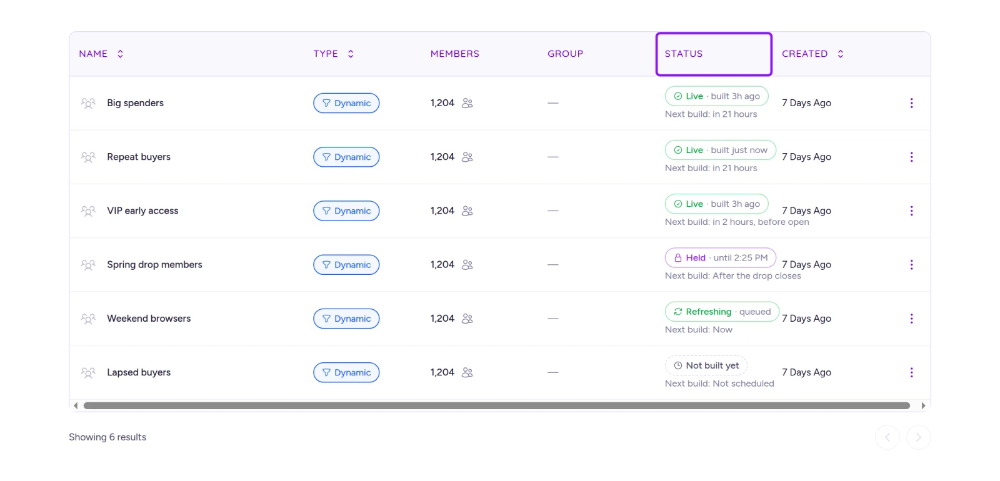

An audience is a named group of customers. You use it for two things: to decide who can enter a sequence, and to choose who gets that sequence's invite email. A sequence is one way in to an experience, and each sequence takes at most one audience, so to admit several groups you create one audience that combines them. Use an audience when you want "only my best customers" to get in first.
<Info>Available on Growth and above.</Info>

On Starter, the forms for creating and importing audiences show an upgrade prompt and cannot be used. Loyalty tiers need Pro: see [Loyalty and Fanfair](/concepts/loyalty).

## Where members come from

The **Type** column on the **Audiences** page shows one of three kinds.

| Kind | Where its members come from | When the list changes |
| --- | --- | --- |
| **Dynamic** | Rules on customer fields that you write | At each build (see below), and when one customer's details change |
| **Static List** | A CSV file you upload when you create the audience | When the import finishes |
| **Imported** | A Klaviyo or Mailchimp list, copied one way into Fanfare | When an import or **Sync Now** finishes |

Two kinds of audience come as a group, shown as one row you can expand:

- Loyalty tiers, created with **Create Loyalty Tiers**: one rule-based audience per tier, each covering a range of one customer field you choose, such as lifetime points or lifetime value. How tiers are set and edited is in [Loyalty and Fanfair](/concepts/loyalty).
- "RFM Segments": five audiences Fanfare creates for every organisation, "Champions", "Loyal", "At-Risk", "New" and "Lost", based on how customers rank on activity, purchase frequency and spend (and, for "New", having placed at most one order). You cannot edit them.

<Frame caption="For a rule-based audience, the Status column shows whether its latest build is live and when it next rebuilds.">
  
</Frame>

### What a rule can look at

A **Dynamic** audience is built from rules on customer fields: how much a customer has spent in total and per order, how many orders they have placed, their loyalty balance and lifetime points, their activity and purchase scores, the date of their last order, when their customer record was created, and their email address. Rules combine in one of two ways only: every rule must be true, or any one rule must be true. You cannot mix the two in one audience. There is no rule on a customer's location.

The full list of fields and operators is in [Build audiences](/guide/create/audiences).

A guest never matches a rule, so a sequence with an audience always asks the customer to sign in. For what that means for routing and guest entry, see [Sequences and routing](/concepts/sequences#audiences).

## Building: what Fanfare checks at the door

When a signed-in customer reaches a sequence with an audience, Fanfare checks them against the audience's current member list, not against live customer data. A build is Fanfare working out the member list from scratch and making it the list the door uses. The audience's status shows where its build stands:

| Status | What it means | Who can enter |
| --- | --- | --- |
| **Not built yet**, **Queued**, **Building** | The first build has not finished. | Nobody. |
| **Build failed** | The first build failed. | Nobody, until a build succeeds. |
| **Live** | The latest build is in place. | Its members. |
| **Refreshing** | A rebuild of the same rules is queued or running. | The members from the last build. |
| **Updating** | You saved a change and the new build has not finished. | Mostly the members from before your change. A customer re-checked in the meantime is judged by the new rules. |
| **Update failed** | The build of your latest change failed. | The members from before your change. |
| **Held** | A drop this audience gates is open, so full rebuilds wait until it closes (see below). | The members from the last build, plus or minus any customer re-checked since because their own details changed. |

<Warning>
  A new audience admits nobody until its first build finishes, and nobody at all if that build fails. Create or import the audience well before the drop, and before your sequence opens check that it reads **Live**: in the Status column for a **Dynamic** audience, or in the **Access** row on the audience's page for a list. If the first build of a rule-based audience you created fails, select **Refresh now** to build it again. For an **Imported** audience, select **Sync Now**. **Refresh now** works only on rule-based audiences, so for a **Static List** whose build failed, import the file again as a new list and set that on the sequence.
</Warning>

### When a Dynamic audience rebuilds

- When you save it, including a rename.
- When you select **Refresh now**.
- 24 hours after its last build, for an audience you create from rules, so any other build moves this time.
- After the daily score refresh, if its rules use scores, spend, orders or last order date.
- Before a drop it gates opens: 5 minutes before the first distribution in the sequence starts taking entries. A queue takes entries into its waiting room 5 minutes before its open time, so for a queue the rebuild runs 10 minutes before open.

Loyalty tiers and "RFM Segments" have no 24-hour rebuild and no **Refresh now**. They rebuild before a drop they gate opens, after the daily score refresh if their rules use scores, spend or orders (every RFM segment does), and, for tiers, when you save the group. A tier on loyalty points otherwise changes only through the per-customer re-checks below, so check its members before a drop.

Between builds, Fanfare re-checks a single customer when one of the fields an audience's rules use changes for them. That customer joins or leaves the audience on their own, without waiting for the next build. The re-check uses the rules as last saved.
### Held while a drop is open

While any distribution in a sequence that a **Dynamic** audience gates is taking entries, the audience is **Held**: full rebuilds wait until the latest such distribution closes. The hold covers every experience that uses the audience, not only the one whose drop is open.

<Warning>
  While an audience is held, **Refresh now** is refused. A rule change you save shows **Updating** and is applied to the whole list only when the drop closes, but any customer re-checked in the meantime is judged by the new rules straight away. Get the rules right before the rebuild that runs ahead of the open.
</Warning>

- If any distribution taking entries has no close time, the audience is not held at all, even while other gated distributions with close times are open.
- The first build of a new audience is never held.

A **Static List** or **Imported** audience is never held. If you select **Sync Now** while a drop it gates is open, the new member list applies as soon as the sync finishes.

## There is no draft step

<Warning>
  Saving a rule change on a **Dynamic** audience changes who can enter every sequence the audience gates and who receives each of those sequences' invite emails. Nothing asks you to confirm or publish. To try a different rule, create a new audience rather than editing one that sequences already use.
</Warning>

## Imported audiences

The **Create Audience** menu does not offer Klaviyo or Mailchimp lists, even with a connected account, so an imported audience cannot be created from **Audiences**. On an imported audience that already exists, **Sync Now** replaces the member list with a fresh copy of the Klaviyo or Mailchimp list. What it clears first, and the care that needs, is in [Build audiences](/guide/create/audiences).

Until a sync finishes, Fanfare keeps checking customers against the members from the last sync that finished. If the sync fails, those members stay in place. Fanfare never re-copies the list on its own.

## Audience or access code?

An access code is one shared code you hand out: at an event, over the phone, through a partner. An audience is a list Fanfare checks after the customer signs in.

| | Access code | Audience |
| --- | --- | --- |
| Suits | People you reach directly, who are not on any list | Customers you can describe by rules or already have on a list |
| Sign-in needed | Not by the code itself | Always |
| What the customer types | The code | Nothing extra: their email or phone and the one-time code to sign in |
| How you take access away | Change the code: new attempts need the new code at once, but a customer who already got past the gate with the old one can still enter for a short while, and anyone already in keeps their place. Clearing the code removes the code requirement; an audience on the same sequence still applies. | For a **Dynamic** audience, change its rules: a customer leaves at the next build that no longer includes them (builds wait while the audience is held), or sooner if their own details change and a re-check no longer matches them. You cannot remove one customer from a **Static List**: import a new list without them and set that on the sequence. For an **Imported** audience, remove them from the Klaviyo or Mailchimp list, then select **Sync Now** |

You can set both on one sequence, and then a customer needs both. Access codes are not case-sensitive. All the rules for codes are on [Sequences and routing](/concepts/sequences#access-codes).

## Plans and downgrades

Creating, editing, renaming, importing, syncing and **Refresh now** need Growth. If you move to a lower plan, your existing audiences keep gating their sequences and keep rebuilding on their schedule, but you cannot edit, refresh or re-sync them. You can still delete them.

## Worked example: Inner Circle early access

Northbound Supply Co. runs "Phantom Stitch Anorak Drop". Its first sequence, "Inner Circle Early Access", is gated by the "Inner Circle" audience and runs a queue that opens at 10:00 and closes at 11:00. Suppose Inner Circle is a **Dynamic** audience with one rule: customers whose lifetime points are above a set number.

1. Inner Circle rebuilds once a day and its status reads **Live**.
2. At 09:50, 10 minutes before the queue opens, Fanfare rebuilds it. Customers who meet the rule at that moment are the members.
3. From 09:55, when the waiting room opens, the audience is **Held** until 11:00, so no full rebuild runs, though an individual customer whose details change can still join or leave.
4. A signed-in customer outside Inner Circle is never shown the sequence. Fanfare tries the next one, or tells them "This experience is for members of a specific group." if no sequence will take them.
5. If you saved a rule change during the queue, Inner Circle rebuilds shortly after 11:00 to apply it. Otherwise its next full build is the daily one, about 24 hours after the 09:50 rebuild.

<Frame caption="While the queue is open, full rebuilds wait, and a saved rule change is applied just after the queue closes.">
  
</Frame>

## On Shopify

Audiences work the same way in the Fanfare app in Shopify. Connecting Klaviyo and Mailchimp differs there: see [Integrations](/guide/account/integrations).

## Related

<CardGroup>
  <Card title="Build audiences" href="/guide/create/audiences">
    Create rule audiences, import a CSV, edit and delete.
  </Card>
  <Card title="Sequences and routing" href="/concepts/sequences">
    Access codes, how gates combine, and where non-members go.
  </Card>
  <Card title="Add and gate sequences" href="/guide/create/sequences">
    Set an audience or access code on a sequence.
  </Card>
  <Card title="Invites, waitlist and access-code sends" href="/guide/create/invites-and-waitlist">
    The invite email an audience sets up.
  </Card>
  <Card title="Loyalty and Fanfair" href="/concepts/loyalty">
    Points and loyalty tiers.
  </Card>
  <Card title="Customers and identity" href="/concepts/customers">
    How customer records are created and matched.
  </Card>
</CardGroup>
