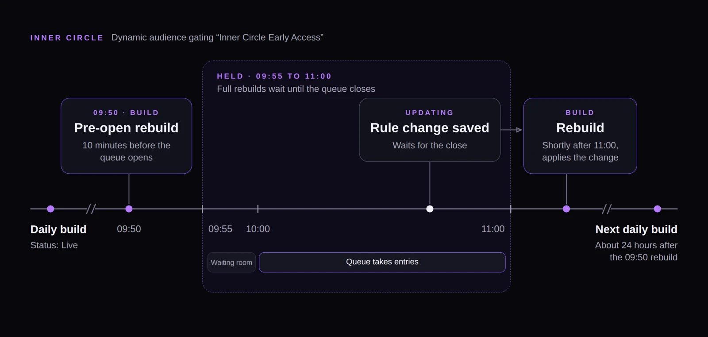

Audiences let you target specific groups of customers—like VIPs, repeat buyers, or newsletter subscribers—for exclusive or early access to a drop. You use an audience in two ways: to control who can enter a sequence, and to define who receives that sequence's invite email. Each sequence accepts one audience, so if you want to admit multiple groups together, combine them into a single audience.

<Info>Available on Growth and above.</Info>

On Starter, audience creation and import controls display an upgrade prompt. Loyalty tier audiences require Pro—see [Loyalty and Fanfair](/concepts/loyalty).

## Where members come from

The **Type** column on the **Audiences** page shows how each audience is populated:

| Type | Where members come from | When the list updates |
| --- | --- | --- |
| **Dynamic** | Rules you define on customer fields | On each rebuild (see below), plus live per-customer updates when a customer's details change |
| **Static List** | A CSV file you upload when creating the audience | When the import finishes |
| **Imported** | A one-way copy of a Klaviyo or Mailchimp list | When an import or manual **Sync Now** finishes |

Two audience types appear as expandable groups on the **Audiences** page:

- **Loyalty tiers** — Created via **Create Loyalty Tiers**, giving you one rule-based audience per tier across ranges of a single customer attribute (such as lifetime points or lifetime value). See [Loyalty and Fanfair](/concepts/loyalty).
- **RFM Segments** — Five built-in, read-only audiences Fanfare maintains for every organization (**Champions**, **Loyal**, **At-Risk**, **New**, and **Lost**), grouped by activity, purchase frequency, and spend (with **New** covering customers who've placed at most one order).

<Frame caption="For rule-based audiences, the Status column shows whether the latest build is live and when the next rebuild is scheduled.">
  
</Frame>

### What rules can target

A **Dynamic** audience filters customers using rules on these fields: total spend, per-order spend, order count, loyalty balance, lifetime points, activity and purchase scores, last order date, account creation date, and email address. You can require either **all** rules to match or **any** rule to match—you can't mix both in a single audience. Location rules aren't available.

See [Build audiences](/guide/create/audiences) for the complete list of fields and operators.

Because guests have no customer profile, they never match audience rules—so any audience-gated sequence automatically requires customers to sign in. See [Sequences and routing](/concepts/sequences#audiences) for how gating interacts with routing and guest access.

## How membership builds work

When a signed-in customer arrives at an audience-gated sequence, Fanfare checks them against the audience's latest built member list rather than recalculating rules on the fly. A **build** evaluates your audience from scratch and activates the resulting list for drop entry.

| Status | What it means | Who can enter |
| --- | --- | --- |
| **Not built yet**, **Queued**, **Building** | The initial build hasn't finished yet. | Nobody. |
| **Build failed** | The initial build failed. | Nobody, until a build succeeds. |
| **Live** | The latest build is active. | Current members. |
| **Refreshing** | A rebuild of the same rules is queued or running. | Members from the previous build. |
| **Updating** | You saved a rule change and the rebuild is in progress. | Mostly members from before the change; individual customers re-checked in the meantime are evaluated against your new rules. |
| **Update failed** | Rebuilding after your latest change failed. | Members from before the change. |
| **Held** | A gated drop is currently open, so full rebuilds are paused until it closes (see below). | Members from the last build, updated by any per-customer re-checks. |

<Warning>
  A new audience won't admit anyone until its first build finishes—and won't admit anyone if that build fails. Create or import audiences well ahead of launch, and verify they read **Live** before doors open (in the **Status** column for **Dynamic** audiences, or the **Access** row on the audience's detail page for lists). If an initial build fails, select **Refresh now** on a rule-based audience or **Sync Now** on an **Imported** audience. For a **Static List**, re-upload the CSV as a new list and attach it to your sequence.
</Warning>

### When a Dynamic audience rebuilds

Fanfare automatically rebuilds custom **Dynamic** audiences at these times:

- **On save** — Whenever you edit or rename the audience.
- **On demand** — Whenever you select **Refresh now**.
- **Daily** — 24 hours after its previous build (any rebuild resets this 24-hour clock).
- **After score refreshes** — Following Fanfare's daily score refresh, if your rules use scores, spend, order count, or last order date.
- **Before a drop opens** — 5 minutes before the sequence's first distribution starts accepting entries. Because a queue's waiting room opens 5 minutes early, Fanfare runs that rebuild 10 minutes before the queue's **Opens** time.

Loyalty tiers and **RFM Segments** don't run on a 24-hour cycle and don't offer **Refresh now**. They rebuild before a gated drop opens, after the daily score refresh when based on scores, spend, or orders (which applies to all RFM segments), and—for loyalty tiers—whenever you edit the tier group. Because tiers based on loyalty points rely on per-customer updates between drops, review their member counts before launch.

Between full builds, whenever a field used by your rules changes for a specific customer, Fanfare re-evaluates that customer right away using the latest saved rules—adding or removing them without waiting for the next full rebuild.

### Held while a drop is open

While any distribution in an audience-gated sequence is taking entries, Fanfare puts the **Dynamic** audience in a **Held** state and pauses full rebuilds until the last open distribution closes. This hold applies across every experience that uses the audience.

<Warning>
  While an audience is **Held**, **Refresh now** is disabled. If you save a rule change during a hold, the status shows **Updating** and the full list won't rebuild until the drop closes—however, any customer whose details change mid-drop is re-evaluated under your new rules right away. Finalize your rules before the pre-open rebuild runs.
</Warning>

Two exceptions apply:

- **Open-ended distributions** — If any open gated distribution has no close time, the audience isn't held—even while other gated distributions with close times are open.
- **First builds** — A brand-new audience's initial build is never held.

**Static List** and **Imported** audiences are never held. Selecting **Sync Now** on an imported audience during an active drop applies the updated list as soon as the sync completes.

## There is no draft step

<Warning>
  There's no draft or publish step for **Dynamic** audiences. Saving a rule change immediately updates who can enter every sequence using that audience—and who receives its invite emails. If you want to test different rules safely, create a new audience instead of editing one attached to active or upcoming drops.
</Warning>

## Imported audiences

The **Create Audience** menu doesn't offer Klaviyo or Mailchimp lists, even with a connected account; if you want to bring in a list from another tool, export it as a CSV and use **Import CSV** (note the column header and profile overwrite rules in [Build audiences](/guide/create/audiences)). On an existing imported audience, **Sync Now** replaces the member list with a fresh one-way copy from Klaviyo or Mailchimp.

Fanfare doesn't re-sync imported lists automatically. While a sync is running—or if a sync fails—Fanfare continues using the member list from the last successful sync.

## Audience vs. access code

An **access code** is a single shared code you hand out directly—at an event, through a partner, or in a private community. An **audience** verifies eligibility automatically after a customer signs in.

| | Access code | Audience |
| --- | --- | --- |
| **Best for** | People you reach directly who aren't on a customer list | Customers you can target with rules or already have in a list |
| **Sign-in required** | Not required by the code itself | Always |
| **What customers enter** | The access code | Just their email or phone and one-time sign-in code |
| **Revoking access** | Change the code—new attempts require it immediately, though anyone who already passed the gate has a brief window to finish entering and people already inside keep their spot. Clearing the code removes the requirement (any audience on the sequence still applies). | For a **Dynamic** audience, update the rules—removed customers lose access on the next rebuild (after any hold ends) or sooner if their profile updates. For a **Static List**, upload a new CSV without them and attach it to the sequence. For an **Imported** audience, remove them in Klaviyo or Mailchimp and select **Sync Now**. |

You can apply both an audience and an access code to the same sequence—customers will need to satisfy both. Access codes aren't case-sensitive. See [Sequences and routing](/concepts/sequences#access-codes) for full access code rules.

## Plans and downgrades

Creating, editing, renaming, importing, syncing, and manually refreshing audiences require **Growth** or above. If you downgrade to Starter, existing audiences continue gating their sequences and rebuilding on schedule, though you won't be able to edit, refresh, or re-sync them until you upgrade again. You can still delete unused audiences on any plan.

## Example: Inner Circle early access

Suppose Northbound Supply Co. launches its "Phantom Stitch Anorak Drop" with an "Inner Circle Early Access" sequence gated by a **Dynamic** "Inner Circle" audience (customers above a lifetime points threshold). The sequence runs a queue from 10:00 to 11:00:

1. **Before launch:** Inner Circle rebuilds daily and shows **Live**.
2. **At 09:50:** Ten minutes before the queue opens (5 minutes before the waiting room opens), Fanfare runs a pre-open rebuild to lock in everyone who qualifies.
3. **From 09:55 to 11:00:** While the waiting room and queue take entries, Inner Circle stays **Held**. Full rebuilds wait until 11:00, though individual customers whose points change are still re-evaluated.
4. **At the door:** Signed-in shoppers outside Inner Circle don't see this sequence—Fanfare routes them to the next eligible sequence, or lets them know the experience is reserved for a specific group if no other sequence is open to them.
5. **After 11:00:** If the team saved a rule tweak during the queue, Inner Circle rebuilds right after 11:00 to apply it. Otherwise, its next scheduled build runs about 24 hours after the 09:50 build.

<Frame caption="While the queue is open, full rebuilds pause; any rule change saved during the drop applies right after the queue closes.">
  
</Frame>

## On Shopify

Audiences work the same way in the Fanfare app in Shopify. Connecting Klaviyo and Mailchimp works differently there—see [Integrations](/guide/account/integrations).

## Related

<CardGroup>
  <Card title="Build audiences" href="/guide/create/audiences">
    Create rule-based audiences, import a CSV, and manage existing lists.
  </Card>
  <Card title="Sequences and routing" href="/concepts/sequences">
    How access codes, audiences, and fallback routing work together.
  </Card>
  <Card title="Add and gate sequences" href="/guide/create/sequences">
    Attach an audience or access code to a sequence.
  </Card>
  <Card title="Invites, waitlist and access-code sends" href="/guide/create/invites-and-waitlist">
    Send invite emails to the audience attached to a sequence.
  </Card>
  <Card title="Loyalty and Fanfair" href="/concepts/loyalty">
    Reward points and build tiered loyalty audiences.
  </Card>
  <Card title="Customers and identity" href="/concepts/customers">
    How customer profiles are created, matched, and verified.
  </Card>
</CardGroup>
