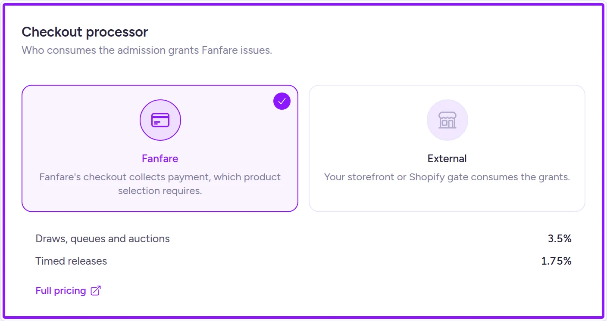

Fanfare manages who gets access to a drop and when; your checkout collects payment. You choose one checkout option for your entire organization: **Fanfare checkout**, **your own store's checkout**, or—when using the Shopify app—**Shopify checkout**.

Your choice determines what Fanfare can automate for you, including inventory counting, per-customer order limits, multi-product selection, and auctions. Pick your setup before creating your first experience, because switching isn't allowed while any queue, draw, auction, or timed release is scheduled or live.

## Where you choose

During sign-up, the **How will you sell?** step lets you choose **Fanfare checkout** or **External checkout**. Afterward, you can view or change this setting under **Settings → Organization → Basic Information** on the **Checkout processor** card (**Fanfare** or **External**). When you install the Fanfare app in Shopify, it sets this to **External** automatically for Shopify checkout.

<Frame caption="Manage your checkout setup from the Checkout processor card in Organization settings.">
  
</Frame>

## Comparing the three options

| | Fanfare checkout | Your own checkout | Shopify checkout |
| --- | --- | --- | --- |
| **Payment collection** | Customers pay inside the Fanfare widget or hosted page; funds go to your Stripe account. | Your store collects payment. Fanfare doesn't process payments. | Shopify collects payment. |
| **Inventory tracking** | Fanfare can track stock (**Fanfare-managed** or **Not managed**). | Not tracked by Fanfare—products are **Not managed**. | Normally tracked by Shopify (**Shopify-managed**). |
| **Order visibility** | Yes. | No. | Yes—Shopify orders sync into Fanfare's **Orders**. |
| **Order limits** | Enforced by Fanfare. | Not enforced by Fanfare; enforce in your store. | Enforced by Fanfare. |
| **Multi-product choice** (**Customer Picks** or **Mystery Box**) | Yes. | No—each sequence offers one product and variant. | Yes, when every product and variant comes from Shopify. |
| **Auctions** | Yes. | No. | Shopify Plus only (see [On Shopify](#on-shopify)). |
| **Card pre-authorization on entry** | Available on queues and draws. | Not available. | Not available. |
| **Refunds** | Issued from Fanfare's **Orders**. | Issued in your store. | Issued in Shopify. |
| **Fanfare per-order fee** | Percentage of each paid order based on your plan and distribution type. Never charged on appointments. | None. | Billed through Shopify app usage charges. |

<Frame caption="How payment flow, order visibility, and inventory tracking compare across the three checkout options.">
  
</Frame>

### Fanfare checkout

Customers complete payment right inside your Fanfare widget or hosted page, with payouts going directly to your connected Stripe account (Stripe's standard processing fees apply separately from Fanfare's take rate). Because Fanfare records every order, it can manage your stock, enforce per-customer order limits, support multi-product selection, run auctions, and pre-authorize cards on entry. You can cancel and refund orders from **Orders** (see [Orders and refunds](/guide/learn/orders)); refunds don't return Fanfare's fee.

Fanfare checkout has two requirements:

- **US & USD only** — Your organization must be based in the US and sell in US dollars.
- **Stripe connected** — Connect your Stripe account before creating experiences.

Connecting Stripe permanently locks your organization's country and currency. See [Payments and fees](/guide/account/payments) for setup details and plan take rates.

### Your own checkout

Fanfare controls who gets in and sends admitted shoppers to your store's checkout to pay. Because Fanfare doesn't collect payment or receive order confirmations from external checkouts, four rules apply:

- **Stock:** Products you create are **Not managed**—Fanfare doesn't track remaining inventory. See [Stock](/concepts/stock).
- **Product selection:** Each sequence can offer only one product and variant. **Customer Picks** and **Mystery Box** aren't available.
- **Order limits:** Fanfare can't enforce per-customer order limits on external sales, so enforce them in your store.
- **Auctions:** Unavailable, since external checkouts can't enforce a dynamic winning bid (the auction option shows *"Needs a checkout that charges the winning bid"*).

When a shopper is admitted, the widget's **Continue to checkout** button opens the checkout URL or triggers the custom handler your developer configured when embedding the widget (if neither is configured, no checkout button appears—see [API keys and embedding](/guide/account/developer)). Because Fanfare can't verify admission or payment windows inside your external store, your storefront is responsible for rejecting shoppers who arrive after their window expires.

#### How stock numbers work on your own checkout

On Fanfare checkout, a sequence's stock count tracks total units sold. On your own checkout, Fanfare doesn't see completed orders—so that number instead caps **how many shoppers can hold an active checkout spot at the same time**. When a shopper's payment window expires, their spot returns to the pool whether or not they bought, meaning more shoppers than your stock number can pass through over the course of a drop.

<Warning>
  With your own checkout, Fanfare's stock number doesn't prevent overselling. Your store's own inventory is the only safeguard, so double-check your store stock levels before opening the drop.
</Warning>

### Shopify checkout

With the Fanfare app in Shopify, shoppers pay in Shopify checkout and Shopify manages your inventory. Completed Shopify orders sync back into Fanfare's **Orders** so per-customer order limits are enforced automatically, while refunds stay in Shopify—see [Orders with Shopify checkout](/guide/shopify/orders). Fanfare's per-order fee is billed through Shopify app usage charges.

## Payment timing is configured per distribution

Choosing whether shoppers pay after admission/winning or pre-authorize a card on entry—as well as whether entry is automatic—is configured on each distribution rather than here. See [Admission and payment](/concepts/admission-and-payment) and [What your customers see](/guide/drop/what-customers-see). Card pre-authorization is available only on Fanfare checkout; external and Shopify checkouts skip payment collection in Fanfare.

## Switching checkout processors

Only organization admins can change **Checkout processor** in the standalone Fanfare admin. Switching isn't allowed while any queue, draw, auction, or timed release is **Scheduled** or **Live**—including ended drops whose winners are still inside a payment window, or open-ended queues and timed releases until you **Deactivate** or delete them.

Moving from **Fanfare** to **External** is also blocked if you have any **Fanfare-managed** products, sequences using multi-product selection the new checkout can't support, or auctions it can't charge for. Shoppers already admitted keep the checkout they started with. See [Organization settings](/guide/account/organization) for the checklist before switching.

## Example: Fanfare checkout vs. your own checkout

Northbound Supply Co., a US brand selling in USD on Fanfare checkout with Stripe connected, runs its "Eternal Bloom No. 1 Auction" for a single numbered silk bomber. Bidders place bids inside the experience, the winner checks out there, the order appears in **Orders**, and Fanfare applies Northbound's standard take rate.

If Northbound instead used its own non-Shopify checkout, it wouldn't be able to run that auction (no checkout to charge the winning bid), wouldn't be able to offer product or variant choice inside Fanfare for its "Phantom Stitch Anorak Drop", and setting a sequence stock of `50` would limit concurrent checkout spots to 50 shoppers rather than capping sales at 50 jackets.

## On Shopify

- **Shopify checkout only:** Fanfare checkout isn't available in the Shopify app yet—keep **Checkout processor** set to **External** so shoppers pay in Shopify checkout.
- **Checkout protection:** Complete storefront setup before launching so Shopify checkout enforces your drop rules. See [Checkout protection](/guide/shopify/checkout-protection).
- **Auctions:** Require **Shopify Plus**, Fanfare checkout rules enabled, Fanfare's latest Shopify permissions approved, and a store currency matching your Fanfare organization's currency. Without all four, auctions remain unavailable regardless of your Fanfare plan. See [Checkout protection](/guide/shopify/checkout-protection).
- **Take rates:** If your organization has separate agreed rates for Shopify checkout and Fanfare checkout, **Settings → Payments** lists both.

## Related

<CardGroup>
  <Card title="Payments and fees" href="/guide/account/payments">
    Connect Stripe, check your plan's take rates, and see what connecting locks.
  </Card>
  <Card title="Organization settings" href="/guide/account/organization">
    Switch your checkout processor and review prerequisites.
  </Card>
  <Card title="Admission and payment" href="/concepts/admission-and-payment">
    Pay-on-win, card pre-authorization, payment windows, and automatic entry.
  </Card>
  <Card title="Stock" href="/concepts/stock">
    Compare Fanfare-managed, Shopify-managed, and Not managed inventory.
  </Card>
  <Card title="Add and gate sequences" href="/guide/create/sequences">
    Configure product selection and per-customer order limits.
  </Card>
  <Card title="Checkout protection" href="/guide/shopify/checkout-protection">
    Protect Shopify checkout during your drops.
  </Card>
</CardGroup>
