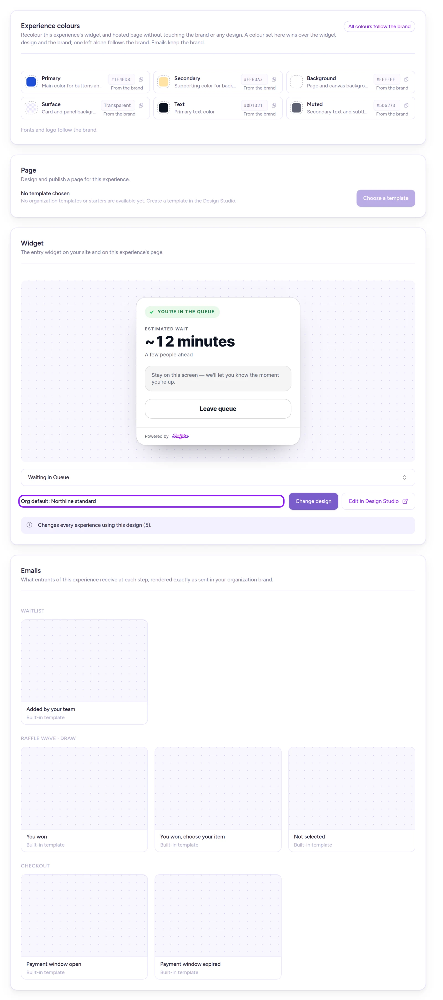
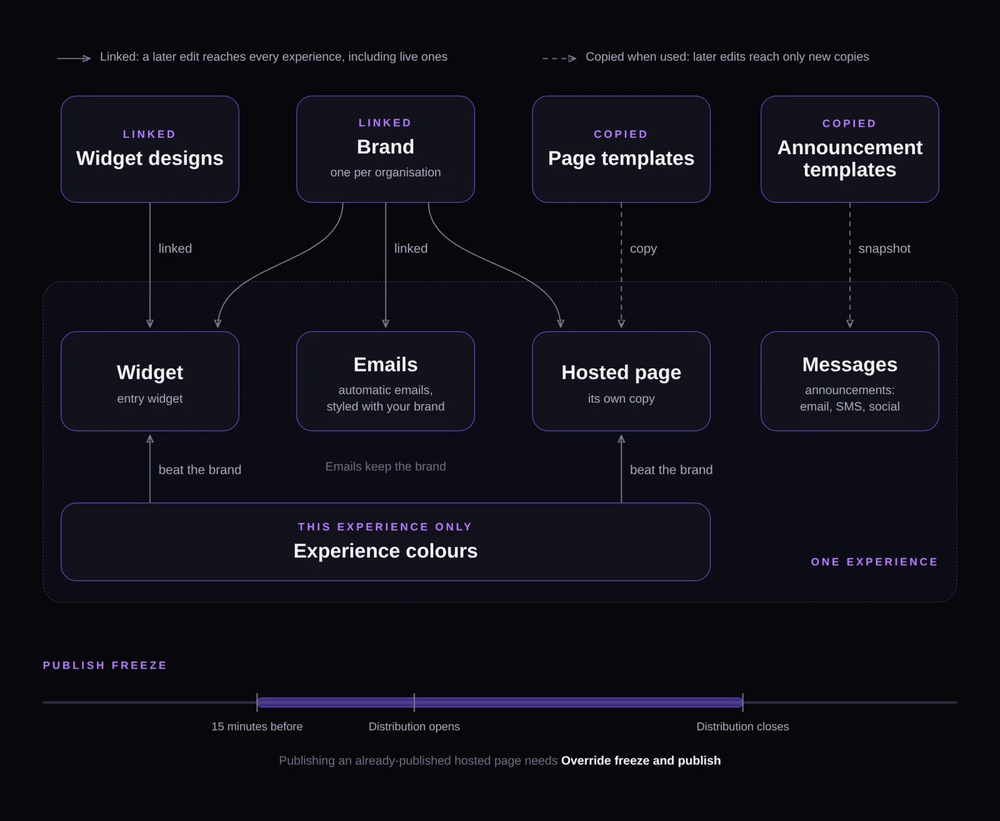

You set your brand once and choose templates for each experience. Some of those layers are copied when you use them, and others stay linked, so a later edit reaches every experience that uses them, including one that is live. This page explains which is which, which colour wins when two layers set one, and what Fanfare stops you changing during a drop.

<Info>The template library and hosted pages are available on Growth and above. Your brand is available on every plan.</Info>

On Starter, selecting **Design Studio** opens the brand editor. The template library does not appear.

## The layers

| Layer | What it controls | Where you set it | How many |
| --- | --- | --- | --- |
| **Brand** | Your **Logo**, six colour roles (**Primary**, **Secondary**, **Background**, **Surface**, **Text**, **Muted**), **Body Font** and **Heading Font**. | **Design Studio → Edit brand** | One per organisation. Every experience shows it. |
| Templates | Reusable designs: hosted-page templates, widget designs, announcement email, SMS and social templates, and wallet pass designs. Each is **Draft** or **Live**. | **Design Studio** | As many as you like, with one **Default** per kind. Social templates have no default. |
| The experience's own design | The hosted page of one experience. It starts as a copy, made for that experience, of a page template or a starter from Fanfare. | The experience's **Design** tab, **Page** card | One hosted page per experience. |
| **Experience colours** | Colour changes for one experience's widget and hosted page. | The experience's **Design** tab | One set per experience. |
| What customers see | The hosted page, if you publish one, and the entry widget. | | |

The automatic emails an experience sends at each step are listed on its **Design** tab under **Emails**. They use a built-in template styled with your brand.

<Frame caption="Each experience's Design tab shows the layers that reach its customers.">
  
</Frame>

## Hosted page and widget

The widget is the entry component: the part where a customer joins the queue, enters the draw, bids, books or buys in a timed release. The same widget design shows on your own site and inside the hosted page.

The hosted page is a whole web page that Fanfare serves for one experience. It is optional: an experience can run with only the widget on your own site. See [Build and publish the hosted page](/guide/create/hosted-page) and [Run it on your own site](/guide/create/your-own-site).

## Copies and live links

This is the rule that decides whether an edit reaches an experience that is already live.

- **Copied when used:** page templates and announcement templates (email, SMS and social). When you apply a page template to an experience, Fanfare makes a copy for that experience. When you compose an announcement from a template, the message takes a snapshot. Editing the template later changes only pages and messages made from it afterwards. Unpublishing it hides it from pickers but does not change pages already made from it.
- **Linked:** your brand, widget designs and wallet pass designs. Every experience or pass that uses one shows its current saved version.

<Warning>
  Editing a **Live** widget design changes what customers see on every experience that uses it, including experiences that are live now, in the same way a brand edit does. Editing a **Live** wallet pass design rebuilds the passes that carry it. There is no per-experience copy to protect a live experience. To change one experience only, use its **Experience colours**, or choose a different widget design for it.
</Warning>

<Frame caption="Linked layers reach every experience as soon as you save them; copied layers change only pages and messages made from them afterwards.">
  
</Frame>

## Which widget design an experience shows

1. The design you chose for the experience, if that design is **Live**.
2. Otherwise, your organisation's default widget design.
3. Otherwise, the built-in style "Kinetic".

The **Widget** card on the experience's **Design** tab says which applies: "Chosen for this experience: [design name]" or "Org default: [design name]" ("Org default: Kinetic" when there is no default). Clearing the default widget design sends every experience that follows it back to Kinetic. See [Templates and widget designs](/guide/create/templates) before you do that.

## Which colour wins

On the widget, from lowest to highest:

1. The colours built into the widget's style.
2. Your brand.
3. The widget design's own colours.
4. **Experience colours**.

On your own site, theme settings your developer puts on the widget sit above all four.

A widget design's style (its corners, border, depth and motion) always comes from the widget design, never from the brand.

On the hosted page, page templates take only **Primary** from your brand, as their accent; the entry widget on the page takes the whole brand. A colour set on the page itself beats both the brand and **Experience colours**. **Experience colours** beat the brand. A colour nobody sets follows the brand, or the template's own value when it has no brand role.

Emails keep the brand and ignore **Experience colours**.

Neither **Experience colours** nor a widget design changes the widget's fonts or logo; those come from your brand. Hosted page templates use their own fonts, not your brand fonts.

On your own site, the widget shows your brand fonts only when the font is loaded on the page or the widget is set to load it. See [Run it on your own site](/guide/create/your-own-site).

## What reaches customers without Publish

A hosted page changes only when you publish it, with four exceptions. Each one reaches customers as soon as it is saved, including while the experience is live:

- **Brand edits.** They save as you go; there is no Save button. Hosted pages restyle within about a minute; widgets and emails pick the change up on their own timing. Emails already sent are unchanged. See [Set your brand](/guide/create/brand).
- **Experience colours.** They apply to that experience's widget and hosted page straight away. See [Set your brand](/guide/create/brand).
- **Widget design changes.** Saving a **Live** widget design, switching or resetting an experience's design with **Change design** or **Reset to org default**, and changing or clearing the default widget design all restyle the entry widget on the experiences each one applies to, on the hosted page and on your site. See [Templates and widget designs](/guide/create/templates).
- **Linked fields on a published page.** A field filled from a source (the product name, description and image; the experience name and times; the organisation name, logo, address and support email) is re-applied to the live page when the source changes, sometimes after a delay. See [Build and publish the hosted page](/guide/create/hosted-page).

## The publish freeze

From 15 minutes before any distribution in the experience opens until it closes, publishing an already-published hosted page is refused unless the admin publishing it confirms **Override freeze and publish**. A distribution with no close time freezes publishing until 30 minutes after it opens; one with a close time but no open time freezes publishing until it closes. Deleted distributions never freeze. A first publish is never frozen, and you can still save drafts during the freeze.

The freeze does not block brand, widget design or **Experience colours** changes. It asks you to confirm them first, once per visit to the page. Saving a **Live** widget design always asks you to confirm and says how many experiences the save updates, including any inside a freeze. The override and its warning are on [Build and publish the hosted page](/guide/create/hosted-page).

## Draft, Live and Default

- Only **Live** templates appear in an experience's pickers.
- You must publish a template before you can **Make default**.
- A template that is the default cannot be unpublished or deleted until you **Clear default**. A widget design that any experience has chosen cannot be unpublished or deleted until those experiences use another design. A wallet pass design that a loyalty audience uses cannot be unpublished or deleted until that audience uses another design.

Creating, publishing and setting defaults are on [Templates and widget designs](/guide/create/templates).

## If your plan changes

After a downgrade, existing designs keep serving and published hosted pages stay up, but you can no longer edit, publish, clone or make templates default. On Starter you cannot open your templates at all, so you also cannot unpublish, delete or **Clear default** any of them. Wallet pass designs need Pro or above: if you move from Pro to Growth, you can still unpublish, delete and **Clear default** a wallet pass design.

## Worked example: changes during a live queue

Northbound Supply Co. has a published hosted page for "Phantom Stitch Anorak Drop", made from a page template, and the "Inner Circle Early Access" queue is open. The experience is inside its publish freeze.

| Change | What customers see |
| --- | --- |
| Change the brand **Primary** colour | The confirmation asks first. After **Save anyway**, the hosted page restyles within about a minute, and the widget and emails follow on their own timing. Every other experience changes too. |
| Edit the page template the hosted page was made from | Nothing. The hosted page is a copy. Only pages made from the template later get the change. |
| Edit the hosted page itself | The draft saves, but publishing is refused while the queue is open. Publishing now needs the admin publishing it to confirm **Override freeze and publish**. |
| Set **Experience colours** | After **Save anyway**, the widget and the hosted page for this experience change straight away. Emails keep the brand. No other experience changes. |

## On Shopify

Design Studio and the experience **Design** tab are the same in the Fanfare app in Shopify. On your storefront, the widget's colours, fonts and wording come from Design Studio, not from the Shopify theme editor. If you set no brand font, the widget uses your theme's font.

In the Fanfare app in Shopify, anyone who can open the app can save, publish (including overriding the freeze) and archive hosted pages; in the Fanfare admin only organisation admins can. See [Build and publish the hosted page](/guide/create/hosted-page).

## Related

<CardGroup>
  <Card title="Set your brand" href="/guide/create/brand">
    Logo, colours and fonts for every experience.
  </Card>
  <Card title="Templates and widget designs" href="/guide/create/templates">
    Create, publish and set default templates.
  </Card>
  <Card title="Build and publish the hosted page" href="/guide/create/hosted-page">
    Edit, publish and override the freeze.
  </Card>
  <Card title="Run it on your own site" href="/guide/create/your-own-site">
    Put the widget on a page you own.
  </Card>
  <Card title="Announcements" href="/guide/create/announcements">
    Email, SMS and social posts made from templates.
  </Card>
</CardGroup>
