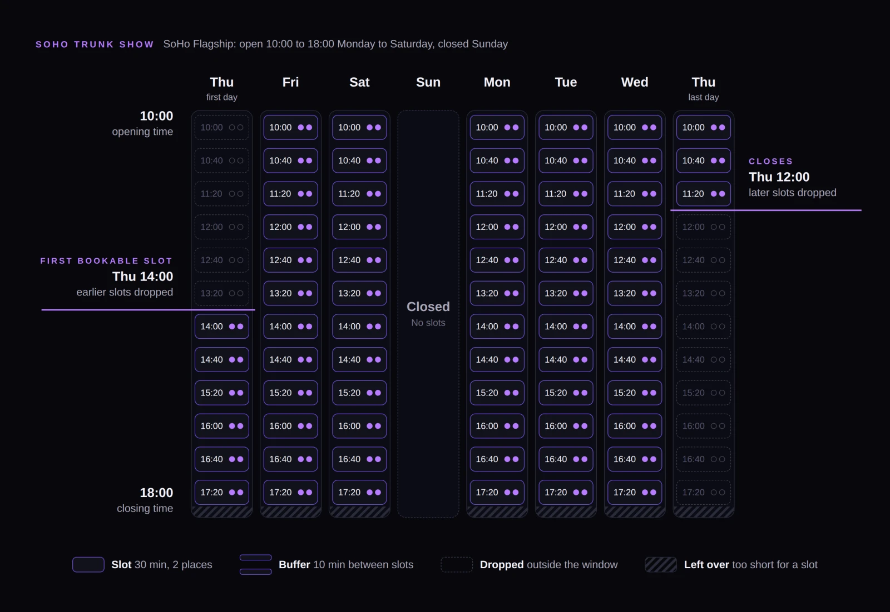
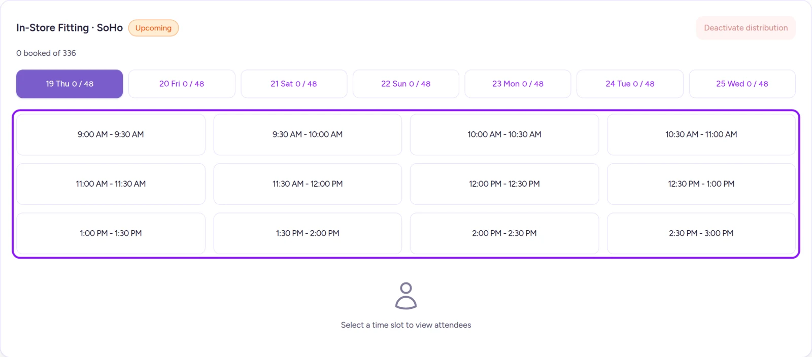

An appointment lets customers book a time to come in, for a fitting, a trunk show or a private viewing, or a time slot online. In the admin it is described as "Offer bookable time slots.", and the experience wizard puts it as "Give customers a scheduled time to shop or access your product. Great for reducing congestion." You choose the days it runs, how long each slot is, the gap between slots and how many people each slot takes. Fanfare cuts the slots from your location's opening hours, and customers pick one.

<Info>Available on Growth and above.</Info>

On Starter, the appointment choice is greyed out and shows that it is available on a higher plan. An appointment made on a higher plan keeps working if you later move down to Starter.

A sequence is one way in to an experience. An appointment is one of the five distributions a sequence can run, alongside queue, draw, auction and timed release.

## How it differs from the other distributions

An appointment hands out time, not products: the other four types decide who gets the right to buy.

- No product or stock is given out. The admin says: "Appointments don't hand out products".
- Fanfare takes no payment for an appointment and charges no fee. There is no payment step when you set one up.
- Customers always have to sign in to book. While an appointment is open or scheduled, its whole sequence asks for sign-in, even if another distribution in it allows guests: see [Sequences and routing](/concepts/sequences).
- A sequence that runs only appointments shows no waitlist in the admin. The sequence has no **Waitlist** tab, and when no sequence in the experience takes a waitlist, the experience's **Waitlist** page says "Appointment sequences take bookings rather than a waitlist". To tell people when booking opens, send an [announcement](/guide/create/announcements).

## How the slots are made

**The window.** **First bookable slot** and **Closes** set the first and last moments a slot can fall in. A slot that would start before **First bookable slot**, or end after **Closes**, is dropped.

<Note>
  **First bookable slot** is not when booking starts. As the admin puts it: "Customers can book as soon as the page is live." If your page goes live a week before the first slot, customers can book from that day. To control when booking starts, control when the page goes live.
</Note>

**The opening hours.** Inside the window, each day's slots are cut from opening hours.

- With a **Physical Location**, slots follow that location's opening hours, in the location's time zone. The location's time zone is used even when the appointment's **Time Zone** is different. A location with no opening hours set gets 09:00 to 17:00 every day.
- With **Online**, there is no location, and slots run from 09:00 to 17:00 every day in the appointment's **Time Zone**.
- A day the location is closed has no slots.

**The slot settings.** Starting at opening time, Fanfare lays out slots of **Slot duration**, with a gap of **Buffer** between one slot's end and the next one's start. A slot must finish by closing time, so a day ends with the last slot that fits. Each slot takes up to **Max capacity per slot** people. When a slot is full, customers can no longer pick it.

The two places you can create an appointment start with different slot settings: see [Set up appointments](/guide/create/appointment), which lists every field with its limits. Opening hours are set on the location.

<Frame caption="Slots are cut from each day's opening hours, and the window drops those that start before First bookable slot or end after Closes.">
  
</Frame>

## Bookings freeze the set-up

As soon as one customer books, you can no longer change **Slot duration**, **Buffer**, **Max capacity per slot**, the location, **First bookable slot**, **Closes** (**Closes At** in the experience wizard) or **Time Zone**. The settings stay locked while any booking stands, and the edit screen says why: "[count] bookings stand on this appointment; slot configuration, window and location cannot change until they end or are cancelled." A booking stops counting once its slot has ended or it has been cancelled.

Two limits on the window apply whether or not anyone has booked. Once the first bookable slot has passed, you can move **First bookable slot** earlier but not later. Once the appointment has ended, its window cannot change.

While any booking stands at a location, its opening hours and time zone cannot change either: see [Locations and opening hours](/guide/create/locations).

<Note>
  Get the set-up right before the page goes live. Once the first customer books, the only ways to change the slots are to wait until every booked slot has ended or to cancel the bookings. Cancelling a booking tells the customer and cannot be undone.
</Note>

## What customers can do

A signed-in customer picks a day, then a time, and books it. They can add the booking to their calendar, reschedule it or cancel it, and hold one booking per appointment at a time. Once the slot has started, the booking can no longer be rescheduled, and once it has ended, it can no longer be cancelled.

Customers receive a message when their booking is confirmed, cancelled or moved to a new time: see [What your customers see](/guide/drop/what-customers-see). Fanfare sends no reminder before the slot.

You can cancel a single booking yourself from the sequence's **Overview**, for a slot in the coming week that has not ended yet: the customer is told. The steps are in [Change things mid-drop](/guide/drop/live-controls). The admin has no way to mark a customer as checked in or as a no-show.

## Watching bookings

On the sequence's **Overview**, below the **Distributions** card, a panel headed with the appointment's name and location shows today and the six days after it, with each day's slots and the people booked into the slot you select. Bookings further ahead do not appear there until their day comes into that week. Times are shown in the location's time zone, or in the appointment's **Time Zone** when it has no location; the panel does not name the zone. Days outside the window read "not in window", and days the location is closed read "closed".

<Frame>
  
</Frame>

## Lifecycle

An appointment is **Scheduled** (its panel on the **Overview** shows **Upcoming**) until its **First bookable slot**, **Live** until it **Closes**, and then **Ended**. Bookings can come in while it is still Scheduled. An appointment has no settling phase: it ends when its window closes.

If you deactivate an appointment while it is scheduled or live, it shows **Ended early**. Every booking whose slot has not ended is cancelled, each customer is sent the cancellation message, and the admin shows the progress as it cancels them. Deactivate cannot be undone: see [Stop a drop](/guide/drop/deactivate).

An appointment's window cannot overlap another distribution's window in the same sequence: see [Distributions](/concepts/distributions/overview).

## Worked example: a trunk show at the SoHo Flagship

The experience "Aether Loafer Trunk Show" has one sequence, "SoHo Fittings", which runs the appointment "SoHo Trunk Show" at the SoHo Flagship location:

- **Slot duration**: 30 minutes
- **Buffer**: 10 minutes
- **Max capacity per slot**: 2

SoHo Flagship opens 10:00 to 18:00 Monday to Saturday and is closed on Sunday. Each slot starts 40 minutes after the one before:

| Slot | Starts | Ends |
| --- | --- | --- |
| 1 | 10:00 | 10:30 |
| 2 | 10:40 | 11:10 |
| 3 | 11:20 | 11:50 |
| 4 | 12:00 | 12:30 |
| 5 | 12:40 | 13:10 |
| 6 | 13:20 | 13:50 |
| 7 | 14:00 | 14:30 |
| 8 | 14:40 | 15:10 |
| 9 | 15:20 | 15:50 |
| 10 | 16:00 | 16:30 |
| 11 | 16:40 | 17:10 |
| 12 | 17:20 | 17:50 |

A slot starting at 18:00 would end after closing, so there are 12 slots a day with two places each: 24 fittings. Sunday has none.

Now the window. **First bookable slot** is Thursday at 14:00, and **Closes** is the following Thursday at 12:00. On the first Thursday, the six slots before 14:00 are dropped and slots 7 to 12 remain. On the last Thursday, only slots 1 to 3 end by 12:00, so slots 4 to 12 are dropped.

The page goes live on Monday, and the first customer books Thursday's 14:00 slot on Tuesday. From that moment the set-up is frozen, and so are the SoHo Flagship's opening hours. To switch to 45-minute fittings, the team has to wait until every booked slot has passed or cancel the bookings.

## On Shopify

The Fanfare app in Shopify does not offer appointments. They are left out of the choices when you create an experience and when you add a distribution to a sequence. On Shopify, customers can buy a product only through its experience, and an appointment never lets anyone buy, so an appointment beside a Shopify product would leave that product unbuyable. For the same reason, in the Fanfare admin an experience that uses a Shopify product can't have an appointment either: use a product created in Fanfare for that experience instead.

## Related

<CardGroup>
  <Card title="Set up appointments" href="/guide/create/appointment">
    Every appointment field, its default and limits, and the steps.
  </Card>
  <Card title="Locations and opening hours" href="/guide/create/locations">
    Create locations and set the hours slots are cut from.
  </Card>
  <Card title="Change things mid-drop" href="/guide/drop/live-controls">
    Cancel a single booking, and what else you can change live.
  </Card>
  <Card title="What your customers see" href="/guide/drop/what-customers-see">
    The booking screens and the messages customers receive.
  </Card>
</CardGroup>
