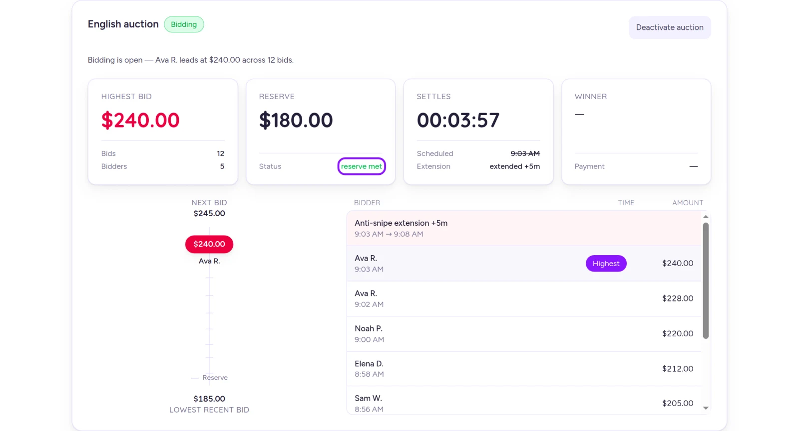

An auction lets demand set the price: "Let people bid — the highest bids win." Use one when you have a few high-value pieces and would rather not fix a price. There are two kinds, chosen when you create the auction:

- **English (ascending)**: customers bid against each other and the price climbs. When bidding ends, the highest bidder wins.
- **Dutch (descending)**: the price starts high and falls on a schedule. The first customers to accept the current price buy a unit at that price.

The kind cannot be changed later. Auctions are available on every Fanfare plan, Starter included.

<Frame caption="English bids climb to a winner at Settles; a Dutch price falls on a schedule until customers buy, and units left at Settles are unsold.">
  
</Frame>

## The times that matter

Every auction has three times: **Opens**, **Settles** (**Settle at** when you add an auction to a sequence) and **Closes**.

- From **Opens**, customers can bid (English) or buy (Dutch).
- At **Settles**, bidding ends. In an English auction "the highest bidder wins"; in a Dutch auction "the price freezes wherever it has landed".
- From **Settles** to **Closes** the auction is settling.

An English winner has 30 minutes to pay, counted from when bidding ends and the result is confirmed. **Closes** does not shorten or lengthen this. A winner who does not pay in that time loses the unit, and nobody else is offered it. The customer sees "Payment window closed".

The window from **Opens** to **Closes** cannot overlap another distribution in the same sequence: see [Distributions](/concepts/distributions/overview).

## English auctions

Each new bid must beat the highest bid by at least the **Minimum Bid Increment**. You can set a **Reserve Price**, the lowest price you will sell for. If the highest bid at **Settles** is below the reserve, there is no winner and every bid is released.

On a sequence that counts stock, "An English auction offers one unit of each size and the winner takes one, so there is no quantity to enter. Units it doesn't sell stay in the sequence." If the sequence holds no units, the auction opens sold out.

A customer's first bid locks their choice of item.

### Late bids and auto-extend

**Auto-Extend** (**Auto Extend Seconds** in the auction's settings) stops a last-second bid from winning unanswered. A bid that arrives within the extension length of **Settles** pushes **Settles** back by that length.

- It happens once. A second late bid during the extension does not extend the auction again.
- It never pushes past **Closes**: bidding then ends at **Closes**.
- **Settles** must be at least the extension length before **Closes**. The admin refuses a schedule without that room.

## Dutch auctions

The price starts at the **Start Price** and drops by the **Price Drop Amount** every **Price Drop Interval (seconds)**, down to the **Floor Price**. A customer buys a unit at the current price with "Buy now — [amount]".

On a sequence that counts stock, the number of units is the sum of the sequence's sizes, with no quantity to enter: change a size on the sequence's Stock card instead. Otherwise it is the **Quantity** you enter.

A Dutch buyer has 30 minutes to pay, counted from the moment they buy. A buyer who does not pay in time loses the unit. While the auction is running, that unit goes back on sale at the current price. Once the auction has ended, it stays unsold and is not offered again. A Dutch auction with a **Quantity** ends as soon as its last unit is bought, so a unit that lapses after that is lost to the sale too.

At **Settles** the price stops where it is and nobody can buy any more. Units not bought by then stay unsold. Reaching the floor price does not end a Dutch auction: customers can still buy at the floor until **Settles**. If the auction ends at the floor with units still unsold, customers who did not buy see "Unsold" and "The auction reached its floor price before all items were claimed."

## Pricing is fixed once the auction opens

<Note>
  "Pricing is locked once the auction opens". From that moment you cannot change the **Reserve Price**, **Minimum Bid Increment**, **Start Price**, **Floor Price**, **Price Drop Amount**, **Price Drop Interval (seconds)** or **Quantity**. Once the auction has opened, **Opens** can only move earlier, so you cannot reopen pricing by postponing it. The auto-extend length (**Auto Extend Seconds**) stays editable.
</Note>

## Rules that make auctions different

- **Customers must sign in.** An open or scheduled auction makes its whole sequence require sign-in, even if another distribution in it allows guests: see [Sequences and routing](/concepts/sequences).
- **Customers always choose to take part.** There is no automatic entry.
- **Payment is taken after the win.** There is no card hold when a customer bids.
- **Bids are binding.** Once a customer has bid, they cannot leave the auction or withdraw the bid.
- **The currency is fixed at creation.** An auction uses your organisation's currency at the moment you create it. While your organisation has auctions that have not been deleted, or ended auctions whose winners can still pay, you cannot change its currency: see [Organisation settings](/guide/account/organization).

### The checkout must charge the winning bid

An auction's price is only known when bidding ends, so the checkout must charge exactly the winning amount. Auctions need either Fanfare checkout or a connected checkout that enforces the auction price in your organisation's currency. Without one, Auction is locked in the admin with "Needs a checkout that charges the winning bid".

This is not a Fanfare plan limit, so upgrading does not unlock it. Switch to Fanfare checkout or connect a checkout that supports auction pricing: see [Checkout options](/concepts/checkout-options).

## What customers see

Every stage and message is in [What your customers see](/guide/drop/what-customers-see). In short:

- An English auction shows a ledger with the highest bid, the minimum next bid, and the amount the sale needs ("Sale needs at least") until the reserve is met.
- A customer who bids far above the minimum next bid must confirm a line saying what they will pay if nobody beats them.
- A customer who is outbid sees "Outbid — the highest bid is now [amount]" and gets an email or a text message.
- After **Settles** they see "Auction settling" while the result is confirmed.
- The winner sees "Won at [amount]" (English) or "Bought at [amount]" (Dutch) and goes on to pay.

When an English auction ends because the reserve was not met, customers see the generic "Ended" message. Nothing tells them the reserve was the reason.

## Deactivating an auction

Deactivating an auction voids its bids and no winner is chosen. A winner already in checkout keeps their unit and can still pay; any other winner loses the win. An English auction whose bidding has ended can refuse deactivation while its winner can still check out, and one that ended without settling must be deactivated on its own: see [Stop a drop](/guide/drop/deactivate).

To follow bids as they arrive, use the auction's panel on the sequence's **Overview**: see [Watch a live drop](/guide/drop/watch-live).

<Frame>
  
</Frame>

## Worked example: one numbered jacket

Northbound Supply Co. auctions one numbered Eternal Bloom Silk Bomber in "Eternal Bloom No. 1 Auction", an English auction:

| Setting | Value |
| --- | --- |
| **Reserve Price** | 650.00 |
| **Minimum Bid Increment** | 25.00 |
| **Settles** | 18:00 |
| **Closes** | 19:00 |
| **Auto Extend Seconds** | 300 (five minutes) |

1. Bids arrive at 600.00 and 625.00. Because the reserve has not been met, the ledger shows "Sale needs at least" 650.00.
2. At 17:40 a bid of 650.00 meets the reserve.
3. At 17:58 another customer bids 675.00. The bid lands inside the last five minutes, so **Settles** moves from 18:00 to 18:05.
4. At 18:03 the previous leader bids 700.00. The auction has already been extended once, so **Settles** stays at 18:05.
5. At 18:05 bidding ends and customers see "Auction settling". The highest bid, 700.00, is above the reserve, so that customer wins and sees "Won at 700.00".
6. The winner has 30 minutes from the end of bidding to pay, so until about 18:35. If they do not pay in time, the jacket stays unsold and is not offered to the 675.00 bidder.

## On Shopify

In the Fanfare app in Shopify, your organisation's currency is your shop's currency.

With Shopify checkout, Auction stays locked with "Needs a checkout that charges the winning bid" unless all of these hold:

- Your shop is on Shopify Plus.
- The **Fanfare checkout validation** rule is on and blocking: see [Checkout protection](/guide/shopify/checkout-protection).
- The app has every permission it asks for.
- Your shop's currency matches your organisation's currency.

Fanfare checks these when you install the app, when your shop or the app's permissions change, and each time you open the app in Shopify admin until the check passes. Changing your Fanfare plan does not help.

## Related

<CardGroup>
  <Card title="Set up an auction" href="/guide/create/auction">
    Every field and the steps.
  </Card>
  <Card title="Admission and the payment window" href="/concepts/admission-and-payment">
    Payment windows in general.
  </Card>
  <Card title="What locks, and when" href="/concepts/what-locks-when">
    The full lock table.
  </Card>
  <Card title="Stop a drop" href="/guide/drop/deactivate">
    Deactivate, and when it is refused.
  </Card>
</CardGroup>
