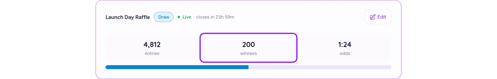

import { DrawOddsFigure } from "/snippets/figures/draw-odds.jsx";

A **draw** selects winners randomly from everyone who enters, making it ideal when demand far outweighs supply and you want luck—not checkout speed—to decide who gets to buy. Everyone who enters before **Draw at** has the same chance of winning (unless you enable loyalty weighting), so shoppers don't need to race the clock.

If you'd prefer a first-come, first-served line after opening, use a [queue](/concepts/distributions/queue) instead. See [Distributions](/concepts/distributions/overview) to compare all five types, or [Sequences and routing](/concepts/sequences) to learn how sequences group distributions.

## How the schedule works

Every draw uses three timestamps:

| Field | What it controls |
| --- | --- |
| **Opens** | Entry begins (labeled **Opens At** in the experience wizard). |
| **Draw at** | First winner selection runs (labeled **Draw date** in the experience wizard and edit dialog). Must be in the future and fall between open and close. |
| **Closes** | Entry ends (labeled **Closes At** in the experience wizard). Required on every draw. |

You can keep entry open past **Draw at** up until **Closes**, though the draw wraps up early once it fills:

- With **Continue selecting until completed** turned off, the draw fills as soon as all winner spots are assigned—immediately at **Draw at** if entries outnumber your winner count.
- With **Continue selecting until completed** turned on (default), the draw stays open until every winner has completed payment (or, on a stock-counted sequence, until no units remain available or held in checkout). Until then, latecomers who enter after **Draw at** can still be selected for open or replacement spots.

Once the draw fills, new entries are closed and remaining entrants aren't selected. Like all distributions, a draw's window can't overlap another distribution in the same sequence. See [Distributions](/concepts/distributions/overview).

<DrawOddsFigure />

## Setting your winner count

**Winner count** sets how many winners the draw aims to select. On stock-counted sequences, Fanfare keeps your winner count aligned with available inventory:

- **Hard cap on total units:** You can't save a winner count higher than the units allocated across the sequence's sizes—or lower sequence stock below an active draw's winner count. (Sizes with no stock limit don't cap winners.)
- **Warning for partially sold stock:** If some units are already sold or held in checkout, Fanfare warns you how many winners the draw can actually grant (for example, `"This draw can grant at most 250 of 300 winners"`).

<Note>
  While a draw is still selecting winners on a stock-counted sequence, moving stock into the sequence automatically increases **Winner count** by the same number of units, and moving stock out decreases it. You can't move stock out if it would drop **Winner count** below winners already selected (or to zero once open), and transfers into the sequence lock once winner selection finishes. After entry closes, **Winner count** can't be edited. See [Stock](/concepts/stock) and [Allocate stock to a drop](/guide/create/stock-allocation).
</Note>

See [Set up a draw](/guide/create/draw) for default winner counts and wizard behavior.

## Unpaid winners and replacements

Each winner receives a timed checkout window controlled by **Admission expiration** (defaults to 60 minutes if left blank when creating the draw; clearing it when editing sets 30 minutes). See [Admission and the payment window](/concepts/admission-and-payment) for full details on payment windows and collection modes.

- **Continue selecting until completed (on by default):** If a winner lets their payment window expire, Fanfare automatically draws a replacement from the remaining entrants until your winner count is filled. This toggle locks once the draw opens.
- **When turned off:** Unpaid winner spots aren't replaced during the draw. Those unsold units return to the sequence's stock so a later distribution can sell them.
- **One win per person:** Each shopper can win once per draw. If a winner misses their checkout window, they lose their spot and can't re-enter the same draw—they'll see **"Purchase window closed"** (**"Your purchase window ended. Each person can win once in this draw."**).

<Note>
  Two details to plan for:
  - **Card pre-authorizations:** Payment collection locks shortly before **Opens**. Because card holds expire after roughly 7 days, avoid leaving a multi-day gap between **Opens** and **Closes** when using card holds—early entrants' holds could expire before replacement winners are drawn.
  - **Automated expiry emails and guests:** The generic payment-window-expired email mentions re-entering, which doesn't apply to draws (see [What your customers see](/guide/drop/what-customers-see)). And if **Allow guest access** is enabled, guest shoppers don't receive emails or texts, so they'll need to keep the page open to see if they won (see [Customers and identity](/concepts/customers)).
</Note>

## While results settle

Once **Draw at** passes, entrants who haven't been selected yet enter a settling state: they see **"Drawing results"** (**"We're finalizing the draw."**) and can no longer select **Withdraw entry**. Anyone entering after **Draw at** goes straight into this state. It continues until they're picked (**"You won"**) or the draw finishes (**"Not selected"**).

## Rewarding loyal shoppers

Turn on **Bias toward loyal consumers** to weight the randomized entry order using loyalty points. Higher point balances improve a customer's odds of winning without guaranteeing selection. This option requires an active loyalty program (Pro and above). See [Loyalty and Fanfair](/concepts/loyalty).

## What your customers see

- **Before opening:** A countdown and **"Get notified when entry opens"**.
- **During entry:** **"Enter the Draw"** with a **"Drawing in"** countdown, an item/size selector (if applicable), and **Enter draw**.
- **After entering:** **"You've Entered"**, a countdown to the draw, and **Withdraw entry**.
- **While settling:** **"Drawing results"**.
- **Final outcome:** **"You won"** with **Continue to checkout** and a checkout countdown, or **"Not selected"**.

See [What your customers see](/guide/drop/what-customers-see) for every stage and notification.

## Deactivating a draw

Choosing **Deactivate** stops any further winner selection and revokes access for winners who haven't started checkout. Winners who are already paying can finish within their payment window, and completed orders remain intact. Deactivating can't be undone; see [Stop a drop](/guide/drop/deactivate).

## Example: running a public draw

After Northbound Supply Co.'s Inner Circle Early Access queue ends, they open the Phantom Stitch Anorak to everyone through a **Public Draw** sequence:

| Setting | Value |
| --- | --- |
| **Opens** | 11:00 |
| **Draw at** | 17:00 |
| **Closes** | 19:00 |
| **Winner count** | Matches the units allocated to the sequence |
| **Continue selecting until completed** | On (default) |

1. Entry opens at 11:00. Shoppers who enter at 11:01 and shoppers who enter at 16:55 have the exact same odds.
2. At 17:00, Fanfare draws winners up to the winner count. Winners see **"You won"** and get their payment window to check out, while remaining entrants see **"Drawing results"**.
3. One winner lets their payment window expire. They see **"Purchase window closed"** and can't re-enter. Because **Continue selecting until completed** is on, Fanfare automatically draws a replacement from the remaining pool.
4. A shopper arriving at 17:30 can still enter (going straight to **"Drawing results"**) and remains eligible while spots are open. Once every winner has paid, the draw closes immediately—new entries stop and remaining entrants see **"Not selected"**.
5. If spots are still open at 19:00, entry closes while remaining results finish settling.

<Frame caption="Track total entries, selected winners, and live draw odds from the sequence Overview.">
  
</Frame>

## Related

<CardGroup>
  <Card title="Set up a draw" href="/guide/create/draw">
    Configure every draw setting, check defaults, and see when options lock.
  </Card>
  <Card title="Distributions" href="/concepts/distributions/overview">
    Compare all five distribution types and how their schedules work.
  </Card>
  <Card title="Admission and the payment window" href="/concepts/admission-and-payment">
    Understand timed checkout windows, stock holds, and payment collection.
  </Card>
  <Card title="What your customers see" href="/guide/drop/what-customers-see">
    Walk through every screen and message customers receive.
  </Card>
</CardGroup>
