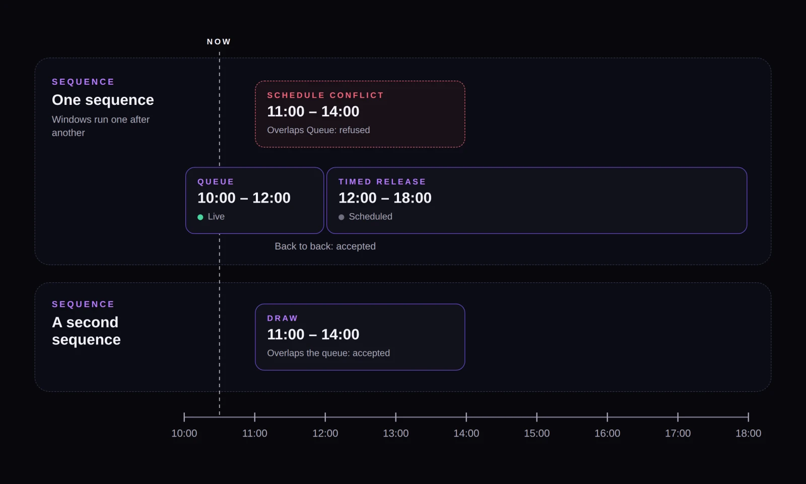

A **distribution** controls how customers claim access to your drop during a scheduled window. Fanfare offers five types: queues, draws, auctions, timed releases, and appointments. Each distribution belongs to a single sequence and determines how customers compete for stock, when they pay, and whether they need to sign in.

Waitlists aren't a distribution type—every sequence (except appointment-only ones) includes a waitlist automatically, regardless of which distributions it runs. See [Waitlists](/concepts/waitlists).

## Compare the five types

| Type | Best for | Guest access | Payment | Settle time | Plan |
| --- | --- | --- | --- | --- | --- |
| [Queue](/concepts/distributions/queue) | First-come, first-served drops with paced checkout traffic | Optional (off by default) | Pay after admission or card hold on entry | None | All plans |
| [Draw](/concepts/distributions/draw) | High-demand drops where luck decides who buys | Optional (off by default) | Pay after winning or card hold on entry | **Draw at** | All plans |
| [Auction](/concepts/distributions/auction) | Rare or one-of-a-kind items where demand sets the price | Sign-in required | After winning | **Settle at** | All plans |
| [Timed Release](/concepts/distributions/timed-release) | Standard scheduled launches with no waiting room | Optional (off by default) | After entering | None | All plans |
| [Appointment](/concepts/distributions/appointment) | In-store fittings, pickups, trunk shows, or private sessions | Sign-in required | No payment or product checkout | None | Growth and above ([plans](/guide/start/plans)) |

<Note>
  Choosing between paying after admission and placing a card hold on entry applies when Fanfare runs checkout with a connected payment provider. If you use your own external checkout, payment happens there after admission. See [Admission and the payment window](/concepts/admission-and-payment).
</Note>

### Choosing the right distribution

- **Queue** — Demand exceeds supply and you want fair, first-come, first-served access. Shoppers wait in a virtual waiting room (early arrivals are shuffled once at open) and enter checkout at a steady rate, keeping traffic smooth.
- **Draw** — Stock is tight and everyone should have an equal shot regardless of speed. Winners are selected randomly from everyone who enters.
- **Auction** — You're releasing limited, high-value, or one-off pieces and want bidding to discover the price—either ascending (English) or descending (Dutch).
- **Timed Release** — You want a clean, scheduled launch that opens to everyone at once, with no queue or waiting room.
- **Appointment** — You want shoppers to reserve a specific time slot to visit in person or meet online. Appointments reserve time rather than selling products.

## How distribution windows work

Every distribution has **Opens**, **Closes**, and a **Time zone** (labeled **Time Zone** when editing), defaulting to your experience's time zone.

- Both **Opens** and **Closes** are required, entered in whole minutes, and **Closes** must come after **Opens**.
- **Opens** can't be in the past when you create a distribution (allowing a few minutes' grace).
- Pick your time zone before setting times. Changing the time zone afterward preserves the same moments in time, so the clock times adjust to the new zone.

Each distribution type uses its window slightly differently:

- **Queue** — Opens a pre-open waiting room 5 minutes before **Opens**. See [Queue](/concepts/distributions/queue).
- **Draw** — Stops accepting entries at **Closes**. The settle moment (**Draw at** when adding a distribution, or **Draw date** in the experience wizard and edit dialog) must fall between **Opens** and **Closes**. See [Draw](/concepts/distributions/draw).
- **Auction** — Stops accepting bids at **Settle at** (labeled **Settles** in the experience wizard and edit dialog), or earlier if a Dutch auction sells out. Auto-extend can push an English auction's settle time back once on a late bid. Winners have 30 minutes to pay from the end of bidding (English) or purchase (Dutch), even if that runs past **Closes**. See [Auction](/concepts/distributions/auction).
- **Appointment** — Uses **First bookable slot** instead of **Opens** to define which slots are offered, not when booking starts. Customers can book as soon as your page goes live. See [Appointment](/concepts/distributions/appointment).

## Status follows the clock

There's no manual launch button—each distribution moves through its lifecycle automatically based on its schedule:

| Status | When it appears |
| --- | --- |
| **Scheduled** | Before **Opens**. On the sequence card, it displays the opening time (if today) or date. |
| **Live** | During the open window. |
| **Ended** | After the window closes. |
| **Ended early** | You deactivated the distribution before its window closed (or before bidding ended for an auction). Deactivating after the window closes—or during an auction winner's payment window—leaves it as **Ended**. |

Draws and auctions go through a settling period after entry or bidding ends while winners are finalized. A draw stays **Live** in the admin until winners are selected and finish checking out (or expire), then switches to **Ended**. An auction displays **Settling** and then **Settled** until **Closes**. On the storefront, customers see both as closed once entry or bidding stops. See [Experiences](/concepts/experiences) for how distribution statuses roll up to the sequence and experience.

<Warning>
  Deactivating a distribution can't be undone. See [What locks, and when](/concepts/what-locks-when) to check what you can still edit once a drop opens and what **Deactivate** does.
</Warning>

<Frame caption="A sequence's distributions appear on its Overview tab, with the active distribution listed first.">
  
</Frame>

## Running multiple distributions in one sequence

A sequence can contain any number of distributions in any mix of types, running one after another.

- **No overlapping windows:** Distributions in the same sequence can't overlap—even a deactivated distribution holds its original window until you delete it. Trying to save an overlapping schedule triggers a **"Schedule conflict"** notice naming the conflicting distribution.
- **Back-to-back windows work seamlessly:** You can start the next distribution the exact minute the previous one closes. It sells whatever units remain in the sequence, starting as soon as everyone admitted by the previous distribution finishes checking out or expires (until then, it shows **Live** without admitting new shoppers). See [Stock](/concepts/stock).
- **Need two distributions running simultaneously?** Put them in separate sequences. See [Sequences and routing](/concepts/sequences).

To reuse a setup, choose **Duplicate** from a distribution card's menu. It copies the distribution type and settings while clearing all dates so you can assign a fresh window.

<Frame caption="Distributions in one sequence run back to back without overlapping; use separate sequences to run two distributions at the same time.">
  
</Frame>

## Shared settings across types

Several settings work consistently across multiple distribution types:

- **Payment collection** and **Automatic entry** — Choose when to charge customers (queues and draws) and whether eligible shoppers enter automatically (queues, draws, and timed releases). See [Admission and the payment window](/concepts/admission-and-payment).
- **Allow guest access** — Lets shoppers enter queues, draws, and timed releases without signing in, provided every other open or scheduled distribution in the sequence allows guests too. Adding an open or scheduled auction or appointment—or gating the sequence with an audience—requires sign-in across the entire sequence. See [Customers and identity](/concepts/customers) and [Sequences and routing](/concepts/sequences).
- **Bias toward loyal consumers** — Uses loyalty points to weight random order in a draw or a queue's pre-open waiting room. Requires an active loyalty program (Pro and above); otherwise it's locked with **"Needs a loyalty program"**. See [Loyalty and Fanfair](/concepts/loyalty).
- **Name** — Customer-facing, not just internal. Shoppers see it in places like waitlist notifications, so give it a clear public title. See [Waitlists](/concepts/waitlists).

## What determines which types you can add

- **Your plan:** Types outside your current plan appear with an **"Available on [Plan]"** badge and an upgrade link. If you downgrade later, existing distributions keep running and remain editable, but you can't create or duplicate types your plan doesn't include. See [Plans and what they unlock](/guide/start/plans).
- **Your checkout:** Auctions require a checkout that can charge the winning bid. If yours can't, **Auction** shows **"Needs a checkout that charges the winning bid"**—this is a checkout requirement, not a plan limit. See [Checkout options](/concepts/checkout-options).
- **Product selection:** Timed releases can't be combined with **Mystery Box** product selection; trying to save one displays **"Timed release can't be combined with Mystery Box products"**. See [Timed release](/concepts/distributions/timed-release).

## Example: structuring a multi-stage drop

Suppose Northbound Supply Co. launches the Phantom Stitch Anorak with two sequences:

1. **Inner Circle Early Access** — Gated to their Inner Circle audience, running an "Inner Circle Queue".
2. **Public Draw** — Open to everyone, running a "Public Draw" after the queue closes.

Splitting these into two sequences solves two things: it keeps the audience gate on VIPs only, and it gives each sequence its own dedicated stock allocation (see [Stock](/concepts/stock)). Even if they wanted the draw to open while VIPs were still queuing, separate sequences allow overlapping schedules without triggering a conflict.

If the drop were open to everyone with a single stock pool, one sequence would do the job: a queue from 10:00 to 12:00 to absorb the opening rush, followed back to back by a timed release from 12:00 to 18:00 for latecomers. At 12:00, the queue ends and the timed release goes **Live**, admitting shoppers as soon as anyone still checking out from the queue finishes or expires.

## On Shopify

The Fanfare app in Shopify supports **Queue**, **Draw**, **Auction**, and **Timed Release**. **Appointment** isn't available in Shopify on any plan—because appointments don't sell products, attaching one to a Shopify product would leave that product unbuyable.

**Auction** is available only when your store's checkout can charge the winning bid; otherwise it displays **"Needs a checkout that charges the winning bid"**. See [Checkout protection](/guide/shopify/checkout-protection) for eligibility details.

## Related

<CardGroup>
  <Card title="Sequences and routing" href="/concepts/sequences">
    How entry paths work and how Fanfare routes each customer to the right sequence.
  </Card>
  <Card title="Add and gate sequences" href="/guide/create/sequences">
    Step-by-step instructions for adding distributions to a sequence.
  </Card>
  <Card title="What locks, and when" href="/concepts/what-locks-when">
    Which settings stay editable after a distribution opens, and how Deactivate works.
  </Card>
  <Card title="What your customers see" href="/guide/drop/what-customers-see">
    Preview every stage and customer message across all five distribution types.
  </Card>
</CardGroup>
