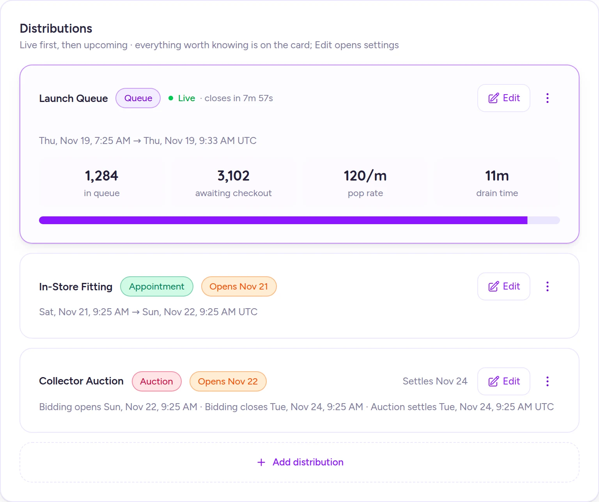

A distribution is how a sequence releases its products to customers during a time window: a queue, a draw, an auction, a timed release, or an appointment, which hands out time slots instead of products. These are the only five types. Each distribution belongs to exactly one sequence, and a sequence is one way in to an experience. The type decides how customers compete for your stock, when they pay, and whether they have to sign in.

The waitlist is not a distribution. Every sequence has one, whatever distributions it runs: see [Waitlists](/concepts/waitlists).

## The five types compared

| Type | Who gets in | Guests allowed? | Payment | Settle moment | Plan |
| --- | --- | --- | --- | --- | --- |
| [Queue](/concepts/distributions/queue) | "Admit people in order at a steady rate." | Optional, off by default | You choose | None | Every plan |
| [Draw](/concepts/distributions/draw) | "Randomly select winners from everyone who enters." | Optional, off by default | You choose | **Draw at** | Every plan |
| [Auction](/concepts/distributions/auction) | "Let people bid — the highest bids win." | Never | Always after winning | **Settle at** | Every plan |
| [Timed Release](/concepts/distributions/timed-release) | "Open access at a set time, first come first served." | Optional, off by default | Always after getting in | None | Every plan |
| [Appointment](/concepts/distributions/appointment) | "Offer bookable time slots." | Never | Never charges; hands out no products | None | Growth and above ([plans](/guide/start/plans)) |

"You choose" means you pick between paying after getting in and a card hold placed on entry. That choice exists only when Fanfare runs the checkout and a payment provider is connected; with your own checkout there is nothing to choose. See [Admission and the payment window](/concepts/admission-and-payment).

The settle moment is the time results are decided. The Add distribution wizard labels it **Draw at** or **Settle at**. The experience creation wizard and the edit dialogue label it **Draw date** for a draw and **Settles** for an auction.

### Which one fits

- **Queue**: more demand than supply and you want first come, first served once it opens (customers already waiting at **Opens** are shuffled once). Customers wait in a virtual waiting room and are let in at a steady rate, which also protects your checkout from a rush.
- **Draw**: limited stock and everyone should have the same chance. Winners are picked at random from everyone who enters.
- **Auction**: one-off or high-value items where you want bidding to find the price. The highest bidders win.
- **Timed Release**: a standard release that opens for everyone at a set time, with no queue.
- **Appointment**: a scheduled time for each customer to shop or visit, such as a fitting or a pickup. It spreads people out and sells nothing itself.

## The window

Every distribution has **Opens**, **Closes** and a **Time zone** (shown as **Time Zone** in the edit dialogue). The time zone starts as the experience's.

- Both times are required. You cannot create a distribution without a close time.
- **Closes** must be after **Opens**.
- **Opens** cannot be in the past when you create a distribution, with a few minutes' grace.
- Times are whole minutes.
- Set the time zone before you pick times. Changing it afterwards keeps the same moments, so the clock times shown change to the new zone.

What the window means depends on the type. Each page below explains it:

- A [queue](/concepts/distributions/queue) opens its waiting room five minutes before **Opens**.
- A [draw](/concepts/distributions/draw) stops taking entries at **Closes**. **Draw at** must fall inside the window.
- An [auction](/concepts/distributions/auction) stops taking bids at **Settle at**, or earlier if a Dutch auction sells out. With auto-extend set, a late bid in an English auction can push that back once. An English winner has 30 minutes to pay from the end of bidding, and a Dutch buyer 30 minutes from buying, even if that runs past **Closes**.
- An [appointment](/concepts/distributions/appointment) shows **First bookable slot** in place of **Opens**. It sets which slots exist, not when booking starts: customers can book as soon as the page is live.

## Status follows the window

There is no launch step. A distribution's status comes from its window and the clock:

| Status | When |
| --- | --- |
| Scheduled | Before **Opens**. The card on the sequence shows "Opens" with the time if it opens today, or the date if later. |
| Live | Inside the window. |
| Ended | After the window has closed. For an auction, see the settling stage below. |
| Ended early | You deactivated it before its window ended. Deactivating after the window has ended leaves it showing Ended. For an auction, "before" means before bidding ends: deactivating it during the winner's time to pay leaves it Ended. |

A draw or an auction has a settling stage after entry or bidding ends, while results are worked out. A draw's card reads Live until the draw has finished picking winners and they have paid or run out of time, then Ended. An auction's card names its stage instead, Settling and then Settled, until **Closes**. The public page reports both as closed. How these statuses roll up to the sequence and the experience is on [Experiences](/concepts/experiences).

Deactivating a distribution cannot be undone. What you can still change once a distribution has opened, and what Deactivate does, is on [What locks, and when](/concepts/what-locks-when).

<Frame caption="A sequence's distributions are listed on its Overview, with the live one first.">
  
</Frame>

## Several distributions in one sequence

A sequence can hold any number of distributions, of any mix of types. They run one after another, never at the same time.

- Windows in one sequence cannot overlap, and a distribution you have deactivated still holds its window until you delete it. If you add or edit a window so that it overlaps another, the admin shows "Schedule conflict" with the name of the distribution in the way, and will not let you continue.
- Back-to-back windows are fine: the next one can open at the same minute the previous one closes. It sells what is left of the sequence's units, but only once everyone the previous one let in has paid or run out of time to pay. Until then it shows Live but lets no one in. See [Stock](/concepts/stock).
- To run two distributions at the same time, put them in two sequences. See [Sequences and routing](/concepts/sequences).

**Duplicate**, in a distribution card's menu, copies its type and settings but clears every date, including **Opens** and **Closes**. Choose a new window that does not overlap any other distribution in the sequence.

<Frame caption="Windows in one sequence run back to back and cannot overlap; to run two distributions at the same time, put them in two sequences.">
  
</Frame>

## Settings several types share

Each of these is explained on its own page:

- **Payment collection** and **Automatic entry** (queues, draws and timed releases for automatic entry; queues and draws for payment collection): [Admission and the payment window](/concepts/admission-and-payment).
- **Allow guest access** (queues, draws and timed releases): lets customers enter without signing in, as long as every other open or scheduled distribution in the sequence allows guests too. An auction or appointment never allows guests, so while one is open or scheduled the whole sequence asks customers to sign in. Giving the sequence an audience turns guest access off. See [Customers and identity](/concepts/customers) and [Sequences and routing](/concepts/sequences).
- **Bias toward loyal consumers** (queues and draws): uses loyalty points to weight a draw's random order, or a queue's order for people who join before it opens. Without a running loyalty programme it is locked with "Needs a loyalty program". See [Loyalty and Fanfair](/concepts/loyalty).
- **Name**: not only for you. Customers can see it, for example in the waitlist's opens-soon email. See [Waitlists](/concepts/waitlists).

## What decides which types you can add

- Your plan. A type your plan does not include is marked "Available on" with the plan's name, with a link to upgrade, and cannot be picked. After a downgrade, distributions you already have keep running and you can still edit them, but you cannot create or duplicate one of a type your plan no longer includes. See [Plans and what they unlock](/guide/start/plans).
- Your checkout. Auction needs a checkout that can charge the winning bid. If yours cannot, Auction shows "Needs a checkout that charges the winning bid" and cannot be picked. This is not a plan lock: upgrading does not lift it. See [Checkout options](/concepts/checkout-options).
- The sequence's product selection. Timed Release can still be picked in a sequence that assigns products as a **Mystery Box**, but creating it is refused with "Timed release can't be combined with Mystery Box products". See [Timed release](/concepts/distributions/timed-release).
## Worked example

Northbound Supply Co. sells the Phantom Stitch Anorak through "Phantom Stitch Anorak Drop", which has two sequences:

1. Inner Circle Early Access: limited to the Inner Circle audience, running a queue called "Inner Circle Queue".
2. Public Draw: open to everyone, running a draw called "Public Draw" that opens after the queue has closed.

The queue and the draw sit in separate sequences for two reasons. They are for different customers: the audience on Inner Circle Early Access would also restrict the draw to members if the draw were in the same sequence. And each sequence sells only its own units: see [Stock](/concepts/stock). Their windows do not overlap today, but separate sequences would also let the draw open while members are still queuing. In one sequence, that would be refused with "Schedule conflict".

If the release were for everyone, one sequence with no audience would do. It could run a queue from 10:00 to 12:00 to handle the opening rush, then a timed release from 12:00 to 18:00 for anyone who comes later. The windows are back to back, so the admin accepts them. At 12:00 the queue reads Ended and lets no one else in: see [Queue](/concepts/distributions/queue). The timed release reads Live, and starts letting customers in once everyone the queue let in has paid or run out of time to pay.
## On Shopify

The Fanfare app in Shopify offers four types: Queue, Draw, Auction and Timed Release. Appointment is never offered, on any plan. An appointment never lets a customer buy, so it would leave the Shopify product it sits beside unbuyable.

Auction is offered only when your shop's checkout can charge the winning bid. Otherwise it shows the same "Needs a checkout that charges the winning bid" lock. Which shops qualify is on [Checkout protection](/guide/shopify/checkout-protection).

## Related

<CardGroup>
  <Card title="Sequences and routing" href="/concepts/sequences">
    Ways in to an experience, and how Fanfare picks one for each customer.
  </Card>
  <Card title="Add and gate sequences" href="/guide/create/sequences">
    Add a distribution to a sequence, step by step.
  </Card>
  <Card title="What locks, and when" href="/concepts/what-locks-when">
    What you can change once a distribution opens, and Deactivate.
  </Card>
  <Card title="What your customers see" href="/guide/drop/what-customers-see">
    Each stage of each type, from the customer's side.
  </Card>
</CardGroup>
