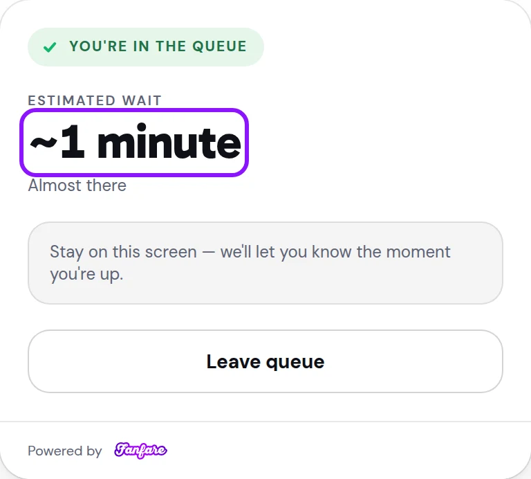

import { QueueAdmissionFigure } from "/snippets/figures/queue-admission.jsx";

A **queue** lets customers into your drop in order at a steady rate you control, protecting your checkout from sudden traffic spikes. Choose a queue when demand will outstrip stock and you want a fair, first-come, first-served release: shoppers join a virtual line, and Fanfare admits a set number per minute until stock sells out or the queue closes.

If you'd rather let luck decide regardless of arrival time, use a [draw](/concepts/distributions/draw). If you want to open access to everyone at once with no waiting room or pacing, use a [timed release](/concepts/distributions/timed-release). See [Distributions](/concepts/distributions/overview) to compare all five types.

## How a queue orders shoppers

A queue works in two phases—a brief pre-open waiting room, followed by a first-in, first-out line:

1. **Waiting room opens 5 minutes before Opens.** Customers can join the line early, though nobody is admitted until **Opens**.
2. **Pre-open shuffle at Opens.** The moment the queue opens, everyone in the waiting room is shuffled once into a random order. Showing up 4 minutes early gives no advantage over arriving 10 seconds early.
3. **First in, first out after Opens.** Everyone who arrives after **Opens** joins the back of the line behind the waiting-room group and moves forward in arrival order.

<Note>
  Set accurate expectations when promoting your drop: arriving during the 5-minute waiting room puts shoppers in the randomized opening group ahead of latecomers, not strictly at the very front.
</Note>

If you enable **Automatic entry**, shoppers join the queue as soon as they reach the page without selecting **Enter queue**; the pre-open waiting-room shuffle still applies. See [Admission and the payment window](/concepts/admission-and-payment).

<QueueAdmissionFigure />

### Loyalty bias in the waiting room

Turn on **Bias toward loyal consumers** to give loyal customers better odds of landing near the front of the **Opens** shuffle. More loyalty points improve a shopper's chances—never as a guarantee—and loyalty bias doesn't affect anyone who joins after **Opens** (that portion stays strictly first in, first out). Guest shoppers count as having zero points.

This setting requires an active loyalty program (Pro and above). While loyalty bias is active and entry is open, shoppers see a **"Fairness provided by Fanfair"** badge on the queue. See [Loyalty and Fanfair](/concepts/loyalty) for how points translate into weighting.

## Controlling admission speed

**Admit rate** sets the maximum number of customers admitted per minute—controlling the pace of traffic, not the total number of buyers. Fanfare keeps admitting shoppers at that rate until stock runs out or the queue closes.

Choose a rate your checkout can comfortably handle; a lower rate keeps checkout smooth at the cost of a slightly longer wait. You can adjust **Admit rate** live mid-drop, and the new rate takes effect on the next minute. See [Set up a queue](/guide/create/queue) for defaults and limits, and [Change things mid-drop](/guide/drop/live-controls) for live pacing adjustments.

## Admission and checkout windows

When a customer reaches the front of the queue, they're admitted and receive a **30-minute payment window** to complete checkout (fixed on queues). On stock-counted sequences, each admitted shopper reserves one unit until they pay or their window expires. See [Admission and the payment window](/concepts/admission-and-payment) for full details.

Two payment rules to plan around:

- **Payment collection locks ~5½ minutes before Opens** (right before the waiting room opens). To change it afterward, you'll need to deactivate the queue and create a new one.
- **No card pre-authorization with item selection:** You can't place a card hold on entry if shoppers still need to pick a product or size.

## What happens when stock runs out

Waiting shoppers aren't kicked out when stock hits zero. What they see depends on whether checkouts are still in progress:

- **All units are held in active checkouts:** The line pauses and waiting shoppers see **"Entry is paused. Your place in line is saved."** New arrivals can still join the back of the line. If an admitted shopper's payment window expires without a purchase, that unit returns to stock and the line starts moving again. See [Stock](/concepts/stock).
- **Every unit is sold and no checkouts remain:** Waiting shoppers see **"Everything claimed"** (**"Right now · you keep your place"**), and the line resumes automatically if you add more stock. (Refunding an order doesn't automatically return stock to the line.) New arrivals aren't added to the line—they see **"Sold out right now"** with a **Try again** button until the queue closes, when it changes to **"Sold out"**.

When **Closes** arrives, anyone still waiting isn't admitted and sees **"Not selected"** (**"You weren't selected this time."**). Customers admitted before **Closes** keep their 30-minute payment window and can still finish checking out.

## Pausing a queue

Pausing temporarily stops admissions while keeping every waiting shopper's spot intact—and new shoppers can still join at the back. While paused, wait-time estimates are hidden (note that the **"Entry is paused"** banner only appears when stock is temporarily held up in checkouts, not when you manually pause). See [Change things mid-drop](/guide/drop/live-controls) for pausing, resuming, and how pausing differs from setting **Admit rate** to `0`.

## Lifecycle and deactivation

A queue moves automatically from **Scheduled** (including the 5-minute waiting room) to **Live** at **Opens**, and to **Ended** after **Closes** with no settling phase. On the sequence's **Distributions** card, an upcoming queue shows its opening time or **Upcoming**.

If you **Deactivate** a queue before it closes, its status changes to **Ended early**. Waiting shoppers aren't admitted and admitted shoppers who haven't started checkout lose access, while customers already checking out can still finish paying within their payment window. Deactivating can't be undone; see [Stop a drop](/guide/drop/deactivate).

Like all distributions, queues can't overlap another distribution in the same sequence. See [Distributions](/concepts/distributions/overview).

## What your customers see

- **Before the waiting room opens:** A **"Coming Soon"** countdown and, if a waitlist is active, **"Notify me when the queue opens"** (signed-out shoppers see **"Sign in to get notified"**).
- **5 minutes before Opens:** **"Queue Open"** with **Enter queue**. Wait estimates stay hidden until the queue opens.
- **In line:** **"You're in the Queue"** with an **Estimated wait** and a progress band (like **"Up next"**, **"Near the front"**, or **"In the line"**)—never an exact queue number.
- **Admitted:** **"You're in"** with **Continue to checkout** and a live checkout countdown.
- **Window expired:** **"Access expired"** with **Rejoin queue** while the queue is still open (or **"Ended"** once closed).

<Note>
  If **Allow guest access** is enabled, guest shoppers don't receive emails or texts and can only return to their spot from the same browser. See [Customers and identity](/concepts/customers) and [What your customers see](/guide/drop/what-customers-see).
</Note>

<Frame caption="Shoppers see an estimated wait and a position band rather than an exact numbered place in line.">
  
</Frame>

## Example: running a members' queue

Northbound Supply Co. runs the Inner Circle Early Access queue for their Phantom Stitch Anorak Drop from 10:00 to 11:00, with **Admit rate** set to `200` and 400 anoraks in stock:

| Time | What happens |
| --- | --- |
| **09:55** | The waiting room opens and members start joining. Nobody is admitted yet, and no wait estimates appear. |
| **09:57** | A member joins. By 10:00, 600 members are waiting. |
| **10:00** | The queue opens. All 600 waiting members are shuffled once—arriving at 09:57 gave no edge over 09:59. Up to 200 shoppers per minute begin entering checkout. |
| **~10:02** | 400 shoppers have been admitted, holding all 400 anoraks in checkout. Admissions pause, and the 200 still waiting see **"Entry is paused. Your place in line is saved."** |
| **10:05** | Another member arrives and joins the back of the line behind everyone already waiting. |
| **~10:30 onward** | Any admitted shopper who didn't pay within 30 minutes loses their hold. Each returned anorak lets the next waiting member through in order. |
| **11:00** | The queue closes. |

If Northbound had turned on **Bias toward loyal consumers**, higher-point members would have better odds of landing near the front of the 10:00 shuffle—while the 10:05 arrival's spot at the back would stay the same.

## Related

<CardGroup>
  <Card title="Set up a queue" href="/guide/create/queue">
    Configure every queue setting, see defaults, and check when fields lock.
  </Card>
  <Card title="Change things mid-drop" href="/guide/drop/live-controls">
    Pause and resume a queue or adjust your admit rate live.
  </Card>
  <Card title="Admission and the payment window" href="/concepts/admission-and-payment">
    Learn how admission holds stock, how payment collection works, and when automatic entry applies.
  </Card>
  <Card title="Watch a live drop" href="/guide/drop/watch-live">
    Monitor queue depth, admissions, and sell-through in real time.
  </Card>
</CardGroup>
