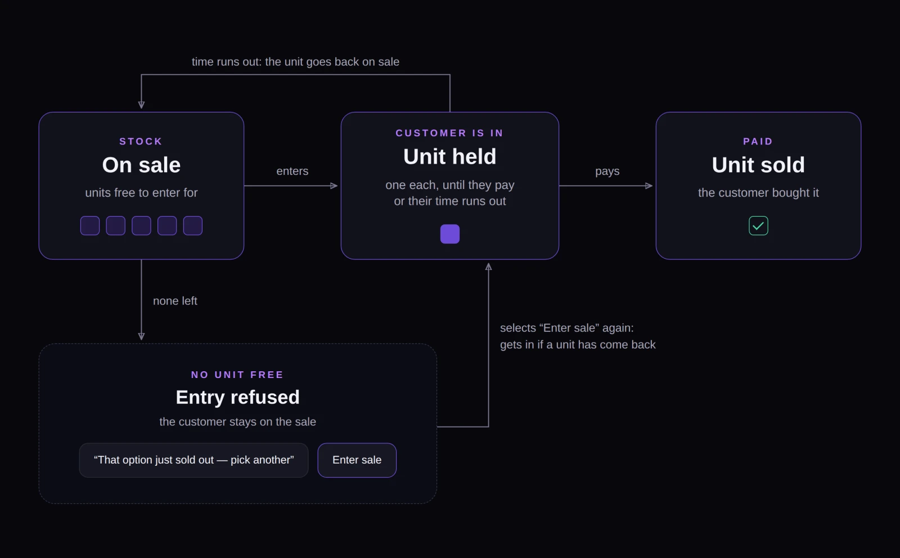

A timed release opens the sale at a set time for everyone who can enter the sequence. There is no line and no pacing: first come, first served. In the admin it is **Timed Release**, described as "Open access at a set time, first come first served." When you create an experience, its card reads "Set a specific time when access opens for everyone. Ideal for standard releases." Choose it when you want the product on sale at a known moment for whoever turns up. If you expect more people than your stock and want them let in at a steady rate, use a queue instead, which paces admissions. The five types are compared in [Distributions](/concepts/distributions/overview).

A sequence is one way in to an experience, and a timed release is one of the distributions a sequence can run. Your customers do not see the words "Timed Release". Their page shows the heading "Flash Sale", with an "Enter sale" button. If you see those on your customer page, that is your timed release.

## How it works

You set when the release opens and when it closes. The time zone starts as the experience's and can be changed with **Time zone**. The other settings are **Allow guest access** (off by default, and unavailable on a sequence gated by an audience) and **Automatic entry** (off by default). There is no payment step to configure. The steps are in [Set up a timed release](/guide/create/timed-release).

Before the release opens, customers see "Coming Soon" with a countdown. Signed-in customers can join the sequence's waitlist with "Enter waitlist"; others see "Sign in to get notified". See [Waitlists](/concepts/waitlists).

At the opening time the sale goes live. Each customer selects "Enter sale", choosing their item first if the sequence offers a choice.

### Entering holds a unit

On a sequence that counts stock, each customer who enters holds one unit of the item they chose from that moment, while they shop and pay. The unit is theirs until one of these happens:

- They pay, and the unit is sold.
- Their time to complete the purchase runs out, and the unit goes back on sale.

A customer cannot give the unit back early: once they are in, it stays held until they pay or their time ends.

When no unit is free, entry is refused. The customer stays on the sale and sees "That option just sold out — pick another" beside the "Enter sale" button, or beside the item picker, where they can choose another item. Fanfare does not let them in on its own: if a unit has come back by the time they select "Enter sale" again, they get in.

Once the release closes, customers who did not get in see "Ended", with "This event has ended. Thank you for your interest. This distribution is no longer available." and no button.

Until the drop's stock is ready, a customer can see "Not ready yet. Try again in a moment.", in place of the item choice or after selecting "Enter sale".

<Warning>
  A timed release can sell out at the moment of entry, not at checkout. Customers who were refused while others held units may get in later, when someone's time to pay runs out and that unit goes back on sale.
</Warning>

<Frame caption="On a sequence that counts stock, each customer who enters holds one unit until they pay or their time runs out.">
  
</Frame>

Entry holds a unit in the same way whether the product's stock is managed in Fanfare or in Shopify.

On a sequence that runs only timed releases, sizes of goods Fanfare does not manage, including products whose stock Shopify manages, start with no limit, so entry never runs out on Fanfare's side. See [Stock](/concepts/stock) for how counting and "no limit" work.

### Automatic entry on a counted sequence

**Automatic entry** enters everyone who reaches the distribution without them selecting anything. On a timed release whose sequence counts a size that can run out, it is not offered to customers, even when you switch it on. The admin says so beside the switch: "Automatic entry is not offered to shoppers while this sequence counts a size that can run out: they tap Enter themselves. The setting is kept as you set it." If no size has a limit and customers have no item to choose, automatic entry stays available.

### Mystery Box

A timed release cannot run on a sequence that assigns products by weight. You cannot add one to a Mystery Box sequence, and you cannot switch a sequence that has one to Mystery Box: the admin answers "Timed release can't be combined with Mystery Box products". Product selection is explained in [Sequences and routing](/concepts/sequences).

### Payment

Customers always pay after they enter, at checkout. There is no card hold. Once in, they see "You're in" with a "Your checkout time" countdown and a "Continue to checkout" button. If their time runs out on the page, they see "Access expired", "Your access has expired." While the release is still open, they can come back to the sale and select "Enter sale" again.

The payment window on a timed release is 30 minutes from the moment the customer enters. It is fixed: a timed release has no setting to change it.

Payment windows in general are covered in [Admission and payment](/concepts/admission-and-payment). On orders paid through Fanfare checkout, Fanfare's fee on timed-release orders uses its own rate, the **Timed-release take rate**. See [Payments and fees](/guide/account/payments).

## Rules that surprise people

- Guests (when **Allow guest access** is on) get no emails or texts and can only come back in the same browser. See [Customers](/concepts/customers).
- Entering or completing a timed release earns no participation points, though the order itself earns purchase points as any order does. See [Loyalty](/concepts/loyalty).
- Distribution windows in one sequence cannot overlap. To run timed releases at different times for different groups, use separate sequences. See [Distributions](/concepts/distributions/overview) and [Sequences and routing](/concepts/sequences).
- The default "opens soon" email to the waitlist uses the distribution's name, so name the release as you want customers to read it. See [Waitlists](/concepts/waitlists).
- Nothing about a timed release locks once it opens beyond the schedule rules every type shares. See [What locks when](/concepts/what-locks-when).

## Lifecycle

A timed release is **Scheduled** before it opens, **Live** while it is open, and **Ended** after it closes. One you deactivate before it closes shows **Ended early**. There is no settling phase: nothing is drawn or decided after it closes.

**Deactivate** stops it at once. The admin warns "It stops now. Shoppers can't buy from the release any more.", or for one that has not opened, "It won't open, so shoppers won't be able to buy from the release." Customers who are in but have not started paying lose their place; those who have already started paying can finish within their payment window. This cannot be undone. Paid orders are kept. See [Stop a drop](/guide/drop/deactivate).

## What your customers see

- Before opening: "Coming Soon" with a countdown, and "Enter waitlist" for signed-in customers.
- While open: "Flash Sale" with a "Window closes in" countdown and "Enter sale", with an item choice if the sequence offers one.
- Once in: "You're in" with a "Your checkout time" countdown and a "Continue to checkout" button.
- When nothing is free: the note "That option just sold out — pick another", with "Enter sale" still there to try again; once the release has closed, "Ended".
- After their time ran out: "Access expired". While the release is open, they can select "Enter sale" again.

The full journey and its messages are in [What your customers see](/guide/drop/what-customers-see).

## Worked example

Northbound Supply Co. is releasing the KaiZen Relic. The experience "KaiZen Relic Release" has a sequence, "Sneaker Club Release", gated by the Sneaker Club audience, so guest access is off. It runs a timed release open for four hours. Say, for example, that the sequence counts 300 pairs.

1. At the opening time, Sneaker Club members sign in and select "Enter sale". The first 300 to enter each hold one pair and see "You're in" with their "Your checkout time" countdown.
2. Customer 301 selects "Enter sale" a moment later. Every pair is held, so they see "That option just sold out — pick another" and stay on the sale page. They have not bought anything, and nobody has refused them for good.
3. One of the first 300 does not finish paying before their countdown ends. Their pair goes back on sale.
4. Customer 301 selects "Enter sale" again, gets in, holds that pair and completes the purchase.
5. Four hours after opening the release closes. Anyone who did not get in now sees "Ended", with no button.

## Related

<CardGroup>
  <Card title="Set up a timed release" href="/guide/create/timed-release">
    The settings and the steps to add one to a sequence.
  </Card>
  <Card title="Distributions" href="/concepts/distributions/overview">
    The five distribution types and how their windows work.
  </Card>
  <Card title="Stock" href="/concepts/stock">
    How a sequence counts stock, and when a size has no limit.
  </Card>
  <Card title="What your customers see" href="/guide/drop/what-customers-see">
    Every stage of the customer's journey and the messages they receive.
  </Card>
</CardGroup>
