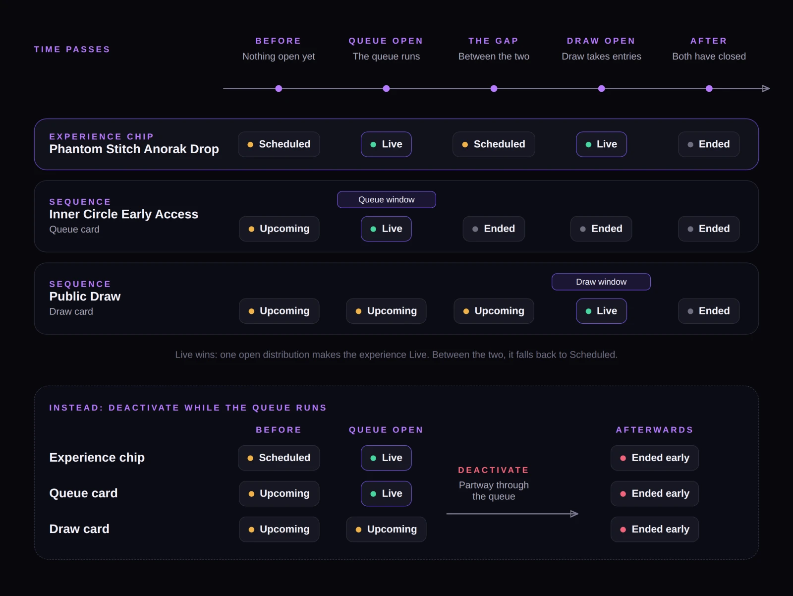
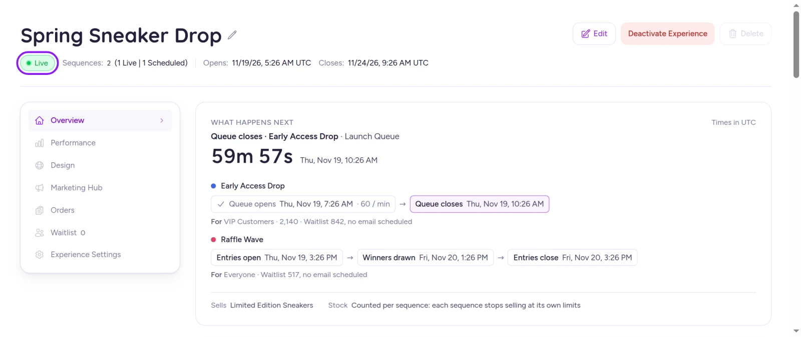

An **experience** is the home for a single drop. It brings together your drop's name, time zone, up to 10 products, design and hosted page (on Growth and above), announcements, and one or more sequences. You create one experience per drop, and everything you configure or monitor for that release lives inside it.

Access rules—who can enter and how they get the right to buy—live on the sequences inside the experience rather than on the experience itself. See [Sequences and routing](/concepts/sequences).

## What an experience holds

Every experience is built in three layers:

- **Experience** — Your products, time zone, design and hosted page (see [Design](/concepts/design)), and announcements.
- **Sequence** — A dedicated entry path with its own access gates, stock allocation, order limits, and waitlist.
- **Distribution** — The release mechanism inside a sequence: a queue, draw, auction, timed release, or appointment. A sequence can run multiple distributions back-to-back.

When you complete **Experiences → Create Experience**, Fanfare creates all three at once: the experience, a first sequence with the same name, and your first distribution. The **Experience type** step simply picks the type of that first distribution—you can add more sequences and mix distribution types afterward, and the **Types** column in your Experiences list displays every type included in the drop.

Appointments require **Growth** or above; queues, draws, auctions, and timed releases are included on every plan. See [Distributions](/concepts/distributions/overview) and [Plans](/guide/start/plans).

## Status chips

Every experience and sequence displays a status chip: **Draft**, **Scheduled**, **Live**, **Ended early**, or **Ended**.

Individual distribution cards show their own status based on their schedule: **Upcoming** (or the opening date) before opening, **Live** while open, **Ended** after closing, and **Ended early** if deactivated before closing. Auction cards show their current phase instead, such as **Bidding** or **Settled**. See [Distributions](/concepts/distributions/overview) for how each format's window works.

A sequence rolls up its chip from its distributions, and the experience rolls up its chip from its sequences (with upcoming distributions counting as **Scheduled**). The highest-priority status below wins:

| Priority | Chip | When it appears |
| --- | --- | --- |
| 1 | **Live** | At least one distribution is currently open. |
| 2 | **Scheduled** | Nothing is open, and at least one distribution is scheduled to open later. |
| 3 | **Ended early** | Nothing is open or upcoming, and at least one distribution was deactivated before its scheduled close. |
| 4 | **Ended** | Every distribution ran to its scheduled close. |
| — | **Draft** | The experience has no distributions yet. |

A single live sequence makes the whole experience **Live**, even if other sequences have already finished. Likewise, a deactivated distribution never changes to **Ended** just because another sequence finished on schedule.

<Note>
  **Draft** only means an experience has no distributions yet—not that it's unpublished. Because **Create Experience** always creates an initial distribution, new experiences start as **Scheduled** or **Live**.
</Note>

<Warning>
  Status chips are for your admin view. If an experience has a published hosted page, deactivating any single sequence or distribution marks the entire hosted page as ended for visitors—even if other sequences are still running. See [What locks, and when](/concepts/what-locks-when).
</Warning>

<Frame caption="The experience chip shows Live whenever any distribution is open, and falls back to Scheduled in the gap between them.">
  
</Frame>

## Going live: no separate launch button

Experiences go live automatically on schedule—there's no manual publish or launch step to trigger. As soon as a distribution has a future opening time, the experience is **Scheduled**, and the moment that time arrives, it flips to **Live**.

Selecting **Create experience** on the **Review & launch** step schedules the drop right away. If you leave the wizard's default opening time unchanged, your drop opens almost immediately—see [Create an experience](/guide/create/experiences).

<Tip>
  Double-check your key settings before the first window opens. While many details stay editable after creation, several settings lock once a distribution opens, and **Deactivate** can't be undone. See [What locks, and when](/concepts/what-locks-when).
</Tip>

## How Opens and Closes are calculated

An experience's **Opens** and **Closes** times aren't separate fields—Fanfare calculates them automatically from your distributions:

- **Opens** is the earliest opening time across all distributions.
- **Closes** is the latest closing time across all distributions. If an active distribution has an opening time but no end time, **Closes** displays a dash.
- **Deactivating pulls Closes forward:** A distribution deactivated while running closes at the moment you deactivated it, and one deactivated before opening is excluded.

To shift an experience's overall window, edit its distributions' schedules. Any announcements timed relative to the experience's opening or close automatically move with it.

<Note>
  On the Experiences list, the **Live now and opening in the next 14 days** strip uses overall **Opens** and **Closes** times. During a gap between two sequences, a card in that strip may read **Live** even while the experience's status chip shows **Scheduled**.
</Note>

## Checking a drop at a glance

Open any experience to check its live state from the header and **Overview** tab:

- **Header:** Shows the status chip, a sequence breakdown by status (such as `Sequences: 2 (1 Live | 1 Scheduled)`), overall **Opens** and **Closes** in the experience's time zone, and a **Deactivated** timestamp once everything has stopped if anything was ended early.
- **What happens next card:** Highlights the next upcoming milestone (such as a queue opening or winners being drawn) with a live countdown, a timeline lane per sequence (including its audience and waitlist, except for appointment-only sequences), a **Show in my time** toggle whenever your browser time zone differs from the experience's, and a summary of your products and who counts their stock (see [Stock](/concepts/stock)).

<Frame caption="The header and the What happens next card show where a drop stands and what happens next.">
  
</Frame>

For metrics and post-drop reporting in the rest of **Overview** and **Performance**, see [Read your results](/guide/learn/performance).

## Time zones

Each experience has its own time zone, which governs every timestamp shown in the Experiences list, header, and **What happens next** card.

For shoppers, widget opening times automatically display in their local time zone and countdowns tick down to the exact same instant worldwide. Dates placed on a hosted page using the **Experience opening time** or **Experience closing time** dynamic fields display in the experience's time zone. See [What your customers see](/guide/drop/what-customers-see).

You can change an experience's time zone after creation, though behavior depends on whether any distribution has opened yet. See [Create an experience](/guide/create/experiences).

## Ending or deleting an experience

An experience moves to **Ended** once every distribution closes on schedule, or **Ended early** once everything stops if any distribution was deactivated beforehand. Both **Deactivate** and **Delete** are permanent—see [What locks, and when](/concepts/what-locks-when) and [Stop a drop](/guide/drop/deactivate).

Deleting an experience never deletes its orders. If someone opens an old link to a deleted experience, Fanfare confirms when it was deleted and reminds them that its orders remain available in **Orders**.

## Example: how status changes across a two-sequence drop

Suppose Northbound Supply Co. runs **Phantom Stitch Anorak Drop** with two sequences: **Inner Circle Early Access** (a queue open today through tomorrow) and **Public Draw** (a draw opening in two days). Here's how status rolls up as the drop progresses:

| Stage | Inner Circle Early Access | Public Draw | Experience chip | Next milestone |
| --- | --- | --- | --- | --- |
| While the queue is open | **Live** | **Scheduled** | **Live** | Queue closes (Inner Circle Early Access) |
| Gap between queue and draw | **Ended** | **Scheduled** | **Scheduled** | Entries open (Public Draw) |
| While the draw accepts entries | **Ended** | **Live** | **Live** | Next draw milestone (for example, Winners drawn) |
| After both close | **Ended** | **Ended** | **Ended** | Everything scheduled has happened |
| Experience deactivated mid-queue | **Ended early** | **Ended early** | **Ended early** | Deactivated distributions drop off the card |

Scheduled announcements and waitlist reminders count as milestones too, so the **What happens next** card displays one first if it's due sooner. Deactivating the experience during the gap between sequences also sets the experience chip to **Ended early** because the draw was stopped before opening, while the completed queue stays **Ended**.

## On Shopify

- **No Appointments:** The Fanfare app in Shopify offers Queue, Draw, Auction, and Timed Release only.
- **Launch from a Shopify product:** On any Shopify product page without an active drop, the Fanfare block includes a **Start a Fanfare experience** button.
- **Different status labels in Shopify admin:** That product-page block labels experiences **Active**, **Upcoming**, or **Closed** rather than using the five chips above.
- **Checkout-gating sync:** Saving or deleting an experience updates Shopify product gating automatically and alerts you if any product couldn't be updated.

See [Fanfare inside Shopify admin](/guide/shopify/in-shopify-admin) for details.

## Related

<CardGroup>
  <Card title="Sequences and routing" href="/concepts/sequences">
    How entry paths work and how Fanfare routes each customer.
  </Card>
  <Card title="Distributions" href="/concepts/distributions/overview">
    Compare all five distribution types and how their schedules work.
  </Card>
  <Card title="Create an experience" href="/guide/create/experiences">
    Walk through the setup wizard, default opening times, and time zones.
  </Card>
  <Card title="What locks, and when" href="/concepts/what-locks-when">
    See what stays editable after a drop opens and what Deactivate does.
  </Card>
  <Card title="Stop a drop" href="/guide/drop/deactivate">
    Deactivate or delete an experience step by step.
  </Card>
  <Card title="Design" href="/concepts/design">
    Configure your hosted page, brand styling, and storefront widget.
  </Card>
</CardGroup>
