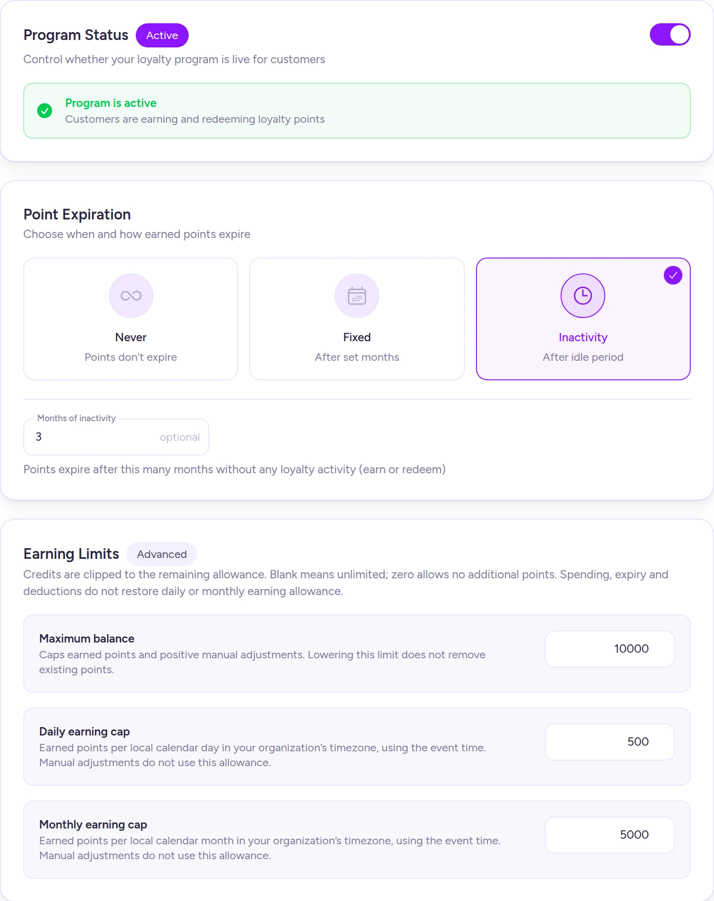

Fanfare's loyalty program rewards your most engaged shoppers with points earned from purchases and drop participation. You can put those points to work in two ways: group customers into **loyalty tiers** to unlock early-access sequences, or enable **Fanfair loyalty prioritization** to give loyal shoppers better odds in queues and draws.

You configure one loyalty program for your entire organization—either **Active** or **Inactive**—with its own event point values, expiration rules, and earning caps.

<Info>Available on Pro and above.</Info>

On Starter and Growth, the **Loyalty** pages remain visible for reference with controls disabled until you upgrade. Loyalty tier groups and Apple/Google Wallet loyalty passes also require Pro, though standard dynamic audiences filtering on **Lifetime points** are available on Growth.

For step-by-step setup instructions, see [Run a loyalty program](/guide/learn/loyalty).

## Balance vs. lifetime points

Fanfare tracks two separate point totals for every signed-in customer:

- **Loyalty balance** — The points a customer currently holds. It increases when they earn points or you add points manually, and decreases when points expire or you deduct them. **Fanfair loyalty prioritization** uses this balance.
- **Lifetime points** — Every point a customer has ever earned or been credited. Expiration and deductions don't lower it, though a CSV import can overwrite it with a new value.

Loyalty tiers can be built on either field. Note that setting **Lifetime points** when creating a record via **Add Customer** updates only the lifetime total—their **Loyalty balance** starts at `0`.

## How customers earn points

Only signed-in customers earn points; guests never do. See [Customers and identity](/concepts/customers).

Customers earn points from:

- **Purchases** made through your drops
- **Drop participation** in queues, draws, auctions, or appointments (such as entering, being admitted, or winning)
- **Waitlist sign-ups** completed by the customer themselves (entries you add manually don't earn points)

You set point values on the **Event Points** page—setting any event to `0` disables points for it. A few auction and appointment events award fixed point values that aren't editable in the admin.

<Warning>
  Not every card listed on **Event Points** awards points automatically. Page views, product impressions, views, and clicks, searches, add to cart, view cart, begin checkout, QR scans, and message opens, reads, and clicks don't award points regardless of the value entered—and neither do referrals, reviews, sign-ups, or store check-ins. Entering a timed release also earns no participation points, though purchases completed through it still earn **Purchase** points.
</Warning>

### How points are used

Fanfare loyalty points aren't redeemable for discounts or checkout credit. Instead, they determine membership in loyalty-based audiences, weight a customer's odds with Fanfair, and display on Apple and Google Wallet loyalty passes.

## Earning limits and expiration

Configure earning caps and expiration policies in **Loyalty → Settings**. See [Run a loyalty program](/guide/learn/loyalty) for every option.

**Earning limits:**

- **Daily earning cap** and **Monthly earning cap** calculate days and months in your organization's time zone, based on when each event occurred.
- Points you add manually bypass daily and monthly caps, but still can't exceed **Maximum balance**.
- Lowering **Maximum balance** never removes points a customer already holds.

**Expiration:**

- Expiration runs hourly using your organization's time zone.
- **Inactivity** expires a customer's entire balance at once after they go the configured number of months without earning points. Manual point adjustments don't count as earning activity—so crediting points to a customer already past the inactivity window can expire within the hour. Customers who have never earned points aren't expired by **Inactivity**.
- **Fixed** assigns an expiration date when points are earned, so points earned before you switched to **Fixed** won't retroactively expire.
- **Never** turns off all expiration, including for points that previously had an expiration date.

<Frame caption="Your program status, expiration policy, and earning limits apply across your entire organization.">
  
</Frame>

## Turning the program off

<Warning>
  Turning your loyalty program off freezes it without resetting balances. Earning, expiration, and manual adjustments all pause—while existing balances stay intact, continue placing customers in tiers, and still count in any queue or draw with **Bias toward loyal consumers** turned on. When you turn the program back on, any points that fell due while it was off expire on the next hourly check—which under **Inactivity** can clear whole balances at once.
</Warning>

## Loyalty tiers

A loyalty tier group is a set of rule-based audiences—one per tier—covering contiguous ranges of a single attribute such as **Loyalty balance** or **Lifetime points**. Create a group from **Audiences** via **Create Audience → Create Loyalty Tiers** (see [Build audiences](/guide/create/audiences)).

- Each group holds **2 to 10 tiers** with no gaps between ranges and an uncapped top tier.
- The lowest tier starts at the lowest value any customer held when you created the group and can't be changed later. If no customer had `0` at that time, future customers with `0` points won't belong to any tier.
- The tiered attribute locks at creation—create a new group if you want to tier on a different field.
- Attach a tier's audience to a sequence to give that tier early or exclusive access. See [Sequences and routing](/concepts/sequences).

Tier audiences don't run on a 24-hour rebuild cycle and don't offer **Refresh now**. They rebuild when you edit the group, before a gated drop opens, and after the daily score refresh if based on scores, spend, or orders—plus individual customers move between tiers right away when their underlying values change. See [Audiences and access codes](/concepts/audiences) for the full schedule.

<Warning>
  Tiers map to audiences by position, not by name. If you delete a tier like Silver, the tier below expands to cover Silver's range, every higher tier shifts down into the audience below it (Silver's audience becomes Gold, Gold's becomes the next tier), and the top tier's audience is deleted. Any sequence gated on those shifted audiences will quietly admit a different range—and if the top tier's audience gates an active or upcoming sequence, saving is blocked. Always check which sequences each tier gates before removing one.
</Warning>

## Fanfair loyalty prioritization

Turn on Fanfair per queue or draw using **Bias toward loyal consumers** (see [Set up a queue](/guide/create/queue) and [Set up a draw](/guide/create/draw)). The toggle requires an active loyalty program—while your program is off, it stays disabled with *"Needs a loyalty program"*.

With Fanfair enabled, Fanfare still randomizes entry order, weighted by each customer's **Loyalty balance**:

- Higher point balances improve a customer's odds of placing ahead, up to a cap.
- Guests are weighted as `0` points.
- Fanfare uses the balance the customer held when they signed in—points earned or added mid-session count starting on their next sign-in.
- Weighting improves odds but never guarantees admission or a win: a shopper with fewer points can still place ahead of a top earner.

How Fanfair applies depends on the distribution:

- **Queue** — Weights the randomized order of shoppers who joined the waiting room before **Opens**. Anyone arriving after **Opens** enters first-in, first-out. See [Queue](/concepts/distributions/queue).
- **Draw** — Weights the random order in which entries are drawn. See [Draw](/concepts/distributions/draw).

While entry is open on a queue or draw with Fanfair enabled, customers see *"Fairness provided by Fanfair"* beneath the entry button.

### Example: how weighting works in a draw

Suppose Northbound Supply Co. turns on **Bias toward loyal consumers** for the Public Draw in its "Phantom Stitch Anorak Drop". Customer A enters with `0` points and Customer B enters with `1,500` points at sign-in. Customer B is more likely to be drawn ahead of Customer A—but it's a weighted draw, not a guarantee, so Customer A can still place first and either shopper can miss out if demand exceeds winners. Any guest entering the same draw is weighted the same as Customer A.

## Plans and downgrades

If you downgrade below **Pro**, an active loyalty program keeps awarding and expiring points automatically, and existing wallet passes keep working. You won't be able to edit settings or adjust points—only turn the program off. Once turned off on a lower plan, you'll need to upgrade back to Pro to turn it on again.

## Related

<CardGroup>
  <Card title="Run a loyalty program" href="/guide/learn/loyalty">
    Turn on your program, configure expiration, caps, and event points, and adjust customer balances.
  </Card>
  <Card title="Build audiences" href="/guide/create/audiences">
    Create and manage loyalty tier groups.
  </Card>
  <Card title="Set up the next drop" href="/guide/learn/next-drop">
    Use loyalty tiers and Fanfair prioritization to plan your next launch.
  </Card>
  <Card title="Customers and identity" href="/concepts/customers">
    How signed-in customers and guests differ.
  </Card>
</CardGroup>
