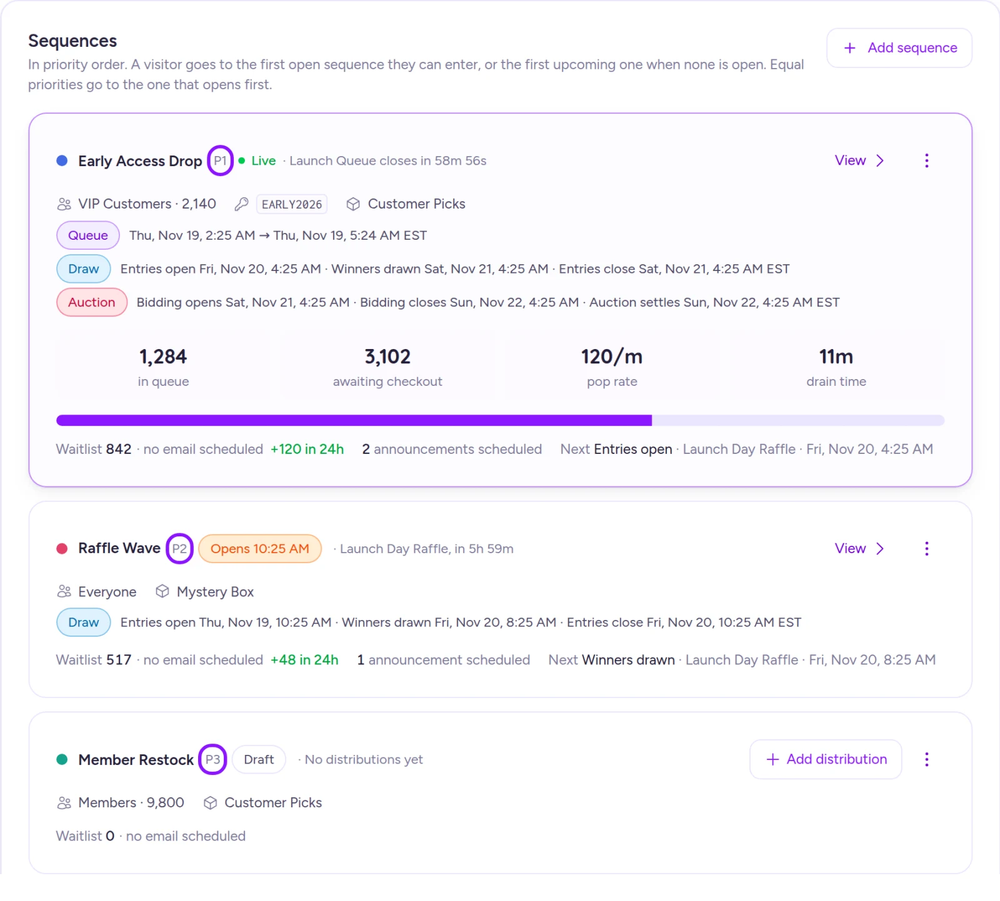

import { SequencesRoutingFigure } from "/snippets/figures/sequences-routing.jsx";

A **sequence** defines an entry path into your experience. Every experience starts with one sequence, and you can add more whenever different groups of shoppers should enter at different times, meet different access rules, or draw from their own dedicated share of stock.

When a visitor opens your drop, Fanfare automatically places them in a single sequence based on what's open right now, each sequence's priority, and which gates they can pass.

## What a sequence controls

While the experience holds your products, time zone, branding, and page, each sequence controls how a specific group gets in:

- **Entry gates:** An optional audience, an optional shared access code, or both.
- **Distributions:** One or more release windows (queue, draw, auction, timed release, or appointment) that run sequentially.
- **Dedicated stock:** Its own allocation of each product's inventory—units are never shared across sequences.
- **Product assignment:** Whether customers choose their item (**Customer Picks**) or receive one assigned by weight (**Mystery Box**) when the experience includes two or more products.
- **Order limits:** Caps on how much a customer can buy.
- **Built-in waitlist:** Automatically created with every sequence (except appointment-only sequences).
- **Priority:** Shown as a chip such as `P1` or `P2`. Lower numbers are offered first.

The **Sequences** card on your experience's **Overview** tab lists every sequence in priority order, along with its audience (or **Everyone**), access code, and distributions.

<Frame caption="Sequences appear in priority order—the lowest number is evaluated first.">
  
</Frame>

## When to add another sequence

A single sequence is all you need when everyone enters under the same rules, shares one stock pool, and participates in one distribution at a time.

Add another sequence when you want to:

- **Give a group its own access rules** — such as VIP early access for an audience, or a private wave unlocked by a code you shared at an event.
- **Reserve a separate stock pool** — because each sequence sells only the units allocated to it.
- **Run two distributions at the same time** — windows inside a single sequence can't overlap, and a distribution with no closing time blocks any later distribution in that sequence. Back-to-back windows work in one sequence; overlapping windows require separate sequences.

For setup steps, see [Add and gate sequences](/guide/create/sequences). Remember to assign stock to each new sequence—see [Allocate stock to a drop](/guide/create/stock-allocation).

## How Fanfare routes customers

Whenever someone visits your drop, Fanfare evaluates your sequences in three steps:

1. **Status comes first:** Sequences with a currently open distribution come before scheduled sequences, which come before inactive sequences (those with no distributions yet, or where every distribution has ended or been deactivated).
2. **Priority breaks ties:** Within each status group, lower priority numbers come first (`P1` before `P2`). If two sequences share a priority, the one opening earlier wins.
3. **Eligibility and friction decide the match:** Fanfare skips any sequence the visitor can't enter at all, then selects the highest-status group that has at least one sequence they can enter now or unlock via a gate. Inside that group, an immediately enterable sequence beats a gated one. If every option requires a gate, Fanfare shows one gate—preferring lower-friction gates (an access code, or sign-in with **Continue as guest**) over a full sign-in.

<Warning>
  **Open always beats scheduled, regardless of priority.** If a lower-priority sequence opens earlier than your VIP sequence, every eligible visitor—including your VIPs—routes into the open sequence until the VIP window begins. To give a group first access, make sure its distribution opens earlier, not just with a lower priority number.
</Warning>

<Warning>
  **Priority follows creation order and can't be reordered in the admin.** Each new sequence receives the next priority number (`P1`, `P2`, `P3`, and so on). Create your most exclusive or earliest sequence first.
</Warning>

Shoppers already placed in an open sequence can still move up to a higher-priority open sequence if that sequence uses an access code. Fanfare shows them a **Have an access code?** link—entering the valid code moves them up immediately, while an invalid code keeps them where they are.

<SequencesRoutingFigure />

## Entry gates

A sequence can require sign-in, an access code, audience membership, or a combination. When multiple gates are set, visitors must satisfy every requirement.

| Gate | What the customer does | When it applies |
| --- | --- | --- |
| **Sign-in** | Enters their email or phone number and verifies with a one-time code. | Always required when the sequence has an audience, when any open or scheduled distribution disallows guests (auctions and appointments never allow guests), when nothing in the sequence is open or scheduled, or when joining a waitlist. |
| **Guest entry** | Selects **Continue as guest** on the sign-in screen. | Available only when the sequence has no audience, has at least one open or scheduled distribution, and every open or scheduled distribution allows guests. |
| **Access code** | Enters the code and selects **Submit**. | Required whenever the sequence has a **Shared access code**. |
| **Audience** | Nothing extra—Fanfare checks membership automatically after sign-in. | Required whenever an audience is attached to the sequence. |

### Access codes

- **Case-insensitive:** Visitors can enter codes in uppercase, lowercase, or any mix. Use **Generate** to create one automatically.
- **Stacks with audiences:** If you set both an audience and a **Shared access code**, visitors must be signed-in members *and* enter the code.
- **Editing or clearing mid-drop:** Updating a code takes effect immediately for new attempts. Visitors who recently passed the old code gate have a brief grace window to finish entering, and anyone already in keeps their spot. Clearing the code removes the code gate while leaving any audience gate intact.
- **Sending codes to waitlists:** Selecting **Send code** on the sequence's **Access** tab sends the code by email or SMS to everyone on that sequence's waitlist. Once sent, it can't be recalled.

### Audiences

- **Invisible to non-members:** Signed-in visitors who aren't in the audience never see the gated sequence or get prompted—Fanfare skips straight to the next eligible sequence.
- **Initial build required:** An audience won't admit anyone until its first build finishes.
- **Behavior while live:** While a distribution in a gated sequence is taking entries, a **Dynamic** audience pauses full scheduled rebuilds until the drop closes, but any individual customer whose attributes change is rechecked against your latest saved rules immediately. See [Audiences and access codes](/concepts/audiences).
- **Plan behavior:** Existing audiences stay attached and selectable on every plan—even after a downgrade. Creating or editing audiences requires **Growth** or above.
- **Member invites:** Attaching an audience automatically sets up an invite email for its members. Review your messages in [Invites, waitlist and access-code sends](/guide/create/invites-and-waitlist) before launch.

<Note>
  Attaching an audience to a sequence automatically turns off guest entry on every queue, draw, and timed release inside it. If you remove the audience later, guest entry doesn't turn back on automatically—you'll need to re-enable it in each distribution's settings.
</Note>

## When no sequence is available

- **Ineligible for all sequences:** Visitors see an **Access unavailable** screen explaining that the experience is restricted to a specific group (for audience gates) or isn't available to them.
- **No distributions scheduled yet:** Visitors routed to an empty sequence see a **No current access window** message.
- **All windows have ended:** Signed-out visitors see when the drop closed along with a prompt to sign in and view their result.

## Example: VIP early access, then a public draw

Suppose Northbound Supply Co. launches **Phantom Stitch Anorak Drop** with two sequences created in this order:

1. **Inner Circle Early Access (`P1`)** — Gated to the "Inner Circle" audience, running a queue from 10:00 to 11:00.
2. **Public Draw (`P2`)** — Open to everyone (no audience or code), running a draw starting at 11:00 with guest entry enabled.

| Time | Visitor | Routed to | What they see |
| --- | --- | --- | --- |
| Before 10:00 | Signed-in member | **Inner Circle Early Access** | Early-access countdown and waitlist |
| Before 10:00 | Signed-in non-member | **Public Draw** | Public draw countdown and waitlist |
| Before 10:00 | Signed-out visitor | **Public Draw** gate | Sign-in screen with **Continue as guest** (members who sign in move straight to **Inner Circle Early Access**) |
| 10:00–11:00 | Signed-in member | **Inner Circle Early Access** | Live queue |
| 10:00–11:00 | Signed-in non-member | **Public Draw** | Public draw countdown and waitlist |
| 10:00–11:00 | Signed-out or guest visitor | **Inner Circle Early Access** gate | Sign-in screen with no guest option |
| 11:00 onward | Anyone | **Public Draw** | Live draw, including VIP members (signed-out visitors see sign-in with **Continue as guest**) |

Notice two subtle behaviors here: during the 10:00–11:00 VIP hour, signed-out visitors are prompted to sign in without a guest option because the *open* VIP sequence beats the *scheduled* public draw. Once the queue closes at 11:00, VIP members route into **Public Draw** like everyone else—whereas if the VIP queue had stayed open past 11:00, members would continue landing in `P1` while both sequences were live.

## On Shopify

The Fanfare app in Shopify supports queues, draws, auctions, and timed releases (not appointments). On your storefront, the Fanfare product widget runs the exact same routing and gating logic described on this page.

## Related

<CardGroup>
  <Card title="Add and gate sequences" href="/guide/create/sequences">
    Create sequences, configure audiences and access codes, and set product selection and order limits.
  </Card>
  <Card title="Distributions" href="/concepts/distributions/overview">
    Compare all five distribution types and how their windows work.
  </Card>
  <Card title="Audiences and access codes" href="/concepts/audiences">
    Learn how audiences are built and how access gates work together.
  </Card>
  <Card title="Stock" href="/concepts/stock">
    See how inventory is allocated and tracked across sequences.
  </Card>
</CardGroup>
