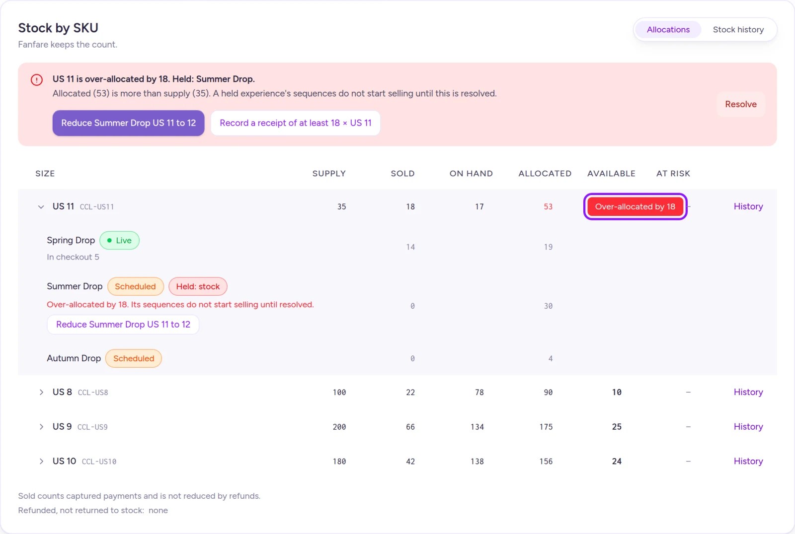

import { StockFlowFigure } from "/snippets/figures/stock-flow.jsx";

Stock is how many of each size a drop may sell. When Fanfare keeps the count, every unit is tracked from the moment it arrives to the moment it sells, and your experiences can never be promised more than you have.

## Who keeps the count

Every product has a **Stock management** setting, chosen when you create it.

| Setting | Where the count lives | Which checkout may sell it | What caps a drop |
| --- | --- | --- | --- |
| **Fanfare-managed** | In Fanfare. Every change is recorded in the product's **Stock history**. | Fanfare checkout only | The units allocated to the experience, and each sequence's share of them |
| **Not managed** | Nowhere. "No count. Sequence limits are the only cap." | Whichever checkout your organisation uses | Each sequence's limit per size, if you set one |
| **Shopify-managed** | In Shopify | Shopify checkout only | Each sequence's limit per size, and Shopify's own stock at checkout |

Three rules about this choice are explained in full where you make it:

- The choice is permanent. See [Add products](/guide/create/products).
- On a Not managed product, the quantity and **When sold out** setting do not cap sales, and Shopify-managed cannot be chosen in the Fanfare admin. See [Manage stock](/guide/create/stock).
- An experience cannot offer Fanfare-managed and Shopify-managed products together. Not managed products can sit with either. See [Manage stock](/guide/create/stock).

Your checkout decides which settings you get. Fanfare-managed needs Fanfare checkout: an organisation that takes payment on its own checkout creates Not managed products in the admin, and its products synced from Shopify are Shopify-managed. What a stock number means on your own checkout is explained in [Checkout options](/concepts/checkout-options).

The rest of this page is about Fanfare-managed goods, except where it says otherwise.

## How units flow through a drop

A Fanfare-managed unit moves through five stages:

1. **Supply**: the opening stock you entered when you created the product, plus every receipt, adjustment, write-off and return recorded since.
2. **Allocated** to an experience: an experience reserves units from Supply, size by size.
3. Split across its sequences: a sequence is one way in to an experience, and each sequence gets its own share. Units the experience holds but has not given to a sequence are **Unassigned**.
4. **In checkout**: a customer who has the right to buy holds a unit while they pay. See [Admission and the payment window](/concepts/admission-and-payment).
5. **Sold**: the payment was captured.

Units are not shared between sequences. A sequence sells only its own units, even when another sequence still has some left. See [Sequences and routing](/concepts/sequences).

The product's **Stock by SKU** panel shows these figures for each size.

| Figure | What it means |
| --- | --- |
| **Supply** | Opening stock plus every recorded change. |
| **Sold** | Units whose payment was captured. A refund does not reduce it. |
| **On hand** | Supply − Sold. |
| **Allocated** | The units all your experiences hold of this size. |
| **Available** | Supply − Allocated: what can still go into an experience. An over-allocated size shows "Over-allocated by [count]" here. |
| **At risk** | Units in live checkouts that On hand no longer covers. Normally 0. |
<StockFlowFigure />

## Each sequence has its own limit per size

Each sequence has a number for each size it offers: the most it may sell. You set it on the sequence's **Stock** card with **Edit allocations**; the steps are in [Allocate stock to a drop](/guide/create/stock-allocation). For Fanfare-managed goods those numbers come out of the experience's allocation, so the sequences together can never hold more than the experience does.

<Warning>
  A size you do not give a number starts at 0 and shows **Opens sold out**. This is always true for Fanfare-managed goods and on any sequence that runs a Dutch auction. Customers cannot buy that size until you give it units. Check every size on every sequence before the drop.
</Warning>

What a size of goods Fanfare does not manage starts at depends on the sequence and your checkout: see [Allocate stock to a drop](/guide/create/stock-allocation).

**No limit** exists only for goods Fanfare does not manage, and never on a sequence that runs a Dutch auction. A size with no limit is never stopped or shown as sold out; Fanfare still counts what sold and what is in checkout.

## What changes when a drop opens

Counting starts about 10 minutes before a sequence opens. The sizes on its **Stock** card move from **Not counting yet** through **Preparing** to **Ready**. When the drop opens they show **Selling**, and from then on **Sold**, **In checkout** and **Remaining** are live figures.

From that point:

- Allocations can't change while the experience is live.
- On a sequence that is counting, a size can still go up, by up to the experience's **Unassigned** units, but never down. Units come out of a sequence only through **Move units**, which moves them to another sequence of the same experience or back to Unassigned. The steps are in [Change things mid-drop](/guide/drop/live-controls).
- While a draw is still selecting winners, moving units into or out of its sequence raises or lowers its **Winner count** by the units moved. You can't set a draw's winner count above the units in its sizes. See [Draw](/concepts/distributions/draw).

<Note>
  A sequence can offer at most 256 size combinations: pairs of product and size, or for a **Mystery Box**, products. Above that, while it counts any size, new customers are refused: a queue, draw or timed release admits nobody and auctions refuse bids. The sequence's **Stock** card warns you. Remove products or sizes until it offers 256 or fewer.
</Note>

## When supply drops below what is allocated

If you record a write-off or a downward adjustment, Supply can fall below Allocated. The size is then over-allocated: **Available** shows "Over-allocated by [count]", and the product's **Stock by SKU** panel shows a banner for it. Fanfare then acts in this order:

1. Live experiences give units back first, newest first: first the Unassigned units of every live experience, then the units their live sequences have not handed to a customer, counting or not. An experience that shows **Ended** still counts as live while a distribution in it has entrants or customers in checkout.
2. Units in checkout stay with their customer. If On hand no longer covers them, they show as **At risk**.
3. If anything is still short, even one unit, every distribution that sells the size and has not started counting is held in full, even in a live experience, and even when an earlier distribution of its sequence is selling. It shows **Held: stock** and does not start selling until the size fits again.

The ways out are recording a receipt, or lowering the allocation of an experience that has not opened yet with **Resolve**. Once the size fits, held sequences start selling at Fanfare's next stock check. The full warnings and the steps are in [Manage stock](/guide/create/stock).

<Frame caption="A negative Available means the size is over-allocated.">
  
</Frame>

## When a drop ends

When every distribution in a sequence has ended or been deactivated, and nothing can still sell (no customer is still in checkout), Fanfare releases the sequence. Each of its allocations drops to what it sold, and the rest returns to the experience's **Unassigned** units. Once at least one of its sequences is released and none of the others still holds Fanfare-managed units, the experience's **Allocated** shrinks to what they sold, so the unsold units show again in **Available** for your next experience.

Release records no stock change, so **Supply** stays the same. A released sequence shows **Released** and is final: its stock can't change and units can't be moved into it.

## Refunds do not restock

**Sold** is not reduced by a refund, and a refunded unit goes back into Supply only if someone returns it to stock, either by ticking it when submitting the refund or later with **Return to stock** on the order. This applies to Fanfare-managed goods only. See [Orders and refunds](/guide/learn/orders).

## Worked example

Northbound Supply Co. has 200 Phantom Stitch Anoraks in size M, Fanfare-managed. The experience "Phantom Stitch Anorak Drop" is allocated 150 of them: 50 to Inner Circle Early Access, a queue from 10:00 to 11:00, and 100 to Public Draw, a draw that opens at 11:00. Nothing is Unassigned.

At 10:30 the queue has sold 20 and 5 customers are paying.

| Where | Figures for size M |
| --- | --- |
| Product's **Stock by SKU** | **Supply** 200, **Allocated** 150, **Available** 50, **Sold** 20, **On hand** 180, **At risk** 0 |
| Inner Circle Early Access **Stock** card | **Allocated** 50, **Sold** 20, **In checkout** 5, **Remaining** 25 |
| Public Draw **Stock** card | **Allocated** 100, **Not counting yet** |

At 10:30 you record a write-off of 80 damaged units. Supply drops to 120, which is 30 short of the 150 allocated.

1. The experience is live, so it gives back first. It has nothing Unassigned. Inner Circle Early Access gives back its 25 units nobody holds; its allocation drops to 25 and its **Remaining** to 0.
2. The 5 units in checkout stay with their customers. On hand is 100, which covers them, so **At risk** stays 0.
3. Allocated is now 125 against a Supply of 120, so **Available** shows −5. Public Draw has not started counting, so it is held: it will not start selling at 11:00 until the size fits.

Because the experience is already live, **Resolve** cannot lower its allocation. Record a receipt of at least 5 M before 11:00. If any of the 5 checkouts lapse, the shortfall shrinks by the same number.

## On Shopify

Products in the Fanfare app in Shopify come from Shopify. A product brought in while your organisation takes payment on its own checkout, as an organisation created by installing the app does, is Shopify-managed: Shopify keeps the count, and you change stock in your Shopify admin. See [Products from Shopify](/guide/shopify/products).

A product brought in while your organisation takes payment on Fanfare checkout can be Fanfare-managed. If it is, Fanfare's count is separate from Shopify's: set the units aside for your drops and take them off sale in Shopify yourself. See [Manage stock](/guide/create/stock).

## Related

<CardGroup>
  <Card title="Manage stock" href="/guide/create/stock">
    The stock management choice, Adjust stock, stock history and over-allocated sizes.
  </Card>
  <Card title="Allocate stock to a drop" href="/guide/create/stock-allocation">
    Allocate units to an experience and split them across its sequences.
  </Card>
  <Card title="Change things mid-drop" href="/guide/drop/live-controls">
    Move units between sequences while a drop is live.
  </Card>
  <Card title="Checkout options" href="/concepts/checkout-options">
    What a stock number means on each checkout.
  </Card>
</CardGroup>
