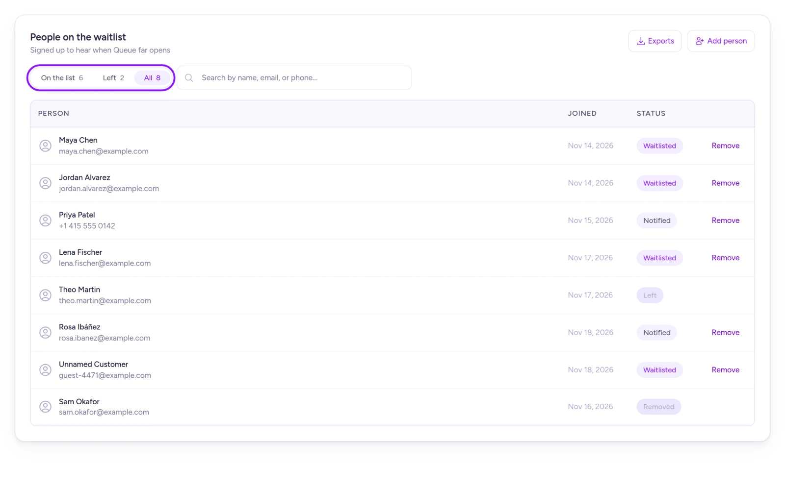

Every sequence in Fanfare includes a built-in **waitlist** so early visitors can sign up to be notified before a drop opens. Fanfare creates it automatically—there's nothing extra to enable or configure.

A waitlist isn't a distribution: it doesn't sell inventory, grant early access, or hold a place in line. It captures pre-launch demand and brings shoppers back right before doors open.

## When customers can sign up

Waitlist sign-ups are open whenever **no distribution in the sequence is currently live** and **either another window is scheduled or no distributions exist yet**:

- **Before the first window opens:** Shoppers can join.
- **While any window is live:** Sign-ups close immediately.
- **In a gap between windows:** Sign-ups reopen automatically until the next window begins.
- **After all windows end or are deactivated:** Sign-ups close unless you schedule a new window (on a sequence that hasn't been deactivated) or remove all existing distributions.

Because sign-ups close the moment a window goes live, a waitlist isn't an overflow list for a busy or sold-out queue.

<Note>
  Using **Add person** on a sequence's **Waitlist** tab works at any time and bypasses audience gating, so double-check eligibility before adding someone manually.
</Note>

<Frame caption="A waitlist accepts sign-ups only while no window in the sequence is live and another window is still to come.">
  
</Frame>

### How customers join

Before a sequence opens, eligible shoppers see a countdown and a join button (such as **Notify me when the queue opens**, **Get notified when entry opens**, **Enter waitlist**, or **Notify me when it opens** for code-gated sequences). Once on the list, they can opt out anytime by selecting **Leave waitlist**.

To join a waitlist, a visitor must:

- Be **signed in** (guests and signed-out visitors see **Sign in to get notified** first).
- Be **eligible for the sequence** (for example, belong to its audience).
- Be **under the experience's order limit**.

For how visitors are matched to a sequence's waitlist, see [Sequences and routing](/concepts/sequences). For the exact pre-launch screens customers see, see [What your customers see](/guide/drop/what-customers-see).

### Appointment-only sequences

Sequences that only run appointments take bookings instead of a waitlist, so they don't display a **Waitlist** tab. If every sequence in an experience runs only appointments, the **Waitlist** item doesn't appear in the experience's navigation.

## Messages sent to your waitlist

Being on a waitlist triggers a focused set of notifications—see [Invites, waitlist and access-code sends](/guide/create/invites-and-waitlist) for full customization options:

- **Sign-up confirmation:** Customers who join on their own see confirmation directly on the page and don't receive an email or text. People you add manually via **Add person** do receive a confirmation by email or SMS based on your messaging settings.
- **Opens-soon reminder:** Fanfare automatically schedules a reminder 5 minutes before each upcoming distribution opens (except appointments). By default, emails use the distribution's name in the subject and body (for example, *"KaiZen Relic Release opens soon"*), while SMS reminders use standard wording with the experience name.
- **Announcements:** You can target any scheduled announcement to the waitlist alongside or instead of an audience. See [Announcements](/guide/create/announcements).
- **Access codes:** If the sequence requires an access code, the opens-soon reminder includes it automatically. You can also send the code immediately to everyone on the waitlist with **Send code** on the sequence's **Access** tab—note that sent messages can't be recalled.

<Tip>
  Give every distribution a clean, customer-friendly name—Fanfare uses it directly in the default opens-soon email subject and body.
</Tip>

Audience invites are separate from waitlist messages and go to members of a sequence's audience regardless of whether they joined the waitlist. Joining a waitlist never grants priority entry or holds a spot—when the distribution opens, waitlisted shoppers enter on the same terms as everyone else.

## Managing who's on the list

Each sequence's **Waitlist** tab displays the **People on the waitlist** table with join dates and statuses:

| Status | What it means |
| --- | --- |
| **Waitlisted** | Actively on the waitlist. |
| **Notified** | Still actively on the waitlist after receiving a notification. |
| **Converted** | Purchased through one of the sequence's distributions; no longer counted as on the list. |
| **Left** | Opted out themselves. |
| **Removed** | Removed manually by your team. |

You can filter by **On the list**, **Left** (which includes people you removed), or **All**. **On the list** counts **Waitlisted** and **Notified** shoppers—and only those shoppers receive waitlist messages. Once someone buys (**Converted**), they automatically stop receiving later opens-soon reminders and waitlist announcements.

<Frame caption="A sequence's Waitlist tab. On the list counts everyone with a Waitlisted or Notified status.">
  
</Frame>

From a sequence's **Waitlist** tab, you can:

- **Add someone manually:** Select **Add person** to add by email, which automatically creates a customer profile if they're new to Fanfare. Fanfare blocks adding anyone who has already hit the experience's order limit.
- **Remove someone:** Removes them silently—no notification is sent.
- **Export the list:** Download your waitlist data via **Exports**.

For a cross-sequence view, open the experience's **Waitlist** page. It lists every signup across all sequences (one row per sequence a customer joined) with direct links to each sequence, though it's read-only—use the individual sequence's **Waitlist** tab to add, remove, or export entries.

## What happens when a drop stops or is deleted

A waitlist doesn't have its own **Deactivate** control—it follows its sequence and distributions:

- **Deactivating** a distribution, sequence, or experience stops it from opening for waitlisted shoppers and cancels any scheduled opens-soon reminders.
- **Deleting** a sequence or experience clears its waitlist and cancels scheduled opens-soon reminders while keeping orders, entries, and customer profiles intact.

See [What locks, and when](/concepts/what-locks-when) and [Stop a drop](/guide/drop/deactivate) for full details.

## On Shopify

Sequence **Waitlist** tabs and the experience **Waitlist** overview work the same way in the Fanfare app in Shopify. Because the Shopify app doesn't offer appointments, every sequence has a waitlist.

On your storefront, the Fanfare product widget shows the same waitlist join button. Visitors who aren't signed in browse as guests and see **Sign in to get notified** until they sign in.

## Related

<CardGroup>
  <Card title="Sequences and routing" href="/concepts/sequences">
    How entry paths work and which sequence each customer is routed to.
  </Card>
  <Card title="Invites, waitlist and access-code sends" href="/guide/create/invites-and-waitlist">
    Customize automated messages and manage waitlist entries step by step.
  </Card>
  <Card title="Distributions" href="/concepts/distributions/overview">
    Compare all five distribution types and how their schedules work.
  </Card>
  <Card title="What your customers see" href="/guide/drop/what-customers-see">
    Preview every stage of the customer journey, from countdown to checkout.
  </Card>
</CardGroup>
