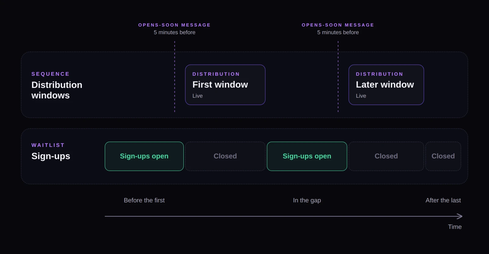

A waitlist is a list of customers who asked to hear when a sequence opens. A sequence is one way in to an experience, and every sequence has its own waitlist: Fanfare creates it with the sequence, and there is nothing to set up or configure. On a sequence's **Waitlist** tab the Fanfare admin describes the people on it in those terms, for example "Signed up to hear when Sneaker Club Release opens". A waitlist is not a distribution and sells nothing; it is how customers who arrive early hear about the opening.

## When customers can join

A waitlist takes sign-ups only while none of the sequence's distributions is live, and either at least one is still to open or the sequence has no distributions yet. In practice:

- Before the first window opens, customers can join.
- The moment a window opens, sign-ups stop.
- If a later window is scheduled after that one ends, sign-ups start again in the gap between the two windows.
- Once every window in the sequence has ended or been deactivated, sign-ups stop. They start again if you schedule a new window in the sequence (a deactivated sequence cannot take one), or if you delete all of its distributions.

So a waitlist is not an overflow list for a full or busy queue: while the queue is live, customers cannot join its sequence's waitlist themselves. **Add person** on the sequence's **Waitlist** tab works at any time and skips the sequence's audience, so check who you add. For how windows are scheduled, see [Distributions](/concepts/distributions/overview).

<Frame caption="A waitlist takes sign-ups only while no window in the sequence is live and another is still to open.">
  
</Frame>

### What the customer does

Before the sequence opens, the customer sees a countdown and a join button. Its label depends on the distribution: "Notify me when the queue opens" for a queue, "Get notified when entry opens" for a draw, and "Enter waitlist" for the others. On a sequence that asks for an access code, it reads "Notify me when it opens". Once they join, they see that they are on the waitlist and can select "Leave waitlist".

Joining needs a signed-in customer who is allowed into the sequence (for example, a member of its audience) and has not reached the experience's order limit. A customer who is not signed in, or who is browsing as a guest, sees "Sign in to get notified" in place of the join button. Which sequence a customer is placed in, and so which waitlist they can join, is covered in [Sequences and routing](/concepts/sequences). For the full customer view before a drop opens, see [What your customers see](/guide/drop/what-customers-see).

### Sequences that run only appointments

In the Fanfare admin, a sequence that runs only appointments has no waitlist. The admin says: "Appointment sequences take bookings rather than a waitlist". Its **Waitlist** tab is not shown, and when every sequence in an experience runs only appointments, the experience has no **Waitlist** item in its side navigation.

## What being on the list sends

Being on a waitlist sends customers a small, specific set of messages. [Invites, waitlist and access-code sends](/guide/create/invites-and-waitlist) covers each one in full, including what you can change.

- No confirmation when a customer joins. A customer who joins by themselves gets no message; they see the result on the page. Someone you add in the Fanfare admin does get the usual waitlist confirmation, by email or by text depending on your messaging settings.
- An opens-soon message before each opening. For each distribution that has not opened yet, except appointments, Fanfare sets up a message to the sequence's waitlist, by default 5 minutes before it opens. Customers who get it by email see, by default, the distribution's name in the subject and body: a distribution named KaiZen Relic Release sends "KaiZen Relic Release opens soon". Name every distribution as you want customers to read it. Customers who get it by text see fixed wording with the experience's name.
- Your own announcements. An announcement can go to the waitlist as well as, or instead of, an audience. See [Announcements](/guide/create/announcements).
- The access code. If the sequence has an access code, the opens-soon message includes it. **Send code** on the sequence's **Access** tab sends the code, by email or text, to everyone on the waitlist straight away, and a send cannot be taken back. See [Sequences and routing](/concepts/sequences).

The invite that goes to a sequence's audience is a different message from any of these; it is covered on the same page.

Being on the list does not let a customer in before the distribution opens, and it holds them no place in it: when it opens, they enter the same way as everyone else.

## Who is on the list

Each sequence's **Waitlist** tab shows the **People on the waitlist** card: everyone who joined, with when they joined and their status.

| Status | Meaning |
| --- | --- |
| **Waitlisted** | On the list. |
| **Notified** | Still on the list. |
| **Converted** | The customer bought through one of the sequence's distributions. No longer counted as on the list. |
| **Left** | The customer left the waitlist. |
| **Removed** | You took the customer off the list. |

The status filter offers **On the list**, **Left** and **All**. **Left** includes people you removed, who show the **Removed** status. **On the list** counts customers who are **Waitlisted** or **Notified**, and that is the number shown on the tab. Messages to the waitlist go only to customers on the list, so once a customer has bought, a later opens-soon message or announcement to the waitlist does not reach them.

<Frame caption="A sequence's waitlist. On the list counts people who are Waitlisted or Notified.">
  
</Frame>

From the tab you can add a person, remove one, or export the list:

- Adding a person by email creates a customer record if they are not a customer yet. It is refused when that person has reached the order limit: "This person has reached the order limit for this experience."
- Removing a person sends them nothing: "They won't be notified."

The steps are in [Invites, waitlist and access-code sends](/guide/create/invites-and-waitlist).

The experience's **Waitlist** page lists everyone on a waitlist across all of the experience's sequences, one row for each sequence a customer joined, with a link to that sequence. It is read-only: to add, remove or export people, go to the sequence's **Waitlist** tab.

## How a waitlist ends

A waitlist has no **Deactivate** of its own. It follows its sequence:

- Deactivating the sequence, the experience, or the distribution the waitlist is waiting for means it will not open for the people on the waitlist. The confirmation says so, and where an opens-soon message is scheduled for them: "It won't open for them, and their opens-soon email won't be sent."
- Deleting the sequence or the experience removes everyone from the waitlist and cancels their opens-soon message. Orders, entries and customer records are kept.

What else changes when you deactivate or delete is in [What locks, and when](/concepts/what-locks-when) and [Stop a drop](/guide/drop/deactivate).

## Worked example: a members' release

Northbound Supply Co. is releasing the KaiZen Relic Sneaker. The experience "KaiZen Relic Release" has one sequence, "Sneaker Club Release", gated to the "Sneaker Club" audience. It runs a timed release, also named "KaiZen Relic Release", that opens in 12 days.

1. A Sneaker Club member opens the page, signs in, sees the countdown and selects "Enter waitlist". The page shows "You're on the waitlist". No message is sent.
2. The experience has an announcement set for 15 minutes before it opens, addressed to both the Sneaker Club audience and the waitlist.
3. 5 minutes before opening, members on the waitlist who get email receive "KaiZen Relic Release opens soon". Because the distribution is named after the drop, the subject reads well to customers.
4. The release opens. From that moment the waitlist takes no more sign-ups, and it takes none after the release ends unless you schedule another window in the sequence.

## On Shopify

The sequence's **Waitlist** tab and the experience's **Waitlist** page are the same in the Fanfare app in Shopify. The app does not offer appointments, so every sequence there has a waitlist.

The product widget on your storefront offers the same join button. A visitor who has not signed in is browsing as a guest, so they see "Sign in to get notified" and must sign in before they can join.

## Related

<CardGroup>
  <Card title="Sequences and routing" href="/concepts/sequences">
    Ways in to an experience, and which one each customer is placed in.
  </Card>
  <Card title="Invites, waitlist and access-code sends" href="/guide/create/invites-and-waitlist">
    Who gets which message and when, and how to add, remove and export people.
  </Card>
  <Card title="Distributions" href="/concepts/distributions/overview">
    The five distribution types and how their windows work.
  </Card>
  <Card title="What your customers see" href="/guide/drop/what-customers-see">
    Every stage of the customer's view, from countdown to checkout.
  </Card>
</CardGroup>
