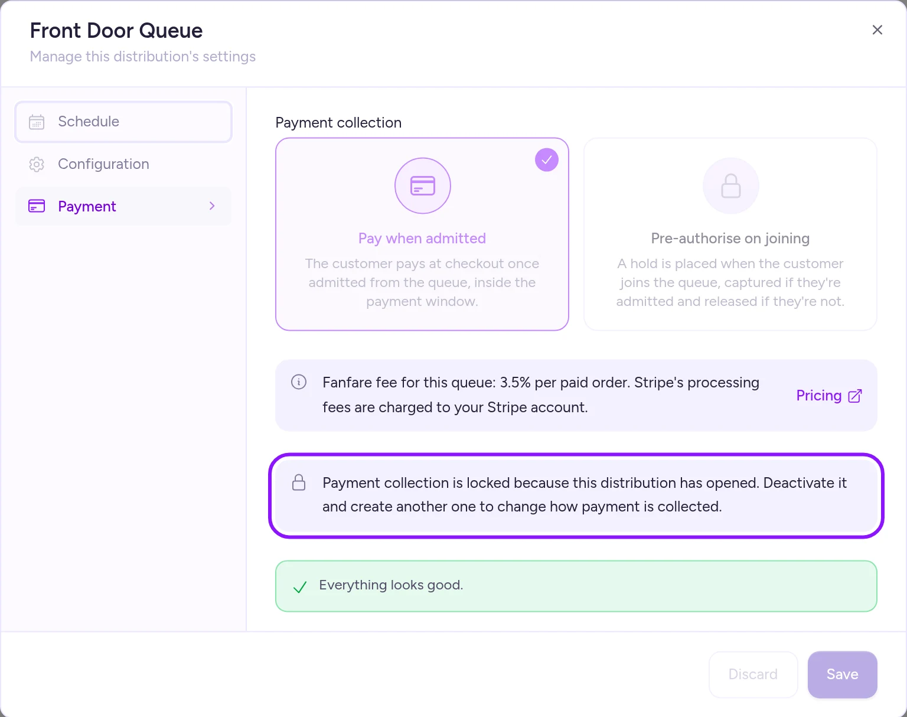

import { WhatLocksWhenFigure } from "/snippets/figures/what-locks-when.jsx";

Once a drop is close to opening, some settings stop accepting changes and others keep taking them, and a save on a live distribution reaches your customers straight away. This page tells you which is which, when each lock starts, and what you can do when a setting you need to change is already fixed.

## How locking works

There is no publish step. An experience runs on the schedules of its distributions, so it can go live without you pressing anything (see [Experiences](/concepts/experiences)). Locks follow the same schedules: most of them start when a distribution opens.

A distribution counts as opened 30 seconds before its **Opens** time. A queue counts as opened 5 minutes 30 seconds before **Opens**, because its waiting room starts letting customers in 5 minutes early. From that moment its opening-time locks apply.

Once a distribution has opened, Fanfare remembers that it has opened. Moving **Opens** back into the future afterwards does not reopen it for editing: every lock that started stays on.

<Note>
  Moving **Opens** later after a distribution has opened unlocks nothing. Once it has opened, the **Opens** picker shows **Locked** and offers no time later than the saved one. The note beside it names the distribution type; on a queue it reads "This queue has opened, so its open time can only move earlier. You can still change when it closes." An earlier time is still accepted.
</Note>

<Note>
  A queue's locks start about 5 minutes 30 seconds before **Opens**, not at **Opens**. Make your last changes to payment collection before then.
</Note>

<Frame caption="Once a queue has opened, Opens can only move earlier; Closes stays editable.">
  
</Frame>

<WhatLocksWhenFigure />

## What locks at each stage

"Opens" in this table means the moment the distribution counts as opened, described above.

| What you change | Before it opens | Once it opens | After it closes | Where it is explained |
| --- | --- | --- | --- | --- |
| **Opens** | Change freely | Can only move earlier | Fixed. The schedule is final, and the admin tells you to create a new one | This page |
| **Closes** | Change freely | Change freely | Fixed | This page |
| Payment collection and **Authorization amount** (queue, draw) | Change freely | Fixed | Fixed | [Admission and the payment window](/concepts/admission-and-payment) |
| Draw: **Continue selecting until completed** | Change freely | Fixed | Fixed | [Draw](/concepts/distributions/draw) |
| Draw: winner count | Change, up to what the stock covers | Change until entry closes, but not below the winners already selected | Fixed | [Draw](/concepts/distributions/draw) |
| Auction: prices and quantity | Change freely | Fixed | Fixed | [Auction](/concepts/distributions/auction) |
| Auction: auction type | Fixed when you create the auction | Fixed | Fixed | [Auction](/concepts/distributions/auction) |
| Appointment: slot length, buffer, capacity, location, window and time zone | Fixed while any booking stands | Fixed while any booking stands | Fixed while any booking stands | [Appointment](/concepts/distributions/appointment) |
| Timed release settings | Change freely | Change freely | Schedule fixed | [Timed release](/concepts/distributions/timed-release) |
| A sequence's product selection (**Customer Picks** or **Mystery Box**) and its Mystery Box products | Change freely until the sequence locks, which can be about 10 minutes before opening (see below) | Fixed while the sequence is locked | Fixed while the sequence is locked | This page; warning on [Add and gate sequences](/guide/create/sequences) |
| The experience's products | Change, except that a product with units already sold in one of the experience's sequences cannot be removed, at any stage; adding or removing products is refused once any sequence locks | Refused while any sequence is locked | Refused while any sequence is locked | This page |
| Stock allocations, and lowering a sequence's stock | Lowering stops when counting starts, about 10 minutes before opening | The experience's allocations are fixed; a sequence's sizes can only be raised, and units come out only through **Move units** | See [Stock](/concepts/stock) for when this ends | [Stock](/concepts/stock) |
| Publishing the hosted page | Frozen from 15 minutes before the first **Opens** | Frozen | Publishing works again once no distribution in the experience is inside its window | [Brand, templates and designs](/concepts/design) |
| The hosted page address | Fixed once the page is first published | Fixed | Fixed | [Brand, templates and designs](/concepts/design) |
| Brand | Saves restyle live pages | Saves restyle live pages | Saves restyle live pages | [Brand, templates and designs](/concepts/design) |
| A **Dynamic** audience's membership | Rebuilds as usual | Full rebuilds wait while a drop the audience gates is taking entries | Rebuilds resume once the last such drop closes | [Audiences and access codes](/concepts/audiences) |
| Access code and order limits | Change freely | Not locked; reach customers as soon as you save | Not locked | [Sequences](/concepts/sequences), [Add and gate sequences](/guide/create/sequences) |
| A product's stock management choice | Fixed when the product is created | Fixed | Fixed | [Stock](/concepts/stock) |
| Experience name | Change freely | Change freely | Change freely | [Create an experience](/guide/create/experiences) |
| Experience time zone | Change, after a confirmation; distributions keep their clock times | Change; once anything in the experience has opened, times keep their moment instead | Same as once it opens | [Create an experience](/guide/create/experiences) |

Three rows need more than a cell.

**Payment collection.** How a queue or draw collects payment, and the **Authorization amount** for pre-authorisation, are fixed from the moment it opens, because from then customers join under those terms. With pre-authorisation, a hold is placed on a customer's card as they join. The admin says so on a locked distribution: "Payment collection is locked because this distribution has opened. Deactivate it and create another one to change how payment is collected." The warning at the point where you choose is on [Set up a queue](/guide/create/queue) and [Set up a draw](/guide/create/draw).

<Frame caption="Once a queue has opened, how it collects payment is locked.">
  
</Frame>

**A sequence's configuration.** A sequence is one way in to an experience. Its product selection and its Mystery Box products lock while any of its distributions is open, has entrants, has customers inside a payment window, or still holds units. A sequence with counted stock starts holding units when counting starts, about 10 minutes before opening, so its lock can start then rather than at **Opens**. The admin shows "This sequence's configuration is locked while it has an open distribution or entrants". This lock can outlast the window: a distribution that has closed but still has customers inside a payment window keeps the sequence locked. A timed release or appointment that has taken any customer keeps it locked until that distribution is deleted. The warning is on [Add and gate sequences](/guide/create/sequences).

**The experience's products.** Adding or removing products is refused while any of the experience's sequences is locked in the same way. Separately, you cannot remove a product with units already sold in one of the experience's sequences, at any stage.

## What stays editable while live

Locks cover a short list. Everything else on a distribution stays editable once it is live:

- the queue's **Admit rate**
- guest access and automatic entry
- loyalty bias
- **Closes**
- every timed-release setting, apart from moving **Opens** later
- an auction's auto-extend
- a draw's winner count, until entry closes

A save to any of these reaches customers straight away. There is no confirmation step: a new **Admit rate** applies from the next minute, and closing early changes who gets in from that moment. Read [Change things mid-drop](/guide/drop/live-controls) before you edit a live distribution. To stop admitting people in a controlled way, pause the queue rather than editing its settings; the same page shows how.

The last step of the experience wizard says "You can still tweak anything after publishing." That overstates it. Payment collection, a sequence's product selection, the experience's products, stock allocations, lowering a sequence's stock and a later open time are all fixed once the drop is live, and Deactivate cannot be reversed.

## The way out of a lock

Some locks lift on their own, and the table above says when: an appointment's slot settings once no booking stands, for example, or publishing once no distribution is inside its window. A setting fixed for good has no unlock. For those, the way out the admin itself gives is to **Deactivate** the distribution, sequence or experience and create a new one with the setting you want. Deactivate can itself be refused for an auction in some states; [Stop a drop](/guide/drop/deactivate) explains when.

A deactivated distribution cannot be edited at all: the admin shows "This distribution was deactivated and can't be edited."

That has a cost. Deactivate cannot be undone, and only organisation admins can do it. Customers who were let in but have not started paying lose their spot. Deactivating anything in an experience shows the experience's whole public page as ended, including any other sequences still running, and a sequence or experience whose distributions are all deactivated takes nothing new. [Stop a drop](/guide/drop/deactivate) covers each of these and what happens per distribution type.

To delete something that is Scheduled or Live, deactivate it first. Delete keeps orders, entries and customer records, and it can be refused for a while after you deactivate; [Stop a drop](/guide/drop/deactivate) explains how long.

Changing plans does not switch off what already runs: see [Plans and what they unlock](/guide/start/plans).

## Worked example

In "Phantom Stitch Anorak Drop", the "Inner Circle Queue" is live and the "Public Draw" opens in two days.

- On the Public Draw, you can still switch payment collection to **Pre-authorise on entry**, provided a payment provider is connected. That stays possible until 30 seconds before it opens.
- On the live Inner Circle Queue, you can change the **Admit rate** and **Closes**. Payment collection is locked.
- Changing the queue's payment collection now would mean deactivating it. That would show the experience's whole public page as ended, Public Draw included, and take their spot from admitted customers who have not started paying. See [Stop a drop](/guide/drop/deactivate).

## On Shopify

Locks work the same way in the Fanfare app in Shopify, with two exceptions. The app does not offer appointments, so the appointment row does not apply. Customers pay in Shopify's checkout, so there is no payment collection or **Authorization amount** to lock: the payment row, and the switch to pre-authorisation in the worked example, do not apply. Every Shopify staff member who can open the app counts as an organisation admin, so anyone there can deactivate; see [Stop a drop](/guide/drop/deactivate).

## Related

<CardGroup>
  <Card title="Change things mid-drop" href="/guide/drop/live-controls">Pause a queue and edit a live drop.</Card>
  <Card title="Stop a drop" href="/guide/drop/deactivate">Deactivate and Delete.</Card>
  <Card title="Stock" href="/concepts/stock">When counting starts and how units move.</Card>
  <Card title="Things that cannot be undone" href="/guide/reference/cannot-be-undone">Every irreversible action in one list.</Card>
</CardGroup>
