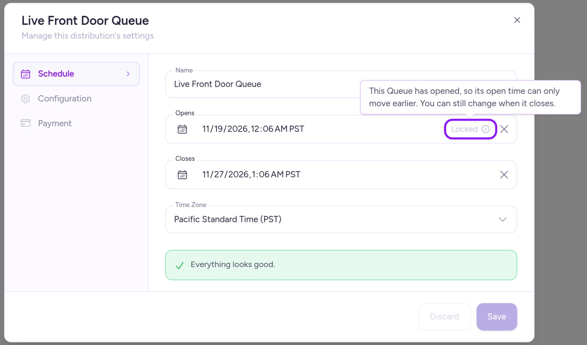

import { WhatLocksWhenFigure } from "/snippets/figures/what-locks-when.jsx";

As a drop gets close to opening, Fanfare locks settings that customers rely on—like payment terms, product lineups, and stock allocations—so the rules don't change underneath shoppers mid-drop. Other controls stay editable live so you can pace traffic or adjust closing times on the fly. Here's when each lock starts, what stays flexible, and what to do if you need to change a locked setting.

## How locking works

Experiences go live automatically on their distributions' schedules—there's no manual publish button (see [Experiences](/concepts/experiences)). Locks follow those same schedules, with most starting when a distribution opens:

- **Standard distributions** count as opened **30 seconds before** their **Opens** time.
- **Queues** count as opened **5 minutes 30 seconds before** **Opens**, because their waiting room opens 5 minutes early.

Once a distribution has opened, opening-time locks stay in place permanently. The **Opens** picker shows **Locked** and only lets you move the start time earlier—never later—and rescheduling won't unlock settings that have already locked.

<Note>
  A queue's locks start about **5 minutes 30 seconds before Opens**, not at **Opens**. Finalize payment collection and other pre-open settings before the waiting room opens.
</Note>

<Frame caption="Once a queue has opened, Opens can only move earlier while Closes stays editable.">
  
</Frame>

<WhatLocksWhenFigure />

## What locks at each stage

In the table below, **"Once it opens"** refers to the moment the distribution counts as opened (30 seconds before **Opens**, or 5 minutes 30 seconds before **Opens** for queues).

| Setting | Before it opens | Once it opens | After it closes | Learn more |
| --- | --- | --- | --- | --- |
| **Opens** | Editable | Can only move earlier | Locked (create a new distribution to run again) | This page |
| **Closes** | Editable | Editable | Locked | This page |
| Payment collection and **Authorization amount** (queue, draw) | Editable | Locked | Locked | [Admission and the payment window](/concepts/admission-and-payment) |
| Draw: **Continue selecting until completed** | Editable | Locked | Locked | [Draw](/concepts/distributions/draw) |
| Draw: winner count | Editable up to available stock | Editable until entry closes (not below winners already selected) | Locked | [Draw](/concepts/distributions/draw) |
| Auction: prices and quantity | Editable | Locked | Locked | [Auction](/concepts/distributions/auction) |
| Auction: auction type | Locked on creation | Locked | Locked | [Auction](/concepts/distributions/auction) |
| Appointment: slot length, buffer, capacity, location, window, and time zone | Locked while any booking exists | Locked while any booking exists | Locked while any booking exists | [Appointment](/concepts/distributions/appointment) |
| Timed release settings | Editable | Editable | Schedule locked | [Timed release](/concepts/distributions/timed-release) |
| Sequence product selection (**Customer Picks** or **Mystery Box**) and Mystery Box products | Editable until the sequence locks (can start ~10 minutes before opening; see below) | Locked while the sequence is locked | Locked while the sequence is locked | This page; [Add and gate sequences](/guide/create/sequences) |
| Experience products | Editable (except products with units already sold can never be removed; adding/removing is blocked once any sequence locks) | Blocked while any sequence is locked | Blocked while any sequence is locked | This page |
| Stock allocations and lowering sequence stock | Lowering stops when counting starts (~10 minutes before opening) | Experience allocations locked; sequence sizes can only increase, and units move out only via **Move units** | See [Stock](/concepts/stock) for when locks lift | [Stock](/concepts/stock) |
| Publishing the hosted page | Frozen starting 15 minutes before the first **Opens** | Frozen | Unlocks once no distribution is in its freeze window | [Brand, templates, and designs](/concepts/design) |
| Hosted page URL | Locked after first publish | Locked | Locked | [Brand, templates, and designs](/concepts/design) |
| **Brand** | Edits update live pages | Edits update live pages | Edits update live pages | [Brand, templates, and designs](/concepts/design) |
| **Dynamic** audience membership | Rebuilds normally | Full rebuilds pause (**Held**) while a gated drop is taking entries | Resumes once the last gated drop closes | [Audiences and access codes](/concepts/audiences) |
| Access code and order limits | Editable | Editable; applies immediately on save | Editable | [Sequences](/concepts/sequences), [Add and gate sequences](/guide/create/sequences) |
| Product stock management mode | Locked on creation | Locked | Locked | [Stock](/concepts/stock) |
| Experience name | Editable | Editable | Editable | [Create an experience](/guide/create/experiences) |
| Experience time zone | Editable (with confirmation; distributions keep clock times) | Editable (once anything has opened, distributions keep their exact UTC moment instead) | Same as once it opens | [Create an experience](/guide/create/experiences) |

Three locks deserve a closer look:

**Payment collection.** How a queue or draw collects payment—and its **Authorization amount** for card holds—locks as soon as the distribution opens so customers' entry terms stay consistent. To change payment collection after opening, you'll need to deactivate the distribution and create a new one. See [Set up a queue](/guide/create/queue) and [Set up a draw](/guide/create/draw).

<Frame caption="Once a queue opens, its payment collection setting locks.">
  
</Frame>

**Sequence configuration.** A sequence's product selection and Mystery Box contents lock whenever any distribution in that sequence is open, has entrants, has shoppers inside an active payment window, or holds counted stock. Because stock counting begins about 10 minutes before opening, this lock can start ahead of **Opens**—and it can remain active after closing until every payment window finishes. A timed release or appointment that has admitted anyone keeps the sequence locked until that distribution is deleted. See [Add and gate sequences](/guide/create/sequences).

**Experience products.** You can't add or remove products from an experience while any of its sequences is locked, and a product with units already sold in any sequence can never be removed.

## What stays editable while live

Most day-of controls stay flexible while a drop is running:

- Queue **Admit rate**
- Guest access and automatic entry
- Loyalty bias (**Bias toward loyal consumers**)
- **Closes** time
- Timed-release settings (apart from moving **Opens** later)
- Auction auto-extend
- Draw winner count (until entry closes)

Live edits apply immediately without a confirmation dialog—for example, updating a queue's **Admit rate** takes effect on the next minute, and moving **Closes** earlier changes eligibility right away. See [Change things mid-drop](/guide/drop/live-controls) before making live changes. If you need to halt admissions cleanly, pause the queue instead of editing its settings.

<Tip>
  Double-check payment collection, product selection, stock allocations, and start times before doors open—once a distribution opens, those settings lock for the life of the distribution.
</Tip>

## How to change a locked setting

Temporary locks lift automatically once their condition clears—such as appointment slot settings when no bookings remain, or hosted page publishing after the freeze window ends.

Permanently locked settings can't be unlocked. To make a change, **Deactivate** the distribution, sequence, or experience and create a new one with the settings you want. Once deactivated, a distribution becomes read-only (note that certain auction states can't be deactivated—see [Stop a drop](/guide/drop/deactivate)).

<Warning>
  **Deactivate** can't be undone and requires organization admin permissions. Admitted customers who haven't started paying lose their spot, and deactivating any part of an experience marks the experience's entire public page as ended—even if other sequences are still running. Review [Stop a drop](/guide/drop/deactivate) before deactivating a live drop.
</Warning>

To delete a scheduled or live distribution, deactivate it first. Deleting preserves your orders, entries, and customer records (though deletion may require a short wait after deactivation—see [Stop a drop](/guide/drop/deactivate)). Changing your Fanfare plan never stops a live drop from serving customers; see [Plans and what they unlock](/guide/start/plans).

## Example: live queue and upcoming draw

In Northbound Supply Co.'s "Phantom Stitch Anorak Drop", the **Inner Circle Queue** is live and the **Public Draw** opens in two days:

- **Public Draw:** Still editable—you can switch payment collection to **Pre-authorise on entry** (with Stripe connected) anytime until 30 seconds before it opens.
- **Inner Circle Queue:** You can still adjust **Admit rate** and **Closes**, while payment collection is locked. Changing payment collection now would require deactivating the queue—which would remove spots from admitted shoppers who haven't started checkout and mark the entire experience's public page as ended, including the upcoming Public Draw.

## On Shopify

Locks work the same way in the Fanfare app in Shopify, with three differences:

- **No appointments:** Appointments aren't available in the Shopify app, so appointment lock rules don't apply.
- **No Fanfare payment collection:** Shoppers pay in Shopify checkout, so there's no Fanfare payment collection or **Authorization amount** to lock.
- **Deactivation permissions:** Every Shopify staff member with access to the Fanfare app counts as an organization admin and can deactivate drops. See [Stop a drop](/guide/drop/deactivate).

## Related

<CardGroup>
  <Card title="Change things mid-drop" href="/guide/drop/live-controls">
    Pause a queue and adjust live drop settings safely.
  </Card>
  <Card title="Stop a drop" href="/guide/drop/deactivate">
    Understand what happens when you deactivate or delete a drop.
  </Card>
  <Card title="Stock" href="/concepts/stock">
    When stock counting starts and how units move between sequences.
  </Card>
  <Card title="Things that cannot be undone" href="/guide/reference/cannot-be-undone">
    Every irreversible action in Fanfare in one checklist.
  </Card>
</CardGroup>
