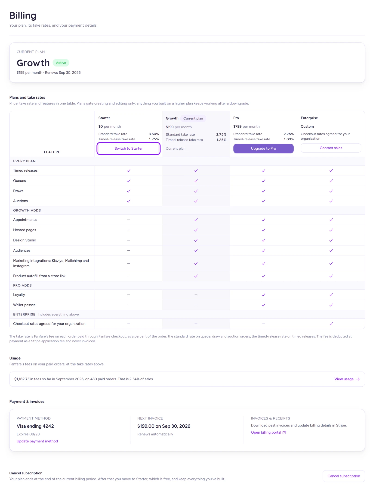
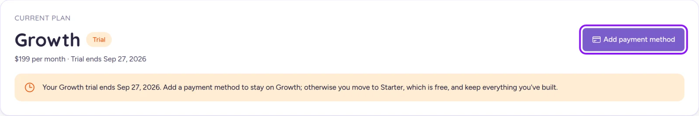
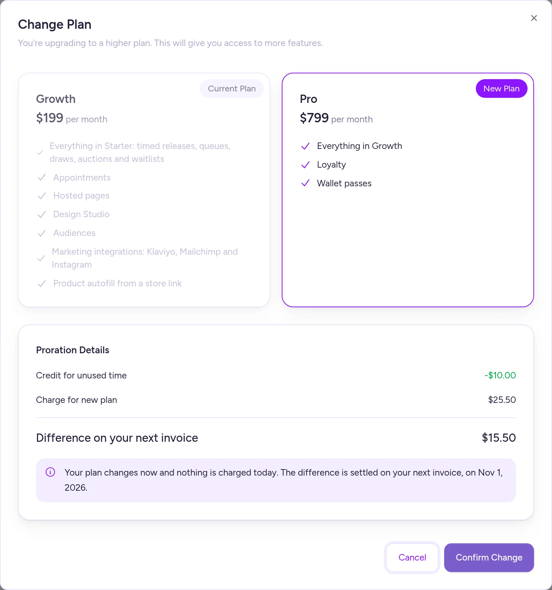
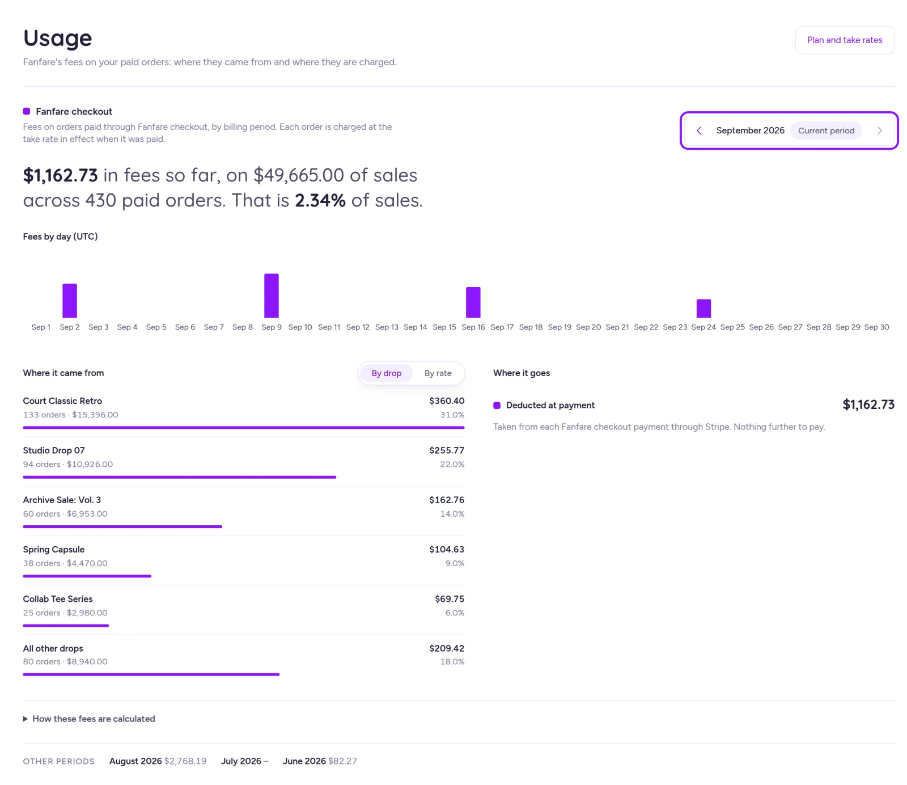

Billing shows which plan your organisation is on and what it costs. It is where you change or cancel the plan, keep the card that pays for it current, and download invoices. Usage shows the fees Fanfare took on your paid orders. Your plan is billed through Stripe, separately from the Stripe account you connect to take your customers' payments: see [Payments and fees](/guide/account/payments).

## Before you start

- Open the user menu at the foot of the sidebar, then **Billing**. **Usage** is in the same menu. Billing is not in the sidebar itself.
- Anyone in your organisation can read every section of both pages. Only organisation admins can change or cancel the plan, reactivate, update the card, open the billing portal, or contact sales from **Billing**. Everyone else sees those buttons disabled, with "Only organization admins can change the plan." beside the plan actions.
- Which features each plan includes, its price and its take rates are on [Plans and what they unlock](/guide/start/plans).

## Read your current plan

The **Current plan** card at the top of **Billing** shows the plan name, a status badge, and a line with the monthly price and what happens next.

<Frame caption="The Current plan card, with the plans table and usage line below it.">
  
</Frame>

| What the card shows | What it means | What you can do there |
| --- | --- | --- |
| Badge **Trial**, "Trial ends" and a date | You are trialling a paid plan. | **Add payment method**, if no usable card is on file. |
| Badge **Active**, "Renews" and a date | The plan is paid up and renews on that date. | Nothing on the card. Change plan in the table below. |
| Badge **Past due**, "Your last payment didn't go through" | A payment failed. You keep the plan's features. | **Update payment method**. |
| Badge **Ends** and a date, "Plan ends" and a date | You have scheduled a cancellation. You keep the plan until that date. | **Keep subscription**. |
| Plan name **Starter**, no badge, "Growth has ended" (or the plan you had) | Your paid plan has ended and you are on Starter. | **Reactivate**, or the text "Choose a plan below to start again." If you are billed through Shopify, change your plan from the Fanfare app in Shopify. |
| Badge **Cancelled**, "Your subscription has ended" | Your subscription billed through Shopify has ended. Only an organisation billed through Shopify sees this badge. | Nothing on the card. Change your plan from the Fanfare app in Shopify. |
| Badge **Inactive** | The subscription is inactive. | Nothing: the card says "This subscription is inactive. Contact support to restore it." |
| Badge **Pending** | The subscription is still being set up. | Nothing: refresh the page in a moment. |

Enterprise shows "Custom pricing" in place of a monthly price.

## Your trial

A new organisation that signs up in the Fanfare admin starts on a 5-day trial of Growth. You do not need a card to start it.

<Warning>
  If no card is on file when the trial ends, the subscription is cancelled and your organisation moves to Starter. Everything you have built stays and keeps working, but you can no longer create or edit Growth features until you choose a plan again. The banner across the admin warns you only in the last three days of the trial. You also cannot change plans during a trial until you add a card. Add one early to stay on your plan.
</Warning>

To add a card:

1. On the **Current plan** card, select **Add payment method**.
2. Add your card in Stripe. Stripe returns you to **Billing**.

<Frame caption="During a trial with no card, the card asks for one.">
  
</Frame>

## Change between paid plans

The **Plans and take rates** section lists every plan side by side. The plan you are on is marked **Current plan**.

1. In **Plans and take rates**, select **Upgrade to Pro** (or another higher plan), or **Switch to Growth** (or another lower paid plan).
2. In **Change Plan**, compare the **Current Plan** and **New Plan** cards and read **Proration Details**: the credit for unused time, the charge for the new plan, and the difference on your next invoice.
3. Select **Confirm Change**.

The change takes effect immediately, whether you move up or down. Nothing is charged today: the difference is settled on your next invoice. There is no option to change at the end of the period. Anything you built on a higher plan keeps working after a downgrade, but you can no longer create or edit it: see [Plans and what they unlock](/guide/start/plans).

You can change plans when:

- you are an organisation admin;
- during a trial, a usable card is on file;
- the plan's price is confirmed. A plan showing "Price unavailable" cannot be chosen until it is.

**Enterprise** is not self-serve. **Contact sales** in the Enterprise column opens a booking page in a new tab.

<Frame caption="The difference is settled on your next invoice.">
  
</Frame>

<Note>
  After a plan change, other pages in the admin can briefly still show the old plan's locks.
</Note>

## Move to Starter or cancel

Starter is free, and you reach it by cancelling your paid subscription. You can start from **Switch to Starter** in the Starter column or, while your plan is active or in a trial, **Cancel subscription** at the foot of **Billing**. Both open the same cancellation flow.

<Warning>
  **Switch to Starter** is not a plan change: it cancels your subscription. If you choose **Cancel immediately**, your organisation moves to Starter at once and there is no refund for the rest of the current period. Creating and editing Growth and Pro features is locked from that moment; see [Plans and what they unlock](/guide/start/plans). Choose **Cancel at end of period** to keep your plan until the period ends.
</Warning>

1. Select **Switch to Starter** or **Cancel subscription**.
2. Choose a reason under "Why are you cancelling?", then select **Continue**.
3. Optionally add feedback. Under "When to cancel", keep **Cancel at end of period** (the default) or choose **Cancel immediately**. Select **Continue**.
4. Read "What happens when you cancel", then select **Confirm Cancellation**.

With **Cancel at end of period**, the card shows **Ends** and the date, and the Starter column reads "Starter from" that date. With **Cancel immediately**, the card shows **Starter** straight away. Either way, everything you have built stays. If you turned Loyalty off after moving to a lower plan, you cannot turn it back on without upgrading: see [Run a loyalty programme](/guide/learn/loyalty).

<Frame caption="Cancel at end of period is the default.">
  
</Frame>

## Keep a subscription you have scheduled to cancel

Until the end date, you can undo a scheduled cancellation:

1. On the **Current plan** card, select **Keep subscription**.
2. In **Reactivate Subscription**, select **Reactivate**.

You are not charged anything new: your current period carries on and the plan renews as before. If no usable card is on file, the dialogue asks you to **Update Payment Method** in Stripe first. The **Keep Subscription** link on the banner only brings you to **Billing**; finish there.

## Come back after your subscription has ended

When a paid plan has ended, you can start it again in two ways.

- **Reactivate** on the **Current plan** card, then **Reactivate** in the dialogue. This restarts the plan you had.
- A plan in **Plans and take rates**. A **Reactivate Subscription** dialogue opens with "You'll be charged" the plan's price "starting immediately". Select **Reactivate Subscription**.

<Warning>
  Reactivating after your subscription has ended charges your card straight away, and there is no trial. The dialogue you reach from **Reactivate** on the card does not mention the charge. Only the dialogue you reach by choosing a plan says so.
</Warning>

If no usable card is on file, **Reactivate** on the card opens a dialogue showing "Payment method update required", and its button becomes **Update Payment Method**, which takes you to Stripe to add a card first. The plans in the table stay unavailable until you do. If the plan you had is no longer offered at its old price, the card shows "Choose a plan below to start again." in place of **Reactivate**: pick a plan in the table.

If your card is declined, an error starting "Payment method failed:" appears, nothing is charged and you stay on Starter. Update your card with **Update payment method** in **Payment & invoices**, then try again.

## Fix a failed payment

When a payment fails, the card shows **Past due** and a "Payment Failed" banner appears across the admin.

1. Select **Update payment method** on the **Current plan** card, or **Update Payment** on the banner.
2. Update your card in Stripe. Stripe returns you to **Billing**, which refreshes your status.

While your subscription is past due, your paid plan's features stay on.

## Payment and invoices

**Payment & invoices** holds three things, all handled in Stripe:

| Part | What it shows |
| --- | --- |
| **Payment method** | Your card and its expiry, another saved payment method, or "No card on file". A card that needs attention shows "Needs updating" or "Expired". **Add payment method** or **Update payment method** opens Stripe. During a trial with no card, use **Add payment method** on the **Current plan** card instead. |
| **Next invoice** | The amount and date of your next subscription charge, with "Renews automatically", "First charge after your trial" or "Payment past due". Otherwise "No upcoming invoice", with "Nothing is charged until you add a card" during a trial with no card. |
| **Invoices & receipts** | **Open billing portal**, where you download past invoices and update your billing details in Stripe. |

## Banners across the admin

A billing problem shows as a banner on every page except **Billing** and **Usage**. Only one shows at a time, the most urgent first.

| Banner | When it shows | Its button | Can you dismiss it? |
| --- | --- | --- | --- |
| "Payment Failed" | Your subscription is past due. | **Update Payment**, which takes an organisation admin straight to Stripe. | No. |
| "Subscription Cancelled" | Your subscription has ended. It stays as long as you are on Starter after cancelling, until you choose a plan again. | **Choose a Plan**, which opens the plans table. | No. |
| "Trial Ending Soon" | Your trial ends within three days. | **Add Payment Method**, which opens **Billing**. | Yes, until you open the admin in a new tab or window. |
| "Cancellation Scheduled" | You have scheduled a cancellation. | **Keep Subscription**, which opens **Billing**. | Yes, until you open the admin in a new tab or window. |

## Read your usage

**Usage** shows the fees Fanfare took on your paid orders, totalled by billing period. The **Usage** section on **Billing** gives the running period's total in one line; select **View usage** for the detail.

Fees on orders paid through Fanfare checkout are deducted from each payment as it is taken. They never appear on an invoice, and your Stripe invoice covers only your plan. Each order keeps the take rate that was in effect when it was paid, so changing plan mid-period does not re-rate earlier orders. How the fee is worked out, and custom rates, are on [Payments and fees](/guide/account/payments).

<Frame caption="Usage shows Fanfare's fees for one period at a time.">
  
</Frame>

| Part | What it shows |
| --- | --- |
| Period stepper | The arrows move to an earlier or later period. The running one carries the badge "Current period". |
| Lead sentence | The period's fees, sales, number of paid orders, and fees as a share of sales. |
| "Fees by day (UTC)" | A bar chart of fees per day. It is hidden for a period with no fees. |
| "Where it came from" | **By drop** lists your top five drops by fees, then "All other drops". **By rate** splits the fees by take rate, and by plan when the period spans a plan change. |
| "Where it goes" | "Deducted at payment" for Fanfare checkout: taken from each payment, nothing further to pay. |
| "How these fees are calculated" | Expand it for the period's arithmetic: gross sales times each rate, rounding, the total and the effective rate. Fanfare checkout only. |
| "Other periods" | For Fanfare checkout, the running period and up to six earlier ones, each with its total. Shopify checkout shows "Other cycles": the current cycle and up to two earlier ones. |

Dates on **Usage** are in UTC. The **Current plan** card, plans table and **Payment & invoices** use your organisation's time zone. The cancellation and plan-change dialogues and the banners use your browser's time zone. A date near midnight can differ by a day between them.

## On Shopify

An organisation billed through Shopify cannot change its plan in Fanfare.

- In the Fanfare app in Shopify, **Billing** is an item in the app's navigation. It leaves the app for Shopify's plan page, showing "Opening Shopify's plan page." and "Open it here if it didn't open." There is no billing overview, plan card, payment section or invoice section in the app. A store that Fanfare provides at no charge sees "Your plan is comped: Fanfare provides it at no charge, so there is no plan to choose or pay for here." Choosing and approving a plan is on [Install and choose a plan](/guide/shopify/install-and-plans).
- In the standalone Fanfare admin, a Shopify-billed organisation sees "Billed through Shopify" on the **Current plan** card, a disabled **Manage in Shopify** on every plan, and no **Payment & invoices** section.

**Usage** in the Fanfare app in Shopify shows only fees on orders paid through Shopify checkout. They are grouped by Shopify billing cycle and charged on your Shopify bill in USD, converted from your store currency at the daily reference rate on each order's paid date. "Where it goes" splits them into "On your Shopify bill" and "Not billed", with the reason for each fee that is never charged. Orders on hold are listed separately and are not counted in the fees until Fanfare releases them. After a cancellation or uninstall, fees in a cycle that has not ended are still billed when it ends; fees after that are not billed.

## Troubleshooting

<AccordionGroup>
  <Accordion title="Plan changes are unavailable until your subscription is active.">
    Your subscription is **Inactive** or **Pending**. A pending subscription is still being set up: refresh **Billing** in a moment. An inactive one needs support to restore it.
  </Accordion>
  <Accordion title="Add a payment method to change plans during your trial.">
    You see this when your trial has a cancellation scheduled and no card is on file. Select **Add payment method** beside the message, or in **Payment & invoices**, add a card in Stripe, then choose the plan again.
  </Accordion>
  <Accordion title="Your bank needs to approve this payment, which a plan change can't ask for.">
    Add a different card in the billing portal and try again, or contact support.
  </Accordion>
  <Accordion title="Another plan change is in progress or did not complete.">
    Refresh the page and check the **Current plan** card before trying again. If it keeps happening, contact support.
  </Accordion>
</AccordionGroup>

## Related

<CardGroup>
  <Card title="Plans and what they unlock" href="/guide/start/plans">
    What each plan includes, its price and take rates, and what a downgrade locks.
  </Card>
  <Card title="Payments and fees" href="/guide/account/payments">
    Connect Stripe to take payments, and how the per-order fee is calculated.
  </Card>
  <Card title="Install and choose a plan" href="/guide/shopify/install-and-plans">
    Choose and approve a plan in the Fanfare app in Shopify.
  </Card>
  <Card title="Team members" href="/guide/account/team">
    Who is an organisation admin.
  </Card>
</CardGroup>
