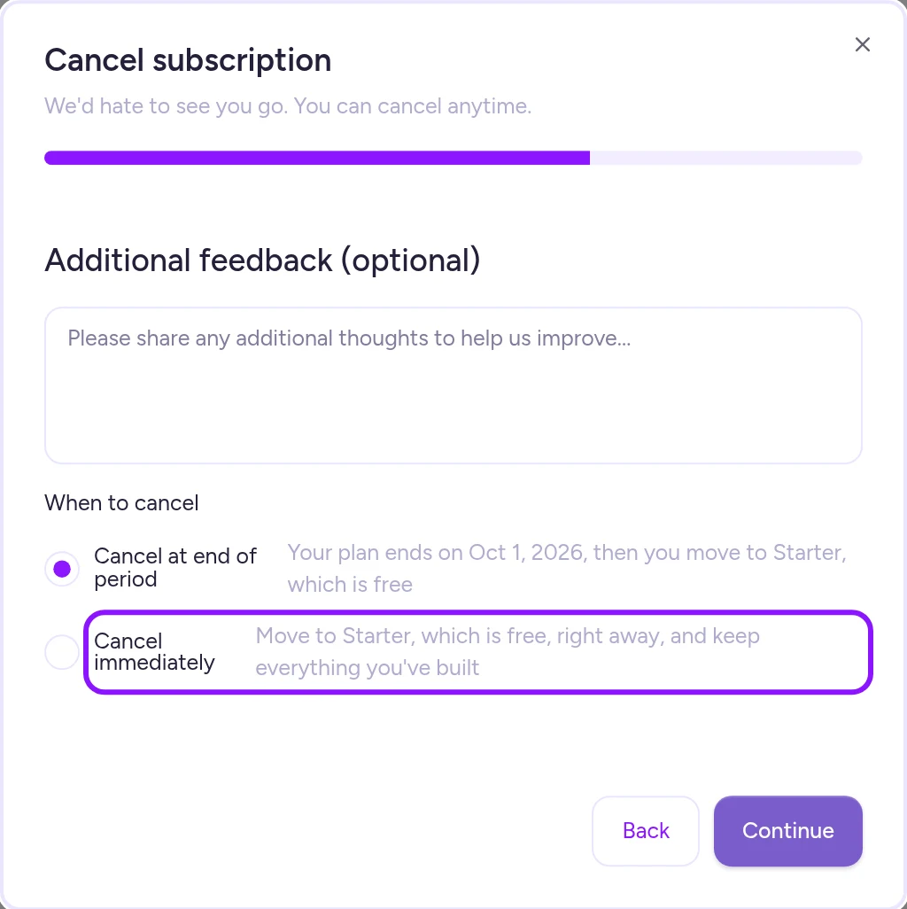

Use **Billing** to manage your subscription, keep your payment method current, and download past invoices, and use **Usage** to track Fanfare's per-order fees by billing period. Your Fanfare subscription is billed through Stripe separately from the Stripe account that receives your customer payouts ([Payments and fees](/guide/account/payments)).

## Before you start

- **Where to find it:** Open the user menu at the bottom of the sidebar and select **Billing** or **Usage**.
- **Permissions:** Everyone in your organization can view both pages, but only organization admins can change or cancel plans, reactivate a subscription, update the payment method, open the billing portal, or contact sales.
- Compare features, monthly prices, and take rates across every tier in [Plans and what they unlock](/guide/start/plans).

## Check your current plan

The **Current plan** card at the top of **Billing** displays your active plan, subscription status, monthly price (or **Custom pricing** on Enterprise), and upcoming renewal or end date.

<Frame caption="Review your current plan, compare tiers, and jump to your usage summary from Billing.">
  
</Frame>

| Status shown | What it means | Action available |
| --- | --- | --- |
| **Trial** | You're on a free trial of a paid plan. | Select **Add payment method** if no card is on file. |
| **Active** | Your paid plan is active and renews automatically. | Change plans anytime in **Plans and take rates** below. |
| **Past due** | Your most recent payment failed; paid features remain active while you resolve it. | Select **Update payment method**. |
| **Ends [date]** | You scheduled a cancellation; you keep your paid plan until that date. | Select **Keep subscription** to undo cancellation. |
| **Starter** (after a paid plan ended) | Your paid plan has ended and your organization is on Starter. | Select **Reactivate** or choose a plan from the table below (Shopify-billed stores manage plans in Shopify). |
| **Cancelled** (Shopify-billed only) | Your Shopify subscription has ended. | Choose a plan inside the Fanfare app in Shopify. |
| **Inactive** | Your subscription is inactive. | Contact support to restore it. |
| **Pending** | Your subscription is finishing setup. | Refresh the page in a moment. |

## Manage your free trial

New organizations created at [admin.fanfare.io](https://admin.fanfare.io) automatically start with a 5-day free trial of Growth—no credit card required.

<Warning>
  If no payment method is on file when your trial ends, your subscription cancels and your organization automatically moves to Starter. Everything you've built keeps working, but creating and editing Growth features locks until you subscribe again. A reminder banner appears during the last three days of your trial, and you'll need to add a payment method before switching plans during a trial.
</Warning>

To add a payment method during your trial:

1. On the **Current plan** card, select **Add payment method**.
2. Enter your card in Stripe. Stripe returns you to **Billing**.

<Frame caption="Add a payment method before your trial ends to stay on your paid plan without interruption.">
  
</Frame>

## Change between paid plans

Compare all plans side by side under **Plans and take rates** (your active tier is marked **Current plan**).

1. Select **Upgrade to Pro** (or another higher tier), or **Switch to Growth** (or another lower paid tier).
2. In **Change Plan**, review **Proration Details** to see your credit for unused time, the charge for the new plan, and the net difference on your next invoice.
3. Select **Confirm Change**.

Plan changes take effect immediately—nothing is charged today, and the prorated difference settles on your next invoice. (There is no option to schedule a paid-to-paid switch for the end of a billing period.) After moving to a lower tier, everything you've already built keeps serving customers while creating and editing higher-tier features locks ([Plans and what they unlock](/guide/start/plans)).

<Note>
  To change plans, you need to be an organization admin, have a payment method on file (if you're in a trial), and select a plan with confirmed pricing. For **Enterprise**, select **Contact sales** to book a call. Right after a plan change, other open admin pages may briefly show your previous plan's locks—refresh if needed.
</Note>

<Frame caption="Plan changes take effect right away, with the prorated difference settled on your next invoice.">
  
</Frame>

## Move to Starter or cancel

Starter is free, so moving to Starter cancels your paid subscription. Both **Switch to Starter** (in the Starter column) and **Cancel subscription** (at the bottom of **Billing**) open the same cancellation flow.

<Warning>
  **Switch to Starter** cancels your subscription. If you choose **Cancel immediately**, your organization moves to Starter right away with no refund for the rest of the current billing period, and creating or editing Growth and Pro features locks immediately ([Plans and what they unlock](/guide/start/plans)). Keep **Cancel at end of period** selected to continue using your paid plan until your cycle ends.
</Warning>

1. Select **Switch to Starter** or **Cancel subscription**.
2. Choose a reason and select **Continue**.
3. Optionally share feedback, choose **Cancel at end of period** (default) or **Cancel immediately**, and select **Continue**.
4. Review what happens on Starter, then select **Confirm Cancellation**.

With **Cancel at end of period**, you keep full access through your end date; with **Cancel immediately**, your workspace switches to Starter right away. Everything you've built stays in place—just note that if you turn off Loyalty after moving down from Pro, you'll need Pro to turn it back on ([Run a loyalty program](/guide/learn/loyalty)).

<Frame caption="Cancel at end of period is selected by default so you keep paid access through the end of your billing cycle.">
  
</Frame>

## Keep a subscription scheduled to cancel

You can undo a scheduled cancellation anytime before the end date:

1. On the **Current plan** card, select **Keep subscription**.
2. Select **Reactivate** to confirm.

There's no extra charge—your current period continues and renews as usual. If no valid payment method is on file, you'll be prompted to **Update Payment Method** in Stripe first.

## Reactivate after your subscription has ended

Once a paid plan has ended, you can restart it in two ways:

- Select **Reactivate** on the **Current plan** card to restart your previous plan.
- Select any plan in **Plans and take rates** and confirm in **Reactivate Subscription**.

<Warning>
  Reactivating after a subscription has ended charges your payment method immediately with no free trial. The **Reactivate** dialog opened from the **Current plan** card doesn't mention the immediate charge—only the dialog opened from the plans table does.
</Warning>

If you don't have a valid card on file, you'll be prompted to add one via **Update Payment Method** in Stripe first. If your previous plan price is no longer offered, choose an active plan in **Plans and take rates** instead. If your card is declined, you aren't charged and stay on Starter—update your card under **Payment & invoices** and try again.

## Fix a failed payment

When a renewal charge fails, your status changes to **Past due** and a **Payment Failed** banner appears across the admin. Your paid features stay active while you resolve it.

1. Select **Update payment method** on the **Current plan** card (or **Update Payment** on the banner).
2. Update your card in Stripe. You'll return to **Billing** and your status refreshes automatically.

## Payment method and invoices

Manage your billing details under **Payment & invoices** (hosted securely in Stripe):

| Section | What you can see and do |
| --- | --- |
| **Payment method** | View your saved card and expiration date (or see if it needs updating). Select **Add payment method** or **Update payment method** to edit in Stripe. (During a trial without a card, use **Add payment method** on the **Current plan** card instead.) |
| **Next invoice** | See the amount and date of your next subscription charge. |
| **Invoices & receipts** | Select **Open billing portal** to download past invoices and receipts or update billing details in Stripe. |

## Billing banners

When your subscription needs attention, Fanfare shows one banner at a time across the admin (prioritizing the most urgent):

| Banner | When it appears | Action | Dismissible? |
| --- | --- | --- | --- |
| **Payment Failed** | Subscription is past due | **Update Payment** (opens Stripe for admins) | No |
| **Subscription Cancelled** | Paid subscription has ended | **Choose a Plan** (opens **Billing**) | No |
| **Trial Ending Soon** | Within three days of trial expiration | **Add Payment Method** (opens **Billing**) | Yes (for the current tab) |
| **Cancellation Scheduled** | Cancellation scheduled for period end | **Keep Subscription** (opens **Billing**) | Yes (for the current tab) |

## Track your usage and fees

**Usage** summarizes Fanfare's per-order fees by billing period. The **Usage** line on **Billing** gives you a quick snapshot of the current period; select **View usage** for the full breakdown.

Fees on Fanfare checkout orders are deducted automatically in Stripe when each order is paid—they never appear on your subscription invoice, and each order keeps the take rate active at payment time ([Payments and fees](/guide/account/payments)).

<Frame caption="Usage breaks down your per-order Fanfare fees one billing period at a time.">
  
</Frame>

| Section | What it shows |
| --- | --- |
| **Period stepper** | Move between billing periods (the active period shows **Current period**). |
| **Summary line** | Total fees, sales volume, paid order count, and effective fee rate for the period. |
| **Fees by day (UTC)** | Daily bar chart of fees (hidden when a period has no fees). |
| **Where it came from** | **By drop** lists your top five drops by fees plus all other drops; **By rate** breaks down fees by take rate (and by plan if you changed plans mid-period). |
| **Where it goes** | Confirms Fanfare checkout fees were **Deducted at payment** with nothing further owed. |
| **How these fees are calculated** | Expand to inspect the full calculation: gross sales by rate, rounding, total, and effective rate (Fanfare checkout only). |
| **Other periods** / **Other cycles** | Quick totals for the current period and up to six prior periods on Fanfare checkout (or up to two prior cycles on Shopify checkout). |

<Note>
  Dates on **Usage** are calculated in UTC, while **Billing** uses your organization's time zone and dialogs or banners use your browser's time zone—so dates near midnight may occasionally appear a day apart.
</Note>

## On Shopify

Organizations billed through Shopify manage their subscription directly in Shopify:

- **In the Shopify app:** Selecting **Billing** opens Shopify's plan selection page directly. (Stores on a complimentary Fanfare plan see a notice that no paid plan is required.) See [Install and choose a plan](/guide/shopify/install-and-plans).
- **In the standalone Fanfare admin:** Your **Current plan** card shows **Billed through Shopify**, and plan changes are managed from Shopify rather than the standalone **Billing** page.
- **Usage on Shopify:** **Usage** tracks fees on Shopify checkout orders grouped by Shopify billing cycle. Fees are added to your Shopify bill in USD (converted from your store's currency at the daily reference rate on each order's paid date). **Where it goes** separates charges **On your Shopify bill** from **Not billed** items with reasons. Orders on hold aren't counted until Fanfare releases them. If you cancel or uninstall mid-cycle, fees already accrued in that open cycle are still billed when the cycle closes; fees afterward aren't billed.

## Troubleshooting

<AccordionGroup>
  <Accordion title="Plan changes are unavailable until your subscription is active">
    Your subscription is either **Pending** or **Inactive**. If it's **Pending**, wait a moment and refresh **Billing**. If it's **Inactive**, contact [support@fanfare.io](mailto:support@fanfare.io) to restore it.
  </Accordion>
  <Accordion title="I'm prompted to add a payment method to change plans during my trial">
    You'll need a valid card on file before switching plans during a trial—especially if cancellation is scheduled. Select **Add payment method**, add your card in Stripe, and choose your new plan again.
  </Accordion>
  <Accordion title="My bank requires additional approval during a plan change">
    `"Your bank needs to approve this payment, which a plan change can't ask for."` means your card requires interactive bank verification that mid-cycle plan changes can't prompt for. Add a different payment method in the billing portal and try again, or contact [support@fanfare.io](mailto:support@fanfare.io).
  </Accordion>
  <Accordion title="Another plan change is in progress or didn't complete">
    Refresh **Billing** and check your **Current plan** card before trying again. If the message persists, contact [support@fanfare.io](mailto:support@fanfare.io).
  </Accordion>
</AccordionGroup>

## Related

<CardGroup>
  <Card title="Plans and what they unlock" href="/guide/start/plans">
    Compare features, monthly pricing, take rates, and downgrade rules.
  </Card>
  <Card title="Payments and fees" href="/guide/account/payments">
    Connect Stripe for payouts and see how per-order fees are calculated.
  </Card>
  <Card title="Install and choose a plan" href="/guide/shopify/install-and-plans">
    Choose and approve a Fanfare plan inside Shopify.
  </Card>
  <Card title="Team members" href="/guide/account/team">
    See which team members have admin billing permissions.
  </Card>
</CardGroup>
