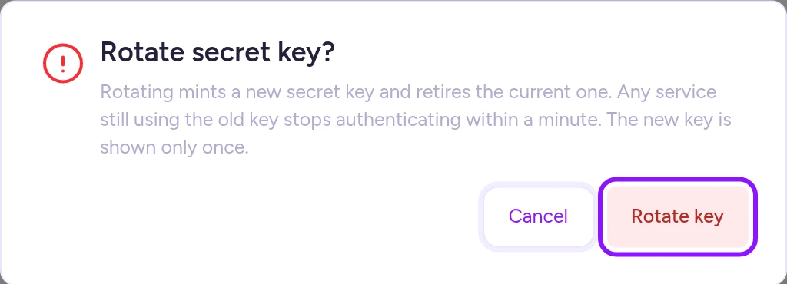

Use **Settings → API Keys** and **Settings → Embedding** (under **Developer**) when a developer is adding Fanfare to your own site or when you want to embed hosted Fanfare pages inside another site, such as your storefront. For a step-by-step walkthrough of embedding Fanfare widgets on your own site, see [Run it on your own site](/guide/create/your-own-site).

## Before you start

- Any team member can copy your **Organization ID**, **Publishable key**, and quick-start snippets.
- Only organization admins can rotate your secret key or edit **Allowed embedding origins** ([Team members](/guide/account/team)).

## Your API keys

Open **Settings → API Keys** to find three cards:

| Card | What's inside | Who can use it |
| --- | --- | --- |
| **Quick start** | Ready-to-copy install, setup (prefilled with your Organization ID and Publishable key), and widget snippets, plus **Read the SDK docs**. | Any team member |
| **Your credentials** | Your **Organization ID** and **Publishable key** with copy buttons. | Any team member |
| **Server-side API access** | Your masked **Secret key** and (for admins) **Rotate secret key**. | Everyone can view; admins only can rotate |

Your **Organization ID** and **Publishable key** are safe to include in browser code so your storefront can load Fanfare. Your **Secret key** is for server-to-server calls only—treat it like a password and never put it in frontend code.

Each organization has one publishable key (which can't be rotated) and one secret key.

<Frame caption="Your secret key stays masked—rotating it generates a new key and displays it once.">
  
</Frame>

## Share credentials with your developer

1. Open **Settings → API Keys**.
2. Under **Your credentials**, copy your **Organization ID** and **Publishable key** (or copy the prefilled snippets in **Quick start**).
3. Send them to your developer along with the **Read the SDK docs** link.

The widget snippet in **Quick start** uses a placeholder experience ID. To grab a real experience ID, open the experience in the admin and copy the ID from the end of your browser's URL (`/app/experiences/<experience-id>`).

If your developer's backend server also calls the Fanfare API directly, follow the steps below to generate and share a secret key.

## Rotate your secret key

Fanfare never reveals your current secret key after it's generated. Rotating creates a new key, displays it once, and retires the previous key—use this when you first need a server-side key or anytime you suspect a key was exposed. Only organization admins can rotate the secret key.

<Warning>
  Rotation takes effect right away and can't be undone. Your previous secret key stops authenticating shortly afterward with no guaranteed grace period, and the new key is shown only once—if you leave the page before copying it, you'll have to rotate again. Coordinate with your developer so they're ready to update your server immediately.
</Warning>

1. Open **Settings → API Keys**.
2. Under **Server-side API access**, select **Rotate secret key**.
3. Confirm by selecting **Rotate key**.
4. Select **Copy** right away and send the new key to your developer over a secure channel.

<Frame caption="Confirming retires your current secret key immediately and shows the new key once.">
  
</Frame>

## Control which sites can embed your hosted pages

By default, other websites can't display your hosted pages inside an iframe. To allow specific sites—like your main store—add them in **Settings → Embedding** (admins only).

1. Open **Settings → Embedding**.
2. Under **Allowed embedding origins**, list one full origin per line, including `https://` and nothing after the domain—for example, `https://shop.example.com`.
3. Select **Save** in the bottom bar.

To revoke access for a site, remove its line and select **Save** (changes take effect shortly after saving). When the list is empty, only your hosted pages' own domain can frame them.

<Frame caption="Add each origin allowed to frame your hosted pages, one per line.">
  
</Frame>

<Note>
  For non-Shopify organizations, this list controls iframe embedding of your hosted pages only—it doesn't restrict where your site can call the Fanfare SDK or API. If you use the Fanfare Shopify app, this list also controls headless storefront API origins—see [On Shopify](#on-shopify).
</Note>

| Setting | Format and behavior | Default | Editable once live? |
| --- | --- | --- | --- |
| **Allowed embedding origins** | One full origin per line (`https://shop.example.com`), with no trailing path and no wildcard (`*`). | Empty (no external sites may embed) | Yes—updates propagate shortly after saving. |

<Frame>
  
</Frame>

## On Shopify

Both developer pages work inside the Fanfare Shopify app with two key differences:

- **Permissions:** Every Shopify staff member who can open the Fanfare app can rotate the secret key and edit **Allowed embedding origins**—even where **Admin only** appears, Shopify manages app access through store staff permissions rather than Fanfare roles ([Team members](/guide/account/team)).
- **Headless storefront API origins:** On Shopify, **Allowed embedding origins** controls both iframe embedding and browser API calls from headless storefronts:
  - Leave the list empty to accept headless storefront API calls from any origin.
  - Once you add any origin to the list, storefront API calls are accepted only from your listed origins, your `.myshopify.com` domain, and your store's primary domain.

<Warning>
  If you run a headless Shopify storefront and add another domain to **Allowed embedding origins** for iframe embedding, include your headless storefront's own origin too—otherwise its browser API calls will be blocked.
</Warning>

For connecting Fanfare to your Shopify theme and checkout, see [Storefront setup](/guide/shopify/storefront-setup).

## Troubleshooting

<AccordionGroup>
  <Accordion title="Allowed embedding origins shows 'Invalid'">
    Make sure every line includes `https://`, ends at the domain with no path (for example, `https://shop.example.com`), and doesn't use `*`. Fix the line and select **Save** again.
  </Accordion>
  <Accordion title="My hosted page won't load inside my storefront iframe">
    Your storefront's origin is likely missing from **Allowed embedding origins**. Add your exact domain (such as `https://shop.example.com`), select **Save**, and wait a moment for the update to propagate.
  </Accordion>
  <Accordion title="Our server integration stopped authenticating after rotating the secret key">
    Rotating retires the previous key shortly afterward. Have your developer deploy the new key everywhere your server calls Fanfare. If the new key wasn't copied before leaving the page, an admin will need to rotate again and copy it immediately.
  </Accordion>
</AccordionGroup>

## Related

<CardGroup>
  <Card title="Run it on your own site" href="/guide/create/your-own-site">
    Embed a drop experience on your own website with the Fanfare SDK.
  </Card>
  <Card title="Build and publish the hosted page" href="/guide/create/hosted-page">
    Design and publish hosted drop pages that other sites can embed.
  </Card>
  <Card title="Team members" href="/guide/account/team">
    See which team members have admin permissions.
  </Card>
</CardGroup>
