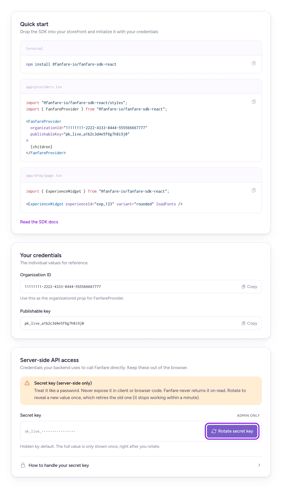
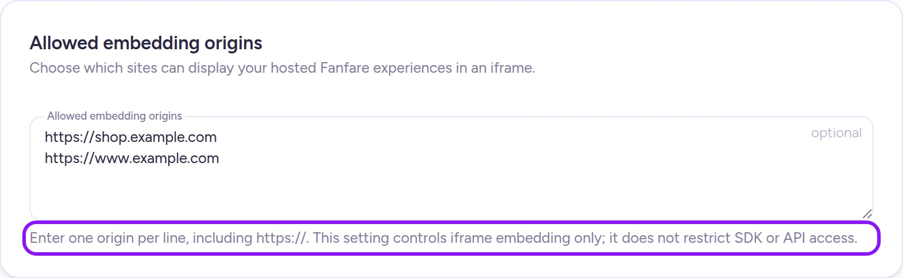
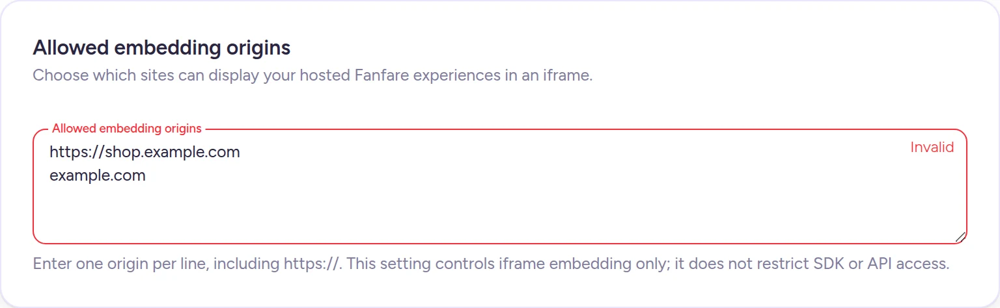

The **Developer** group in **Settings** has two pages. **API Keys** holds the values a developer needs to put Fanfare on a site you own. **Embedding** decides which other sites may show your hosted Fanfare pages inside a frame on their own pages. You need these pages only if a developer is building Fanfare into your site, or your hosted pages must load inside another site such as your store. To run an experience on your own site, start with [Run it on your own site](/guide/create/your-own-site).

## Before you start

- You can sign in to the Fanfare admin.
- To rotate the secret key or change the embedding list, you must be an organisation admin. See [Team members](/guide/account/team) for who is an admin.

## What is on the API Keys page

Open **Settings → API Keys**. The page has three cards.

| Card | What it holds | Who may see it |
| --- | --- | --- |
| **Quick start** | Three code snippets: an install command, a setup snippet filled in with your organisation ID and publishable key, and a widget snippet. Also a **Read the SDK docs** link. | Everyone |
| **Your credentials** | Your **Organization ID** and **Publishable key**, each with a copy button. | Everyone |
| **Server-side API access** | Your **Secret key**, shown masked, with an **Admin only** label. Admins also see **Rotate secret key**. | Everyone sees the card; only admins can rotate |

The organisation ID and the publishable key are safe to use in a browser: they are what your site uses to load Fanfare. The secret key is for your developer's server only. Treat it like a password and never put it in code that runs in a browser.

Your organisation has one publishable key and one secret key. You cannot create more keys, and the publishable key cannot be rotated.

<Frame caption="The secret key stays masked. Rotating it is the only way to see a key, and only once.">
  
</Frame>

## Give your developer the credentials

1. Open **Settings → API Keys**.
2. Under **Your credentials**, copy the **Organization ID** and the **Publishable key**. Or copy the snippets under **Quick start**: the setup snippet already contains both.
3. Send them to your developer, with the **Read the SDK docs** link.

The last **Quick start** snippet shows the widget for one experience, and the experience ID in it is a placeholder. Your developer replaces it with the ID of the experience you want on the page.

The Fanfare admin has no field that shows an experience's ID. To find it, open the experience from your list of experiences. The address in your browser then ends in `/app/experiences/` followed by the experience's ID. Copy that last part and send it to your developer.

If your developer's server also needs to call Fanfare, it needs the secret key. The next task is the only way to get it.

## Rotate the secret key

Fanfare never shows your current secret key. Rotating creates a new key, shows it to you once, and retires the old one. Do this when you first need a secret key, or when you think the current one has been exposed.

Only organisation admins can rotate. Other members have no rotate button. Under the masked key they see "Only organization admins can rotate the secret key. Contact an admin to get a new one."

<Warning>
  Rotation takes effect straight away and cannot be undone. The old key may keep working for a short time afterwards, but Fanfare offers no grace period you can rely on to switch over. The new key is shown once: if you leave the page before copying it, it is gone and you have to rotate again. Rotate only when your developer is ready to put the new key in place at once.
</Warning>

1. Open **Settings → API Keys**.
2. Under **Server-side API access**, select **Rotate secret key**.
3. In the "Rotate secret key?" dialogue, select **Rotate key**.
4. The new key appears in a highlighted row with the message "Copy it now. You won't be able to see it again." Select **Copy** and pass the key to your developer straight away, through a channel you trust.

<Frame caption="Confirming retires the current key. There is no undo.">
  
</Frame>

## Choose which sites may show your hosted pages

Your hosted pages can load inside a frame on another site, such as a page in your store. Fanfare allows that only for the sites you list. Only organisation admins can change the list. Other members see "Only organization admins can change the allowed embedding origins." and cannot edit the box.

1. Open **Settings → Embedding**.
2. In **Allowed embedding origins**, enter each site on its own line as its full address, such as `https://shop.example.com`, with nothing after the domain.
3. A bar appears at the bottom of the page once you change the list. Select **Save** in it. You see "Organization settings updated successfully".

To stop a site showing your pages, delete its line and select **Save**. Shortly after you save, that site can no longer frame your hosted pages. The change is not instant.

With the list empty, only your hosted pages' own address can show them in a frame. No other site can.

<Frame caption="List each site that may show your hosted pages, one per line.">
  
</Frame>

<Note>
  For a store that does not use the Fanfare app in Shopify, this list controls only which sites may show your hosted pages in a frame. It does not limit where your site can use Fanfare's SDK or API. If your store uses the Fanfare app in Shopify, the same list can do more: see [On Shopify](#on-shopify).
</Note>

| Setting | What it does | Default | Can you change it once it is live? |
| --- | --- | --- | --- |
| **Allowed embedding origins** | The sites that may show your hosted pages in a frame. One per line, as a full address such as `https://shop.example.com`, with no path, and never `*`. | Empty: no other site can frame your pages | Yes, at any time. A change takes effect shortly after you save, not instantly. |

<Frame>
  
</Frame>

## On Shopify

The **API Keys** page is the same in the Fanfare app in Shopify, with one difference: everyone who can open the app can rotate the secret key. The **Admin only** label still shows, but there is no admin role in the Shopify app, so the rotation Warning above applies to every member of your staff who uses it. See [Team members](/guide/account/team).

**Embedding** is also open to everyone who can open the app, and the list does more there. Its help text reads: "One origin per line, including scheme (https://shop.example.com). Embedding: only the listed domains may place Fanfare experiences in an iframe. Browser API calls from a headless storefront: leave this empty to accept calls from any origin; once any domain is listed, storefront API calls are accepted only from the listed origins, this store's myshopify domain, and its primary domain."

If you run a headless storefront and add a site to this list so it can frame your pages, list your storefront's own address too. Otherwise your storefront can no longer use Fanfare's responses, because once the list has any entry only the listed sites and your store's own domains are allowed.

For connecting Fanfare to your store's theme and checkout, see [Storefront setup](/guide/shopify/storefront-setup).

## Troubleshooting

<AccordionGroup>
  <Accordion title="Saving the embedding list shows 'Invalid'">
    One of the lines is not in the form Fanfare accepts. Point at **Invalid** in the corner of the box to read the message: "Enter each origin as https://example.com, with no path after the domain. * is not allowed: name each site that may embed your pages." Check that every line is a full address that includes https://, ends at the domain, and is not `*`. Then select **Save** again.
  </Accordion>
  <Accordion title="My hosted page does not load inside my store">
    The store's address is probably missing from **Allowed embedding origins**. Add the store's address, for example `https://shop.example.com`, and select **Save**.
  </Accordion>
  <Accordion title="Our server stopped working with Fanfare after a rotation">
    Rotating retired the old secret key shortly afterwards. Your developer must replace it with the new key everywhere the server uses it. If nobody copied the new key before leaving the page, an admin has to rotate again and copy the new one at once.
  </Accordion>
</AccordionGroup>

## Related

<CardGroup>
  <Card title="Run it on your own site" href="/guide/create/your-own-site">
    Put an experience on a page you own, with links to the SDK docs.
  </Card>
  <Card title="Build and publish the hosted page" href="/guide/create/hosted-page">
    Design the hosted page that other sites can frame.
  </Card>
  <Card title="Team members" href="/guide/account/team">
    Who is an organisation admin.
  </Card>
</CardGroup>
