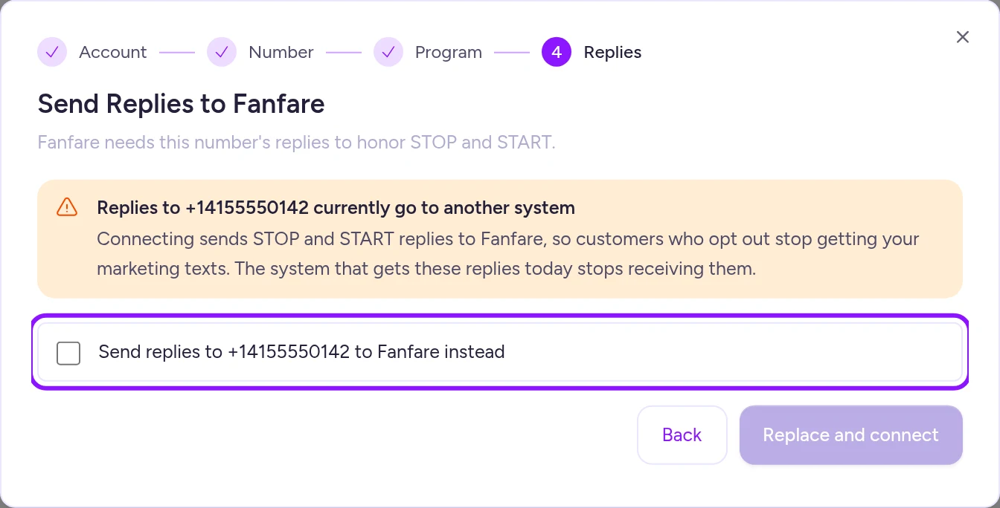

Integrations link Fanfare to the other tools you use for a drop: email marketing, analytics, social channels and your own Twilio number for marketing texts.
<Info>Available on Growth and above.</Info>

Google Analytics is available on every plan. On Starter, the page shows an "Available on Growth" prompt above the cards, and the same prompt inside the Klaviyo, Mailchimp, Meta, Discord and Twilio dialogues, where you cannot add or reconnect a connection but can still disconnect one. Telegram's dialogue shows no prompt: see [Telegram](#telegram). See [Plans and what they unlock](/guide/start/plans).

## Before you start

- Check the "Who can connect" column below: some integrations need an admin of your Fanfare organisation. See [Team members](/guide/account/team) for who is an admin.

## Find the Integrations page

Open **Settings**, then **Integrations** in the **Connections** group. Above the cards, the tabs **All Integrations**, **Email Marketing**, **Analytics**, **Social Media** and **Communication** filter the list.

<Frame caption="Each card shows whether that integration is connected.">
  
</Frame>

Each card carries a badge:

| Badge | What it means |
| --- | --- |
| **Inactive** | Nothing is connected. |
| **Not Connected** | Twilio only: nothing is connected. |
| **Connected** | At least one connection is active. The badge does not test your key: a wrong Klaviyo key also shows **Connected** (see below). |
| **Error** | There are connections, but none of them is active. For Klaviyo, Mailchimp, Google Analytics, Meta, Discord and Telegram this also covers a connection that needs reconnecting: open the card to see which. |
| **Needs Reconnecting** | Twilio only: Twilio no longer accepts the Auth Token Fanfare holds. Other Twilio problems, such as a number Twilio no longer has, show **Error**. |

<Frame caption="Integrations on a lower plan show an upgrade prompt above the cards.">
  
</Frame>

## Which integration does what

| Integration | What it is for | How you connect | Who can connect | Plan |
| --- | --- | --- | --- | --- |
| Klaviyo | Importing Klaviyo lists into audiences | Paste a private API key | Anyone on the team | Growth and above |
| Mailchimp | Importing Mailchimp audiences into audiences | Paste an API key | Anyone on the team | Growth and above |
| Google Analytics | Saving your Google Analytics 4 Measurement ID and the events you want forwarded | Enter a Measurement ID and choose events | Anyone on the team | Every plan |
| Meta | Posting announcements on a Facebook Page and its linked Instagram account | Sign in with Facebook, then choose Pages | Anyone can start; an admin must finish | Growth and above |
| Discord | Posting announcements in a Discord channel | Add the Fanfare bot to your server, then choose a channel | Anyone can start; an admin must finish | Growth and above |
| Telegram | Posting announcements in a Telegram channel | Put a one-time code in the channel description | An admin, who gets the code and verifies it | Growth and above |
| Twilio | Sending marketing texts from your own number | Account SID and Auth Token, then a number and your SMS programme | Admins only | Growth and above |

Using these connections is covered in [Build audiences](/guide/create/audiences) and [Announcements](/guide/create/announcements). The **Create Audience** menu does not offer Klaviyo or Mailchimp lists, even with a connected account, so connecting either one does not let you import a list. Google Analytics is separate from Fanfare's own numbers, which are in [Read your results](/guide/learn/performance).

## Klaviyo and Mailchimp

1. Select the **Klaviyo** or **Mailchimp** card.
2. Paste your key into **API Key**.
   - Klaviyo: your private API key, which starts with `pk_`. It is in your Klaviyo account settings.
   - Mailchimp: the key in the form key-datacentre, for example `abc123-us19`. It is in Mailchimp under Account & Billing > Extras > API keys.
3. Optionally fill in **Connection name**, which tells connections apart when you have more than one. It defaults to the provider name.
4. Mailchimp only: select **Test Connection** to check the key before saving.
5. Select **Save**. The card shows **Connected**.

<Warning>
  **Save** always adds a new connection. It never updates the existing one. To change a key, save the new key, then disconnect the old connection (see [Manage a connection](#manage-a-connection)). If you do not, both connections stay live.
</Warning>

Imported lists stay tied to the connection they came through. Once you disconnect the old connection, an audience imported through it keeps its members but can no longer be synced, and the **Create Audience** menu does not offer Klaviyo or Mailchimp lists, so you cannot import it again through the new connection (see [Build audiences](/guide/create/audiences)). Weigh that before you disconnect a working connection.

<Note>
  Klaviyo has no **Test Connection** button. A wrong Klaviyo key still saves, and the card keeps showing **Connected**, so copy the key carefully.
</Note>

On Starter, importing lists stops, because audiences need Growth.

<Frame caption="Saving here adds a new connection; it does not replace the one listed above it.">
  
</Frame>

## Google Analytics

Your organisation can have one working Google Analytics connection.

<Note>
  Saving the connection stores your Measurement ID and event choices. It does not by itself send events to Google Analytics 4.
</Note>

1. Select the **Google Analytics** card.
2. Enter your **Measurement ID**: G- followed by capital letters and digits, for example `G-XXXXXXXXXX`. It is in your Google Analytics 4 property settings under Data Streams.
3. Under **Event Forwarding**, choose events. They are grouped by type, such as Queue and Draw, and every one is ticked at first. One button changes them all at once: it reads **Deselect All** when every event is ticked, and **Select All** otherwise.
4. Select **Save**.

<Warning>
  Saving a change removes the current Google Analytics connection before creating the new one. If creating the new one fails, Google Analytics is left disconnected. After saving, check that the card shows **Connected**. If it does not, open it, enter the Measurement ID, choose your events again (all are ticked), and save.
</Warning>

<Note>
  If you untick every event and save, the card still shows **Connected**, with no events chosen.
</Note>

## Meta

1. Select the **Meta** card, then **Connect with Facebook**. Your browser goes to Facebook.
2. Sign in and leave every permission switched on. If you switch one off, Fanfare cannot connect and asks you to start again.
3. Back in Fanfare, **Choose Pages** opens. Tick the Facebook Pages Fanfare may post to.
4. Select **Connect selected Pages** within 15 minutes.

Instagram is connected only if it is linked to the Page when you connect. Otherwise the Page connects without it, and its row shows **Instagram** as **Not linked**. To add Instagram later, link it to the Page in Meta, then select **Connect with Facebook** again and choose the same Page. Fanfare updates that Page's connection instead of adding a second one.

If Facebook shares more Pages than the list can show, only the first ones are listed.

## Discord

1. Select the **Discord** card, then **Add to Discord**. Your browser goes to Discord.
2. Choose your server and authorise the Fanfare bot.
3. Back in Fanfare, **Choose a channel** opens. Pick the channel announcements are posted in. Fanfare posts to one channel per server: picking a channel in a server you have already connected moves that connection, and its scheduled posts, to the new channel.
4. Select **Connect channel** within 15 minutes.

If the bot is not allowed to create scheduled events in your server, the chooser says so: announcements then post as messages only. If the bot cannot post in any channel, allow it to send messages in one, then start again.

## Telegram

1. Select the **Telegram** card.
2. Enter the channel's public username in **Channel**, for example `@yourchannel`, and select **Get code**. A channel without a public username cannot be connected.
3. In Telegram, add the bot the dialogue names to the channel as an administrator with the Post messages and Edit messages of others rights.
4. Paste the code into the channel description and save it in Telegram.
5. Back in Fanfare, select **Verify channel** within 30 minutes of getting the code.
<Note>
  On Starter, **Get code** is refused with "This feature requires the … plan. Upgrade to continue.", naming the plan you need.
</Note>

## Twilio

Only admins can connect, change or disconnect Twilio; anyone else who opens the card sees "Only organization admins can change the Twilio connection."

1. Select the **Twilio** card.
2. Enter your **Account SID** (on your Twilio Console home page, under Account Info) and **Auth Token**, then select **Test and continue**.
3. Choose the number or Messaging Service that sends your texts. The list shows up to the first 100 SMS-capable numbers and the first 100 Messaging Services that Twilio returns. If yours is not listed, choose **Another number or Messaging Service** and enter the number in international format (a plus sign, the country code, then the number) or a Messaging Service SID that starts with MG.
4. Select **Continue**.
5. Fill in your SMS programme: **Brand name in texts**, **SMS terms link** and **Privacy policy link**. **Customers will see** previews the consent wording built from them.
6. Select **Connect**.
7. If Fanfare asks, tick "Send replies to [your number] to Fanfare instead" and select **Replace and connect**.

When it is done, Fanfare shows "Twilio connected. Marketing texts will send from your number."

<Note>
  Fanfare does not check carrier registration. US carriers block marketing texts from numbers without an approved A2P 10DLC campaign or toll-free verification, so confirm the number's registration in Twilio before you send.
</Note>

<Frame caption="The preview shows the consent wording customers see before they agree to marketing texts.">
  
</Frame>

| Setting | What it does | Default | Can you change it once it is live? |
| --- | --- | --- | --- |
| **Brand name in texts** | Starts every marketing text, such as "Kazen: Doors open at 10am". Up to 20 standard characters: letters, numbers and common punctuation, no emoji. | Your company name, if it fits these rules; otherwise empty | Yes, with **Edit program details** |
| **SMS terms link** | Your SMS terms page, linked from the consent wording. It must start with https://. | None | Yes, with **Edit program details** |
| **Privacy policy link** | Your privacy policy, linked from the consent wording. It must start with https://. | None | Yes, with **Edit program details** |

### When Fanfare asks to take over replies

Fanfare needs your number's replies so that customers who reply STOP stop getting marketing texts. If they go to another system today, Fanfare shows "Replies to … currently go to another system". **Replace and connect** points them at Fanfare, and the other system stops getting them.

<Frame>
  
</Frame>

### Change your SMS programme

Open the **Twilio** card and select **Edit program details**. Change the fields and select **Save**. Changes apply to the next marketing text and consent prompt.

### One organisation per account

A Twilio account or number, a Discord server and a Telegram channel can each be connected to only one Fanfare organisation. If you run several brands as separate organisations, each needs its own.

## Manage a connection

For Klaviyo, Mailchimp, Meta, Discord and Telegram, open the card to see **Connected accounts**: one row per connection, with a status dot (**Connected**, **Needs reconnecting** or **Error**), the date under **Connected on**, and, for Meta, Discord and Telegram, the number of **Scheduled posts**. The Google Analytics dialogue shows its one working connection the same way.

### Reconnect

- Meta, Discord or Telegram showing "Needs reconnecting": expand the row and select **Reconnect**. Meta and Discord send you through Facebook or Discord again. Telegram returns to its first step with the channel filled in.
- Twilio showing "Marketing texts are paused" (see [Troubleshooting](#troubleshooting)): an admin selects **Reconnect Twilio** and walks through the steps again with the same Twilio account. The **Auth Token** is always empty on reconnect, so paste it again. To move to a different Twilio account, disconnect Twilio first, then connect the new one.

### Disconnect

- Klaviyo, Mailchimp, Google Analytics, Meta, Discord, Telegram: expand the row and select **Disconnect**, then **Disconnect** again to confirm, or **Keep** to back out. Anyone on the team can do this.
- Twilio: open the card and select **Disconnect**. In "Disconnect Twilio?", select **Disconnect** to confirm, or **Keep connected**.

Before you disconnect Meta, Discord or Telegram, check the row's footer. If it reads "1 scheduled post won't go out." or similar, those posts will not be published to this account. "Nothing is scheduled here." means nothing is lost.

Disconnecting Twilio stops marketing texts at once: SMS announcements due afterwards show "Didn't send" (see [Announcements](/guide/create/announcements)). Twilio keeps sending your number's replies to Fanfare, which no longer acts on them: point them back at your own system in Twilio if you need them.

## On Shopify

The Integrations page in the Fanfare app in Shopify differs in four ways:

- Everyone who can open the Fanfare app can connect, change and disconnect Klaviyo, Mailchimp, Google Analytics, Meta, Discord and Twilio on this page; there are no admin-only steps. See [Team members](/guide/account/team).
- **Connect with Facebook** and **Add to Discord** open Facebook and Discord outside the Shopify admin. When you finish, you return to the Integrations page in the Fanfare app in Shopify.
- If the Meta and Discord cards show **Coming Soon** and cannot be opened, connecting them is not available in your Shopify app.
- Telegram cannot be connected in the Fanfare app in Shopify: **Get code** answers "Fanfare could not complete this step. Check that you are an organization admin."

## Troubleshooting

<AccordionGroup>
  <Accordion title="This step expired. Start the connection again.">
    Start again from the card. "The connection attempt expired or was already used. Start again." means you took more than 10 minutes in Facebook or Discord, or used an old link.
  </Accordion>
  <Accordion title="Fanfare could not complete this step. Check that you are an organization admin.">
    Anyone on the team can start a Meta, Discord or Telegram connection, but only an admin can finish it: the check happens after Facebook or Discord, or when you select **Verify channel**. Ask an admin to connect it from the start.
  </Accordion>
  <Accordion title="This connection already exists.">
    Google Analytics is already connected, for example from another tab. Reload the page and open the **Google Analytics** card to change it.
  </Accordion>
  <Accordion title="… is already connected to another Fanfare organization.">
    That Twilio account or number, or Telegram channel, belongs to another Fanfare organisation. For a Discord server the message reads "This destination is already connected to another organization." See [One organisation per account](#one-organisation-per-account).
  </Accordion>
  <Accordion title="Marketing texts are paused">
    Marketing texts stop; sign-in codes and order texts still send from Fanfare. The notice gives the reason, such as an Auth Token Twilio no longer accepts or a number Twilio no longer has. Fix it in Twilio if the notice says to, then reconnect as described in [Reconnect](#reconnect). If you are not an admin, ask one.
  </Accordion>
</AccordionGroup>

## Related

<CardGroup>
  <Card title="Build audiences" href="/guide/create/audiences">
    Import Klaviyo lists and Mailchimp audiences.
  </Card>
  <Card title="Announcements" href="/guide/create/announcements">
    Post to Facebook, Instagram, Discord and Telegram, and send marketing texts.
  </Card>
  <Card title="Plans and what they unlock" href="/guide/start/plans">
    Which plan includes which integrations.
  </Card>
  <Card title="Team members" href="/guide/account/team">
    Who is an admin in your organisation.
  </Card>
</CardGroup>
