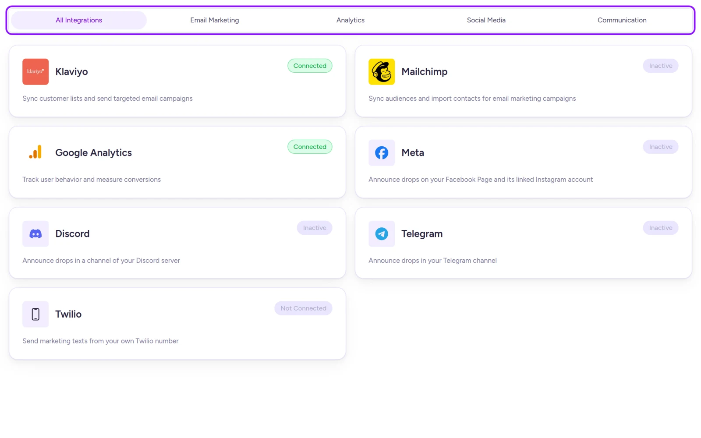
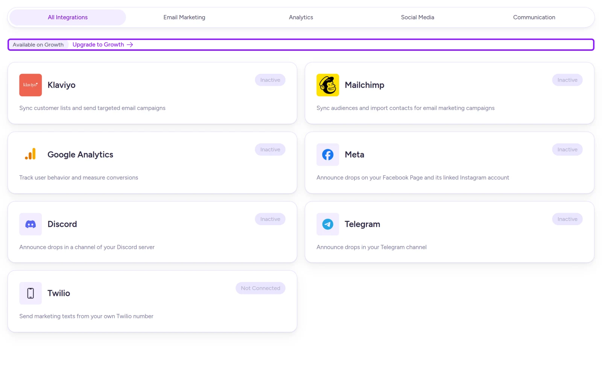
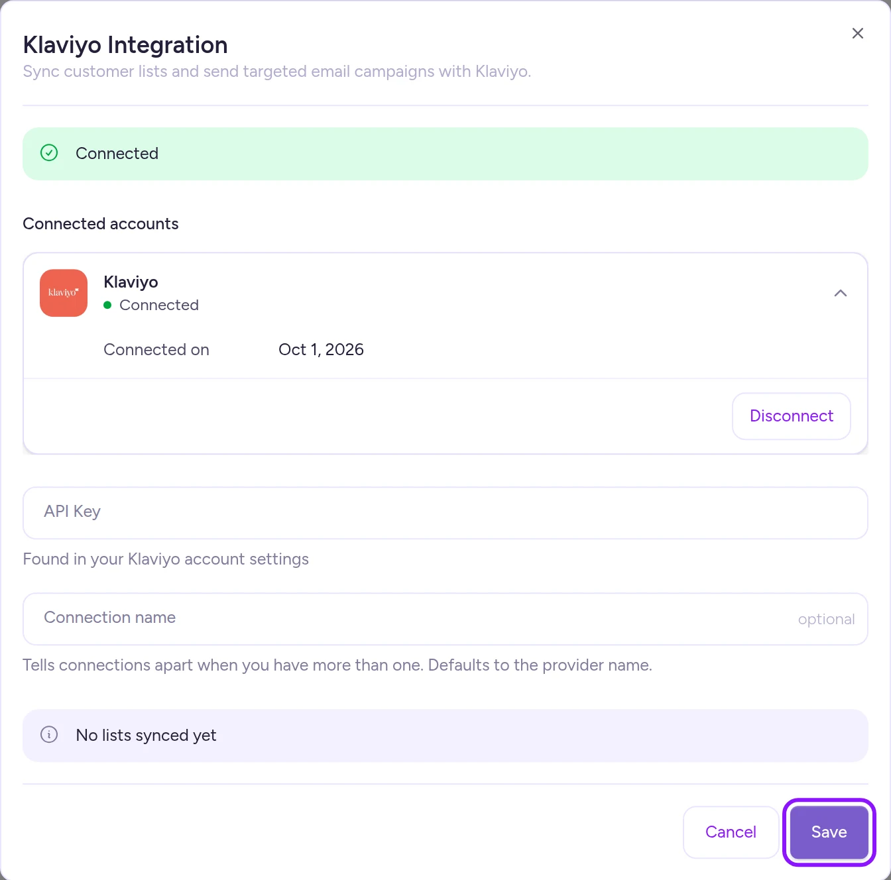
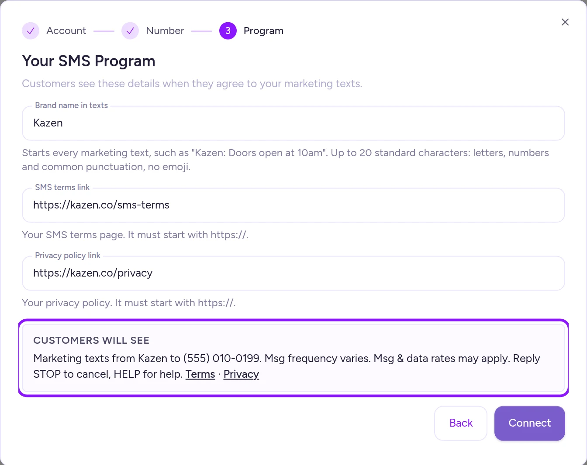

Connect Fanfare to the marketing, analytics, social, and messaging tools you already use for drops.

<Info>
  Marketing integrations (Klaviyo, Mailchimp, Meta, Discord, Telegram, and Twilio) require **Growth** or above. **Google Analytics** is available on every plan. On Starter, you can still disconnect existing integrations, while adding or reconnecting marketing integrations requires upgrading ([Plans and what they unlock](/guide/start/plans)).
</Info>

## Before you start

- Check the **Who can connect** column below—several integrations require an organization admin ([Team members](/guide/account/team)).

## Find your integrations

Go to **Settings → Integrations** (under **Connections**). Use the filter tabs—**All Integrations**, **Email Marketing**, **Analytics**, **Social Media**, and **Communication**—to narrow the grid.

<Frame caption="Each integration card shows its current connection status.">
  
</Frame>

Card status badges:

| Badge | What it means |
| --- | --- |
| **Inactive** / **Not Connected** | No account is connected (**Not Connected** is used for Twilio). |
| **Connected** | At least one connection is active. (Note: Fanfare doesn't live-verify Klaviyo keys, so verify yours carefully.) |
| **Error** | Existing connections aren't active or need attention—open the card for details. |
| **Needs Reconnecting** | Twilio only: Twilio no longer accepts the saved Auth Token. |

<Frame caption="Integrations outside your current plan display an upgrade prompt above the cards.">
  
</Frame>

## Available integrations

| Integration | What it does | How you connect | Who can connect | Plan |
| --- | --- | --- | --- | --- |
| **Klaviyo** | Connect your Klaviyo account via API key | Paste a private API key | Any team member | Growth and above |
| **Mailchimp** | Connect your Mailchimp account via API key | Paste an API key | Any team member | Growth and above |
| **Google Analytics** | Store your GA4 Measurement ID and forwarded event preferences | Enter Measurement ID and select events | Any team member | Every plan |
| **Meta** | Publish announcements to a Facebook Page and its linked Instagram account | Sign in with Facebook and pick Pages | Anyone can start; an admin must finish | Growth and above |
| **Discord** | Post announcements to a Discord server channel | Add the Fanfare bot and pick a channel | Anyone can start; an admin must finish | Growth and above |
| **Telegram** | Post announcements to a public Telegram channel | Verify a one-time code in the channel description | Admins only | Growth and above |
| **Twilio** | Send marketing texts from your own phone number or Messaging Service | Account SID, Auth Token, number, and SMS program | Admins only | Growth and above |

For how these channels work in drops, see [Build audiences](/guide/create/audiences) and [Announcements](/guide/create/announcements). Google Analytics is tracked separately from Fanfare's built-in drop analytics ([Read your results](/guide/learn/performance)).

<Note>
  While you can save Klaviyo and Mailchimp connections here, importing lists directly from the **Create Audience** menu isn't currently available.
</Note>

## Klaviyo and Mailchimp

1. Select the **Klaviyo** or **Mailchimp** card.
2. Paste your **API Key**:
   - **Klaviyo:** Your private API key starting with `pk_` (from your Klaviyo account settings).
   - **Mailchimp:** Your key in `key-datacenter` format, such as `abc123-us19` (from Mailchimp under **Account & Billing → Extras → API keys**).
3. Optionally enter a **Connection name** to tell multiple accounts apart.
4. For Mailchimp, select **Test Connection** to verify the key before saving.
5. Select **Save**.

<Warning>
  **Save** always adds a new connection rather than replacing an existing one. To rotate an API key, save the new key first and then disconnect the old connection ([Manage a connection](#manage-a-connection)). You can't re-import that list through the new connection, so audiences imported through the old one stop syncing for good (existing members remain). Weigh that before you disconnect a working connection (if you leave both connected, both stay live).
</Warning>

<Note>
  Klaviyo doesn't have a **Test Connection** button—an invalid key still saves as **Connected**, so double-check it carefully.
</Note>

<Frame caption="Saving adds a new connection rather than overwriting an existing one.">
  
</Frame>

## Google Analytics

Your organization can keep one active Google Analytics 4 connection.

<Note>
  Saving this connection stores your Measurement ID and event preferences in Fanfare; it doesn't automatically transmit events to Google Analytics 4 on its own.
</Note>

1. Select the **Google Analytics** card.
2. Enter your **Measurement ID** (`G-` followed by uppercase letters and digits, such as `G-XXXXXXXXXX`, found in GA4 under **Data Streams**).
3. Under **Event Forwarding**, choose which event groups (such as Queue or Draw) to include. Use **Deselect All** or **Select All** to toggle everything at once.
4. Select **Save**.

<Warning>
  Saving a change replaces your existing Google Analytics connection. If saving fails partway through, your connection may be left disconnected—verify that the card shows **Connected** after saving. If it isn't, re-enter your Measurement ID and choose your events again (re-entering the connection resets every event to ticked).
</Warning>

## Meta

1. Select the **Meta** card, then select **Connect with Facebook**.
2. Sign in to Facebook and leave all requested permissions turned on (turning any off prevents Fanfare from connecting).
3. Back in Fanfare, select the Facebook Pages Fanfare can post to in **Choose Pages**.
4. Select **Connect selected Pages** within 15 minutes.

Instagram connects automatically only if it's already linked to your Facebook Page in Meta. If a Page connects with **Instagram** shown as **Not linked**, link Instagram to that Page in Meta, then run **Connect with Facebook** again and select the same Page—Fanfare updates the existing connection instead of creating a duplicate. (If your Facebook account manages a large number of Pages, only the first batch is listed.)

## Discord

1. Select the **Discord** card, then select **Add to Discord**.
2. Choose your server and authorize the Fanfare bot.
3. Back in Fanfare, pick your destination channel in **Choose a channel**.
4. Select **Connect channel** within 15 minutes.

Fanfare posts to one channel per Discord server—selecting a different channel on a server you already connected moves that connection and its scheduled posts to the new channel. Make sure the bot has permission to send messages in your chosen channel; if it doesn't have permission to create scheduled events, announcements will post as regular messages.

## Telegram

1. Select the **Telegram** card.
2. Enter your channel's public username in **Channel** (for example, `@yourchannel`) and select **Get code**. Private channels without a public username can't be connected.
3. In Telegram, add the bot named in the dialog as a channel administrator with **Post messages** and **Edit messages of others** permissions.
4. Paste the verification code into your channel's description and save it in Telegram.
5. Back in Fanfare, select **Verify channel** within 30 minutes of generating the code.

## Twilio

Only organization admins can connect, edit, or disconnect Twilio.

1. Select the **Twilio** card.
2. Enter your **Account SID** (from your Twilio Console home page under **Account Info**) and **Auth Token**, then select **Test and continue**.
3. Pick the phone number or Messaging Service that will send your texts. Fanfare lists up to the first 100 SMS-capable numbers and 100 Messaging Services from Twilio—if yours isn't listed, choose **Another number or Messaging Service** and enter an international phone number (starting with `+`) or a Messaging Service SID (starting with `MG`).
4. Select **Continue**.
5. Fill in your SMS program details—**Brand name in texts**, **SMS terms link**, and **Privacy policy link**—and review the **Customers will see** consent preview.
6. Select **Connect**. If prompted to route replies to Fanfare, check the box and select **Replace and connect**.

<Note>
  Fanfare doesn't check carrier registration. US carriers block marketing texts from numbers without an approved A2P 10DLC campaign or toll-free verification—confirm your registration in Twilio before sending campaigns.
</Note>

<Frame caption="Preview the exact SMS consent wording customers will see before connecting.">
  
</Frame>

| Setting | What it does | Default | Editable after connecting? |
| --- | --- | --- | --- |
| **Brand name in texts** | Prefixes every marketing text (for example, "Kazen: Doors open at 10am"). Up to 20 standard characters—letters, numbers, and common punctuation, no emoji. | Your company name (if it fits), otherwise blank | Yes, via **Edit program details** |
| **SMS terms link** | Link to your SMS terms page (`https://...`), included in customer consent wording. | Blank | Yes, via **Edit program details** |
| **Privacy policy link** | Link to your privacy policy (`https://...`), included in customer consent wording. | Blank | Yes, via **Edit program details** |

### When Fanfare asks to take over replies

Fanfare needs to receive replies to your Twilio number so customers who reply `STOP` are unsubscribed automatically. If replies currently route to another system, selecting **Replace and connect** updates where Twilio sends replies to Fanfare (and the previous system stops receiving replies).

<Frame>
  
</Frame>

### Update your SMS program

Open the **Twilio** card, select **Edit program details**, update any field, and select **Save**. Changes take effect on your next marketing text and consent prompt.

### One organization per account

A Twilio account or phone number, a Discord server, and a Telegram channel can each be connected to only one Fanfare organization at a time. If you manage multiple brands in separate organizations, each needs its own account or channel.

## Manage a connection

Open any integration card to see its **Connected accounts**, including status, **Connected on** date, and (for Meta, Discord, and Telegram) the count of **Scheduled posts**.

### Reconnect

- **Meta, Discord, or Telegram:** If a connection shows **Needs reconnecting**, expand its row and select **Reconnect** to re-authorize or re-verify.
- **Twilio:** If Twilio shows **Marketing texts are paused** (see [Troubleshooting](#troubleshooting)), an admin can select **Reconnect Twilio** and walk through setup again with the same Twilio account—you'll need to paste your **Auth Token** again. To switch to a different Twilio account, disconnect first and then connect the new one.

### Disconnect

- **Klaviyo, Mailchimp, Google Analytics, Meta, Discord, and Telegram:** Expand the account row, select **Disconnect**, and confirm. Any team member can disconnect these integrations.
- **Twilio (admins only):** Open the **Twilio** card, select **Disconnect**, and confirm.

<Warning>
  Before disconnecting **Meta**, **Discord**, or **Telegram**, check whether any scheduled posts are listed on the row—disconnecting prevents those posts from publishing. Disconnecting **Twilio** stops marketing texts right away (upcoming SMS announcements won't send—see [Announcements](/guide/create/announcements)), and you'll need to update where Twilio sends replies if you want another system to receive replies again.
</Warning>

## On Shopify

The **Integrations** page works the same in the Fanfare Shopify app, with four differences:

- **Permissions:** Every Shopify staff member who can open the Fanfare app can connect, edit, and disconnect Klaviyo, Mailchimp, Google Analytics, Meta, Discord, and Twilio—there are no admin-only steps ([Team members](/guide/account/team)).
- **External sign-in:** **Connect with Facebook** and **Add to Discord** open outside the Shopify admin and return you to **Integrations** when finished.
- **Social availability:** If the Meta or Discord cards show **Coming Soon**, they aren't yet available in your Shopify app.
- **Telegram:** Telegram connections aren't available inside the Fanfare Shopify app.

## Troubleshooting

<AccordionGroup>
  <Accordion title="The connection step expired">
    `"The connection attempt expired or was already used. Start again."` means Facebook or Discord sign-in took longer than 10 minutes, or you reused an older link. Start the connection again from the integration card.
  </Accordion>
  <Accordion title="I see 'Fanfare could not complete this step. Check that you are an organization admin.'">
    Only organization admins can finalize Meta, Discord, or Telegram connections (permissions are checked when saving the selection or verifying the channel). Ask an admin to complete the connection from the start.
  </Accordion>
  <Accordion title="Google Analytics says the connection already exists">
    Google Analytics was already connected (for instance, in another browser tab). Reload the page and open the **Google Analytics** card to edit it.
  </Accordion>
  <Accordion title="My account or channel is already connected to another Fanfare organization">
    Each Twilio account or number, Discord server, and Telegram channel can only belong to one organization at a time. Disconnect it from the other organization first, or use a separate account—see [One organization per account](#one-organization-per-account).
  </Accordion>
  <Accordion title="Marketing texts are paused">
    Marketing SMS campaigns pause while transactional sign-in codes and order texts continue sending from Fanfare. Check the notice for the cause (such as an invalid Auth Token or removed Twilio number), fix it in Twilio if needed, and have an admin reconnect—see [Reconnect](#reconnect).
  </Accordion>
</AccordionGroup>

## Related

<CardGroup>
  <Card title="Build audiences" href="/guide/create/audiences">
    Manage audiences and access gating for your drops.
  </Card>
  <Card title="Announcements" href="/guide/create/announcements">
    Publish drop announcements to Facebook, Instagram, Discord, Telegram, and SMS.
  </Card>
  <Card title="Plans and what they unlock" href="/guide/start/plans">
    See which plans include marketing integrations.
  </Card>
  <Card title="Team members" href="/guide/account/team">
    See which integrations require admin permissions.
  </Card>
</CardGroup>
