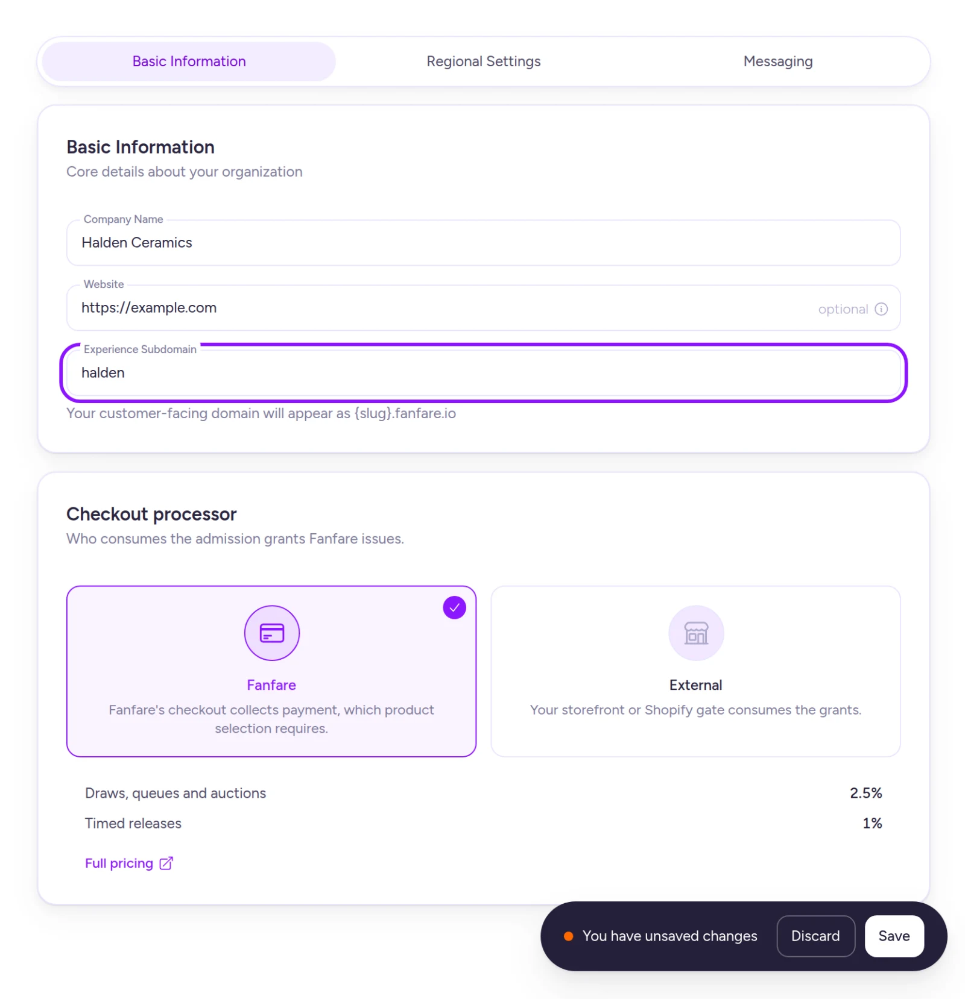
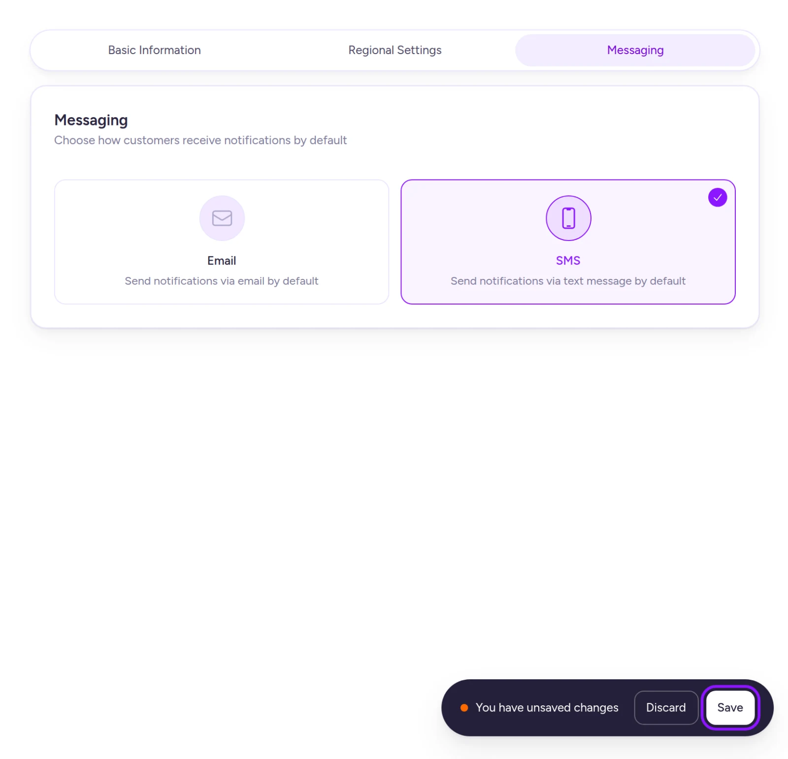
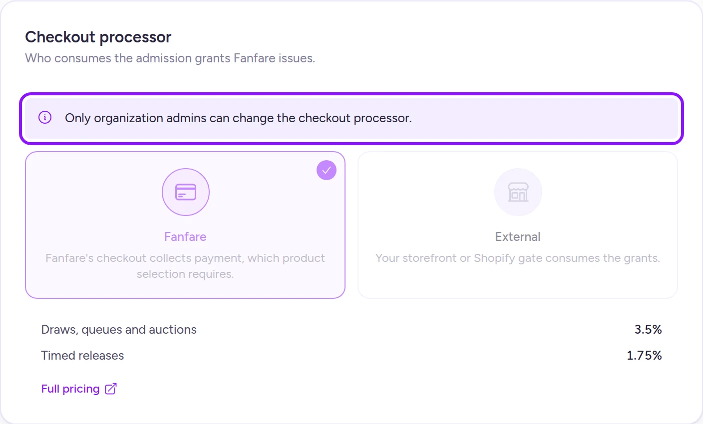

Your **Organization** page holds the account-wide defaults every experience inherits: your company name and website, your drop-page subdomain, your region and currency, who handles checkout, and your default messaging channel. You set most of these when you first created your organization ([Your first drop](/guide/start/your-first-drop)), and you can update them here anytime—keep an eye on the locks below, since a few settings can't change while drops are running or once Stripe is connected.

## Before you start

- **Permissions:** Any team member can edit most fields on this page, except **Checkout processor**, which is restricted to organization admins. See [Team members](/guide/account/team) for the full role breakdown.
- **Stripe lock:** Confirm your **Country** and **Currency** before connecting Stripe. Once a Stripe account is linked to your organization—even if setup isn't finished or you disconnect it later—neither can change. See [Payments and fees](/guide/account/payments).
- For a full overview of settings that lock across Fanfare, see [What locks, and when](/concepts/what-locks-when).

## Navigating Settings

Selecting **Settings** in the sidebar opens **Organization** directly. The Settings menu is organized into four groups:

| Group | Pages | Guide |
| --- | --- | --- |
| **General** | **Organization**, **Email Sender**, **Tours & Tips** | This page; [Sender identity and sending domain](/guide/create/email-sender); [A tour of the admin](/guide/start/tour-of-the-admin) |
| **Commerce** | **Payments**, **Variant Options** | [Payments and fees](/guide/account/payments); [Add products](/guide/create/products) |
| **Connections** | **Integrations** | [Integrations](/guide/account/integrations) |
| **Developer** | **API Keys**, **Embedding** | [API keys and embedding](/guide/account/developer) |

Looking for brand colors and fonts? Those live in Design Studio—see [Set your brand](/guide/create/brand).

<Frame caption="The Basic Information tab holds your company identity, drop-page subdomain, and checkout processor.">
  
</Frame>

## How saving works

**Basic Information**, **Regional Settings**, and **Messaging** share one form. As soon as you edit a field on any tab, a bar appears at the bottom with **Discard** and **Save**. Selecting **Save** applies your edits across all three tabs at once, and updates reach your customer-facing pages within moments.

<Frame caption="One Save button applies changes across all three tabs.">
  
</Frame>

## Settings reference

| Setting | What it controls | Default | Editable once live? |
| --- | --- | --- | --- |
| **Company Name** | Your organization's name as your team and customers see it. Required. | Set at sign-up | Yes—updates on customer pages within moments. |
| **Website** | Your main storefront URL, linked from ended or unavailable drop pages. Optional. | Blank | Yes. |
| **Experience Subdomain** | Your hosted drop-page address (`your-subdomain.fanfaredrops.com`). Required. | Chosen at sign-up | Yes, though it changes your primary customer-facing URL. See warning below. |
| **Checkout processor** | Who takes payment for your drops: **Fanfare** or **External**. Admins only. | Chosen at sign-up (**Fanfare** is available to US organizations selling in USD; all others start on **External**) | Not while any experience (including drafts) has an upcoming or live distribution. See warning below. |
| **Country** | Your organization's country. | Detected from your browser at sign-up | Yes, until a Stripe account is linked to your organization. Permanently locked afterward. |
| **Currency** | The currency used for prices and bids. | Detected from your browser at sign-up | Not while any undeleted auction exists or an ended auction's payment window is still open. Permanently locked once Stripe is linked. |
| **Time Zone** | Starting time zone for new experiences and locations, plus Billing dates and calendar order limits. | Detected from your browser at sign-up | Yes. |
| **Language** | One of nine languages: English, Spanish, French, German, Italian, Portuguese, Japanese, Korean, or Chinese. | English | Yes. |
| **Email** / **SMS** (**Messaging**) | Your preferred customer messaging channel. | **Email** | Yes. |

## Update your company identity and subdomain

1. Open **Settings → Organization** on the **Basic Information** tab.
2. Update **Company Name** and, if you want ended or missing drop pages to link back to your store, enter your **Website**.
3. To change your drop-page address, edit **Experience Subdomain**. Fanfare automatically formats your entry to lowercase and replaces unsupported characters with hyphens.
4. Wait for the green checkmark confirming your subdomain is available.
5. Select **Save**.

Subdomain rules:

- Between 3 and 64 characters long
- Lowercase letters, numbers, and hyphens only (no leading or trailing hyphens)
- Not a reserved word (such as *admin*, *app*, *checkout*, *help*, *login*, or *www*)
- Not already used by another organization, including a previous subdomain an organization changed away from

Customers reach your hosted pages at `your-subdomain.fanfaredrops.com`, and each experience's page card displays its exact live URL.

<Warning>
  Changing **Experience Subdomain** updates your primary customer-facing URL for all future links and emails. Your previous subdomain continues serving the same pages alongside the new one with no redirect and remains permanently reserved for your organization.
</Warning>

## Choose your checkout processor

Your checkout processor determines where customers complete payment after admission:

- **Fanfare:** Customers pay directly through Fanfare checkout using your connected Stripe account. Offering customers a choice of product inside a sequence requires Fanfare checkout (with one Shopify exception—see [On Shopify](#on-shopify)). When **Fanfare** is selected, your card displays Fanfare checkout rates and a link to full pricing.
- **External:** Customers check out on your own storefront or Shopify store.

Compare both flows in [Checkout options](/concepts/checkout-options).

1. Open **Settings → Organization** on the **Basic Information** tab.
2. Under **Checkout processor**, choose **Fanfare** or **External**.
3. Select **Save**.

Only organization admins can change the checkout processor—non-admin members see the options disabled.

<Warning>
  You can't switch checkout processors while any experience (including drafts) has a distribution that hasn't opened yet, is currently live, or has ended with winners still inside their payment window. Queues, timed releases, or auctions with no close time—and draws whose results haven't been recorded—hold the lock until you deactivate or delete them. Appointments, deactivated distributions, and deleted experiences don't hold the lock. Switching never moves customers who have already been admitted.
</Warning>

Switching from **Fanfare** to **External** also requires that you have no:

- **Fanfare-managed products** still in your catalog, even if their drops have ended. Remove them from any active or draft experiences (or end/deactivate those experiences), then delete the products before switching. See [Add products](/guide/create/products).
- **Sequences offering a choice of product or variant**—reduce any sequence that offers customers a choice of product or variant to a single product and variant first.
- **Auctions** that rely on Fanfare checkout to charge the winning bid.

<Frame caption="Non-admin members can view the checkout processor but can't change it.">
  
</Frame>

## Set your regional defaults

1. Open **Settings → Organization** and select **Regional Settings**.
2. Choose your **Country**, **Currency**, **Time Zone**, and **Language**.
3. Select **Save**.

Keep these regional rules in mind:

- **Country and Currency:** Both lock permanently as soon as your organization has a Stripe account (even if onboarding isn't complete or you later disconnect it). See [Payments and fees](/guide/account/payments) for details and why Fanfare checkout requires a US organization selling in USD.
- **Currency and auctions:** You can't change **Currency** while you have an undeleted auction or an ended auction whose winner can still pay. Wait for the payment window to close and delete the auction before changing currency.
- **Time Zone:** Sets the starting time zone for new experiences and locations without altering existing experiences. It's also used for dates on **Billing** and for resetting **Calendar** order-limit windows at midnight ([Add and gate sequences](/guide/create/sequences)).
- **Language:** Combines with **Country** to format dates and times in your social posts. It doesn't translate the Fanfare admin, customer pages, or emails.

<Frame>
  
</Frame>

## Set your default messaging channel

1. Open **Settings → Organization** and select **Messaging**.
2. Choose **Email** or **SMS**.
3. Select **Save**.

This sets your preferred channel rather than a strict rule. If **SMS** is selected, customers without a phone number or who opted out of texts still receive emails. If **Email** is selected, customers without a usable email address receive texts instead if they provided a phone number and haven't opted out.

## On Shopify

The **Organization** page works the same in the Fanfare Shopify app, with a few differences:

- **Default processor:** Organizations installed from Shopify start on **External**.
- **Permissions:** Every Shopify staff member with access to the Fanfare app can edit every field, including the checkout processor—there's no admin/member split. See [Team members](/guide/account/team).
- **Currency:** Automatically matches your Shopify store's currency when the app is installed.
- **Multi-product sequences:** Sequences can offer customers a choice of product on **External** checkout as long as every option is linked to a Shopify variant. Only unlinked options block switching to **External** (all other checkout locks still apply).
- **Settings menu:** Adds **Storefront setup** under **General** and omits **Tours & Tips**. See [Storefront setup](/guide/shopify/storefront-setup).

## Troubleshooting

<AccordionGroup>
  <Accordion title="Save is disabled after I edited the subdomain">
    A red X next to **Experience Subdomain** means the name is already taken, is a reserved word, or doesn't meet the formatting rules above. Fix any validation message shown on the field and try another name until the green checkmark appears, or select **Discard** to keep your current subdomain.
  </Accordion>
  <Accordion title="My checkout processor change was refused when I saved">
    Check every experience—including drafts—for upcoming or live distributions, ended distributions whose winners are still in their payment window, distributions without a close time, or draws without recorded results. If switching to **External**, also make sure no Fanfare-managed products, sequences offering a choice of product or variant, or Fanfare-checkout auctions remain. Wait for payment windows to close or delete what's holding the lock, then save again. (Deactivating also releases the lock, but review [Stop a drop](/guide/drop/deactivate) first—**Deactivate** can't be undone.) If you also edited other fields, revert **Checkout processor** to its previous value and select **Save** to keep your other edits.
  </Accordion>
  <Accordion title="My currency change was refused when I saved">
    Either your organization already has a Stripe account (which permanently locks currency), or you have an active/undeleted auction or an ended auction whose winner is still within their payment window. For auctions, wait for the hold to end, delete the auction, and try again. To save your other edits in the meantime, set **Currency** back to its previous value and select **Save**.
  </Accordion>
  <Accordion title="My country change was refused when I saved">
    Your organization already has a Stripe account linked to it—even if onboarding wasn't finished or the account was disconnected—so **Country** is permanently locked. Set **Country** back to its previous value and select **Save** to keep your other changes. See [Payments and fees](/guide/account/payments).
  </Accordion>
</AccordionGroup>

## Related

<CardGroup>
  <Card title="Team members" href="/guide/account/team">
    See who can change which settings in your organization.
  </Card>
  <Card title="Payments and fees" href="/guide/account/payments">
    Connect Stripe and learn why country and currency lock.
  </Card>
  <Card title="Checkout options" href="/concepts/checkout-options">
    Compare Fanfare checkout, external checkout, and Shopify checkout.
  </Card>
  <Card title="What locks, and when" href="/concepts/what-locks-when">
    See what you can change before, during, and after a drop.
  </Card>
</CardGroup>
