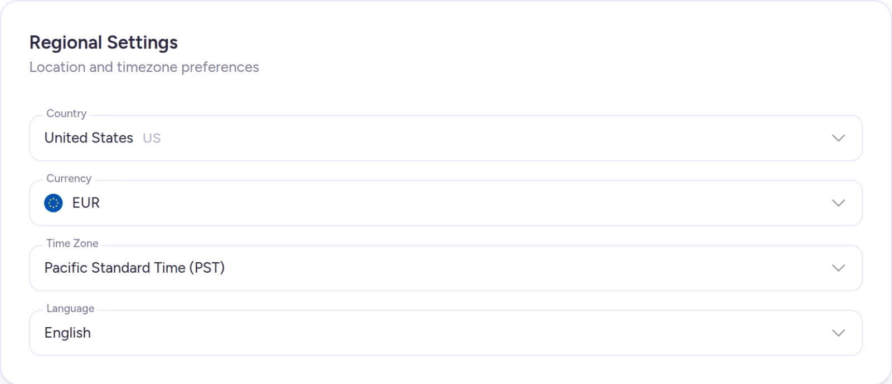

The **Organization** page holds the account-wide details every experience inherits: your company name and website, the address customers reach your pages at, your country, currency, time zone and language, who takes payment, and how customers hear from you by default. Most of these you set once when you signed up (see [Your first drop](/guide/start/your-first-drop)). Come here to change them, and read the warnings first: some of them cannot change while a drop is scheduled or live, and some lock for good.

## Before you start

- Any member of your organisation can edit this page, except the checkout processor, which only organisation admins can change. The full role table is on [Team members](/guide/account/team).
- Decide your country and currency before you set up or connect Stripe. Once your organisation has a Stripe account, even one whose setup is unfinished or that you have disconnected, neither can change. See [Payments and fees](/guide/account/payments).
- For what locks when across the whole product, see [What locks, and when](/concepts/what-locks-when).

## Find the page

Select **Settings** in the sidebar. It opens **Organization** directly; there is no separate settings home page. The Settings side nav has four groups:

| Group | Items | Where they are covered |
| --- | --- | --- |
| **General** | **Organization**, **Email Sender**, **Tours & Tips** | This page; [Sender identity and sending domain](/guide/create/email-sender); [A tour of the admin](/guide/start/tour-of-the-admin) |
| **Commerce** | **Payments**, **Variant Options** | [Payments and fees](/guide/account/payments); [Add products](/guide/create/products) |
| **Connections** | **Integrations** | [Integrations](/guide/account/integrations) |
| **Developer** | **API Keys**, **Embedding** | [API keys and embedding](/guide/account/developer) |

Your brand colours and fonts are not in Settings: see [Set your brand](/guide/create/brand).

<Frame caption="The Basic Information tab holds your identity, your customer-facing address and the checkout processor.">
  
</Frame>

## How saving works

The page has three tabs: **Basic Information**, **Regional Settings** and **Messaging**. They are one form. As soon as you change anything on any tab, a bar appears reading "You have unsaved changes", with **Discard** and **Save**. **Save** saves every tab at once; **Discard** puts every field back to its saved value. A successful save shows "Organization settings updated successfully".

Changes reach your customers' pages within moments of saving.

<Frame caption="One Save covers all three tabs.">
  
</Frame>

## Settings on this page

| Setting | What it does | Default | Can you change it once it is live? |
| --- | --- | --- | --- |
| **Company Name** | Your organisation's name, as your team and customers see it. Required. | The name you gave at sign-up. | Yes. Customers see the new name within moments. |
| **Website** | Your own site. Drop pages that have ended or cannot be found link to it. Optional. | Blank. | Yes. |
| **Experience Subdomain** | The address of your drop pages: *your-subdomain*.fanfaredrops.com. Required. | The subdomain you chose at sign-up. | Yes, but it changes your main customer-facing address. See the warning below. |
| **Checkout processor** | Who takes payment for your drops: **Fanfare** or **External**. Admins only. | Chosen at sign-up. Only organisations in the US using US dollars can choose Fanfare at sign-up; everyone else starts on External. | Not while any experience, draft or not, has a distribution that has not opened yet or is still running. See the warning below. |
| **Country** | Your organisation's country. | Filled in from your browser at sign-up. | Yes, until your organisation has a Stripe account. After that, never. |
| **Currency** | The currency your prices and bids are in. | Filled in from your browser at sign-up. | Not while you have an auction you haven't deleted, or an ended auction whose winner may still pay. Never once your organisation has a Stripe account. |
| **Time Zone** | The time zone new experiences and locations start in. | Filled in from your browser at sign-up. | Yes. |
| **Language** | One of nine languages: English, Spanish, French, German, Italian, Portuguese, Japanese, Korean or Chinese. | English. | Yes. |
| **Email** / **SMS** (on **Messaging**) | The channel customers hear from you on by default. Some messages still go by the other channel; see below. | **Email**. | Yes. |

## Set your company identity and subdomain

1. Open **Settings → Organization** and stay on **Basic Information**.
2. Edit **Company Name** and, if you want ended and missing drop pages to send customers somewhere, **Website**.
3. To change your address, edit **Experience Subdomain**. When you leave the field, Fanfare tidies what you typed: capitals become lower case, any other character becomes a hyphen, repeated hyphens become one, hyphens at the start and end are removed, and anything past 64 characters is cut off.
4. Wait for the icon beside the field. A green check means the subdomain is free. A red cross means it cannot be used, and **Save** stays disabled.
5. Select **Save**.

A subdomain must:

- be 3 to 64 characters long
- use only lower-case letters, digits and hyphens
- not start or end with a hyphen
- not be a reserved word, such as *admin*, *app*, *checkout*, *help*, *login* or *www*
- not already be used by another organisation, including as an old address it kept after changing its own subdomain

Customers reach your drop pages at *your-subdomain*.fanfaredrops.com. The page card on each experience shows the exact address.

<Warning>
  Changing **Experience Subdomain** changes your main customer-facing address. Your old drop-page address keeps serving the same pages alongside the new one, with no redirect and no end date, and no other organisation can take it. Every link and email you send from now on uses the new address.
</Warning>

## Choose the checkout processor

The checkout processor decides who takes payment when a customer gets in:

- **Fanfare**: Fanfare's checkout collects payment. Letting customers choose a product needs it, with one exception in the Fanfare app in Shopify (see [On Shopify](#on-shopify)). While **Fanfare** is selected, the card shows Fanfare checkout's rates and a link to the full pricing.
- **External**: your own storefront, or Shopify, takes payment.

[Checkout options](/concepts/checkout-options) explains what each means for your customers.

1. Open **Settings → Organization** and stay on **Basic Information**.
2. Under **Checkout processor**, choose **Fanfare** or **External**.
3. Select **Save**.

Only organisation admins can make this change. Members see "Only organization admins can change the checkout processor." and both cards are disabled.

<Warning>
  You cannot change the checkout processor while any experience, including a draft, has a distribution that has not opened yet or is still running. A distribution keeps the lock until its winners' payment window has closed, so the lock can outlast the end of a drop. A queue, timed release or auction with no close time, or a draw whose results have not been recorded, holds the lock until you deactivate or delete it. The page does not warn you before you select **Save**: the change is refused and an error message appears after you save. Appointments, deactivated distributions and anything in a deleted experience do not hold the lock. Customers who have already got in are not moved to the new processor.
</Warning>

The message reads "The checkout processor cannot change while the organization has an upcoming or live distribution".

Switching to **External** is also refused while:

- you have any Fanfare-managed product you have not deleted, whether or not it is in an experience and whether or not its drop has ended. Delete those products first, then switch. A product cannot be deleted while an experience that has not ended, including a draft, offers it: end or deactivate those experiences, or remove the product from them, first. See [Add products](/guide/create/products).
- a sequence offers customers a choice of product. Keep Fanfare, or reduce the sequence to a single product and variant.
- an auction relies on Fanfare's checkout to charge the winning bid.

<Frame caption="Members can see the checkout processor but not change it.">
  
</Frame>

## Set your regional defaults

1. Open **Settings → Organization** and select **Regional Settings**.
2. Set **Country**, **Currency**, **Time Zone** and **Language**.
3. Select **Save**.

**Currency** cannot change while you have any auction you haven't deleted, or an ended auction whose winner may still be inside the payment window. Wait for each ended auction's hold to end, delete it, then try again. Prices and bids are in your organisation's currency, so this keeps a winner from being left unable to pay.

Country and currency lock for good once your organisation has a Stripe account; [Payments and fees](/guide/account/payments) explains this, and why Fanfare checkout needs a US organisation using US dollars.

New experiences and new locations start in your **Time Zone**, and you can change it on each one. Each experience keeps its own time zone, so changing it here does not move experiences you have already created. The dates on your Billing page use it, and order limits with a **Calendar** window reset at the start of each day, week or month in it; see [Add and gate sequences](/guide/create/sequences).

**Language** does not translate the Fanfare admin, your customer pages or your emails. Together with **Country**, it sets how dates and times are written in your social posts.

<Frame>
  
</Frame>

## Set the default messaging channel

1. Open **Settings → Organization** and select **Messaging**.
2. Choose **Email** or **SMS**.
3. Select **Save**.

This is a default, not a guarantee. With **SMS** selected, a customer who has no phone number, or who has opted out of texts, still gets email. With **Email** selected, a customer with no usable email address gets a text if they have given a phone number and not opted out.

## On Shopify

The Fanfare app in Shopify has the same **Organization** page, with these differences:

- Organisations created through the Fanfare app in Shopify start on **External**.
- Every staff member who can open the Fanfare app in Shopify can change every field, the checkout processor included. There is no admin or member distinction. See [Team members](/guide/account/team).
- Your organisation's currency is your shop's currency, set when the app was installed.
- A sequence can offer customers a choice of product with **External** selected, as long as every option is linked to a Shopify variant. Such a sequence blocks a switch to **External** only while an option isn't linked; the other restrictions above still apply.
- The Settings side nav adds **Storefront setup** under **General** and has no **Tours & Tips**. See [Storefront setup](/guide/shopify/storefront-setup).

## Troubleshooting

<AccordionGroup>
  <Accordion title="Save is greyed out after I changed the subdomain">
    The icon beside **Experience Subdomain** shows a red cross: the subdomain is already used by another organisation, is a reserved word, or breaks the format rules above. If the field shows an error in its corner instead, such as "Too short", fix what it says. Try another subdomain until the green check appears, or select **Discard** to keep your current one.
  </Accordion>
  <Accordion title="My checkout processor change was refused after I saved">
    Something still holds the processor. Check every experience, drafts included, for a distribution that has not opened yet, is still running, or has ended with winners still inside their payment window; for a queue, timed release or auction with no close time; and for a draw whose results have not been recorded. When switching to **External**, also check for Fanfare-managed products, sequences that offer a choice of product, and auctions that need Fanfare to charge the winning bid. Wait for the payment windows to close, or delete what holds the lock, then save again. Deactivating also releases the lock, but read [Stop a drop](/guide/drop/deactivate) first: Deactivate cannot be undone, customers who have not started paying lose their places, and your public page shows the whole experience as ended. A refused save saves nothing on any tab, but your edits stay on the form: to keep your other changes, set **Checkout processor** back to its saved value and select **Save** again.
  </Accordion>
  <Accordion title="My currency change was refused after I saved">
    Either you have an auction you haven't deleted, an ended auction whose winner may still pay, or your organisation has a Stripe account. For auctions, wait for each ended auction's hold to end, delete it, then try again. Once your organisation has a Stripe account, the currency cannot change. Your other edits stay on the form but were not saved: set **Currency** back and select **Save** again to keep them.
  </Accordion>
  <Accordion title="My country change was refused after I saved">
    Your organisation has a Stripe account, even if its setup is unfinished or you have disconnected it. The country cannot change after that. To keep your other edits, set **Country** back and select **Save** again. See [Payments and fees](/guide/account/payments).
  </Accordion>
</AccordionGroup>

## Related

<CardGroup>
  <Card title="Team members" href="/guide/account/team">Who can change what in your organisation.</Card>
  <Card title="Payments and fees" href="/guide/account/payments">Connect Stripe, and why country and currency lock.</Card>
  <Card title="Checkout options" href="/concepts/checkout-options">Fanfare checkout, your own checkout and Shopify checkout.</Card>
  <Card title="What locks, and when" href="/concepts/what-locks-when">What you can change before, during and after a drop.</Card>
</CardGroup>
