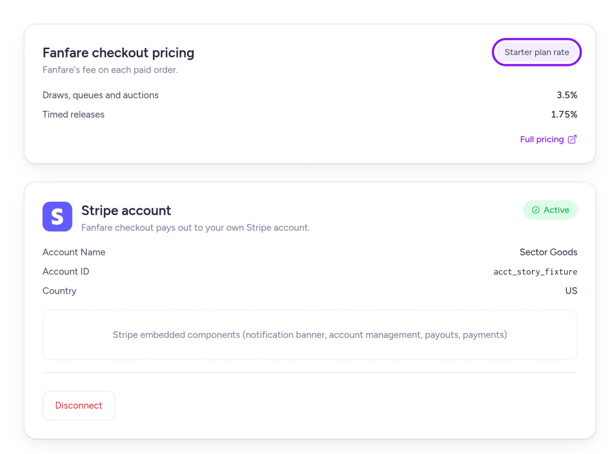
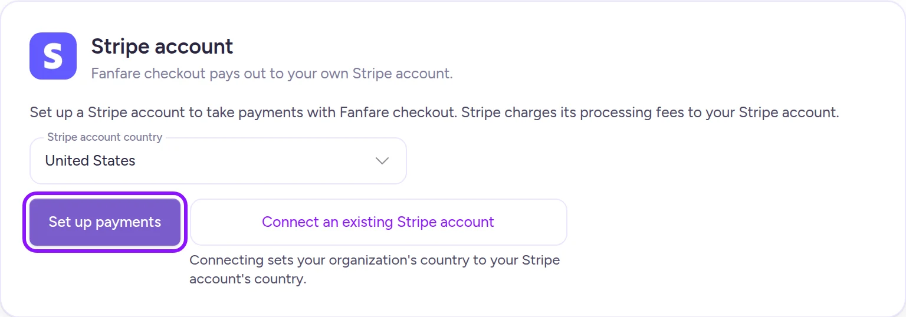
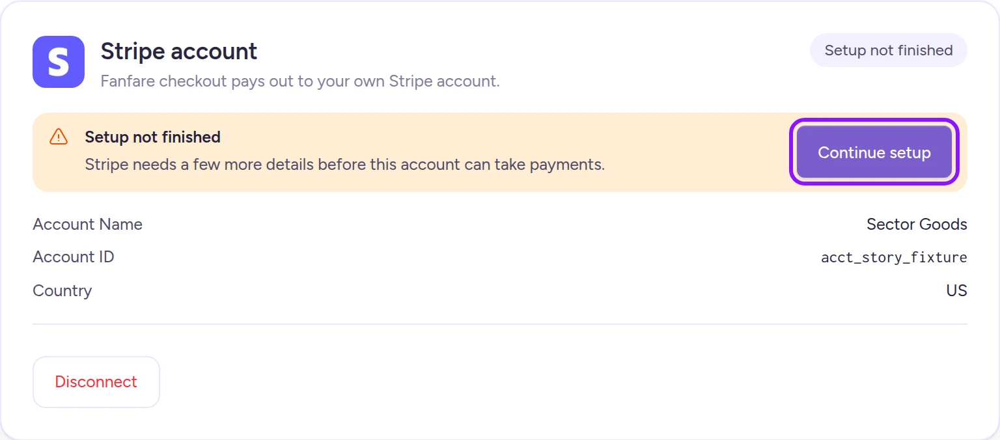

**Settings → Payments**, in the **Commerce** group, is where you connect the Stripe account that Fanfare checkout pays out to, and where you see the fee Fanfare takes from each paid order. You need it only when your checkout processor is Fanfare: customers pay on Fanfare's checkout, and the money goes to your Stripe account. Choosing the processor is covered in [Organisation settings](/guide/account/organization), and what each kind of checkout means for your customers is in [Checkout options](/concepts/checkout-options).

## Before you start

- You are an organisation admin. Members can read this page but cannot connect, manage or disconnect the Stripe account.
- Fanfare checkout works only with a US Stripe account charging US dollars.
- Connect Stripe before you create experiences. The organisation setup screen says so: "Sell through Fanfare. Connect Stripe before you create experiences." Until your Stripe account can take payments, Fanfare refuses to create a queue, draw, auction or timed release. Appointments are not affected.
- Set your organisation's **Currency** to USD in [Organisation settings](/guide/account/organization) first. Creating or connecting a Stripe account sets your organisation's country to the account's country, and after that neither the country nor the currency can change.

<Frame caption="The pricing card shows what Fanfare takes from each paid order; the Stripe account card shows where the money goes.">
  
</Frame>

## Read your fee

The **Fanfare checkout pricing** card ("Fanfare's fee on each paid order.") shows the rates that apply to your organisation.

- The badge says where the rates come from: "Starter plan rate", "Growth plan rate", "Pro plan rate" or "Enterprise plan rate" for your plan's published rates, or "Custom rate" when Fanfare has agreed a rate with you.
- **Draws, queues and auctions** is the percentage taken on orders from those three distributions.
- **Timed releases** is the percentage taken on timed-release orders.
- **Minimum fee per order** appears only on a custom rate that carries a minimum.
- When orders paid through Shopify checkout are charged a different rate, the card splits into **On Fanfare checkout** and **On Shopify checkout**.
- **Full pricing** opens the public price list.

Each plan's percentages are listed in [Plans and what they unlock](/guide/start/plans). Fees by billing period are on the Usage page: see [Billing and usage](/guide/account/billing).

### How the fee works

- The fee is a percentage of each paid order. With a minimum fee per order, Fanfare takes whichever is larger, and never more than the order itself.
- It is deducted from the payment in Stripe when the payment is taken; for a pre-authorised hold, that is when the hold is captured. Fanfare never invoices you for it, and your subscription invoice does not include it.
- Each order keeps the rate in effect when it was paid. If you change plan partway through a billing period, orders already paid are not re-rated.
- Appointments carry no fee.
- Stripe charges its own processing fees to your Stripe account, separately from Fanfare's fee.
- A custom rate applies on every plan and stays in place when you change plan, so upgrading does not lower it.
- On each order, the fee appears as **Fanfare fee** on the order's **Payment** card once the payment has been captured. A distribution's payment settings also state the fee for that distribution: see [Admission and the payment window](/concepts/admission-and-payment).

A refund does not return the Fanfare fee. See [Orders and refunds](/guide/learn/orders).

## Choose how to connect

You can connect Stripe in two ways.

| | Created through Fanfare | Your own Stripe account |
| --- | --- | --- |
| How you connect | **Set up payments**, then Stripe's onboarding | **Connect an existing Stripe account**, then authorise Fanfare in Stripe |
| Where you finish setup | **Continue setup** on this page | Your own Stripe Dashboard (**Open Stripe Dashboard**) |
| Where you manage payouts, bank details and disputes | On this page, in **Account and bank details**, **Payouts** and **Payments and disputes** | Your own Stripe Dashboard |
| After **Disconnect** | The account stays tied to your organisation, but you can no longer see its payouts, balance, bank details or disputes, because these accounts have no Stripe Dashboard of their own. **Set up payments** brings the same account back. | You can reconnect only the same account, with **Connect an existing Stripe account**. Fanfare cannot create a new account for you. |

<Warning>
  Selecting **Create account** locks your organisation's country and currency and ties your organisation to that new Stripe account at once, even if you never finish Stripe's onboarding. From then on you cannot connect a Stripe account you already have, even after you disconnect. Connecting your own account locks the same way, and no other account can replace it later. Decide which way to connect before you select **Create account**. The confirmation warns about the country only; the currency is locked too.
</Warning>

<Frame>
  
</Frame>

## Create a Stripe account through Fanfare

1. Go to **Settings → Payments**.
2. Under **Stripe account country**, check the country. Only United States is offered.
3. Select **Set up payments**.
4. Read the confirmation, "Create your Stripe account in United States?", which says: "Your organization's country becomes United States. Stripe accounts can't move between countries, so your organization's country can't change after this."
5. Select **Create account**. Stripe's onboarding opens.
6. Complete Stripe's onboarding. Stripe sends you back to **Settings → Payments**.

If Stripe has finished checking the account, you see "Stripe account connected successfully". The badge then says whether anything is still needed: see [Account states](#account-states). If the onboarding link had expired, the page reopens Stripe's onboarding for you when you come back.

{/* image: guide-account-payments-create-account-confirm */}

## Connect a Stripe account you already have

1. Go to **Settings → Payments**.
2. Select **Connect an existing Stripe account**. Stripe opens.
3. Authorise Fanfare in Stripe.
4. Stripe sends you back to **Settings → Payments**.

Connecting sets your organisation's country to your Stripe account's country, and the same permanent lock applies as for an account created through Fanfare (see the warning above).

If Fanfare cannot accept the account, you see "Your Stripe account wasn't connected" with one of these reasons:

| Reason shown | What to do |
| --- | --- |
| "Connection was cancelled or denied." | Start again and authorise Fanfare in Stripe. |
| "Invalid connection state. Please try again." | Start again from **Connect an existing Stripe account**. |
| "Failed to connect Stripe account. Please try again." | Try again. |
| "Fanfare checkout isn't available for Stripe accounts in this country yet." | Use a US Stripe account. |
| "Fanfare checkout is available for organizations that use US dollars with a US Stripe account." | Make sure your organisation's currency is USD and your Stripe account's default currency is US dollars, then connect again. |
| "This Stripe account can't accept card payments yet. Finish its setup in Stripe, then connect it again." | Finish the account's setup in Stripe, then connect again. |
| "This organization is tied to a different Stripe account than the one you chose. Connect that account instead, or contact support." | Connect the account your organisation used before. |
| "An error occurred. Please try again." | Try again. |

## Account states

The **Stripe account** card ("Fanfare checkout pays out to your own Stripe account.") shows a badge once an account exists.

| Badge | What it means | What to do |
| --- | --- | --- |
| "Setup not finished" | "Stripe needs a few more details before this account can take payments." | **Continue setup** for an account created through Fanfare. **Open Stripe Dashboard** for your own account. |
| "Action needed" | "Stripe needs more information." Payments or payouts can pause until you provide it. | For an account created through Fanfare, update the details Stripe asks for in the sections below the notice. For your own account, **Open Stripe Dashboard**. |
| "Active" | The account can take payments. | Nothing. |

If you removed Fanfare's access from your own Stripe account, the badge also reads "Setup not finished". Select **Disconnect**, then connect the same account again with **Connect an existing Stripe account**.

The card lists the account's **Account ID**, and its **Account Name**, **Email** and **Country** when Stripe has them.

<Frame>
  
</Frame>

## Manage payouts, bank details and disputes

- **An account created through Fanfare:** once it is "Action needed" or "Active", the Stripe account card shows **Account and bank details**, **Payouts** and **Payments and disputes**, with any notices from Stripe above them. Only admins see these sections.
- **Your own Stripe account:** the card says "You manage this account's payouts, bank and business details in your own Stripe Dashboard." Select **Open Stripe Dashboard**.

## Disconnect Stripe

1. On the **Stripe account** card, select **Disconnect**.
2. Read the confirmation, "Disconnect Stripe Account?": "This will remove the connection between your Fanfare organization and your Stripe account. You will no longer be able to process payments until you set up payments again."
3. Select **Disconnect**.

<Warning>
  Disconnecting stops Fanfare checkout taking new payments at once, including for experiences that are live or scheduled. Fanfare does not check whether any are running before it disconnects. A customer who has been admitted but has not paid yet cannot complete payment: checkout shows "An unexpected error occurred." and offers no way to try again. New customers cannot enter a distribution that pre-authorises payment. Despite the wording of the confirmation, you cannot set up payments with a different Stripe account afterwards: you can reconnect only the same one. Your organisation's country and currency stay locked.
</Warning>

To bring back an account created through Fanfare, select **Set up payments**. The confirmation still says "Create your Stripe account", but no new account is created, and Stripe's onboarding opens again so you can confirm the details.

## What members see

A member who is not an admin sees "Only organization admins can connect, manage or disconnect the Stripe account." They can read the pricing card, the account's badge and its details, but get no **Set up payments**, **Connect an existing Stripe account**, **Continue setup** or **Disconnect**, and no payout or bank sections. For an account you connected yourself, **Open Stripe Dashboard** still appears.

To make someone an admin, see [Team members](/guide/account/team).

## On Shopify

Taking payments with Fanfare checkout is not available in the Fanfare app in Shopify. Orders there are paid through Shopify checkout: see [Orders with Shopify checkout](/guide/shopify/orders) and [Checkout protection](/guide/shopify/checkout-protection).

**Settings → Payments** in the Fanfare app in Shopify shows "Taking payments with Fanfare checkout isn't available in the Shopify app yet. Your plan's checkout rates are below.", a disabled **Connect Stripe Account** button with a "Coming soon" badge, and the **Fanfare checkout pricing** card.

<Warning>
  If a Stripe account was connected earlier, the Fanfare app in Shopify still offers **Disconnect**. Once you use it, you cannot reconnect from the Shopify app.
</Warning>

{/* image: guide-account-payments-on-shopify */}

## Troubleshooting

<AccordionGroup>
  <Accordion title="Set up payments shows an error">
    "Fanfare checkout is available for organizations that use US dollars with a US Stripe account." means your organisation's currency is not USD. Change it in [Organisation settings](/guide/account/organization) and try again. "This organization uses its own Stripe account, so Fanfare can't set one up for it. Use Connect an existing Stripe account instead." means your organisation was connected to your own Stripe account before: reconnect that account with **Connect an existing Stripe account**.
  </Accordion>
  <Accordion title="I came back from Stripe and nothing says connected">
    The confirmation appears only when the account can take payments. Look at the badge on the **Stripe account** card: "Setup not finished" or "Action needed" tells you what Stripe still wants. If you have just finished Stripe's steps and the badge still reads "Setup not finished", refresh the page, because the badge can take a moment to catch up.
  </Accordion>
  <Accordion title="I can't change my organisation's country or currency">
    Both are locked for good once you select **Create account** or connect your own Stripe account, including after **Disconnect**. There is no way to unlock them in the admin. The currency can also be refused for other reasons, such as auctions that exist: see [Organisation settings](/guide/account/organization).
  </Accordion>
  <Accordion title="The page says account management is unavailable">
    "Account management is unavailable right now. Please try again later." appears in place of the payout and bank sections when Fanfare cannot open them. Try again later, and contact support if it persists.
  </Accordion>
</AccordionGroup>

## Related

<CardGroup>
  <Card title="Organisation settings" href="/guide/account/organization">
    Choose the checkout processor and set the country and currency.
  </Card>
  <Card title="Checkout options" href="/concepts/checkout-options">
    Fanfare checkout, your own checkout and Shopify checkout compared. Auctions need a checkout that charges the winning bid.
  </Card>
  <Card title="Plans and what they unlock" href="/guide/start/plans">
    Each plan's checkout rates.
  </Card>
  <Card title="Orders and refunds" href="/guide/learn/orders">
    The Fanfare fee on an order, refunds and cancellations.
  </Card>
</CardGroup>
