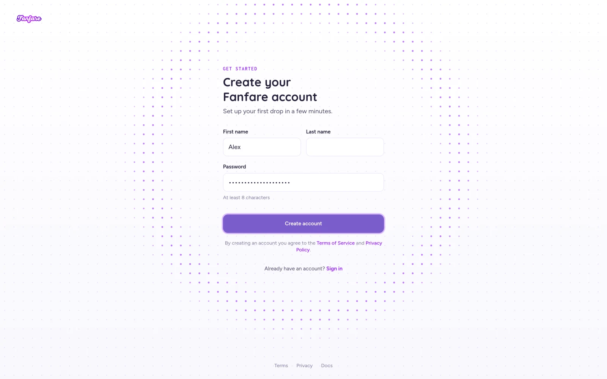
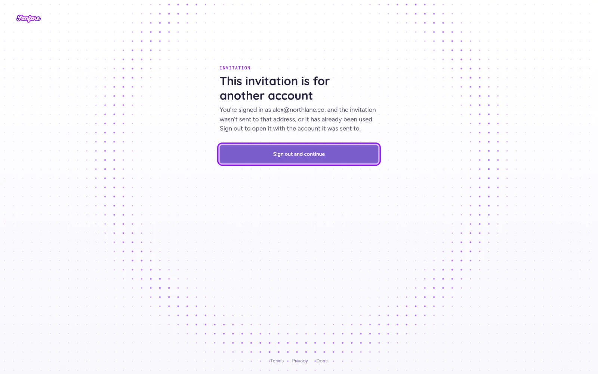

Everyone who works on your drops can have their own sign-in to the Fanfare admin. You invite them by email from the **Account** dialogue, and each person joins your organisation as an admin or a member. Members can run most of Fanfare day to day. An admin is needed for payments, billing, developer settings, the email sender, text messaging, building and publishing experience pages, and deactivating a live experience. On the Fanfare app in Shopify, none of this applies: see [On Shopify](#on-shopify).

## Before you start

- You are signed in to the Fanfare admin at admin.fanfare.io.
- You know the email address your colleague will sign in with.

## Where team management lives

Team management is not under **Settings**. Open the user menu at the foot of the sidebar (your name and email) and choose **Account**. Despite its name, **Account** opens your organisation's profile, with its members and invitations. Your own sign-in details are under **Profile** in the same menu.

{/* image: guide-account-team-user-menu-account */}

The rest of the user menu and the admin's layout are covered in [A tour of the admin](/guide/start/tour-of-the-admin).

## Invite a team member

1. Open the user menu at the foot of the sidebar and choose **Account**.
2. Go to the organisation's members.
3. Send an invitation to your colleague's email address.

{/* image: guide-account-team-account-dialog */}

Your colleague receives an email with a link. What they do next is in [Accept an invitation](#accept-an-invitation).

Fanfare's plans do not limit the number of team members.

## Admins and members

Fanfare acts on two roles: admin and member. The person who created the organisation is an admin.

| Action | Admin | Member |
| --- | --- | --- |
| Change the checkout processor (**Settings → Organization**) | Yes | No |
| Edit allowed origins in **Settings → Embedding** | Yes | No |
| **Rotate secret key** in **Settings → API Keys** | Yes | No |
| Connect, manage or disconnect the Stripe account (**Settings → Payments**) | Yes | No |
| Change plan, cancel, reactivate, open the billing portal | Yes | No: sees **Billing** read-only |
| Change the email sender, or see, add, check or remove a sending domain (**Settings → Email Sender**) | Yes | No: sees the sender read-only |
| Any Twilio action: connect, edit, disconnect | Yes | No |
| Finish connecting Meta, Discord or Telegram | Yes | No: can start, and is refused at the last step |
| Create an experience's page, change or reset its template, save or publish the page, or archive it | Yes | No: can open the page editor read-only |
| **Deactivate** an experience, sequence or distribution | Yes | No: sees the button and is refused |
| Edit company name, website, subdomain, country, currency, time zone, language and default channel | Yes | Yes |
| Connect Klaviyo, Mailchimp or Google Analytics; disconnect any integration other than Twilio | Yes | Yes |
| Refund or cancel an order; return items to stock | Yes | Yes |
| Everything else: experiences, sequences, products, audiences, announcements, Design Studio templates | Yes | Yes |

<Warning>
  Members, not only admins, can change what customers see. A member can rename the company, change the subdomain (the address customers use), the currency, the time zone and the default channel, and the change reaches customers' pages within moments. See [Organisation settings](/guide/account/organization) for what each setting does. Any member can also refund and cancel orders: see [Orders and refunds](/guide/learn/orders). A member can also disconnect Meta, Discord or Telegram, and any posts scheduled through that account will not go out. Invite people as members only if you trust them with these. Admin is still needed for the checkout processor and payments.
</Warning>

For the detail of each area, see [Billing and usage](/guide/account/billing), [Payments and fees](/guide/account/payments) and [Integrations](/guide/account/integrations).

## Change a member's role or remove them

Fanfare has no screen of its own for this. Membership is managed from **Account** in the user menu.

## Accept an invitation

Open the link in the invitation email. What happens depends on whether you already have a Fanfare account.

<Warning>
  The Fanfare admin works with one organisation at a time and has no way to switch between them. You cannot create a second organisation. If you already run your own Fanfare organisation and accept an invitation with the same email, you may not be able to choose which one opens when you next sign in, so ask to be invited with a different email address.
</Warning>

### You are new to Fanfare

1. Open the link in the invitation email. A sign-up form opens. It asks only for your name and a password: the email address is the one the invitation was sent to, and there is no Google option.
2. Enter **First name**, **Last name** and **Password** (at least 8 characters).
3. Select **Create account**.
4. Fanfare shows "Setting up your workspace..." and then opens the admin on the organisation that invited you. You are not asked to name or create an organisation.

<Frame caption="An invitation link asks only for your name and a password.">
  
</Frame>

### You already have an account

1. Open the link in the invitation email.
2. Fanfare shows "Accepting your invitation…" and then opens the admin on the organisation that invited you.

If your account uses two-step verification, you are asked for your authenticator code or a backup code, and then the admin opens on the organisation that invited you.

## Sign in

The **Sign in to Fanfare** screen offers several ways in.

| Method | What you do |
| --- | --- |
| Password | Enter **Work email** and **Password**, then **Sign in**. |
| Emailed code | Enter **Work email**, select **Email me a code**, and type the 6-digit code from the email. The screen says the code expires in 10 minutes. |
| Passkey | Select **Use a passkey**. In browsers that support it, you can also pick a saved passkey when you click into the **Work email** field. |
| Google | Select **Continue with Google**. |

If two-step verification is on for your account, after your password or emailed code you see **Two-step verification**. Enter the 6-digit code from your authenticator app, or select **Use a backup code** and enter one of the backup codes you saved, then select **Verify**.

After signing in you land on the page you were trying to open, or on **Home**.

6-digit code fields submit on their own when you type the sixth digit, and a wrong code is cleared so you can type it again. A backup code needs **Verify**.

<Note>
  Two-step verification here works with an authenticator app or backup codes only. An account whose only second step is a text message cannot finish signing in.
</Note>

<Note>
  If your password has appeared in a known data breach, Fanfare will not let you sign in with it. Reset your password using the steps below.
</Note>

### Reset a forgotten password

1. On the sign-in screen, select **Forgot password?**.
2. Enter your **Work email** and select **Send reset code**.
3. Type the 6-digit code from the email and select **Continue**.
4. Enter a **New password** of at least 8 characters.
5. Leave **Sign out of all other devices** ticked to sign out everywhere else, or untick it to stay signed in on your other devices. It is ticked by default.
6. Select **Update password and sign in**.

If two-step verification is on, you are asked for your second step before you reach the admin.

### Your own account and signing out

Your password and sign-in methods are under **Profile** in the user menu. To sign out, choose **Sign Out** in the same menu.

New to Fanfare and not invited by anyone? Create your own account and organisation: see [Your first drop](/guide/start/your-first-drop).

## On Shopify

The Fanfare app in Shopify has no invitations, members or roles. There is no **Account**, **Profile** or **Sign Out** inside the app: who can open it is decided by your store's staff permissions in Shopify. See [Fanfare in Shopify](/guide/shopify/overview).

<Warning>
  On Shopify, everyone who can open the Fanfare app has admin powers in Fanfare. That includes rotating the secret key, changing the checkout processor and **Embedding**, connecting integrations and publishing experience pages. Messages elsewhere in this guide that say "ask an admin" do not apply. Limit who can open the app in Shopify accordingly.
</Warning>

## Troubleshooting

<AccordionGroup>
  <Accordion title="This invitation is for another account">
    You are signed in as someone other than the person the invitation was sent to. Select **Sign out and continue**. Fanfare signs you out and carries on with the invitation, so you can accept it with the account it was sent to. If you have already accepted the invitation, you do not need a new one: sign in with the account it was sent to.

    <Frame>
  
</Frame>
  </Accordion>
  <Accordion title="This invitation can't be used">
    The invitation may have expired or been revoked. Ask whoever invited you to send a new one.
  </Accordion>
  <Accordion title="Setting up your workspace... appears, then you are signed out">
    Fanfare could not open your organisation and signed you out without saying why. Sign in again.
  </Accordion>
</AccordionGroup>

## Related

<CardGroup>
  <Card title="Organisation settings" href="/guide/account/organization">Company details, subdomain, region and checkout.</Card>
  <Card title="Billing and usage" href="/guide/account/billing">Plans, and who can change them.</Card>
  <Card title="Integrations" href="/guide/account/integrations">Which connections need an admin.</Card>
  <Card title="A tour of the admin" href="/guide/start/tour-of-the-admin">The sidebar, the user menu and where things live.</Card>
</CardGroup>
