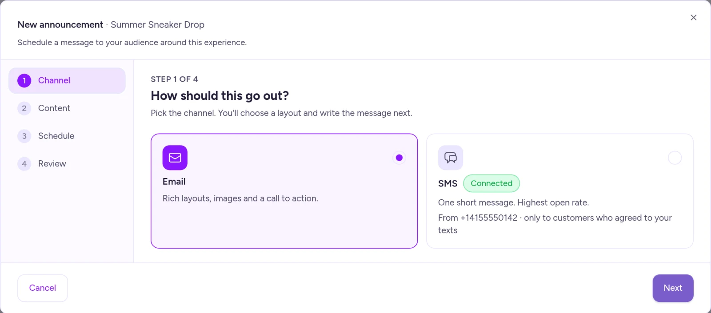
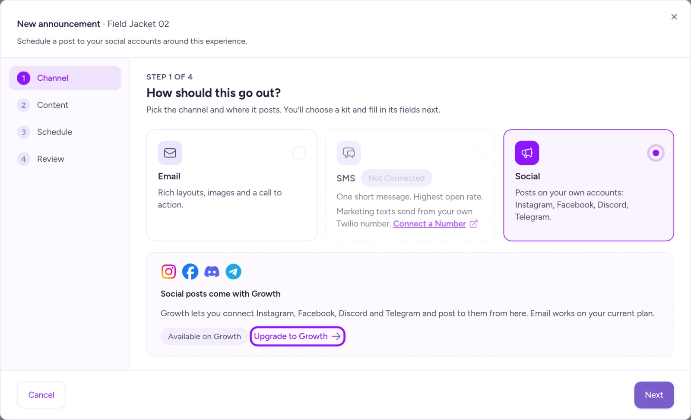

Announcements are the messages you write yourself to tell customers about a drop: an email, a text, or a post on your own social accounts. You schedule each one for a fixed time or a set time before or after something in the experience, such as a distribution opening. They live in the experience's **Marketing Hub**.

## Before you start

- For email: a postal address saved in **Settings → Email Sender**. Fanfare will not schedule an email announcement without it. See [Sender identity and sending domain](/guide/create/email-sender).
- For SMS: your own Twilio number, connected in **Settings → Integrations**. Connecting Twilio needs the Growth plan.
- For social posts: at least one connected Instagram, Facebook, Discord or Telegram account, also on Growth. See [Integrations](/guide/account/integrations) for both.

## Find your announcements

Open **Experiences**, choose the experience, and select **Marketing Hub** in its side menu. The experience's Overview page shows a shorter, read-only list with its own **Schedule** button.

The list is grouped:

| Group | What is in it |
| --- | --- |
| **Needs attention** | Social posts where at least one account failed, was skipped, or may have posted |
| **Up next** | Everything still to go out, soonest first |
| **Recently sent** | What has gone out |
| **Won't send** | Sends that will not go out: a deactivated distribution, a turned-off invite, a send that failed (with the reason on the row), or a send whose time passed more than 24 hours ago |
| **Cancelled** | Social posts you cancelled |

A **Draft** badge does not mean unsaved: the send time cannot be worked out yet, because whatever the announcement is anchored to has no time.

Each sequence also has an **Announcements** tab listing that sequence's announcements. You can schedule email and SMS there, but not social posts.

The Marketing Hub also lists each sequence's invite; the automatic waitlist message shows on the Overview instead. Both work differently: see [Invites, waitlist and access-code sends](/guide/create/invites-and-waitlist).

<Frame caption="The Marketing Hub lists the announcements for an experience, with the selected announcement's details beside it.">
  
</Frame>

## Schedule an email

1. In the **Marketing Hub**, select **Schedule**. The **New announcement** dialogue opens on the **Channel** step.
2. Choose **Email** and select **Next**.

   <Note>
     Social posts need the Growth plan. On Starter, choosing **Social** shows "Social posts come with Growth" and you cannot continue. Texts and posts already scheduled still go out after a move to a lower plan, while their accounts stay connected. On a lower plan, **Cancel and copy** cancels the post but the copy cannot be scheduled.
   </Note>

   <Note>
     If no postal address is on file, the **Channel** step says so when you choose **Email**. You can keep writing, but **Create** stays unavailable on **Review** until you add one with **Add your postal address**, which opens **Settings → Email Sender** in a new tab. Until then the preview shows a stand-in address.
   </Note>

3. On the **Content** step, choose a layout and fill in its fields. A live preview updates as you type.
   - **Simple:** **Headline** and **Body**.
   - **Big CTA:** adds a button, with **Button label** and **Button link**.
   - **Image-led:** adds an **Image**, which needs a description for people who cannot see it, and a button.

   The **Headline** becomes the email subject, up to 60 characters. A **Button label** can be up to 40.

4. Select **Next**. On the **Schedule** step, under "When to send", choose one:
   - **A specific date and time**, with a time zone.
   - **Relative to an event**. Under **Anchor to**, choose **The experience** or **A distribution** (and which one). Pick the moment, such as **Experience starts** or **Distribution opens**, then the amount, the unit (minutes, hours or days), and before or after.

   A card under your answers shows the send time Fanfare has worked out. You cannot schedule a time that has already passed: the card says "This time has already passed" (or "Too far in the past to send" for a relative time more than 24 hours back), and **Next** stays unavailable until you pick a later time.

   Below the card, "Already scheduled near here" lists other sends within a day of this one and flags any "Within the hour".

5. Under "Who receives this", tick **Audience**, **Waitlist**, or both (at least one). Despite its description, "Everyone signed up to this experience.", **Audience** reaches the members of the sequences' audiences, entered or not: every sequence in the experience, or only the one whose **Announcements** tab you scheduled from. If those sequences have no audience, it reaches no one. **Waitlist** reaches everyone on their waitlists. No one gets two copies. See [Audiences](/concepts/audiences) and [Waitlists](/concepts/waitlists).

6. Select **Next**. On the **Review** step, check the message in the **Inbox**, **Desktop** and **Mobile** views, and the summary.
7. Optionally, [send yourself a test](#send-yourself-a-test).
8. Select **Create**. The announcement appears in **Up next** with its send time.

### Schedule step settings

| Setting | What it does | Default | Can you change it once it is live? |
| --- | --- | --- | --- |
| **When to send** | A fixed time, or a time set against the experience or one of its distributions | **A specific date and time** | Until it sends. After that, saving any change needs a new send time in the future, and can send it again (see the warning under [Edit an announcement](#edit-an-announcement)) |
| Time zone | The zone a fixed date and time is read in | The experience's time zone | Until it sends, as above |
| **Anchor to** | **The experience** or **A distribution** | None | Until it sends, as above |
| **Relative to** | The moment: **Experience starts** or **Experience ends**; for a distribution **Distribution opens**, **Distribution closes**, **Draw time** or **Auction settles** | None | Until it sends, as above |
| Amount, unit, before or after | How far from that moment | Hours, before | Until it sends, as above |
| **Who receives this** | Sends to the experience's **Audience**, its **Waitlist**, or both | **Audience** ticked | Until it sends, as above |

<Frame caption="The Headline becomes the email subject.">
  
</Frame>

<Frame>
  
</Frame>

## Schedule a text message

Follow the email steps, with these differences.

- On the **Channel** step, choose **SMS**. When Twilio is connected, the card shows the number texts send from and "only to customers who agreed to your texts". If it cannot be chosen, see [Troubleshooting](#troubleshooting).
- SMS has one layout, **Standard**, with one field, **Message**. Every text starts with your brand name, set in your Twilio connection (see [Integrations](/guide/account/integrations)), and ends with an opt-out line, so room for both is held back. The counter under the field shows how much room you have. A single emoji or curly quote anywhere in the message cuts that room by more than half.

<Frame>
  
</Frame>

## Schedule a social post

A social post goes to the followers of each account you pick, so there is no audience to choose. You can schedule one only from the experience (the **Marketing Hub** or the Overview list), not from a sequence.

1. Select **Schedule**, choose **Social**, and under "Publishes to" tick each account and format, such as an Instagram **Feed post** or **Story**, a Facebook **Page post**, a Discord **Message** or a Telegram **Channel post**. Select **Next**.
2. Choose a **Kit**: **Countdown card**, **Photo-led**, or one of your own kits made in Design Studio (see [Templates](/guide/create/templates)).
3. Choose the **Moment** the post is about: **Announced**, **Reminder**, **Live**, **Closing** or **Closed**. A post that has not gone out by its moment's deadline is skipped, not posted late.

   | Moment | Skipped if not posted by |
   | --- | --- |
   | **Announced**, **Reminder** | the experience opening |
   | **Live**, **Closing** | the experience closing |
   | **Closed** | 24 hours after the experience closes |

   A moment whose open or close time is not set yet shows "Needs the experience's open or close time" and cannot post.

   With **Countdown card** and **Photo-led**, **Reminder** and **Closing** leave out Instagram **Feed post** and Facebook **Page post**, even if ticked; those show "Not posted at" the moment.

4. Select **Next**, then fill in the post: **Hook** (optional), and a **Photo** with its **Alt text**. Photo-led needs a photo; on Countdown card it is optional. Select **Next**.
5. Set when it posts: **A specific date and time**, or **Relative to an event** (relative to the experience only). A time at or after the moment's deadline is refused.
6. On **Review**, look through each post.

   <Warning>
     Social posts are public, and there is no test post. You can cancel a scheduled post only until shortly before its post time (the time is shown under "Good to know"), and a cancelled post cannot be restored.
   </Warning>

7. Select **Schedule**.

<Frame caption="On Starter, social posts need an upgrade.">
  
</Frame>

## Send yourself a test

On the **Review** step of an email, select **Send test** under "Send yourself a test". The test goes only to the email address you sign in with, shown beside "Goes to". After each test you wait 30 seconds before you can send another.
## Edit an announcement

Select the row, then **Edit**. The wizard opens on **Review**. Select a step to change it, then select **Save**.

- An announcement keeps the channel it was created on. To switch channel, create a new one.
- If you change the layout, fields the new layout also has (such as **Headline** and **Body**) keep what you wrote. Fields it does not have are cleared, and are empty if you switch back.
- Social posts cannot be edited. Use **Cancel and copy** instead (below).

<Warning>
  Once an announcement has gone out, you can save an edit to it (even a wording fix) only with a new send time in the future. A fixed-time announcement then sends again to everyone. A relative one sends again only if its new time is further from its last send time than the amount it is set before or after (for one set a day before, more than a day). Otherwise nothing more is sent.
</Warning>

A relative announcement follows what it is set against. If you move the distribution or the experience, the send time moves too. If you deactivate the distribution before the announcement has gone out, it moves to **Won't send** with "was deactivated".

<Warning>
  Moving the experience or distribution earlier can put the send time in the past. If the new time is less than 24 hours ago, the announcement sends straight away; if it is 24 hours or more ago, it never sends and moves to **Won't send**. Once it has gone out, moving the experience or distribution by more than the announcement's own offset (for example, more than a day for one set to send a day before) sends it again to everyone.
</Warning>

## Delete or cancel

- Email or SMS: select the row, open the **More** menu and choose **Delete**. The confirmation reads "It won't be sent. This can't be undone." Invites cannot be deleted, but you can turn one off: see [Invites, waitlist and access-code sends](/guide/create/invites-and-waitlist).
- Social post: select the row. **Copy to another moment**, on the detail card, opens a copy for a different moment; the original stays scheduled. To stop the post, open the **More** menu:
  - **Cancel** stops every post in it. "None of its posts will go out. This can't be undone."
  - **Cancel and copy** cancels it and opens a copy with the same settings for you to change. If you close the copy without scheduling it, the original stays cancelled.

## Things to know before you go live

- Text messages reach only customers who agreed to your marketing texts and have not opted out. Emails skip customers who unsubscribed from your marketing email. Anyone with no email address or phone number for that channel is skipped. See [What customers see](/guide/drop/what-customers-see).
- Disconnecting a social account means its scheduled posts will not go out. See [Integrations](/guide/account/integrations).

## On Shopify

The Fanfare app in Shopify differs in two ways.

- Test emails go to your Shopify staff account's email address, and only if Shopify has verified it. If it has not, the **Review** step says "We do not have an address for you to send a test to." and **Send test** is unavailable.
- Connecting Meta or Discord opens their consent screen in the full browser window, then returns you to Shopify admin. See [Integrations](/guide/account/integrations).

## Troubleshooting

<AccordionGroup>
  <Accordion title="A row shows a Didn't send line">
    The line gives the reason. For an email or text you scheduled, fix it, then open the announcement, set a new send time in the future, and save it: it does not go out on its own once fixed.
    - "your postal address isn't set in Settings → Email sender": add the address in **Settings → Email Sender**.
    - "your Twilio number isn't connected or needs attention in Settings → Integrations": reconnect Twilio there.

    An invite works differently: once you fix the cause, it tries again by itself. See [Invites, waitlist and access-code sends](/guide/create/invites-and-waitlist).
  </Accordion>
  <Accordion title="There is no Social option">
    Social is offered only when you create an announcement from the experience, not when you edit one or schedule from a sequence's **Announcements** tab. On Starter it needs an upgrade: see the note under [Schedule an email](#schedule-an-email).
  </Accordion>
  <Accordion title="I can't choose SMS">
    The SMS card cannot be chosen when no Twilio number is connected, when Twilio needs reconnecting, or when Fanfare could not check the connection. If the card says "You can write this now, but texts won't send until Twilio is reconnected.", you can still schedule the text. Reconnect Twilio before its send time, or it does not send and needs a new time.
  </Accordion>
  <Accordion title="The send time has already passed">
    To send as soon as possible, choose a time a few minutes from now.
  </Accordion>
  <Accordion title="A social post is under Needs attention">
    Select the row to see each post. Use **Reconnect** if the account needs reconnecting, or **View post** to check what went out. For "May have posted", check the account before doing anything else.
  </Accordion>
</AccordionGroup>

## Related

<CardGroup>
  <Card title="Invites, waitlist and access-code sends" href="/guide/create/invites-and-waitlist" />
  <Card title="Sender identity and sending domain" href="/guide/create/email-sender" />
  <Card title="Integrations" href="/guide/account/integrations" />
  <Card title="What customers see" href="/guide/drop/what-customers-see" />
  <Card title="Performance" href="/guide/learn/performance" />
</CardGroup>
