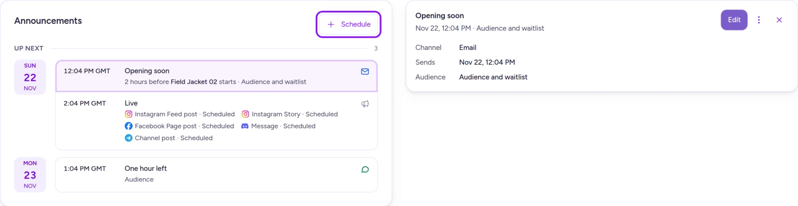
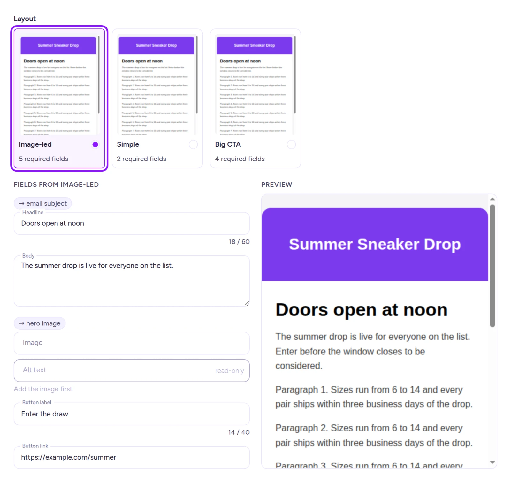
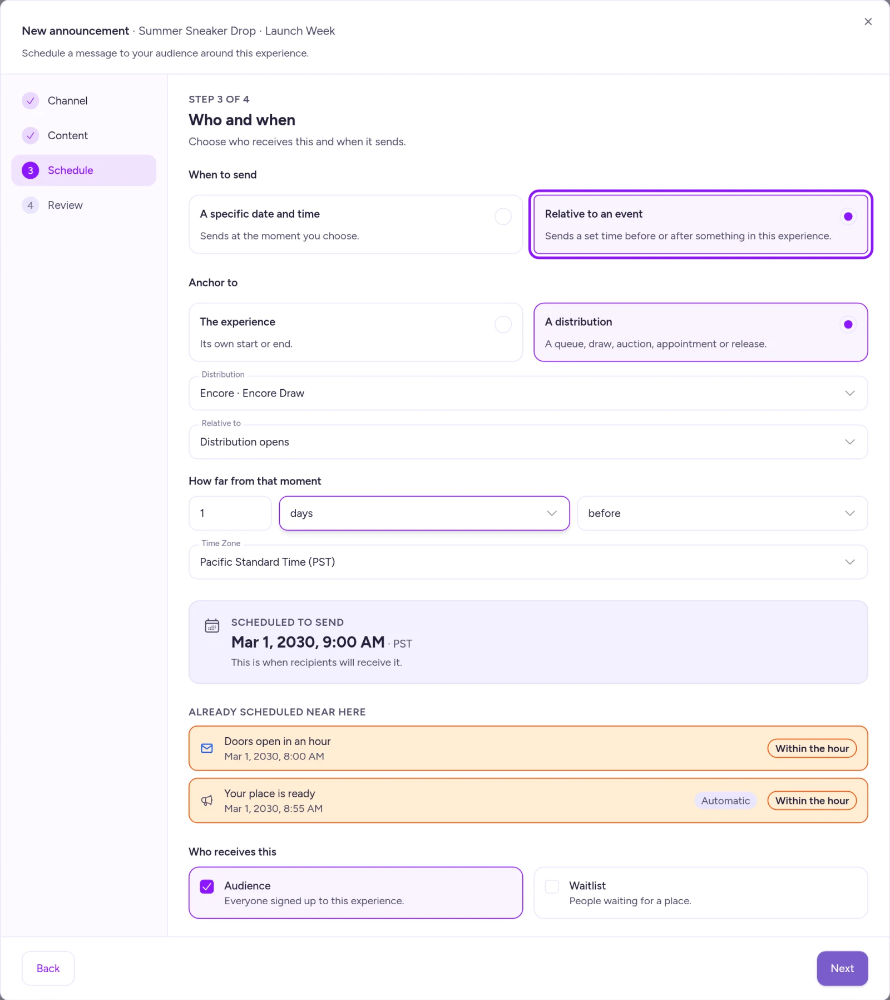

Build anticipation before doors open and remind shoppers as a drop goes live or closes. From your experience's **Marketing Hub**, you can schedule emails, SMS texts, and social posts—either at an exact date and time or anchored to key moments like when a distribution opens.

## Before you start

- **Email:** Save a business postal address under **Settings → Email Sender** (required before scheduling any email announcement). See [Sender identity and sending domain](/guide/create/email-sender).
- **SMS:** Connect your Twilio number under **Settings → Integrations** (Growth plan and above).
- **Social posts:** Connect at least one Instagram, Facebook, Discord, or Telegram account under **Settings → Integrations** (Growth plan and above). See [Integrations](/guide/account/integrations) for both SMS and social setup.

## Find and track your announcements

Go to **Experiences**, open your experience, and select **Marketing Hub** in the sidebar. (The experience's **Overview** page also shows a quick read-only preview with a **Schedule** button.)

Announcements are grouped by status:

| Group | What's inside |
| --- | --- |
| **Needs attention** | Social posts where at least one account failed, was skipped, or has an unconfirmed status. |
| **Up next** | Scheduled messages waiting to go out, soonest first. |
| **Recently sent** | Messages that have already gone out. |
| **Won't send** | Messages that won't send—for example, a deactivated distribution, a paused invite, a failed send (with the reason shown on the row), or a relative send whose time passed more than 24 hours ago. |
| **Canceled** | Social posts you canceled. |

A **Draft** badge means the announcement is saved, but its send time can't be calculated yet because the event it's anchored to doesn't have a scheduled time yet.

You can also view and schedule sequence-specific emails and texts on a sequence's **Announcements** tab (social posts are always scheduled at the experience level).

The **Marketing Hub** also shows each sequence's automatic audience invite, while automatic waitlist notifications appear on the experience **Overview**. See [Invites, waitlist and access-code sends](/guide/create/invites-and-waitlist) for how those work.

<Frame caption="Review all scheduled emails, texts, and social posts in the experience's Marketing Hub.">
  
</Frame>

## Schedule an email

<Steps>
  <Step title="Choose Email">
    In the **Marketing Hub**, select **Schedule** to open **New announcement**, choose **Email**, and select **Next**.

    <Note>
      Social posts require the Growth plan or above. If you downgrade after scheduling texts or social posts, existing scheduled sends still go out while your accounts remain connected, though creating new social posts (or scheduling copies after **Cancel and copy**) requires Growth.
    </Note>

    <Note>
      If you haven't saved a postal address yet, you can still draft your email, but **Create** won't unlock on **Review** until you select **Add your postal address** to save one in **Settings → Email Sender** (the preview shows a placeholder address until then).
    </Note>
  </Step>
  <Step title="Write your message">
    On the **Content** step, pick a layout and fill in the fields while watching the live preview update:
    - **Simple:** **Headline** and **Body**.
    - **Big CTA:** Adds a button with **Button label** and **Button link**.
    - **Image-led:** Adds an **Image** (with required alt text) plus a button.

    Your **Headline** serves as the email subject line (up to 60 characters), and **Button label** supports up to 40 characters. Select **Next**.
  </Step>
  <Step title="Set the timing and recipients">
    On the **Schedule** step, choose **When to send**:
    - **A specific date and time** in your chosen time zone.
    - **Relative to an event:** Under **Anchor to**, pick **The experience** or **A distribution**, then choose the trigger moment (such as **Experience starts** or **Distribution opens**) and how many minutes, hours, or days before or after.

    Check the calculated send time card—times in the past can't be scheduled. Fanfare also flags any other messages under **Already scheduled near here** (calling out anything **Within the hour**) so you don't accidentally double-message customers.

    Under **Who receives this**, select **Audience**, **Waitlist**, or both:
    - **Audience** reaches members of the experience's gated sequence audiences—whether or not they've entered yet (or just that sequence's audience if scheduled from a sequence's **Announcements** tab). If no sequence has an audience attached, no one matches.
    - **Waitlist** reaches everyone on the waitlist.

    Customers in both groups receive only one copy. See [Audiences](/concepts/audiences) and [Waitlists](/concepts/waitlists). Select **Next**.
  </Step>
  <Step title="Review, test, and schedule">
    Inspect your email across **Inbox**, **Desktop**, and **Mobile** previews on the **Review** step. Optionally [send yourself a test](#send-yourself-a-test), then select **Create**. Your announcement moves to **Up next**.
  </Step>
</Steps>

### Schedule settings reference

| Setting | What it controls | Default | Editable after creation? |
| --- | --- | --- | --- |
| **When to send** | Exact date/time or relative to an experience/distribution event. | **A specific date and time** | Until sent. Editing afterward requires a new future send time (see [Edit an announcement](#edit-an-announcement)). |
| Time zone | Time zone for a fixed send time. | The experience's time zone | Until sent (same rule as above). |
| **Anchor to** | **The experience** or **A distribution**. | None | Until sent (same rule as above). |
| **Relative to** | **Experience starts** or **Experience ends**; or for a distribution: **Distribution opens**, **Distribution closes**, **Draw time**, or **Auction settles**. | None | Until sent (same rule as above). |
| Offset | Amount, unit (minutes/hours/days), and before or after. | Hours, before | Until sent (same rule as above). |
| **Who receives this** | **Audience**, **Waitlist**, or both. | **Audience** checked | Until sent (same rule as above). |

<Frame caption="Choose a layout and preview your email live—the Headline becomes the email subject line.">
  
</Frame>

<Frame caption="Anchor announcements to key drop moments and spot nearby sends before scheduling.">
  
</Frame>

## Schedule a text message

Follow the same flow as scheduling an email, with two differences:

- On the **Channel** step, choose **SMS**. When Twilio is connected, the card shows your sending number and confirms that texts go only to opted-in shoppers. (If **SMS** is unavailable, see [Troubleshooting](#troubleshooting).)
- SMS uses a single **Standard** layout with one **Message** field. Fanfare reserves characters automatically for your brand prefix (configured in your Twilio integration—see [Integrations](/guide/account/integrations)) and the required opt-out line. Keep an eye on the character counter: adding emojis or smart/curly quotes switches SMS encoding and cuts your remaining character limit by more than half.

<Frame caption="Choose Email or SMS—connected Twilio accounts display your sending number directly on the channel card.">
  
</Frame>

## Schedule a social post

Social posts publish directly to the followers of your connected accounts (no Fanfare audience selection required). Schedule them from the experience's **Marketing Hub** or **Overview** page.

<Steps>
  <Step title="Pick your channels and formats">
    Select **Schedule**, choose **Social**, and under **Publishes to**, select the connected accounts and formats you want—such as Instagram **Feed post** or **Story**, Facebook **Page post**, Discord **Message**, or Telegram **Channel post**. Select **Next**.
  </Step>
  <Step title="Choose a kit and moment">
    Select a **Kit** (**Countdown card**, **Photo-led**, or a custom kit from [Templates and widget designs](/guide/create/templates)) and pick the **Moment** your post celebrates: **Announced**, **Reminder**, **Live**, **Closing**, or **Closed**.

    To keep stale posts from going out late, Fanfare skips any post that hasn't published by its moment's deadline:

    | Moment | Skipped if not posted by |
    | --- | --- |
    | **Announced**, **Reminder** | Experience open time |
    | **Live**, **Closing** | Experience close time |
    | **Closed** | 24 hours after the experience closes |

    Moments require the relevant experience open or close time to be set. With Fanfare's built-in **Countdown card** and **Photo-led** kits, **Reminder** and **Closing** posts skip Instagram **Feed post** and Facebook **Page post** formats automatically. Select **Next**.
  </Step>
  <Step title="Add your hook and photo">
    Enter an optional **Hook**, upload a **Photo** (required for **Photo-led**, optional for **Countdown card**), and add **Alt text**. Select **Next**.
  </Step>
  <Step title="Schedule and review">
    Set **A specific date and time** or **Relative to an event** (anchored to the experience, before the moment's deadline). Review each generated post preview carefully, then select **Schedule**.

    <Warning>
      Social posts go live publicly and don't support test sends. You can only cancel a scheduled post until shortly before its publish time (shown under **Good to know**), and canceling can't be undone.
    </Warning>
  </Step>
</Steps>

<Frame caption="Scheduling social posts requires the Growth plan or above.">
  
</Frame>

## Send yourself a test

On an email's **Review** step, select **Send test** under **Send yourself a test**. Fanfare sends a preview directly to your sign-in email address (shown beside **Goes to**), with a 30-second cooldown between test sends.

## Edit an announcement

Select any email or SMS row in **Marketing Hub**, then click **Edit** to jump into **Review**. Click any step to update it, then select **Save**.

- **Channels are fixed:** To switch between email and SMS, create a new announcement.
- **Switching email layouts:** Shared fields like **Headline** and **Body** carry over; fields unique to the old layout are cleared.
- **Social posts can't be edited directly:** Use **Cancel and copy** instead (see below).

<Warning>
  After an email or SMS has already been sent, saving any edit—even a typo fix—requires setting a new future send time. Fixed-time announcements resend to everyone at that new time; relative announcements resend only if the new time shifts past their original offset (for example, shifting a "1 day before" email by more than a day).
</Warning>

Relative announcements track the schedule of whatever they're anchored to—if you move an experience or distribution, the announcement moves with it. If you deactivate an anchored distribution before the message sends, the announcement moves to **Won't send**.

<Warning>
  Moving an experience or distribution earlier can push a relative announcement's send time into the past: if the new time is less than 24 hours ago, it sends right away; if it's 24 hours or more ago, it moves to **Won't send**. If an announcement has already sent and you move its anchor by more than its offset, it will resend to everyone.
</Warning>

## Delete or cancel

- **Email or SMS:** Select the announcement, open the **More** menu, and select **Delete** (can't be undone). Automatic audience invites can't be deleted—turn them off instead under [Invites, waitlist and access-code sends](/guide/create/invites-and-waitlist).
- **Social post:** Select the post to see its options:
  - **Copy to another moment:** Duplicates the post for another drop moment while keeping the original scheduled.
  - **More → Cancel:** Stops every post in the bundle (can't be undone).
  - **More → Cancel and copy:** Permanently cancels the original and opens an editable copy (closing without scheduling leaves the original canceled).

## Things to know before you go live

- **Opt-in and unsubscribe compliance:** SMS reaches only customers who opted into marketing texts and haven't opted out. Emails automatically skip customers who unsubscribed from marketing email, and anyone missing contact info for a channel is skipped. See [What your customers see](/guide/drop/what-customers-see).
- **Keep social accounts connected:** Disconnecting a social account stops its scheduled posts from publishing. See [Integrations](/guide/account/integrations).

## On Shopify

Two details differ in the Fanfare app on Shopify:

- **Test emails:** **Send test** delivers to your Shopify staff account's email address—which must be verified in Shopify first.
- **Connecting social accounts:** Authorizing Meta or Discord opens their consent flow in the full browser window before returning you to the Shopify admin. See [Integrations](/guide/account/integrations).

## Troubleshooting

<AccordionGroup>
  <Accordion title="An announcement shows Didn't send">
    Check the reason printed on the row, resolve it, then open the announcement, pick a new future send time, and save—scheduled announcements don't automatically retry after a failure.
    - **Missing postal address:** Add your business postal address under **Settings → Email Sender**.
    - **Twilio needs attention:** Reconnect your Twilio number under **Settings → Integrations**.

    Automatic audience invites behave differently—once you fix the cause, invites retry on their own. See [Invites, waitlist and access-code sends](/guide/create/invites-and-waitlist).
  </Accordion>
  <Accordion title="I don't see the Social option">
    Social posts can only be scheduled from the experience's **Marketing Hub** or **Overview**—not from a sequence's **Announcements** tab or when editing an existing email/SMS. Social posts also require the Growth plan or above (see [Schedule an email](#schedule-an-email)).
  </Accordion>
  <Accordion title="I can't select SMS">
    SMS requires an active Twilio number in **Settings → Integrations**. If Twilio is disconnected and the card notes that texts won't send until reconnected, you can still draft and schedule—just reconnect Twilio before the send time so the message doesn't fail.
  </Accordion>
  <Accordion title="Fanfare says the send time has already passed">
    To send as soon as possible, pick a specific time a few minutes in the future.
  </Accordion>
  <Accordion title="A social post is under Needs attention">
    Select the row to inspect each platform's status. Use **Reconnect** if an account lost authorization, or **View post** to verify what published. If a post says **May have posted**, check that social account directly before reposting.
  </Accordion>
</AccordionGroup>

## Related

<CardGroup>
  <Card title="Invites, waitlist and access-code sends" href="/guide/create/invites-and-waitlist">
    Manage automatic audience invites, waitlist alerts, and access-code blasts.
  </Card>
  <Card title="Sender identity and sending domain" href="/guide/create/email-sender">
    Set your postal address, sender name, and custom sending domains.
  </Card>
  <Card title="Integrations" href="/guide/account/integrations">
    Connect Twilio for SMS and Instagram, Facebook, Discord, or Telegram for social.
  </Card>
  <Card title="What your customers see" href="/guide/drop/what-customers-see">
    See every notification and screen customers encounter during a drop.
  </Card>
  <Card title="Performance" href="/guide/learn/performance">
    Track email delivery, engagement, and drop conversion after launch.
  </Card>
</CardGroup>
