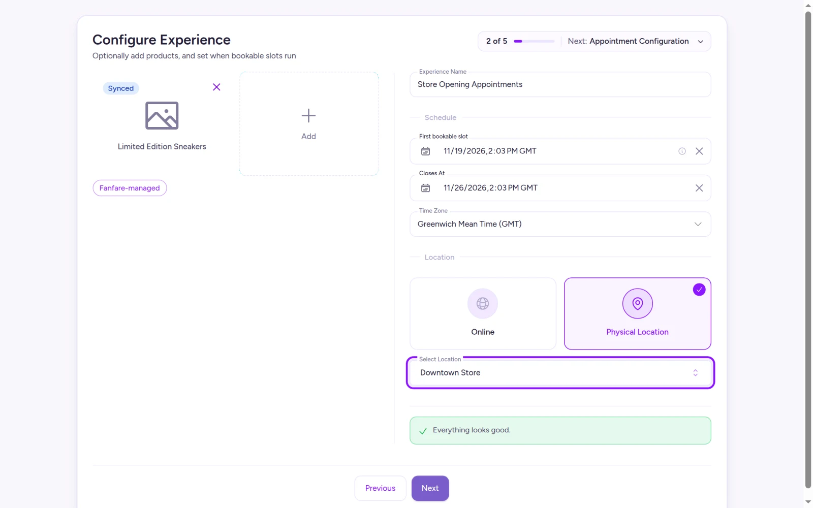
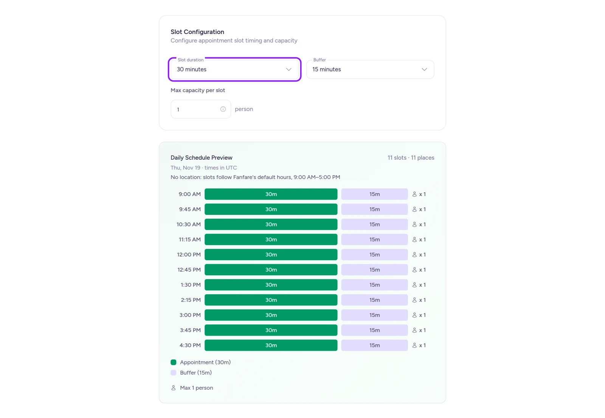

An appointment lets customers book a time slot instead of queueing or entering a draw. You set the dates slots can run between, how long each slot lasts, the gap between slots and how many people each slot takes. Slots run inside the opening hours of the location you choose, or inside Fanfare's default hours for an online appointment.

<Info>Available on Growth and above.</Info>

On Starter, the **Appointment** card in the experience wizard and the Appointment option in **Add Distribution** show an upgrade prompt instead of letting you pick them.

## Before you start

- For an in-person appointment, create the location first, with its opening hours and time zone. The location picker cannot create one. See [Locations and opening hours](/guide/create/locations).
- Decide your slot length, buffer and capacity before you announce the experience. The first booking locks them.

## Create an experience with appointments

The wizard's shared steps, and the defaults it fills in, are described in [Create an experience](/guide/create/experiences). These are the steps that differ for an appointment.

1. Go to **Experiences → Create Experience**.
2. On **Experience type**, select **Appointment** ("Pick a time").
3. On **Configure Experience** ("Optionally add products, and set when bookable slots run"), products are optional. If you add any, use products created in Fanfare: an experience with an appointment cannot offer a product synced from Shopify. Enter an **Experience Name**, then set:
   - **First bookable slot**: the earliest a slot can start. This is not when booking opens: customers can book as soon as the page is live.
   - **Closes At**: no slot can end after this.
   - **Time Zone**.
4. Under **Location**, choose **Online** or **Physical Location**. **Physical Location** is selected when the step opens. Keep it and pick a location from **Select Location**, or switch to **Online**. You cannot continue with **Physical Location** selected and no location picked.

<Frame caption="Pick a location to run slots inside its opening hours, or choose Online.">
  
</Frame>

5. There is no Stock step for an appointment. On **Appointment Configuration**, set:
   - **Slot duration**: 15 minutes to 2 hours. Starts at 30 minutes.
   - **Buffer**: the gap between slots, from **No buffer** to 30 minutes. Starts at 15 minutes.
   - **Max capacity per slot**: how many people can book the same slot. Starts at 1.
6. Check the **Daily Schedule Preview** under those fields. It shows the slots for the first day of your window and states where the hours come from:
   - "Slots follow [name]'s hours, [opens]–[closes]" for a location, with its name and that day's hours.
   - "No location: slots follow Fanfare's default hours, [opens]–[closes]" for an online appointment, or a location with no opening hours saved. The default hours are 9 AM to 5 PM.
   - "[name] is closed on [day], so no slots run" when the location is closed that day.
7. Complete the remaining steps and select **Create experience** on **Review & launch**.

<Frame caption="The preview shows the day's slots, cut from the opening hours.">
  
</Frame>

## Add appointments to an existing sequence

A sequence is one way in to an experience. You can add an appointment to one that already exists, as long as the experience offers no product synced from Shopify.

1. Open the experience, then the sequence.
2. On the **Distributions** card, select **Add distribution**.
3. Enter a **Name**, choose **Appointment**, and select **Next**.
4. Set **First bookable slot**, **Closes** and **Time zone**, and leave **Location** empty: you choose the location afterwards in **Edit**. The window cannot overlap another distribution in the same sequence.
5. On the configure step, set **Slot duration**, **Buffer** and **Max capacity per slot**, then select **Create Distribution** on **Review**. This dialogue checks the slot duration and buffer limits in the table below only when you select **Create Distribution**.
6. The new appointment runs online. To run it at a location, select **Edit** on its card, open **Configuration**, choose **Physical Location**, pick the location and save.

<Note>
  In this dialogue **Slot duration** and **Buffer** start empty. An empty slot duration runs as 60-minute slots, and an empty buffer runs as no buffer. **Max capacity per slot** starts at 1.
</Note>

## Settings

You change these later with **Edit** on the appointment's card: the window and time zone are under **Schedule**, the slot settings and location under **Configuration**.

| Setting | What it does | Default | Can you change it once it is live? |
| --- | --- | --- | --- |
| **First bookable slot** | The earliest a slot can start. Customers can book as soon as the page is live, not from this time. | In the wizard, the next whole minute. | Not while any booking stands. Once the appointment has opened, it can only move earlier. |
| **Closes** (**Closes At** in the wizard) | No slot can end after this. | In the wizard, a week after the first bookable slot. | Not while any booking stands. Once it has closed, the schedule is final. |
| **Time Zone** (**Time zone** in **Add distribution**) | The zone of the window. For an online appointment, slots also run in this zone. A location's own time zone sets its slot times. | In the wizard, your organisation's time zone. | Not while any booking stands. |
| **Slot duration** | How long each slot lasts. In **Add distribution** and **Edit**, any whole number of minutes from 5 to 480. | 30 minutes in the wizard. Empty in **Add distribution**, which runs as 60. | Not while any booking stands. |
| **Buffer** | The gap between one slot and the next. In **Add distribution** and **Edit**, 0 to 240 minutes. | 15 minutes in the wizard. Empty in **Add distribution**, which runs as none. | Not while any booking stands. |
| **Max capacity per slot** | How many people can book the same slot, from 1 to 1000. It cannot be left empty. | 1 | Not while any booking stands. |
| **Location** | **Online**, or **Physical Location** with one location chosen. Slots run inside that location's opening hours. | **Physical Location** with nothing picked in the wizard. **Online** in **Add distribution**. | Not while any booking stands. |

<Warning>
  One booking locks the whole appointment. While any booking stands, you cannot change the slot duration, buffer, capacity, location, window or time zone. The settings show "1 booking stands on this appointment; slot configuration, window and location cannot change until it ends or is cancelled." The lock lifts once no booking is still waiting for its slot: every booking has ended, been checked in, or been cancelled. Because customers can book as soon as the page is live, this can happen before your first slot. Set your slots before you announce the experience.
</Warning>

{/* image: guide-create-appointment-locked */}

A deactivated appointment opens read-only: its card shows **View** instead of **Edit**.

## Where the hours come from

Slots run only inside the chosen location's opening hours, in the location's time zone. An online appointment, or one at a location with no opening hours saved, uses Fanfare's default hours, 9 AM to 5 PM every day. You set a location's hours and time zone on the location itself, and they too lock while bookings stand: see [Locations and opening hours](/guide/create/locations). Changing the experience's time zone does not move an appointment: its window, time zone and bookings stay as they are. See [Create an experience](/guide/create/experiences).

## Manage bookings

On the sequence's **Overview**, below the **Distributions** card, a card headed with the appointment's name shows a row of days and the slots for the day you select. The card shows while the appointment is Scheduled or Live, and after you deactivate it. It is gone once the window has ended without the appointment being deactivated. The **Overview** shows one such card per sequence: a Live distribution first, then the next Scheduled one, so another distribution in the same sequence can take the appointment's place.

Days outside your window or when the location is closed are marked. Select a slot to see its **Slot Attendees**, each with a status: Confirmed, Checked In, Cancelled or Completed.

To cancel a booking:

1. Select the slot, then select **Cancel booking** beside the attendee.
2. Confirm. The dialogue reads "Are you sure you want to cancel the appointment for [name]? This action cannot be undone and the person will be notified."

You can cancel a booking only before its slot ends, and not once the appointment has been deactivated.

Deactivating an appointment cancels bookings whose slots are still to come. See [Stop a drop](/guide/drop/deactivate).

How booking works for customers, and what they see, is on [Appointment](/concepts/distributions/appointment) and [What your customers see](/guide/drop/what-customers-see).

## Payment and waitlist

An appointment never takes payment, so it has no payment step. A sequence that runs only appointments has no waitlist: its **Waitlist** tab is not shown. See [Waitlists](/concepts/waitlists).

## On Shopify

The Fanfare app in Shopify does not offer appointments. On Shopify, a product in an experience can be bought only by customers the experience lets through, and an appointment never lets anyone through to buy, so an appointment beside a Shopify product would leave that product impossible to buy. In the Fanfare app in Shopify:

- **Appointment** is missing from the experience wizard and from **Add distribution**.
- A link that asks the wizard for an appointment opens with no type chosen.
- A saved wizard draft with **Appointment** chosen cannot continue.

## Troubleshooting

<AccordionGroup>
  <Accordion title="&quot;Choose a location, or switch to Online&quot;">
    **Physical Location** is selected but no location is picked. Pick one from **Select Location**, or choose **Online**. If the location you want is not in the list, create it first under [Locations and opening hours](/guide/create/locations).
  </Accordion>
  <Accordion title="&quot;Appointments can't use Shopify products&quot;">
    The experience offers, or would offer, a product synced from Shopify alongside an appointment. Fanfare refuses this when you create the experience, add an appointment to a sequence, or add a Shopify product to an experience that has an appointment. Use a product created in Fanfare instead.
  </Accordion>
  <Accordion title="No slots run on some days">
    The location is closed on those days. On the appointment's card in the sequence **Overview**, those days read "closed". In the wizard, if the first day of the window is one of them, the preview reads "[name] is closed on [day], so no slots run". Change the location's opening hours on the location, before anyone books.
  </Accordion>
  <Accordion title="The appointment's settings are greyed out">
    At least one booking stands. The notice at the top says how many. Wait for those bookings to end, or cancel them from the appointment's card on the sequence **Overview**. Cancelling notifies each person and cannot be undone.
  </Accordion>
</AccordionGroup>

## Related

<CardGroup>
  <Card title="Appointment" href="/concepts/distributions/appointment">
    How appointments work and what customers do to book.
  </Card>
  <Card title="Locations and opening hours" href="/guide/create/locations">
    Create a location and set the hours its slots run in.
  </Card>
  <Card title="Create an experience" href="/guide/create/experiences">
    The wizard's shared steps and experience settings.
  </Card>
  <Card title="Stop a drop" href="/guide/drop/deactivate">
    Deactivate an appointment and what happens to its bookings.
  </Card>
</CardGroup>
