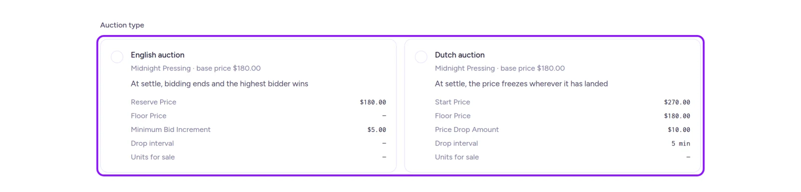
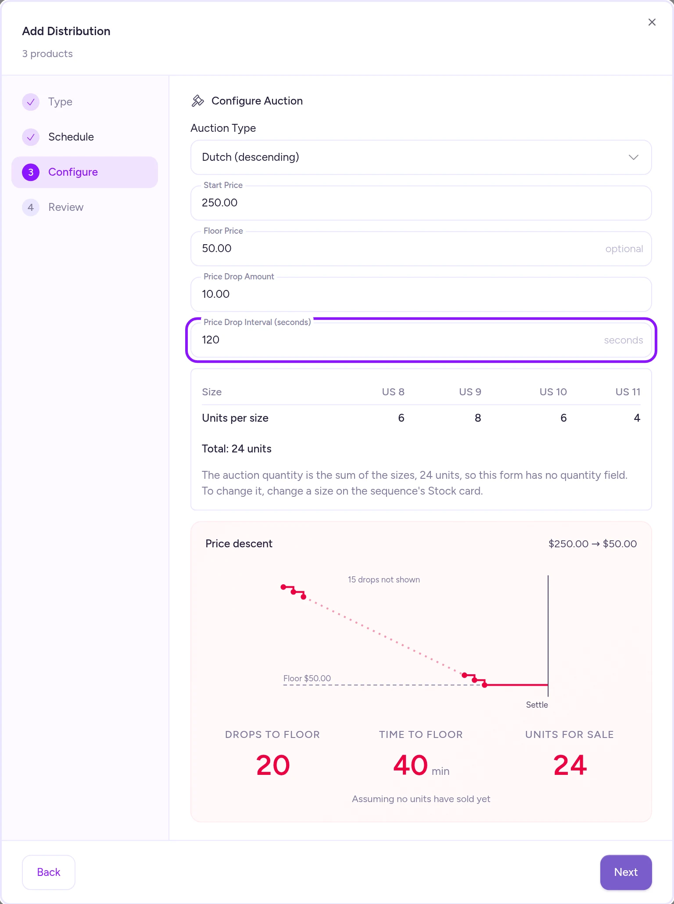

An auction lets shoppers bid for scarce items—either driving the price up until the highest bidder wins (English) or starting high and stepping down on a schedule until buyers jump in (Dutch). You can launch an auction with a new experience or add one to an existing sequence.

For how bidding, settlement, reserve prices, and unpaid wins work, read [Auction](/concepts/distributions/auction).

## Before you start

- **Checkout support:** Your checkout must be able to charge the winning bid. Auctions are included on every Fanfare plan—if the **Auction** card shows **"Needs a checkout that charges the winning bid"**, upgrading won't unlock it. Switch to **Fanfare checkout** or connect a checkout that supports auction pricing in your organization's currency. See [Checkout options](/concepts/checkout-options), or [On Shopify](/guide/create/auction#on-shopify) if you're using the Shopify app.
- **Currency lock:** Your organization's currency can't be changed while any undeleted auction exists, or while a winner from an ended auction is still inside their payment window (even if you've deleted that auction). See [Organization settings](/guide/account/organization).
- **Allocated stock:** Make sure the sequence holds units—adding an English auction to a sequence with zero units causes it to open sold out. See [Allocate stock to a drop](/guide/create/stock-allocation).

Auctions don't have a **Payment** step: winners always pay after winning, and shoppers always enter by placing a bid (no guest access or automatic entry).

## Choose English or Dutch

| Type | How pricing works | Key settings |
| --- | --- | --- |
| **English** | Price rises with each bid; the highest bidder wins when the auction settles. | **Reserve Price**, **Minimum Bid Increment**, auto-extend |
| **Dutch** | Starts at **Start Price** and drops by **Price Drop Amount** each interval, never below **Floor Price**. At settle, the price freezes where it stands. | **Start Price**, **Floor Price**, **Price Drop Amount**, **Price Drop Interval (seconds)**, quantity |

<Warning>
  **Auction type is permanent.** Once you create an auction, you can't switch between English and Dutch—create a new auction instead.
</Warning>

## Create an auction with a new experience

Shared wizard steps and default times are covered in [Create an experience](/guide/create/experiences). Here's what's specific to an auction:

<Steps>
  <Step title="Choose Auction">
    Open **Experiences**, select **Create Experience**, and choose **Auction**.
  </Step>
  <Step title="Set products and schedule">
    On **Configure Experience**, pick your products, enter an **Experience Name**, and set **Time Zone**, **Opens At**, **Closes At**, and **Settles**. **Settles** is when bidding ends and must fall between **Opens At** and **Closes At**.
  </Step>
  <Step title="Allocate stock">
    On **Stock**, enter units per size. A Dutch auction sells the total across sizes. An English auction ignores the quantities you type and assigns one unit of each size to the sequence.
  </Step>
  <Step title="Pick the auction type and pricing">
    On **Auction Configuration**, choose **English auction** or **Dutch auction**, then review and adjust the pricing fields (see the tables below).
  </Step>
  <Step title="Set access and create">
    Complete **Access** and **Review & launch**, then select **Create experience**.
  </Step>
</Steps>

## Add an auction to an existing sequence

1. Open your experience, then open the sequence you want to add to.
2. On the **Overview** tab, select **Add distribution** in the **Distributions** card.
3. Enter a **Name**, choose **Auction**, and select **Next**.
4. On **Schedule**, set **Opens**, **Closes**, **Time zone**, and **Settle at** (same field as **Settles** in the wizard and **Edit**). Windows in the same sequence can't overlap—see [Distributions](/concepts/distributions/overview).
5. On **Configure**, choose **English (ascending)** (selected by default) or **Dutch (descending)** under **Auction Type**, then fill in your pricing fields and select **Next**.
6. Review your settings and select **Create Distribution**.

To reuse an existing auction's configuration, select **Duplicate** from its card menu. See [Add and gate sequences](/guide/create/sequences).

<Frame caption="Select English or Dutch auction to configure its pricing rules.">
  
</Frame>

<Note>
  **Leave room for auto-extend:** If you turn on auto-extend, **Settle at** (or **Settles**) must leave at least the full extension length before **Closes**. A late bid extends the auction once by that duration, and never past **Closes**.
</Note>

<Note>
  **Check prefilled wizard prices:** **Add distribution** leaves price fields blank, while the experience wizard prefills starting values from a base price (the lowest price of your first selected product, or `100` if unpriced): **Reserve Price** and **Floor Price** default to the base price, **Start Price** to 1.5× the base price, **Minimum Bid Increment** to `5`, and **Price Drop Amount** to `10` every `5 minutes`. Review every price before creating your auction.
</Note>

## English auction settings

| Setting | What it does | Default | Editable once live? |
| --- | --- | --- | --- |
| **Reserve Price** | Minimum winning bid. If the highest bid stays below it, nobody wins. Optional. | Wizard: base price; **Add distribution**: blank | No |
| **Minimum Bid Increment** | Minimum amount each new bid must beat the current bid by (in the wizard, at least your currency's smallest unit, like `0.01` USD). Optional. | Wizard: `5`; **Add distribution**: blank | No |
| **Auto-Extend** and **Extension Duration** (wizard) / **Auto Extend Seconds** (**Add distribution** and **Edit**) | Gives late bidders extra time. A bid placed within this window before **Settles** pushes **Settles** out once by the same length (never past **Closes**). Choose 1, 2, 5, 10, 15, or 30 minutes in the wizard, or enter seconds elsewhere. | Off | Yes |

English auctions don't have a quantity field. On a stock-tracked sequence, the auction offers one unit of each size and the winner takes one (any extra units remain in the sequence). On an untracked sequence, it still picks one winner without deducting stock, and **Add distribution** doesn't show a units summary.

## Dutch auction settings

| Setting | What it does | Default | Editable once live? |
| --- | --- | --- | --- |
| **Start Price** | Opening price when bidding starts (must be above `0`). | Wizard: 1.5× base price; **Add distribution**: blank | No |
| **Floor Price** | Lowest price the auction can reach (can't exceed **Start Price**). Optional. | Wizard: base price; **Add distribution**: blank | No |
| **Price Drop Amount** | Amount the price steps down at each interval (must be above `0`). | Wizard: `10`; **Add distribution**: blank | No |
| **Price Drop Interval (seconds)** | How often the price drops. Pick 1, 2, 5, 10, 15, or 30 minutes in the wizard, or enter seconds (at least `1`) elsewhere. | Wizard: 5 minutes; **Add distribution**: blank | No |
| **Quantity** | Total units the auction sells. | See below | No |

How **Quantity** is set depends on where you create the auction:

- **In the wizard:** Automatically equals the total units entered on **Stock** (edit it on that step).
- **In Add distribution:** On a stock-tracked sequence, it automatically equals the sum of sizes on the sequence's **Stock** card. On an untracked sequence, enter **Quantity** manually (at least `1`).

The **Configure** step previews the price drop schedule as you enter your values.

<Frame caption="On a stock-tracked sequence, a Dutch auction automatically sells the total allocated across sizes.">
  
</Frame>

## Edit an auction

Open the sequence's **Overview** tab and select **Edit** on the auction card to adjust **Schedule** or **Configuration**.

<Warning>
  **Pricing locks 30 seconds before Opens.** Once an auction approaches its open time, **Reserve Price**, **Minimum Bid Increment**, **Start Price**, **Floor Price**, **Price Drop Amount**, **Price Drop Interval (seconds)**, and **Quantity** can no longer be changed. To change pricing after that point, you must **Deactivate** the auction (which voids every bid and can't be undone) and create a new one. See [Stop a drop](/guide/drop/deactivate).
</Warning>

On a stock-tracked sequence, a Dutch auction's quantity displays as **"From allocation"** in **Edit** and tracks the sequence's **Stock** card until the auction opens.

After an auction opens, you can still:

- Move **Closes**, or move **Opens** earlier (never later)
- Adjust **Auto Extend Seconds** on an English auction
- Adjust **Settles**, as long as it stays inside the window and leaves room for any extension

Once bidding ends (at **Settles** or the end of an extension), the schedule locks completely. See [What locks, and when](/concepts/what-locks-when) for the full lock-in timeline.

{/* image: guide-create-auction-pricing-locked */}

To track bids in real time, see [Watch a live drop](/guide/drop/watch-live). For the bidder experience, see [What your customers see](/guide/drop/what-customers-see).

## On Shopify

In the Shopify app, **Auction** stays locked with **"Needs a checkout that charges the winning bid"** (regardless of your Fanfare plan) until all four requirements are met:

- Your store is on **Shopify Plus**.
- The Fanfare app has all requested permissions in Shopify.
- The **Fanfare checkout validation** rule is turned on in Shopify's checkout settings, with **Allow all customers to complete checkout** unchecked. Fanfare won't re-enable this rule if you turn it off. See [Checkout protection](/guide/shopify/checkout-protection).
- Your Shopify store's currency matches your Fanfare organization's currency.

## Troubleshooting

<AccordionGroup>
  <Accordion title="Auction is grayed out with 'Needs a checkout that charges the winning bid'">
    Your current checkout can't charge dynamic winning bids—upgrading your Fanfare plan won't unlock it. Switch to **Fanfare checkout** or connect a checkout that supports auction pricing in your organization's currency. Using Shopify? Check the four requirements under [On Shopify](/guide/create/auction#on-shopify).
  </Accordion>
  <Accordion title="My auto-extend duration is rejected">
    Your extension would push settlement past **Closes**. Move **Settles** (or **Settle at**) earlier, push **Closes** later, or shorten the extension length.
  </Accordion>
  <Accordion title="The price fields are grayed out when editing">
    Pricing changes are refused starting 30 seconds before **Opens**, and the price fields become disabled once the auction opens. If pricing must change, deactivate the auction and create a new one.
  </Accordion>
  <Accordion title="I can't get past the Dutch auction settings">
    Your stock allocation is missing units. In the wizard, select **Go to Stock** and enter units for each size. In **Add distribution** on a stock-tracked sequence, give every size a unit count on the sequence's **Stock** card so the total is above zero.
  </Accordion>
</AccordionGroup>

## Related

<CardGroup>
  <Card title="Auction" href="/concepts/distributions/auction">
    How English and Dutch auctions run, settle, and pick a winner.
  </Card>
  <Card title="Allocate stock to a drop" href="/guide/create/stock-allocation">
    Set the units per size that an auction sells.
  </Card>
  <Card title="Watch a live drop" href="/guide/drop/watch-live">
    Follow bids and extensions while an auction runs.
  </Card>
  <Card title="Stop a drop" href="/guide/drop/deactivate">
    Deactivate an auction and learn when Fanfare blocks deactivation.
  </Card>
</CardGroup>
