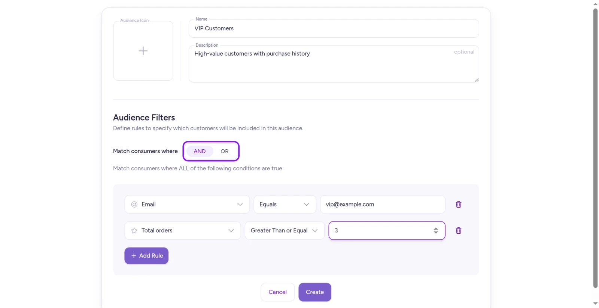
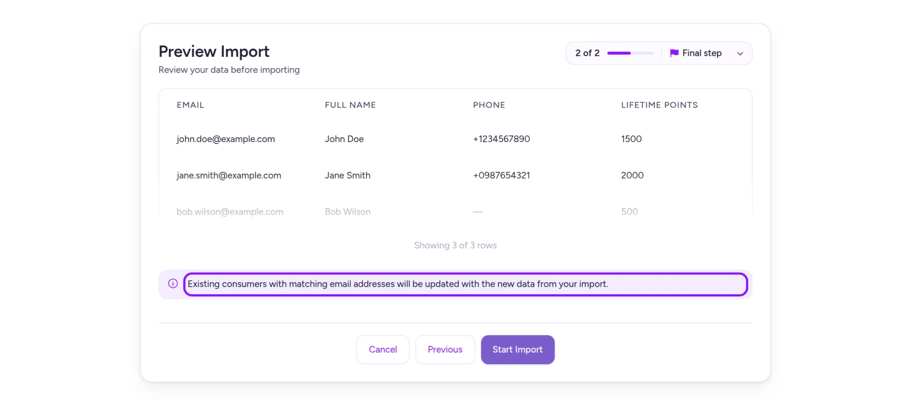
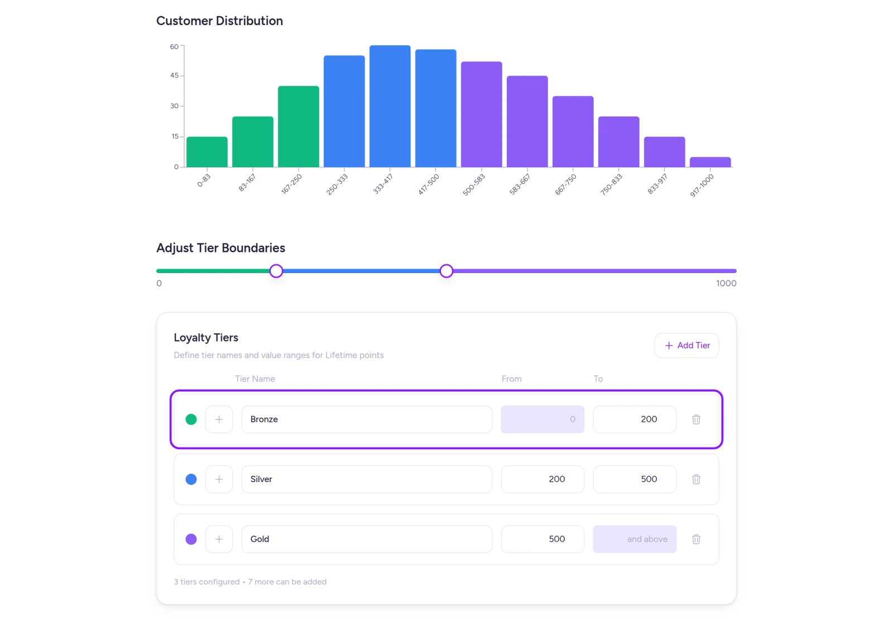

An audience is a named group of customers you use to gate a sequence—like giving repeat buyers early access, rewarding top loyalty members, or running an invite-only drop.

<Info>
  Available on Growth and above. **Loyalty tiers** require Pro. On Starter, creating and importing audiences is locked, while any audiences you already have keep gating sequences and can still be deleted.
</Info>

You can build an audience in three ways, all from the **Create Audience** menu on **Audiences**:

| To build | Choose | How it works |
| --- | --- | --- |
| A dynamic, rule-based list | **Create Audience** | Automatically includes customers matching your rules and rebuilds once a day. |
| A fixed list | **Import CSV** | Includes the exact customers from your CSV file. |
| Tiers by a numeric score or spend | **Create Loyalty Tiers** | Splits customers into ranges, creating one audience per tier. |

For how audiences are built, refreshed, and evaluated during a drop, see [Audiences and access codes](/concepts/audiences). To attach an audience to a drop, see [Add and gate sequences](/guide/create/sequences).

{/* image: guide-create-audiences-list */}

## Before you start

- If you're importing a CSV, make sure your file has a header row with a lowercase `email` or `phone` column.

## Create an audience from rules

1. Open **Audiences** and select **Create Audience**.
2. Enter a **Name** (and optionally choose an **Audience Icon** and **Description**).
3. Under **Match consumers where**, select **AND** (customers must meet every rule) or **OR** (customers can meet any rule). This applies across all rules—nested combinations like `A and (B or C)` aren't supported.
4. Set your first rule—field, operator, and value—and select **Add Rule** for each additional condition.
5. Select **Create** to save and return to the **Audiences** list.

| Field | Available operators |
| --- | --- |
| **Email** | **Equals**, **Not Equals**, **Contains**, **Not Contains** |
| **Loyalty balance**, **Lifetime points**, **Lifetime value**, **Total orders**, **Average order value**, **Activity score**, **Purchase frequency score**, **Monetary score** | **Equals**, **Not Equals**, **Greater Than**, **Greater Than or Equal**, **Less Than**, **Less Than or Equal**, **Between** |
| **Last order**, **Created at** | **Greater Than**, **Greater Than or Equal**, **Less Than**, **Less Than or Equal** |

- **Between** is inclusive of both values you enter.
- Guest shoppers never match audience rules.

<Note>
  The first rule starts as **Email Equals** with an empty value, and blank values aren't blocked. Leaving **Email Equals** blank matches no customer who has an email address, whereas blank **Email Not Equals** or **Email Contains** matches everyone. Always enter a value or replace the default rule before selecting **Create**.
</Note>

<Note>
  Enter **Last order** and **Created at** dates manually in `YYYY-MM-DD` format (for example, `2026-03-01`)—Fanfare reads them as the start of that day in UTC. There's no rolling "last N days" filter, so update the date whenever you want to move the window forward.
</Note>

<Frame caption="Your AND or OR selection applies across every rule in the audience.">
  
</Frame>

### Change the rules

1. Open the audience and select **Details**.
2. Edit the rules, **Match consumers where**, name, or description.
3. Select **Save** in the action bar.

<Warning>
  Rule edits apply live with no draft step. Once the rebuild finishes, your updated rules immediately change who can enter every sequence this audience gates and who receives its invite email. While the rebuild runs, previous members can still enter, though any customer re-checked in the meantime is evaluated against the new rules right away. The audience page doesn't list which sequences use it, so check your experiences before editing. See [Audiences and access codes](/concepts/audiences).
</Warning>

### Refresh now

To rebuild a rule-based audience without waiting for its daily run, select **Refresh now** from the audience's row menu or detail page—builds start within a minute. **Refresh now** isn't available while a build is already queued or running, or while a drop gated by the audience is live (membership locks during live drops; see [Audiences and access codes](/concepts/audiences)).

## Import a CSV file

1. Open **Audiences**, open the **Create Audience** menu, and select **Import CSV**.
2. Enter a **Name** (plus an optional **Audience Icon** and **Description**).
3. Drop your `.csv` file onto the upload area (or browse for it), then select **Next**.
4. Review the sample rows on **Preview Import** and select **Start Import**.

**File requirements:**

- `.csv` file up to 100 MB with a header row.
- Must include a lowercase `email` or `phone` column (`Email` isn't recognized).
- Optional columns: `fullName`, `phone`, `loyaltyLifetimePoints`, and `metadata`. Any other columns are ignored silently.
- **Preview Import** shows up to 6 sample rows regardless of file size—it isn't your total member count.

<Warning>
  Importing a CSV overwrites data on existing customers matched by email or phone. Any name, phone number, lifetime points, or metadata in your file replaces what Fanfare currently stores. Updating a customer's phone number also clears their SMS consent and phone verification, and newly created customers start opted out of SMS marketing. This can't be undone—review every column carefully before selecting **Start Import**.
</Warning>

Fanfare creates the audience before uploading the file, so a canceled or failed upload leaves an empty audience behind. You can't append a second file to an existing static list—include everyone in one CSV.

<Frame caption="Review the sample rows and data-overwrite notice before starting your import.">
  
</Frame>

### Rows that were skipped

Open the imported audience and select **Details** to see how many rows succeeded. If any rows were skipped, expand the skipped-rows summary to see each reason and up to 5 row numbers (row 1 is the first data row below the header):

- **Needs an email or phone number**
- **Invalid email address**
- **Invalid phone number**
- **Email and phone belong to different customers**
- **Duplicate of another row**
- **Temporary problem, try importing again**
- **Couldn't be imported**

## Klaviyo and Mailchimp lists

Klaviyo and Mailchimp lists can't be imported directly from **Audiences**, even if you've connected those integrations. Export a CSV from your email platform, rename the email column header to lowercase `email`, and upload it with [Import CSV](#import-a-csv-file) (keep in mind that importing overwrites existing customer details and can clear SMS consent if a phone number changes).

## Create loyalty tiers

<Info>
  Available on Pro and above.
</Info>

Loyalty tiers divide your customers into ranges based on a single numeric attribute—such as lifetime points or total spend—creating one audience per tier. For running a points program, see [Run a loyalty program](/guide/learn/loyalty).

1. Open **Audiences**, open the **Create Audience** menu, and select **Create Loyalty Tiers**.
2. Enter a **Name** and choose a **Consumer Attribute**: **Loyalty balance**, **Lifetime points**, **Lifetime value**, **Total orders**, **Average order value**, **Activity score**, **Purchase frequency score**, or **Monetary score**.
3. Review the customer distribution chart and suggested tiers. (If all customers have the same value, select **Add Tier** to define ranges manually.) Drag the **Tier Boundaries** handles—or edit **From** and **To** directly—rename tiers, and add up to 10 tiers (at least 2 tiers are required to save).
4. Select **Create Tiers**.

The **Consumer Attribute** locks at creation—to segment on a different attribute, create a new tier group.

<Frame caption="The first tier's From value is fixed at your lowest existing customer value.">
  
</Frame>

### Change tiers

Open the tier group, select **Settings → Details**, update tier names, boundaries, or count, and select **Save**.

<Warning>
  Tiers map to their underlying audiences by list position, not by name. If you delete a middle tier, the tier below takes over the removed range and the top tier's audience is deleted—which can silently change which shoppers a gated sequence admits (or block saving if the deleted top audience gates an active or upcoming sequence). To reorganize tiers safely, adjust boundaries instead of deleting tiers, or create a new tier group.
</Warning>

## RFM segments

Every organization includes a built-in **RFM Segments** group (**Champions**, **Loyal**, **At-Risk**, **New**, and **Lost**). You can attach them to sequences right away or delete the whole group, though individual segments can't be edited or deleted (and deleted RFM segments may reappear automatically).

## Read the Audiences list

- **Type:** **Dynamic** for rule-based audiences, or **Static List** for CSV imports.
- **Members:** Current member count (`—` if the audience hasn't built yet or couldn't load).
- **Status:** Import progress for CSV lists, or build state with **Next build** for dynamic audiences (see [Audiences and access codes](/concepts/audiences)).
- Each loyalty tier group and the **RFM Segments** group appears as a single row.

## Delete an audience

Select **Delete** from the row menu or on the audience's detail page.

You can't delete an audience—or a tier group containing one—while it gates a sequence in any active, upcoming, or draft experience. Remove the audience from those sequences first, then delete it. Deleting an audience can't be undone.

## Things to know before you go live

- **Wait for the first build:** A brand-new or newly imported audience won't admit anyone until its initial build finishes. See [Audiences and access codes](/concepts/audiences).
- **Watch the lowest tier boundary:** The first loyalty tier's **From** value locks to the lowest value your customers had at creation—not `0`. If your lowest existing customer was above `0`, new customers starting at `0` won't match any tier.
- **Loyalty-tier refresh timing:** Tier audiences don't rebuild daily and don't offer **Refresh now**—they rebuild whenever you create or save changes to them, and automatically before a gated experience opens.

## On Shopify

Audience tools work the same in the Shopify app. Shopify customer segments and lists can't be imported directly—export a CSV from Shopify, rename the email column header to lowercase `email`, and upload it with [Import CSV](#import-a-csv-file) (keep in mind that importing overwrites existing customer details and can clear SMS consent if a phone number changes).

## Troubleshooting

<AccordionGroup>
  <Accordion title="I don't see Klaviyo or Mailchimp in the Create Audience menu">
    Klaviyo and Mailchimp lists can't be imported from **Audiences**, even when those integrations are connected. Export a CSV from your email platform, rename the email column header to lowercase `email`, and upload it with [Import CSV](#import-a-csv-file) (keep in mind that importing overwrites existing customer details and can clear SMS consent if a phone number changes).
  </Accordion>
  <Accordion title="My CSV file was rejected">
    Make sure the file is a `.csv` under 100 MB, includes a header row with a lowercase `email` or `phone` column, and has at least one customer row beneath the header.
  </Accordion>
  <Accordion title="Some rows were skipped during CSV import">
    Check the skip reasons under **Details** (see [Rows that were skipped](#rows-that-were-skipped)). Because you can't append rows to an existing static list—and each sequence takes one audience—fix your CSV, re-import the full file as a new audience, attach it to your sequence, and delete the old one.
  </Accordion>
  <Accordion title="Refresh now is disabled or unavailable">
    A build is already queued or running, or an experience gated by the audience is currently live. Loyalty-tier audiences don't support **Refresh now**.
  </Accordion>
  <Accordion title="I can't delete an audience">
    It's currently gating a sequence in an active, upcoming, or draft experience. Remove it from those sequences first (for a tier group, check every tier inside it).
  </Accordion>
</AccordionGroup>

## Related

<CardGroup>
  <Card title="Audiences and access codes" href="/concepts/audiences">
    How audiences are built, locked during live drops, and evaluated for each shopper.
  </Card>
  <Card title="Add and gate sequences" href="/guide/create/sequences">
    Restrict a sequence to members of an audience.
  </Card>
  <Card title="Invites, waitlist and access-code sends" href="/guide/create/invites-and-waitlist">
    Manage the invite email automatically sent to audience members.
  </Card>
  <Card title="Set up the next drop from this one" href="/guide/learn/next-drop">
    Build audiences from how customers engaged with a past drop.
  </Card>
</CardGroup>
