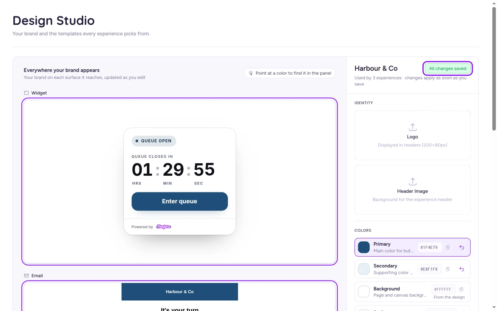
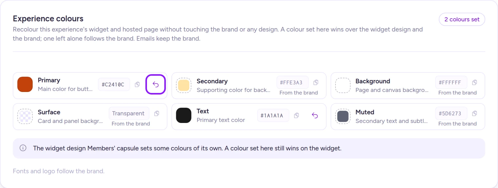

Your brand is the logo, six colours and two fonts that Fanfare starts from for the entry widget, your hosted pages and the emails customers receive. One brand serves your whole organisation, and every experience uses it. You set it once in **Design Studio**, and you can give a single experience its own colours on that experience's **Design** tab. How the brand combines with widget designs, page templates and experience colours is explained in [Brand, templates and designs](/concepts/design).

## Before you start

- Any team member can change the brand and an experience's colours, not only admins.
- The Brand editor works on every plan. On Starter, opening **Design Studio** takes you straight to the Brand editor; the template library needs Growth or above. See [Templates and widget designs](/guide/create/templates) and [Plans and what they unlock](/guide/start/plans).
- Have your logo ready as a JPG, PNG, GIF or WebP file.

## Set up your brand

1. In the sidebar, select **Design Studio**.
2. On the brand card at the top, select **Edit brand**. On Starter you are already there.
3. Under **Identity**, upload a **Logo**. The field describes it as "Displayed in headers (200×80px)". To take it away, remove it from the same field.
4. Under **Identity** there is also a **Header Image** field, described as "Background for the experience header". Customers do not see it on any widget, hosted page or email today, even though the hosted page illustration in the editor shows it.
5. Under **Colors**, set any of the six roles: **Primary**, **Secondary**, **Background**, **Surface**, **Text** and **Muted**. A role you leave unset is labelled "From the design" and shows the colour of the built-in **Kinetic** widget design. To hand a role you have set back to the design, select its reset arrow (**Reset to design**).
6. Under **Typography**, pick a **Body Font** and a **Heading Font** from the font list.

There is no Save button. Each change saves itself about half a second after you stop, and the badge at the top of the panel shows **Saving...**, then **All changes saved**, or **Save failed** if the save did not go through. A new logo saves as soon as it uploads.

<Warning>
  A brand change restyles every experience at once, including drops that are live right now. There is no Save or Publish step to stop it, and no undo: to go back, set the old value again. Make brand changes when no drop is running.
</Warning>

If a change saves while an experience is inside its publish freeze around its drop, Fanfare normally asks first: **Update your brand during a drop?** The dialogue names an experience that is inside its freeze, says that saving restyles its hosted page, entry widget and emails within about a minute, gives the time its freeze ends when that is known, and, when there are others, says how many other experiences also update. Do not rely on the question as a safeguard: it does not always appear, for example when the freeze has only just begun.

- **Save anyway** saves the change, and the question does not come back for the rest of your visit to the page.
- **Cancel** stops the save, and the badge shows **Save failed**. A new logo is taken back off the panel. A colour or font change stays in the panel, though: your next change saves it along with everything else, and asks first. To drop it, set the value back or reload the page.

What the publish freeze is and when it applies is explained in [Brand, templates and designs](/concepts/design).

<Note>
  Hosted pages pick up a brand change within about a minute, and the widget usually sooner. Emails can take longer, and an email already queued to send keeps the brand it was built with.
</Note>

<Frame caption="Every change saves itself. The badge at the top of the panel shows whether it has.">
  
</Frame>

<Frame caption="The question appears once per visit, and only while an experience is inside its publish freeze.">
  
</Frame>

### Brand settings

| Setting | What it does | Default | Can you change it once it is live? |
| --- | --- | --- | --- |
| **Logo** | Your logo, shown in headers (200×80px). JPG, PNG, GIF or WebP. | None | Yes. The change reaches live experiences. |
| **Header Image** | Stored with the brand. No widget, hosted page or email shows it. | None | Yes. |
| **Primary** | Main colour for buttons and accents. On hosted pages it is the accent colour. | From the design | Yes. The change reaches live experiences. |
| **Secondary** | Supporting colour for backgrounds. | From the design | Yes. The change reaches live experiences. |
| **Background** | Page and canvas background. | From the design | Yes. The change reaches live experiences. |
| **Surface** | Card and panel backgrounds. | From the design | Yes. The change reaches live experiences. |
| **Text** | Primary text colour. | From the design | Yes. The change reaches live experiences. |
| **Muted** | Secondary text and subtle elements. | From the design | Yes. The change reaches live experiences. |
| **Body Font** | The font for body text. | Not set; the picker shows Inter | Yes. The change reaches the widget, unless a hosted page sets its own font; the rest of a hosted page keeps its template's fonts. |
| **Heading Font** | The font for headings. | Not set; the picker shows Inter | Yes. The change reaches the widget, unless a hosted page sets its own font; the rest of a hosted page keeps its template's fonts. |

Fonts have no reset control. Selecting the font a picker already shows clears it, and that includes the Inter it shows when no font is set. A cleared font does not give customers Inter: the entry widget falls back to a plain system font, and a cleared **Body Font** leaves emails in the email app's default font. To change a font, pick a different one. To use Inter after clearing a font, pick another font, then Inter.

On a Fanfare-hosted page, the entry widget shows your brand fonts unless the page sets its own, and the rest of the page keeps the fonts its template sets. On your own site, the widget shows your fonts only if your site loads them or tells the widget to load them: see [Run it on your own site](/guide/create/your-own-site) and [How fonts work](https://docs.fanfare.io/sdk/components/fonts).
## See where your brand appears

The left side of the Brand editor previews the brand on three surfaces, updated as you edit: the **Widget**, an **Email**, and a **Hosted page**. The hosted page is an illustration, not one of your pages: pages take only **Primary** as their accent, and their entry widget takes the whole brand. Point at a colour row in the panel to ring each surface that uses that colour, labelled with where it lands; a surface that does not use it is dimmed with a note such as "Secondary isn't used here". Point at a colour on a preview to see which role it is, and select it to jump to that row.

## Check which pages keep their own values

Below the brand settings, the **Where it's used** panel counts the experiences the brand styles. It lists each experience whose published hosted page sets a brand value of its own, with one line per colour or font it sets, in the form "Sets *field* on its page". A page that sets its own value keeps it whatever you change the brand to.

Select a line to open that experience's **Design** tab. A page's own colours and fonts are covered in [Build and publish the hosted page](/guide/create/hosted-page). If you have experiences and no page sets its own values, the panel says "Every experience follows the brand."

## Give one experience its own colours

Use this when one drop needs a different look, for a collaboration or a seasonal release, without touching the brand or any design.

1. Select **Experiences**, then open the experience.
2. Select **Design**.
3. On the **Experience colours** card, set any of the six roles. Each unset role shows the brand's colour, labelled "From the brand".
4. To hand a role back to the brand, select its reset arrow (**Reset to the brand**).

The badge on the card shows how many roles are set, such as **2 colours set**, or **All colours follow the brand**. A colour set here wins over the widget design and the brand, on the widget and on the hosted page. The exception is a hosted page that sets its own value for that colour: the page's value wins there, including in the widget on that page. Emails keep the brand, and fonts and logo follow the brand. If the experience's widget design sets some colours of its own, the card says so; a colour set on the card still wins on the widget. Widget design colours and starting styles are covered in [Templates and widget designs](/guide/create/templates).

<Warning>
  An experience colour goes live as soon as you commit it: when you leave the field, press Enter, close the colour picker or select reset. It changes the widget everywhere it appears and the hosted page (except where the page sets its own value), with no Publish step. If the experience is inside its publish freeze, Fanfare normally asks first: **Change this experience during its drop?** Select **Save anyway** to go ahead, or **Cancel** to keep what customers see now.
</Warning>

<Frame caption="Colours set here win on this experience's widget and hosted page, unless the page sets its own. Everything else follows the brand.">
  
</Frame>

## See your emails in your brand

The **Emails** card on an experience's **Design** tab shows the built-in emails that experience sends, in your brand. You cannot edit them there. Which messages customers receive, and when, is covered in [What your customers see](/guide/drop/what-customers-see). The sender name and address are not part of the brand: see [Sender identity and sending domain](/guide/create/email-sender).

## On Shopify

The Brand editor and the **Experience colours** card work the same way in the Fanfare app in Shopify. Widget colours, fonts and wording are set in **Design Studio**, not in the Shopify theme editor, so every experience on your store matches. If you set no brand font, the widget on your store uses your theme's font. See [Storefront setup](/guide/shopify/storefront-setup).

## Troubleshooting

<AccordionGroup>
  <Accordion title="The badge shows Save failed">
    Your last change did not save, so customers still see the previous value. This is expected after you select **Cancel** in the freeze question. Fanfare does not retry on its own. The next time you change a value, the panel saves every colour and font it holds, including the one that failed; a logo that failed to save is removed from the panel, so upload it again. Wait for **All changes saved** before you leave the page.
  </Accordion>
  <Accordion title="A colour does not change on one experience">
    The colour is set closer to that experience, and keeps its value whatever the brand says: in the experience's own colours, in the widget design it uses, or on its hosted page. Check the **Experience colours** card on the experience's **Design** tab, which also says when the widget design sets colours of its own, then **Where it's used** in the Brand editor. On a hosted page, the page's own style fields follow only **Primary**: one marked **Template default** keeps the template's colour.
  </Accordion>
  <Accordion title="An unset colour looks different on different screens">
    A colour role you have not set is filled in from a fallback, and not every screen uses the same fallback. The Brand editor swatch shows the **Kinetic** colour, while your default widget design, a page template or a page's style settings can show another. Setting the role in the brand replaces the fallback wherever that role follows the brand. It does not change a colour that a widget design, an experience or a hosted page sets for itself, or a page colour that keeps its template default.
  </Accordion>
  <Accordion title="My fonts show in the widget but not on the rest of a hosted page">
    On a Fanfare-hosted page, your brand fonts appear in the entry widget, unless the page sets its own; the page's own headings and text use the fonts its template sets. On your own site, load the fonts yourself or tell the widget to load them: see [How fonts work](https://docs.fanfare.io/sdk/components/fonts).
  </Accordion>
</AccordionGroup>

## Related

<CardGroup>
  <Card title="Brand, templates and designs" href="/concepts/design">
    Which layer wins, and what the publish freeze is.
  </Card>
  <Card title="Templates and widget designs" href="/guide/create/templates">
    Widget design colours, starting styles and the template library.
  </Card>
  <Card title="Build and publish the hosted page" href="/guide/create/hosted-page">
    A page's own colours and fonts.
  </Card>
  <Card title="Run it on your own site" href="/guide/create/your-own-site">
    The widget on a page you own.
  </Card>
</CardGroup>
