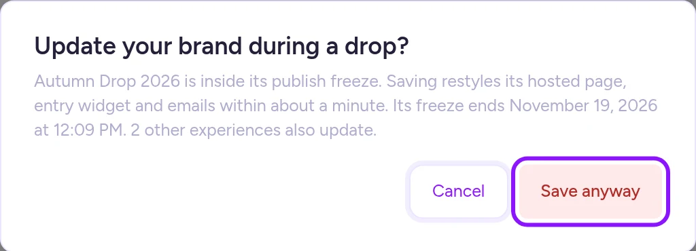

Your brand sets the foundation for how your drops look—your logo, six color roles, and two fonts automatically style your entry widget, hosted pages, and customer emails. You configure your brand once in **Design Studio** for your entire organization, and you can override colors for any individual experience on its **Design** tab.

To see how brand settings interact with widget designs, page templates, and per-experience colors, read [Brand, templates, and designs](/concepts/design).

## Before you start

- Any team member can edit your brand and per-experience colors—admin permissions aren't required.
- The Brand editor is available on every plan. On Starter, selecting **Design Studio** opens the Brand editor directly; reusable templates require Growth or above. See [Templates and widget designs](/guide/create/templates) and [Plans and what they unlock](/guide/start/plans).
- Have your logo ready in JPG, PNG, GIF, or WebP format.

## Set up your brand

<Steps>
  <Step title="Open the Brand editor">
    Select **Design Studio** in the sidebar, then select **Edit brand** on the brand card at the top. On Starter, **Design Studio** takes you straight to the Brand editor.
  </Step>
  <Step title="Upload your logo">
    Under **Identity**, upload a **Logo** (displayed in headers at 200×80px). You can remove or replace it from the same field at any time.

    <Note>
      The **Header Image** field under **Identity** is stored with your brand, but isn't currently displayed on widgets, hosted pages, or emails.
    </Note>
  </Step>
  <Step title="Pick your colors">
    Under **Colors**, set any of the six color roles: **Primary**, **Secondary**, **Background**, **Surface**, **Text**, and **Muted**. Any role you leave unset shows **From the design** and falls back to your widget design's color (previewed with the built-in **Kinetic** style). Select **Reset to design** to hand a role back to the design.
  </Step>
  <Step title="Choose your fonts">
    Under **Typography**, select a **Body Font** and **Heading Font** from the font list.
  </Step>
</Steps>

Brand edits auto-save about half a second after you stop typing—there's no Save button. Watch the status badge at the top of the panel (**Saving...** → **All changes saved**) before leaving the page. Uploaded logos save immediately.

<Warning>
  Brand changes apply to every experience right away—including drops that are live—with no separate publish step or undo. Avoid making brand edits while a drop is running.
</Warning>

If you edit your brand while an experience is inside its [publish freeze](/concepts/design), Fanfare typically prompts you with **Update your brand during a drop?**, naming the affected experience and when its freeze ends:

- **Save anyway:** Applies your change and won't prompt again during your current visit.
- **Cancel:** Stops the save and displays **Save failed**. A newly uploaded logo is removed from the panel; color or font edits stay in the panel until you change them back or reload the page.

Don't rely on this prompt as a safety net—it may not appear if a freeze has just started.

<Note>
  Hosted pages pick up brand changes within about a minute, and embedded widgets update even faster. Emails can take slightly longer, and emails already queued to send keep the brand they were generated with.
</Note>

<Frame caption="Brand changes auto-save—wait for All changes saved at the top of the panel before leaving.">
  
</Frame>

<Frame caption="When an experience is inside its publish freeze, Fanfare asks you to confirm before saving brand changes.">
  
</Frame>

### Brand settings reference

| Setting | What it controls | Default | Updates live drops? |
| --- | --- | --- | --- |
| **Logo** | Header logo (200×80px). Accepts JPG, PNG, GIF, or WebP. | None | Yes |
| **Header Image** | Stored with your brand; not currently shown on widgets, hosted pages, or emails. | None | Not displayed |
| **Primary** | Main color for buttons and accents, and the accent color on hosted pages. | From the design | Yes |
| **Secondary** | Supporting color for secondary backgrounds. | From the design | Yes |
| **Background** | Page and canvas background. | From the design | Yes |
| **Surface** | Card and panel backgrounds. | From the design | Yes |
| **Text** | Primary text color. | From the design | Yes |
| **Muted** | Secondary text and subtle UI elements. | From the design | Yes |
| **Body Font** | Font for body copy. | Unset (picker shows Inter) | Yes, on widgets unless overridden by a hosted page. Hosted page copy keeps its template's fonts. |
| **Heading Font** | Font for headings. | Unset (picker shows Inter) | Yes, on widgets unless overridden by a hosted page. Hosted page headings keep their template's fonts. |

<Tip>
  To clear a font, re-select the font currently shown in the picker—this returns the widget to a system font (and emails to the email client's default font). To explicitly set **Inter** after clearing it, select another font first, then select **Inter**.
</Tip>

On Fanfare-hosted pages, your brand fonts style the embedded entry widget (unless the page sets its own fonts), while the surrounding page keeps its template's fonts. On your own website, load your brand fonts on the page or enable SDK font loading—see [Run it on your own site](/guide/create/your-own-site) and [How fonts work](https://docs.fanfare.io/sdk/components/fonts).

## Preview where your brand appears

The left side of the Brand editor renders live previews across three surfaces: **Widget**, **Email**, and **Hosted page**. Hover over any color row to highlight where that role lands on each surface (unused surfaces dim with a note), or hover and click directly on a preview surface to jump to its color role.

Note that the **Hosted page** preview is illustrative—real hosted pages inherit only **Primary** as their page accent, while the embedded entry widget inherits your full brand.

## See which pages override your brand

Below the brand settings, the **Where it's used** panel shows how many experiences use your brand and lists any published hosted page that sets its own colors or fonts (for example, *"Sets Primary on its page"*). Pages with custom overrides keep their own values even when you update your brand.

Select any row to jump straight to that experience's **Design** tab. If no pages override your brand, the panel displays *"Every experience follows the brand."* See [Build and publish the hosted page](/guide/create/hosted-page) to adjust page-level styles.

## Override colors for a single experience

Give a collaboration, VIP launch, or seasonal release its own palette without changing your organization-wide brand or templates:

1. Go to **Experiences**, open the experience, and select **Design**.
2. On the **Experience colours** card, set any of the six color roles. Unset roles display **From the brand**.
3. To revert a role back to your brand, select **Reset to the brand**.

The card badge tracks how many custom colors are active (such as **2 colours set** or **All colours follow the brand**). Experience colors override both your brand and your widget design on that drop's widget and hosted page—except where a hosted page sets its own page-level color, which takes top priority there. Emails, fonts, and your logo always follow your organization brand.

If your experience's widget design sets its own colors, the card notes it—any color you set on **Experience colours** still takes precedence on the widget. See [Templates and widget designs](/guide/create/templates) for more on widget design colors.

<Warning>
  Experience colors go live as soon as you commit a change (leaving the field, pressing Enter, closing the color picker, or clicking reset), with no publish step. If the experience is inside its publish freeze, Fanfare prompts **Change this experience during its drop?**—select **Save anyway** to apply it immediately or **Cancel** to keep what customers currently see.
</Warning>

<Frame caption="Experience colours override your brand and widget design for a single drop, while logo, fonts, and emails stay on brand.">
  
</Frame>

## Preview branded emails

On any experience's **Design** tab, the **Emails** card lets you preview the built-in automated emails that drop sends—styled with your logo and brand colors. These system emails are read-only here. To see every message customers receive during a drop, read [What your customers see](/guide/drop/what-customers-see); to customize your sender name, reply-to, and domain, see [Sender identity and sending domain](/guide/create/email-sender).

## On Shopify

The Brand editor and **Experience colours** card work the same way in the Fanfare app on Shopify. Configure your widget colors, fonts, and wording in **Design Studio** rather than the Shopify theme editor so every drop on your storefront stays consistent. If you leave your brand fonts unset, the embedded widget automatically inherits your Shopify theme's font. See [Storefront setup](/guide/shopify/storefront-setup).

## Troubleshooting

<AccordionGroup>
  <Accordion title="The status badge shows Save failed">
    Your last edit wasn't saved, so customers still see the previous settings. This also happens when you select **Cancel** on a publish-freeze prompt. Fanfare doesn't retry failed saves automatically—the next edit you make saves all current color and font values in the panel (if a logo upload failed, upload it again). Wait for **All changes saved** before leaving the page.
  </Accordion>
  <Accordion title="A brand color change isn't showing on one experience">
    A closer layer is overriding that color—check **Experience colours** on the experience's **Design** tab (which also flags widget design overrides), then check **Where it's used** in the Brand editor for hosted-page overrides. On hosted pages, page-level style fields inherit only your brand's **Primary** color; fields set to **Template default** keep the template's color.
  </Accordion>
  <Accordion title="An unset color looks different across screens">
    Unset brand colors fall back to whatever layer renders them—the Brand editor previews the **Kinetic** palette, while your default widget design or a page template may use different defaults. Setting the color in your brand replaces the fallback everywhere that follows the brand (without overriding colors set explicitly on a widget design, experience, or hosted page).
  </Accordion>
  <Accordion title="My brand fonts appear in the widget, but not on the rest of my hosted page">
    Hosted pages apply your brand fonts only to the embedded entry widget (unless overridden on the page); the page's own headings and body copy use its template's fonts. On your own website, load the fonts on your site or configure the widget to load them—see [How fonts work](https://docs.fanfare.io/sdk/components/fonts).
  </Accordion>
</AccordionGroup>

## Related

<CardGroup>
  <Card title="Brand, templates, and designs" href="/concepts/design">
    How design layers prioritize colors and when publishing freezes.
  </Card>
  <Card title="Templates and widget designs" href="/guide/create/templates">
    Create reusable page templates, widget designs, and social kits.
  </Card>
  <Card title="Build and publish the hosted page" href="/guide/create/hosted-page">
    Customize a hosted drop page's colors, content, and blocks.
  </Card>
  <Card title="Run it on your own site" href="/guide/create/your-own-site">
    Embed and style the entry widget on your own website.
  </Card>
</CardGroup>
