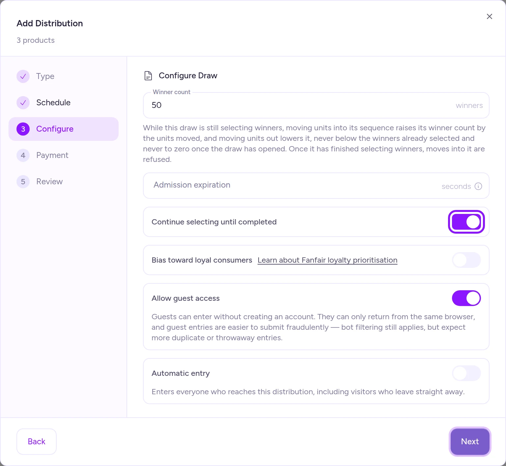
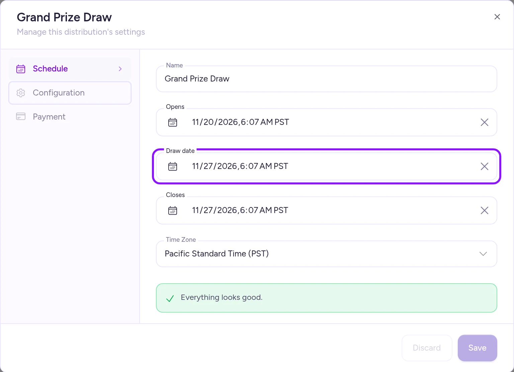

A draw takes entries during a window you set and picks winners at random. Each winner then gets a payment window to buy. Use a draw when everyone who enters in time should have a chance, however early or late they arrive. How a draw picks winners and replaces winners who do not pay is explained in [Draw](/concepts/distributions/draw).

A sequence is one way in to an experience. A draw always belongs to one sequence, and each sequence has its own waitlist.

## Before you start

- You have at least one product to sell. See [Add products](/guide/create/products).
- To use **Pre-authorise on entry**, a payment provider is connected and customers pay through Fanfare checkout. It is not available in the Fanfare app in Shopify. See [Payments and fees](/guide/account/payments).
- To use **Bias toward loyal consumers**, your loyalty programme is turned on. The loyalty programme is part of the Pro and Enterprise plans. See [Run a loyalty programme](/guide/learn/loyalty).

Draws are available on every plan, including Starter.

## Create a draw with a new experience

The experience wizard creates the experience, its first sequence and the draw in one go. Steps that work the same for every distribution are covered in [Create an experience](/guide/create/experiences).

1. Open **Experiences** and select **Create Experience**.
2. On **Experience type**, select the **Draw** card. The wizard moves to the next step on its own.
3. On **Configure Experience**, pick the products and enter an **Experience Name**. Set **Time Zone** first (it is below the dates), then **Opens At**, **Draw date** and **Closes At**. **Draw date** must fall between the other two. Select **Next**.
4. On **Stock**, set how many units this experience can sell. See [Allocate stock to a drop](/guide/create/stock-allocation).
5. With two or more products, a **Product assignment** step follows. See [Add and gate sequences](/guide/create/sequences).
6. On **Draw Configuration**, set **Winner count** and **Admission expiration**, and choose the switches. See [Draw settings](#draw-settings) below.
7. On **Payment**, choose how winners pay under **Payment collection**. See [Payment collection](#payment-collection) before you choose.
8. On **Access**, choose **Who can enter**. Guest entry for a draw made in the wizard is set here: choose **Anyone, as a guest** to let customers enter without signing in, or **Anyone, after signing in** to require it.
9. On **Review & launch**, check each row. **Edit** jumps back to that step. Select **Create experience**.

There is no separate launch step: once you select **Create experience**, the draw is scheduled to open at the time you set. See [Experiences](/concepts/experiences).

## Add a draw to an existing sequence

1. Open the experience, then open the sequence.
2. On the **Overview** tab, in the **Distributions** card, select **Add distribution**. **Create Distribution** at the top of the page does the same.
3. Enter a **Name**, choose **Draw**, and select **Next**.
4. On **Schedule**, set **Opens**, **Closes**, **Time zone** and **Draw at**, then select **Next**. **Draw at** must fall between **Opens** and **Closes**. The time zone starts as the experience's time zone.
5. On the **Configure** step, set **Winner count** and **Admission expiration**, and choose the switches. Select **Next**.
6. On **Payment**, choose the **Payment collection** option. Select **Next**.
7. Check the review and select **Create Distribution**. The draw appears in the **Distributions** card.

The time winners are picked is labelled **Draw at** when you add a draw to a sequence, and **Draw date** in the wizard and when you edit a draw. They are the same setting.

Distributions in one sequence cannot overlap in time: an overlapping window shows **Schedule conflict**, and you cannot continue. See [Distributions](/concepts/distributions/overview).

<Frame caption="Continue selecting until completed is on by default.">
  
</Frame>

## Draw settings

| Setting | What it does | Default | Can you change it once it is live? |
| --- | --- | --- | --- |
| **Draw at** (**Draw date** in the wizard and in **Edit**) | When winners are picked. It must fall between **Opens** and **Closes**. | None | Yes, until entry closes. |
| **Opens** | When customers can start entering. | None in **Add distribution**. In the wizard, the next whole minute | Yes until about 30 seconds before **Opens**. After that, only earlier. |
| **Closes** | When entry ends. A draw must have a close time. | None in **Add distribution**. In the wizard, 7 days after **Opens At** | Yes, until entry closes. |
| **Winner count** | How many winners the draw picks. | 10. In the wizard it follows the **Stock** total when every size has a number. | Yes, until entry has closed. |
| **Admission expiration** | How many seconds each winner has to check out: the payment window. | Blank, which uses the default the field's hint shows | Yes. |
| **Continue selecting until completed** | Keeps picking replacement winners until the winner count is met. | On | No. It locks about 30 seconds before **Opens**. |
| **Bias toward loyal consumers** | "When enabled, loyalty points weight the randomized entry order. Selection is not guaranteed." | Off | Yes, but a customer's weight is set when they enter, so a change only affects later entries. |
| **Allow guest access** (in the wizard: **Anyone, as a guest**) | Lets customers enter without an account. | Off | Yes. |
| **Automatic entry** | Enters everyone who reaches the draw, including visitors who leave straight away. With **Pre-authorise on entry**, customers are still asked for a card before they are entered. | Off | Yes. |
| **Payment collection** | When the winner pays: **Pay after the win** or **Pre-authorise on entry**. | **Pay after the win** | No. It locks about 30 seconds before **Opens**. |
| **Authorization amount** | The amount held on each entrant's card with **Pre-authorise on entry**. | None | No. It locks with **Payment collection**. |
| **Name** | The draw's name in the admin. | None | Yes. |
| **Time zone** (**Time Zone** in the wizard and in **Edit**) | The zone the times are shown and entered in. Changing it does not move the times. | The experience's time zone | Yes. |

### Winner count

In the wizard, when every size on the **Stock** step has a number, **Winner count** is greyed and reads "Follows the Stock total. Change the units on the Stock step to change it." Change the units on **Stock** instead.

Once entry has closed, **Winner count** is greyed in **Edit**. The info icon on the field reads "Winner count can't change after entry has closed."

<Note>
  On a sequence that counts its stock, the winner count follows units you move. While the draw is still selecting winners, moving units into its sequence raises the winner count by the units moved, and moving units out lowers it, never below the winners already selected. If the winner count is more than the units left, **Edit** warns that "This draw can grant at most" so many of your winners. You cannot create a draw, or raise its winner count, so that the draws in the sequence have more winners between them than it has units. The admin refuses with "A draw can't have more winners than the units in its sizes. Lower the winner count or add units first." See [Stock](/concepts/stock) and [Allocate stock to a drop](/guide/create/stock-allocation).
</Note>

On a sequence that counts its stock, with **Continue selecting until completed** on, a draw that has sold out refuses new entrants once **Draw at** has passed.

### Admission expiration

Enter the payment window in seconds. Leave it blank when you create the draw to use the default the field's hint shows, which begins "Leave blank for the default:". [Admission and the payment window](/concepts/admission-and-payment) explains what happens when a winner does not pay in time.

In **Add distribution** and **Edit**, when the sequence offers customers a choice of products or variants, a window under 5 minutes shows "A multi-choice selection window under 5 minutes leaves little time to pick". It is a warning only: you can still save.

To change the window in **Edit**, type a new number. Do not clear the field or enter 0: either gives winners 30 minutes, not the default the hint shows when you create the draw.

### Guest access and loyalty bias

**Bias toward loyal consumers** cannot be turned on while your loyalty programme is off: the switch shows "Needs a loyalty program". See [Loyalty and Fanfair](/concepts/loyalty).

Guests can only come back from the same browser, and guest access brings more duplicate or throwaway entries than sign-in. A sequence with an audience cannot allow guests. While any Scheduled or Live distribution in the sequence lacks guest access, everyone in the sequence must sign in. See [Sequences and routing](/concepts/sequences).

### Payment collection

- **Pay after the win**: "The winner pays after winning, inside the payment window."
- **Pre-authorise on entry**: "A hold is placed on entry and captured when the winner is chosen." Set the **Authorization amount** too. The hold is one amount, so every product and variant on offer has to cost exactly that amount.

If your customers pay in your own checkout, there is no choice to make: the step reads "Customers pay in your own checkout, so Fanfare collects no payment for this draw." Without a connected payment provider, **Pre-authorise on entry** cannot be selected. See [Checkout options](/concepts/checkout-options).

<Warning>
  **Payment collection**, **Authorization amount** and **Continue selecting until completed** lock about 30 seconds before **Opens**. After that, the **Payment** section shows "Payment collection is locked because this distribution has opened. Deactivate it and create another one to change how payment is collected.", and saving a change to **Continue selecting until completed** is refused. Deactivating and creating another draw is the only way out, and deactivating cannot be undone. Check these settings before the draw opens.
</Warning>

<Warning>
  With **Pre-authorise on entry**, card holds last about a week. If **Draw at**, plus the payment window, plus a day, is more than about seven days after **Opens**, the admin refuses the schedule: "Card authorizations last about a week, so this schedule would leave every entrant's authorization expired before selection. Move the selection time earlier or open entry later." A shorter overlap only warns, and the holds of customers who entered early can lapse before they are picked. To avoid both, keep the time from **Opens** to the later of **Draw at** and **Closes**, plus the payment window, under about six days. In **Edit**, or after going back to **Schedule** in **Add distribution**, the schedule shows from which date entries "hold a live authorization at selection". See [Admission and the payment window](/concepts/admission-and-payment).
</Warning>

<Frame caption="With Pre-authorise on entry, every entrant's card is held for the authorisation amount.">
  
</Frame>

## Edit a draw

On the sequence's **Overview** tab, select **Edit** on the draw's card. The settings are in three sections: **Schedule**, **Configuration** and **Payment**. Make your change and select **Save**.

- After entry closes, a change to **Draw date**, **Opens** or **Closes** is refused with "This draw has closed. Create a new one."
- Once the draw has opened, **Opens** shows **Locked** and can only move earlier: "This Draw has opened, so its open time can only move earlier. You can still change when it closes." Moving **Opens** earlier does not unlock **Payment collection**.
- Changing **Continue selecting until completed** after the draw has opened is refused with "Selection mode cannot change after a draw opens."
- A deactivated draw is read only, and its card shows **View** instead of **Edit**.

Settings you can still change while a draw is live are covered in [Change things mid-drop](/guide/drop/live-controls). To copy a draw, use **Duplicate** on its card: see [Add and gate sequences](/guide/create/sequences). To stop or remove one, see [Stop a drop](/guide/drop/deactivate).

<Frame caption="When you edit a draw, the time winners are picked is labelled Draw date.">
  
</Frame>

What customers see before, during and after a draw, including the messages winners and non-winners receive, is in [What your customers see](/guide/drop/what-customers-see).

## On Shopify

You set up a draw the same way in the Fanfare app in Shopify, with two differences:

- Customers pay in Shopify's checkout, so the **Payment** step reads "Customers pay in your own checkout, so Fanfare collects no payment for this draw." and you cannot choose **Pre-authorise on entry**.
- If you leave a Shopify size's units blank on **Stock**, the wizard shows no **Winner count** field. It reads "Winner count follows the total, which includes Shopify's count at creation. Fanfare sets it when the draw is created."

Until checkout protection is on and the product widget is on your theme, the draw does not protect your product. See [Storefront setup](/guide/shopify/storefront-setup).

## Troubleshooting

<AccordionGroup>
  <Accordion title="The draw time shows 'Must fall within the distribution's window.'">
    **Draw at** (or **Draw date**) is before **Opens** or after **Closes**. Move it inside the window, or widen the window.
  </Accordion>
  <Accordion title="Winner count is greyed out">
    In the wizard, it follows the **Stock** total: change the units on the **Stock** step. In **Edit**, entry has closed, and the winner count can no longer change.
  </Accordion>
  <Accordion title="I can't change Payment collection">
    It locked about 30 seconds before the draw opened. Deactivate the draw and create a new one with the payment collection you want.
  </Accordion>
  <Accordion title="I can't select Next on the Schedule step">
    The window overlaps another distribution in the same sequence. The dialogue names it under **Schedule conflict**. Choose a window that starts after the other one ends, or add the draw to another sequence.
  </Accordion>
</AccordionGroup>

## Related

<CardGroup>
  <Card title="Draw" href="/concepts/distributions/draw">How a draw picks winners and replaces those who do not pay.</Card>
  <Card title="Admission and the payment window" href="/concepts/admission-and-payment">The payment window and pre-authorisation.</Card>
  <Card title="Allocate stock to a drop" href="/guide/create/stock-allocation">How many units the draw can sell.</Card>
  <Card title="Stop a drop" href="/guide/drop/deactivate">Deactivate and Delete.</Card>
</CardGroup>
