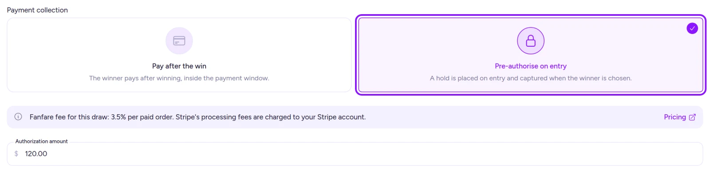

A draw collects entries during a window you set, picks winners at random, and gives each winner a timed window to complete checkout. Use a draw when you want every shopper who enters in time to have an equal shot—whether they arrive in the first second or the last minute.

For how winner selection and replacement draws work under the hood, read [Draw](/concepts/distributions/draw).

## Before you start

- Have at least one product ready in Fanfare. See [Add products](/guide/create/products).
- To use **Pre-authorize on entry**, you need **Fanfare checkout** and a connected Stripe account (not available in the Shopify app). See [Payments and fees](/guide/account/payments).
- To use **Bias toward loyal consumers**, turn on your loyalty program first (Pro and Enterprise). See [Run a loyalty program](/guide/learn/loyalty).

Draws are available on every plan, including Starter.

## Create a draw with a new experience

The experience wizard creates your experience, its first sequence, and the draw together. Shared steps are covered in [Create an experience](/guide/create/experiences). Here's how to set up a draw:

<Steps>
  <Step title="Choose Draw">
    Open **Experiences**, select **Create Experience**, and choose **Draw**.
  </Step>
  <Step title="Set products and dates">
    On **Configure Experience**, pick your products and enter an **Experience Name**. Set **Time Zone** first (it appears below the date fields), then set **Opens At**, **Draw date**, and **Closes At**—**Draw date** must fall between **Opens At** and **Closes At**.
  </Step>
  <Step title="Allocate stock">
    On **Stock**, enter how many units the drop can sell. If you picked two or more products, complete **Product assignment** next. See [Allocate stock to a drop](/guide/create/stock-allocation) and [Add and gate sequences](/guide/create/sequences).
  </Step>
  <Step title="Configure draw behavior">
    On **Draw Configuration**, set **Winner count**, **Admission expiration**, and any optional switches. See [Draw settings](#draw-settings) below.
  </Step>
  <Step title="Choose payment and access">
    On **Payment**, choose **Pay after the win** or **Pre-authorize on entry** under **Payment collection** (review [Payment collection](#payment-collection) first). Then on **Access**, choose **Who can enter**—pick **Anyone, as a guest** to allow entry without signing in, or **Anyone, after signing in** to require it.
  </Step>
  <Step title="Review and create">
    Check every row on **Review & launch** (use **Edit** to jump back to any step), then select **Create experience**.
  </Step>
</Steps>

There's no separate launch step—your draw opens automatically at the **Opens At** time you set. See [Experiences](/concepts/experiences).

## Add a draw to an existing sequence

1. Open your experience, then open the sequence you want to add to.
2. On the **Overview** tab, select **Add distribution** in the **Distributions** card (or **Create Distribution** at the top of the page).
3. Enter a **Name**, choose **Draw**, and select **Next**.
4. On **Schedule**, set **Opens**, **Closes**, **Time zone** (defaults to the experience's time zone), and **Draw at** (must fall between **Opens** and **Closes**), then select **Next**.
5. On **Configure**, set **Winner count**, **Admission expiration**, and your toggles, then select **Next**.
6. On **Payment**, choose your **Payment collection** option and select **Next**.
7. Review your setup and select **Create Distribution**.

<Note>
  **Draw at** (in **Add distribution**) and **Draw date** (in the wizard and **Edit**) are the same setting. Distributions in the same sequence can't overlap—if they do, **Schedule conflict** blocks you from continuing until you adjust the dates or move the draw to another sequence. See [Distributions](/concepts/distributions/overview).
</Note>

<Frame caption="Continue selecting until completed is turned on by default so unclaimed spots go to replacement winners.">
  
</Frame>

## Draw settings

| Setting | What it does | Default | Editable once live? |
| --- | --- | --- | --- |
| **Draw at** (**Draw date** in wizard and **Edit**) | When winners are selected. Must fall between **Opens** and **Closes**. | None | Yes, until entry closes. |
| **Opens** | When shoppers can start entering. | Wizard: next whole minute; **Add distribution**: none | Until about 30 seconds before **Opens**; after that, only earlier. |
| **Closes** | When entry closes (required). | Wizard: 7 days after **Opens At**; **Add distribution**: none | Yes, until entry closes. |
| **Winner count** | Total winners to select. | 10 (wizard tracks **Stock** total when every size has a count) | Yes, until entry closes. |
| **Admission expiration** | How many seconds each winner gets to complete checkout. | Blank (uses the default shown in the field hint) | Yes |
| **Continue selecting until completed** | Keeps picking replacement winners if someone doesn't check out, until the winner count is met. | On | No—locks about 30 seconds before **Opens**. |
| **Bias toward loyal consumers** | Weights the randomized entry order using loyalty points (selection isn't guaranteed). | Off | Yes, though each entrant's weight is recorded when they enter, so changes only affect later entries. |
| **Allow guest access** (**Anyone, as a guest** in wizard) | Lets shoppers enter without an account. | Off | Yes |
| **Automatic entry** | Enters everyone who lands on the draw, including visitors who leave right away. With **Pre-authorize on entry**, shoppers are still prompted for a card first. | Off | Yes |
| **Payment collection** | Whether winners pay at checkout (**Pay after the win**) or place a card hold on entry (**Pre-authorize on entry**). | **Pay after the win** | No—locks about 30 seconds before **Opens**. |
| **Authorization amount** | Card hold amount per entrant with **Pre-authorize on entry**. | None | No—locks with **Payment collection**. |
| **Name** | Internal name in the admin. | None | Yes |
| **Time zone** (**Time Zone** in wizard and **Edit**) | Zone used to display and enter times. Changing it doesn't shift the actual open, draw, or close moments. | Experience's time zone | Yes |

### Winner count

- **Wizard auto-sync:** When every size on the **Stock** step has a unit count, **Winner count** automatically follows that total—update units on **Stock** to change it.
- **Locks at close:** Once entry closes, **Winner count** can't be edited.
- **Stock-tracked sequences:** Moving units into or out of a stock-tracked sequence while selection is still running raises or lowers **Winner count** automatically (never below the winners already chosen). Total winners across all draws in a sequence can't exceed its allocated units—lower the winner count or add stock first. If **Continue selecting until completed** is on and stock sells out, new entrants are turned away once **Draw at** passes. See [Stock](/concepts/stock) and [Allocate stock to a drop](/guide/create/stock-allocation).

### Admission expiration

Enter the checkout window in **seconds**, or leave it blank when creating the draw to use the default shown in the field's hint. For what happens when a winner lets their window expire, see [Admission and the payment window](/concepts/admission-and-payment).

- On sequences where winners pick between multiple products or variants, Fanfare displays a warning if the window is under 5 minutes (you can still save).
- **Editing the window:** Always enter an explicit number in **Edit**. Clearing the field or entering `0` sets a **30-minute** window rather than the creation default.

### Guest access and loyalty bias

- **Bias toward loyal consumers** requires an active loyalty program—see [Loyalty and Fanfair](/concepts/loyalty).
- Guests can only return from the same browser, and open guest entry tends to draw more duplicate or throwaway entries than sign-in. Audience-gated sequences never allow guests, and if any Scheduled or Live distribution in a sequence requires sign-in, everyone in that sequence must sign in. See [Sequences and routing](/concepts/sequences).

### Payment collection

- **Pay after the win:** Winners receive a notification and pay at checkout within their payment window.
- **Pre-authorize on entry:** Fanfare places a hold on each entrant's card when they enter and captures it automatically if they win (or releases it if they don't). Because the hold is a single **Authorization amount**, every product and variant in the draw must cost exactly that amount.

Pre-authorization requires **Fanfare checkout** and a connected Stripe account. If you use external checkout, shoppers pay in your store and Fanfare skips payment collection. See [Checkout options](/concepts/checkout-options).

<Warning>
  **Payment collection**, **Authorization amount**, and **Continue selecting until completed** lock about **30 seconds before Opens**. Moving **Opens** earlier never unlocks them. To change any of them after they lock, you must **Deactivate** the draw (which can't be undone) and create a new one. Review all three before launch.
</Warning>

<Warning>
  **Keep pre-authorized draw schedules under 6 days.** Card holds expire after about 7 days. If **Draw at** plus the payment window plus one day extends beyond ~7 days from **Opens**, Fanfare blocks the schedule. Shorter overlaps trigger a warning, and early entrants' holds can expire before selection runs. To stay safe, keep the span from **Opens** to the later of **Draw at** and **Closes**, plus the payment window, under about 6 days. In **Edit** (or when revisiting **Schedule** in **Add distribution**), Fanfare shows which entry dates will still hold a live authorization at selection. See [Admission and the payment window](/concepts/admission-and-payment).
</Warning>

<Frame caption="With Pre-authorize on entry, Fanfare holds the authorization amount on each entrant's card until selection.">
  
</Frame>

## Edit a draw

Open the sequence's **Overview** tab, select **Edit** on the draw card, update **Schedule**, **Configuration**, or **Payment**, and select **Save**.

- **After Opens:** **Opens** can only move earlier (moving it never unlocks **Payment collection**), and **Continue selecting until completed** can't change.
- **After entry closes:** **Draw date**, **Opens**, **Closes**, and **Winner count** are locked—create a new draw if you need another window.
- **Deactivated draws:** Become read-only (**View** replaces **Edit**).

See [Change things mid-drop](/guide/drop/live-controls) for live edits, [Add and gate sequences](/guide/create/sequences) to copy a draw with **Duplicate**, and [Stop a drop](/guide/drop/deactivate) to deactivate or delete one.

<Frame caption="In Edit, the winner selection time is labeled Draw date.">
  
</Frame>

For the shopper experience before, during, and after selection—including winner and non-winner messages—see [What your customers see](/guide/drop/what-customers-see).

## On Shopify

Draws work the same way in the Shopify app, with two differences:

- **No card pre-authorization:** Shoppers pay in Shopify's checkout, so **Pre-authorize on entry** isn't available.
- **Automatic winner count for blank Shopify sizes:** If you leave any Shopify size's units blank on **Stock**, the wizard omits **Winner count** and sets it automatically from the total (including Shopify's inventory count) when the draw is created.

Make sure checkout protection is enabled and the product widget is on your theme so shoppers can't bypass the draw. See [Storefront setup](/guide/shopify/storefront-setup).

## Troubleshooting

<AccordionGroup>
  <Accordion title="The draw time shows 'Must fall within the distribution's window'">
    **Draw at** (or **Draw date**) is set before **Opens** or after **Closes**. Move it inside the entry window, or widen **Opens** and **Closes**.
  </Accordion>
  <Accordion title="Winner count is grayed out">
    In the wizard, **Winner count** tracks your **Stock** total—adjust units on the **Stock** step. In **Edit**, entry has already closed and the winner count is locked.
  </Accordion>
  <Accordion title="I can't change Payment collection">
    **Payment collection** locks about 30 seconds before the draw opens. Deactivate the draw and create a new one with the payment option you want.
  </Accordion>
  <Accordion title="I can't continue past the Schedule step">
    Your draw overlaps another distribution in the same sequence, shown under **Schedule conflict**. Move the dates so the draw starts after the other distribution ends, or add it to a different sequence.
  </Accordion>
</AccordionGroup>

## Related

<CardGroup>
  <Card title="Draw" href="/concepts/distributions/draw">
    How a draw picks winners and replaces anyone who doesn't pay.
  </Card>
  <Card title="Admission and the payment window" href="/concepts/admission-and-payment">
    Payment windows and card pre-authorization rules.
  </Card>
  <Card title="Allocate stock to a drop" href="/guide/create/stock-allocation">
    Control how many units the draw can sell.
  </Card>
  <Card title="Stop a drop" href="/guide/drop/deactivate">
    Deactivate or delete a draw.
  </Card>
</CardGroup>
