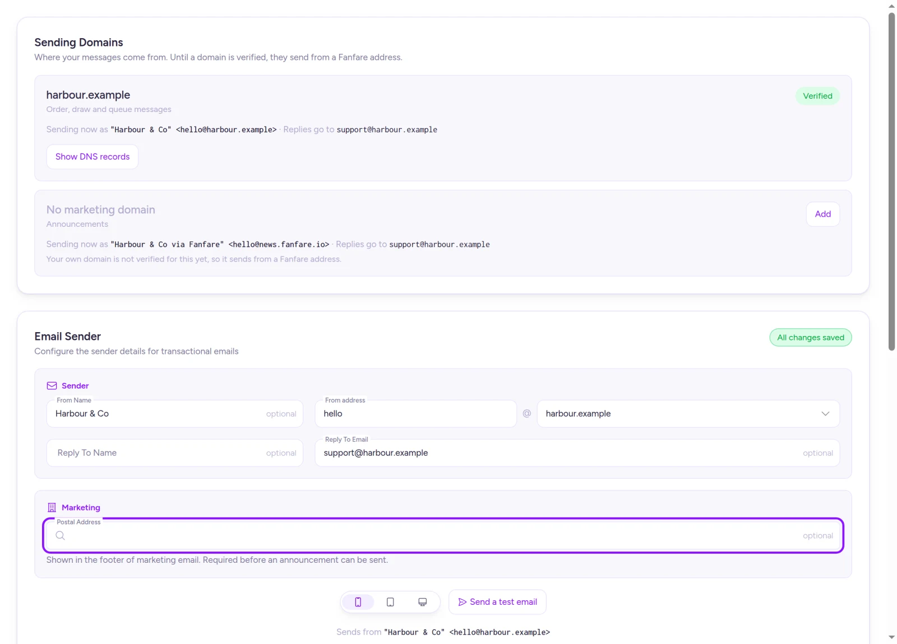
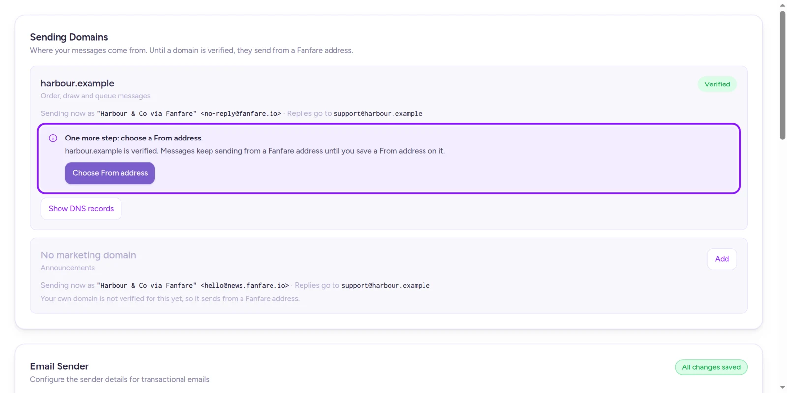

Fanfare emails your customers throughout every drop—both automatic updates (sign-in codes, draw results, queue turns, and order receipts) and the announcements you schedule. Under **Settings → Email Sender**, you control the sender name shoppers see, where replies land, the business postal address required on marketing emails, and your custom sending domains.

Until you verify your own domain and save a From address on it, emails send from a Fanfare address under your brand name.

<Note>
  Save your **Postal Address** before scheduling your first drop—Fanfare requires a postal address to schedule email announcements or send audience invites.
</Note>

## Before you start

- You're an organization admin in the Fanfare admin (other team members have read-only access to this page).
- To send from your own domain, have access to your domain's DNS provider (or a teammate who can add DNS records for you).

<Frame caption="Manage custom sending domains at the top and configure your sender details and postal address below.">
  
</Frame>

## Set your sender details and postal address

1. Go to **Settings → Email Sender**.
2. Under **Sender**, set your **From Name**—the display name shoppers see in their inbox (defaults to your organization name).
3. Enter your **Reply To Email** (labeled **Replies go to** before you verify a custom domain) and an optional **Reply To Name** so customer replies go straight to your inbox instead of Fanfare.
4. Once your domain for order, draw, and queue messages is verified, enter the local part of your **From address** before the `@` (your verified domain appears beside it). Before verification, select **Verify a domain**—see [Use your own domain](#use-your-own-domain).
5. Under **Marketing**, enter your business **Postal Address**. This appears in the footer of every marketing email and is required for email announcements and audience invites.
6. Select **Save** in the bottom bar.

All fields are optional to save, though any email address you enter must be valid.

<Warning>
  Removing your **Postal Address** stops all scheduled email announcements and audience invites from delivering—they aren't paused and will fail when their send time arrives. If you accidentally clear it, re-enter your address, save, and reschedule any announcement marked **Didn't send** under [Announcements](/guide/create/announcements) (invites retry automatically—see [Invites, waitlist and access-code sends](/guide/create/invites-and-waitlist)).
</Warning>

### Preview and test what customers see

The **Sends from** line below the form confirms the exact name and address your automatic emails currently use. While sending from a Fanfare address, your display name appears as **"[From Name] via Fanfare"**, and if **Reply To Email** is blank with no custom From address saved, replies route to Fanfare support.

To inspect an email in your inbox, save any pending changes, then select **Send a test email → Send**. Fanfare sends a sample appointment confirmation to your sign-in email address using your saved sender details.

### Field reference

| Setting | What it controls | Default | Updates live drops? |
| --- | --- | --- | --- |
| **From Name** | Sender display name shown in customer inboxes. | Your organization name | Yes |
| **From address** | Sender email for automatic messages (requires a verified transactional domain). Announcements reuse the same prefix on your announcements domain unless you set a **Marketing Address**. | A Fanfare address | Yes |
| **Reply To Name** | Display name on the reply-to address. | Empty | Yes |
| **Reply To Email** (or **Replies go to**) | Inbox that receives customer replies. | Empty | Yes |
| **Postal Address** | Business address shown in marketing email footers. Required for announcements and invites. | Empty | Yes—clearing it prevents scheduled email announcements and invites from sending |

Sender changes apply to all upcoming emails as they send—allow a few minutes for updates to take effect.

## Use your own domain

Send email from your own domain for stronger brand trust and inbox deliverability. The **Sending Domains** card splits your mail into two separate rows to protect transactional deliverability:

- **Order, draw and queue messages:** Automatic transactional emails like sign-in codes, draw outcomes, and payment windows ([What your customers see](/guide/drop/what-customers-see)).
- **Announcements:** Scheduled marketing emails sent to customers who haven't unsubscribed from marketing email.

Each row holds one domain, and the two must be distinct—when you add an announcements domain, Fanfare suggests a subdomain like `news.yourbrand.com`. You can't add `fanfare.io` domains or a domain already registered on another email service account (use a dedicated subdomain instead).

<Warning>
  Choose each sending domain carefully. Once a domain is **Verified** or enters **Needs attention**, it can't be removed or replaced from the admin (unless our email provider reports it no longer exists, in which case **Remove domain** appears), and each mail type holds only one domain. **Remove** is available only while a domain is **Waiting for DNS**, **Failed**, or **Removing**, and removes it immediately.
</Warning>

### Add and verify a domain

<Steps>
  <Step title="Add your domain">
    On the **Sending Domains** card, select **Add** on the row you want, enter your **Domain** (for example, `mail.yourbrand.com`), and select **Continue**.
  </Step>
  <Step title="Add the DNS records">
    Fanfare displays the DNS records to add—**Type**, **Status**, **Name**, and **Value** (plus priority where shown). Copy each record into your DNS provider's dashboard.
  </Step>
  <Step title="Verify your records">
    Select **Check now** (available once per minute). DNS propagation can take up to a few hours—you can close the dialog while Fanfare checks in the background, and reopen it anytime via **Show DNS records**. Each record updates to **Found**, **Not yet**, **Retrying**, **Failed**, or **Unknown**.
  </Step>
  <Step title="Set your From address">
    Once verified, select **Choose From address** (or **Done** if your From address is already configured).
  </Step>
</Steps>

<Note>
  Domains that have never been verified and remain in **Waiting for DNS** or **Failed** for 7 days are released automatically so you can start fresh. Previously verified domains aren't released automatically.
</Note>

<Frame caption="Copy each DNS record into your DNS provider, then select Check now to verify.">
  
</Frame>

### Choose the From address

<Warning>
  Verifying a domain for order, draw, and queue messages doesn't automatically switch your sender—emails keep sending from a Fanfare address until you save a **From address** on that domain (the card prompts *"One more step: choose a From address"*). A verified announcements domain starts sending right away if you already have a **From address** saved; otherwise, set a **Marketing Address**.
</Warning>

Select **Choose From address** on the verification dialog or domain card:

- **Order, draw and queue messages:** Enter the prefix before `@` in **From address**, confirm your verified domain beside it, and select **Save**.
- **Announcements:** Enter your preferred prefix in the **Marketing Address** dialog and select **Save**. Update it anytime with **Change address**, or select **Use the default** to fall back to your **From address** prefix on your announcements domain (or a Fanfare address if no **From address** is set).

Once saved, the row's **Sending now as** line confirms your active sender address.

<Frame caption="After DNS verification, save a From address on your domain to start sending from it.">
  
</Frame>

### Domain statuses

| Status | What it means | Next step |
| --- | --- | --- |
| **Waiting for DNS** | Not all DNS records have been detected yet. | Add any missing records at your DNS provider, then select **Check now**. |
| **Verified** | All records verified successfully. | Save a From address on the domain if you haven't yet. |
| **Needs attention** | DNS verification lapsed; mail temporarily falls back to a Fanfare address. | Select **Show DNS records**, restore any missing or changed records at your DNS provider, and re-verify. |
| **Failed** | Verification failed; mail sends from a Fanfare address. | Double-check each record's exact values and re-check, or **Remove** and re-add the domain. |
| **Removing** | Removal is in progress; mail sends from a Fanfare address. | Select **Remove** again if it stalls, or contact support if removal fails. |
| **Unknown** | Status check couldn't confirm the domain right now. | Select **Show DNS records**, wait a moment, then select **Check now**. |

If a domain row warns that messages aren't sending from your domain, an outbound email from your domain was rejected and automatically fell back to a Fanfare address so the customer still received it. Verify all DNS records show **Found**—if they do, contact Fanfare support.

## Related settings

- **Default messaging channel (email vs. SMS):** Configure under **Settings → Organization → Messaging**. See [Organization settings](/guide/account/organization).
- **SMS brand prefix:** Configured in your Twilio connection under [Integrations](/guide/account/integrations).
- **Email logo and colors:** Controlled by your brand in [Set your brand](/guide/create/brand).

## On Shopify

- Any Shopify staff member with access to the Fanfare app can update sender settings and sending domains—admin-only restrictions don't apply in the Shopify app.
- **Send a test email** sends to your Shopify staff account's email address, which must be verified in Shopify first.
- Legacy links to the app's email or messaging settings redirect here automatically.

## Troubleshooting

<AccordionGroup>
  <Accordion title="DNS records still show Not yet after several hours">
    DNS propagation typically finishes within a few hours. If records still show **Not yet**, compare each **Type**, **Name**, and **Value** at your DNS provider against **Show DNS records** (watching for duplicate domain suffixes added automatically by some DNS hosts), fix any mismatch, and select **Check now**.
  </Accordion>
  <Accordion title="My domain shows Needs attention or Failed">
    Open **Show DNS records** and verify every required record is still active at your DNS provider. While you fix it, Fanfare automatically sends from a Fanfare address so customer emails aren't dropped. A **Failed** domain can also be removed and added again.
  </Accordion>
  <Accordion title="My domain is verified, but emails still come from a Fanfare address">
    You still need to save a From address on the verified domain. Follow [Choose the From address](#choose-the-from-address).
  </Accordion>
  <Accordion title="An announcement says Didn't send because my postal address isn't set">
    Add your **Postal Address** on this page and select **Save**, then reschedule the announcement under [Announcements](/guide/create/announcements).
  </Accordion>
</AccordionGroup>

## Related

<CardGroup>
  <Card title="Announcements" href="/guide/create/announcements">
    Schedule email, SMS, and social announcements for your drop.
  </Card>
  <Card title="Invites, waitlist and access-code sends" href="/guide/create/invites-and-waitlist">
    Automatic audience invites, waitlist alerts, and access-code emails.
  </Card>
  <Card title="What your customers see" href="/guide/drop/what-customers-see">
    Every automated message customers receive throughout a drop.
  </Card>
  <Card title="Organization settings" href="/guide/account/organization">
    Configure your default messaging channel and organization settings.
  </Card>
</CardGroup>
