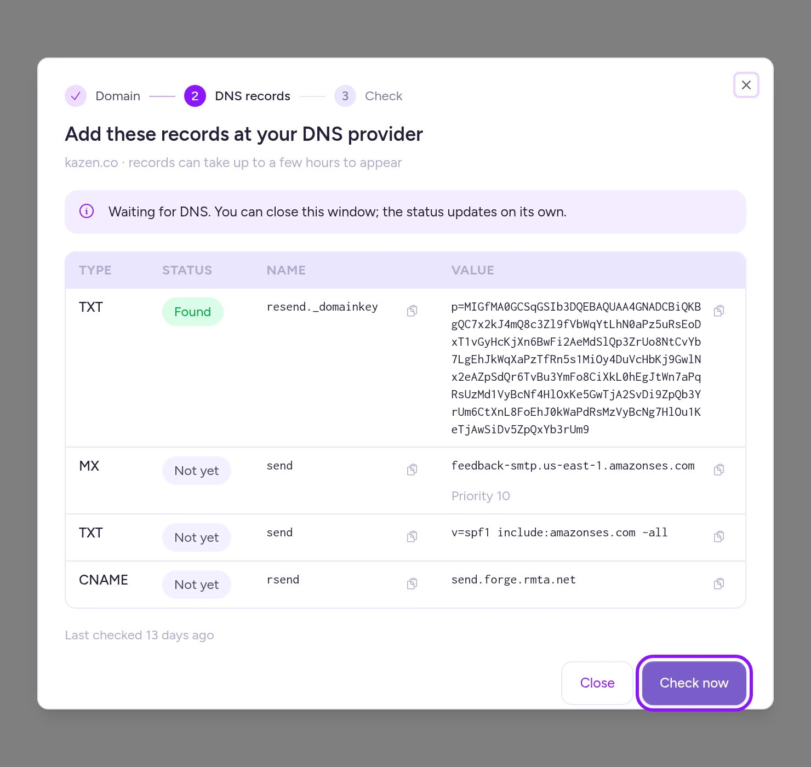

Fanfare sends email to your customers on your behalf: automatic messages about their orders, draws and queues, and the announcements you schedule. **Settings → Email Sender** controls how that mail is signed: the name customers see, where their replies go, the postal address that marketing email must carry, and the domains it is sent from. Until you verify a domain of your own and choose a From address on it, mail comes from a Fanfare address under your brand name.

Set this up before you schedule your first email announcement: an email announcement cannot be scheduled or sent without a postal address.

## Before you start

- You are an organisation admin. Other team members see the page with its fields disabled, the note "Only organization admins can change the email sender." and, in place of the domains, "An organization admin manages sending domains."
- To use your own domain, you can add records at your domain's DNS provider, or you can ask the person who does.

<Frame caption="Sending domains sit above the sender form. The Sends from line shows the address mail actually leaves from.">
  
</Frame>

## Set the sender and postal address

1. Open **Settings → Email Sender**.
2. In the **Sender** section, enter a **From Name**. This is the name customers see in their inbox. It starts as your organisation's name.
3. Enter a **Reply To Email**, and a **Reply To Name** if you want one. Customers who reply reach this inbox, not Fanfare. While you have no verified domain for order, draw and queue messages, this field is labelled **Replies go to** and sits first in the section, because it is the one address customers see that you control.
4. If your domain for order, draw and queue messages is verified, enter the part of the **From address** before the @. Your domain is already selected beside it. While that domain is not verified, including while it shows **Needs attention**, the field is locked to a Fanfare address and offers **Verify a domain** instead (see [Use your own domain](#use-your-own-domain)).
5. In the **Marketing** section, enter your **Postal Address**. It is shown in the footer of every marketing email, and an email announcement cannot be scheduled or sent without it.
6. Select **Save** in the bar that appears at the bottom of the page.

Every field is optional, but each email address you enter must be a valid address.

<Warning>
  Clearing the **Postal Address** stops every scheduled email announcement from reaching anyone. They keep their send times and fail when they come due; they are not paused or moved. Fanfare asks "Remove the postal address?" before it saves. To keep your announcements, cancel that dialogue and leave the address in place. If you have already removed it, enter it again; an announcement that has already failed shows a "Didn't send" line explained in [Announcements](/guide/create/announcements).
</Warning>

Invites to a sequence's audience are marketing email too and also need the postal address. See [Invites, waitlist and access-code sends](/guide/create/invites-and-waitlist).

### Check what customers will see

Under the form, the **Sends from** line shows the name and address your automatic messages actually go out from right now. If that is still a Fanfare address, the line adds "Your own domain is not verified for this yet, so it sends from a Fanfare address." While mail comes from a Fanfare address, the name customers see is your **From Name** followed by "via Fanfare". If **Reply To Email** is empty and you have no From address of your own saved, replies to that mail go to Fanfare's support team.

To see it in your own inbox, select **Send a test email**, then **Send**. Fanfare sends a sample appointment confirmation to your own sign-in address, using the sender you saved. The button is unavailable while you have unsaved changes ("Save your changes to send a test of them."), so save first.

### Field reference

| Setting | What it does | Default | Can you change it once a drop is live? |
| --- | --- | --- | --- |
| **From Name** | The sender name customers see. | Your organisation's name | Yes. |
| **From address** | The address automatic messages come from. Only a domain you have verified for order, draw and queue messages can be chosen. Announcements use the same part before the @ at your announcements domain unless you set a **Marketing Address**. | A Fanfare address | Yes. |
| **Reply To Name** | The name shown on the reply address. | Empty | Yes. |
| **Reply To Email** (or **Replies go to**) | Where customer replies are delivered. | Empty | Yes. |
| **Postal Address** | The address in the footer of every marketing email. Required for email announcements and invites. | Empty | Yes, but clearing it stops scheduled email announcements from sending. |

Changes to the sender name, From address and reply address apply to each email as it is sent, so they also reach messages still waiting to go out. Allow a few minutes for a change to take effect.

## Use your own domain

The **Sending Domains** card has two rows, one for each kind of mail:

- **Order, draw and queue messages**: the automatic messages Fanfare sends when something happens to a customer, such as a sign-in code, a draw result or a payment window. Which ones customers receive is covered in [What your customers see](/guide/drop/what-customers-see).
- **Announcements**: the marketing email you schedule. Customers who have unsubscribed from marketing email do not receive it.

Each row holds one domain. The two must be different domains: when you add an announcements domain, the card suggests a subdomain of your other domain, such as `news.yourbrand.com`. Domains on fanfare.io cannot be added. If your domain is already registered with another email service account, Fanfare refuses it and suggests a subdomain instead.

<Warning>
  Choose each domain carefully. Once a domain is **Verified**, or shows **Needs attention**, the admin offers no way to remove or replace it, and you cannot add a second domain for the same kind of mail. The one exception: if a check reports that the email service no longer has the domain, the window offers **Remove domain**. **Remove** appears only while a domain is **Waiting for DNS**, **Failed** or **Removing**, and it removes the domain straight away, without asking you to confirm.
</Warning>

### Add and verify a domain

1. On the **Sending Domains** card, select **Add** on the row you want.
2. Enter the **Domain**, for example `mail.yourbrand.com`, and select **Continue**.
3. Fanfare shows the records to add at your DNS provider, in a table of **Type**, **Status**, **Name** and **Value**. Copy each name and value into your DNS provider with the copy button beside it. If a record shows a priority under its value, enter that too.
4. Select **Check now**. You can check once a minute; the button counts down with "Check again in" a number of seconds. Records can take up to a few hours to appear.
5. When the domain is verified, the window says so. If that kind of mail still sends from a Fanfare address, select **Choose From address**. Otherwise select **Done**.

Each record shows **Found**, **Not yet**, **Retrying** or **Failed**, or **Unknown** if Fanfare can't tell. You can close the window while you wait: Fanfare keeps checking the domain, and you see the new status the next time you open this page or the window. The window does not refresh while it is open, so select **Check now** to see the latest. Selecting **Show DNS records** on the card opens the records again.

If a domain that has never been verified stays at **Waiting for DNS** or **Failed** for 7 days, Fanfare releases it, and you add it again. A domain that was verified once and later failed is not released: remove it yourself.

<Frame caption="Copy each record into your DNS provider, then select Check now.">
  
</Frame>

### Choose the From address

<Warning>
  Verifying a domain for order, draw and queue messages does not change where they come from. They keep sending from a Fanfare address until you save a From address on the domain. Until then, the card shows "One more step: choose a From address" on that row. An announcements domain is used straight away if you already have a From address saved; otherwise it waits until you set a **Marketing Address**.
</Warning>

**Choose From address**, on the verify window or on the card's notice, takes you to the right place:

- **Order, draw and queue messages**: it moves you to the **From address** field on the form. Enter the part before the @, check the domain beside it, and select **Save**.
- **Announcements**: it opens the **Marketing Address** dialogue. Enter the **Address** (the part before the @ on your announcements domain) and select **Save**. To change the announcements address later, select **Change address** on the row. **Use the default**, shown once you have set your own address, clears it: announcements go back to your **From address**'s part before the @ on this domain, or to a Fanfare address if you have no From address saved.

Once the From address is saved, the row's "Sending now as" line shows your own address.

<Frame caption="A verified domain is not used until you save a From address on it.">
  
</Frame>

### Domain statuses

| Status | What it means | What to do |
| --- | --- | --- |
| **Waiting for DNS** | Fanfare has not found every record yet. | Add any missing records, then **Check now**. |
| **Verified** | Every record was found. | Choose a From address on it, if you have not. |
| **Needs attention** | The domain "stopped passing verification". Messages send from a Fanfare address until the DNS records are fixed. | Select **Show DNS records**, fix the records at your DNS provider, and check again. |
| **Failed** | Verification failed. Messages send from a Fanfare address. | Check that each record matches exactly, then check again. You can also select **Remove** and add the domain again. |
| **Removing** | The domain is being removed. Mail already sends from a Fanfare address. | If it stays here, select **Remove** again. If the card says the domain couldn't be removed, contact support. |
| **Unknown** | Fanfare can't tell where the domain stands. | Select **Show DNS records**, then **Check now** in a moment. |

A row can also show a notice that messages are not sending from your domain. That means a message from your domain was refused and went out from a Fanfare address instead. Check that the DNS records are all found. If they are, contact support.

## Related settings

- Whether automatic messages go to customers by email or by text by default is set in **Settings → Organization**, on the **Messaging** tab. See [Organisation settings](/guide/account/organization).
- The brand name at the start of marketing texts is set with your Twilio connection. See [Integrations](/guide/account/integrations).
- Your logo and brand colours in emails come from your brand. See [Set your brand](/guide/create/brand).

## On Shopify

- Every staff member who can open the Fanfare app in Shopify can change the sender and the sending domains. There is no admin-only restriction.
- **Send a test email** goes to your Shopify staff account's email address, and only when Shopify reports that address as verified. Otherwise the test window says "Your account has no email address to send a test to."
- Older links to the app's email settings and messaging settings pages open this page.

## Troubleshooting

<AccordionGroup>
  <Accordion title="Records still show 'Not yet' after several hours">
    Records can take up to a few hours to appear. If they still show **Not yet** after that, compare each record at your DNS provider with the **Type**, **Name** and **Value** in the window, fix any that differ, then select **Check now**.
  </Accordion>
  <Accordion title="My domain shows 'Needs attention' or 'Failed'">
    Select **Show DNS records** and check every record is still in place at your DNS provider. Until it is fixed, messages go out from a Fanfare address, so customers still receive them. A **Failed** domain can also be removed and added again.
  </Accordion>
  <Accordion title="My domain is verified but mail still comes from a Fanfare address">
    A verified domain is not used until you save a From address on it. Follow [Choose the From address](#choose-the-from-address).
  </Accordion>
  <Accordion title="An announcement says 'Didn't send: your postal address isn't set in Settings → Email sender'">
    Enter your **Postal Address** on this page and select **Save**. Then follow [Announcements](/guide/create/announcements) to get the announcement sent.
  </Accordion>
</AccordionGroup>

## Related

<CardGroup>
  <Card title="Announcements" href="/guide/create/announcements">
    Schedule email, text and social announcements around a drop.
  </Card>
  <Card title="Invites, waitlist and access-code sends" href="/guide/create/invites-and-waitlist">
    The emails Fanfare sends to a sequence's audience and waitlist.
  </Card>
  <Card title="What your customers see" href="/guide/drop/what-customers-see">
    The automatic messages customers receive at each stage.
  </Card>
  <Card title="Organisation settings" href="/guide/account/organization">
    Your default messaging channel and other organisation-wide settings.
  </Card>
</CardGroup>
