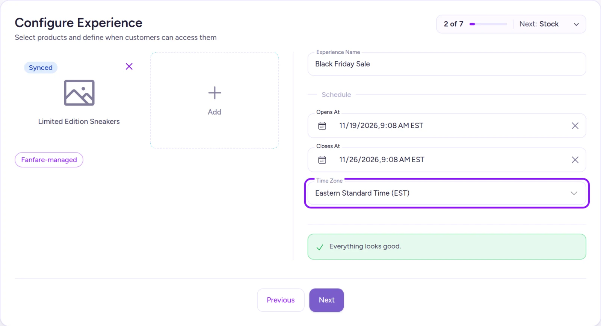
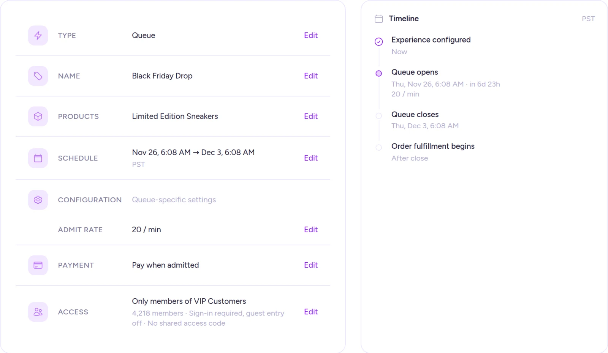

An experience is the drop you're running—its products, time zone, and every way customers can enter. The **Create Experience** wizard sets it all up in one pass, creating the experience, its first sequence, and its first distribution together.

## Before you start

- Create the products you want to sell. See [Add products](/guide/create/products). (Products are optional for appointments.)
- **Appointments** require the Growth plan or above. In-person appointments also need a location—see [Locations and opening hours](/guide/create/locations). Online appointments don't need one.
- **Auctions** require a checkout configuration that can charge the winning bid.

## Create the experience

<Steps>
  <Step title="Start the wizard and pick an experience type">
    Open **Experiences** and select **Create Experience**. (If you don't have any experiences yet, you can also select **Create Queue**, **Create Draw**, **Create Auction**, or **Create Appointment** to jump straight in with that type selected.)

    On **Experience type**, choose **Queue**, **Draw**, **Auction**, **Appointment**, or **Timed Release**. Types outside your plan appear grayed out with an upgrade prompt—for example, **Appointment** requires Growth or above. If **Auction** shows **"Needs a checkout that charges the winning bid"**, that depends on your checkout setup rather than your plan.
  </Step>
  <Step title="Select products, name, and schedule">
    On **Configure Experience**, pick up to 10 products. You can't mix **Fanfare-managed** and **Shopify-managed** products in the same experience—see [Manage stock](/guide/create/stock).

    Enter an **Experience Name**. You'll use it in the admin, and customers see it in Fanfare emails and SMS messages such as waitlist confirmations and payment-window alerts.

    Set **Time Zone** first, then set **Opens At** and **Closes At**:

    - **Draws** also ask for a **Draw date**.
    - **Auctions** also ask for **Settles**.
    - **Appointments** ask for **First bookable slot** instead of **Opens At**, plus whether the **Location** is online or in person.

    <Warning>
      **Opens At** defaults to the next minute and **Closes At** defaults to 7 days later (opening times up to 5 minutes in the past are accepted). There's no separate publish step—if you finish the wizard without updating **Opens At**, your drop opens almost immediately.
    </Warning>

    <Note>
      Changing **Time Zone** after picking your times keeps the exact same moment in time and shifts the displayed clock times (for example, 10:00 AM in New York becomes 7:00 AM in Los Angeles). Always pick your time zone first.
    </Note>

    <Frame caption="Set your time zone before choosing opening and closing times.">
      
    </Frame>
  </Step>
  <Step title="Complete the remaining drop steps">
    Select **Next** and work through the steps that apply to your drop type:

    - **Stock** (all types except Appointment, once a product is selected): Set how many units of each size this drop can sell. See [Allocate stock to a drop](/guide/create/stock-allocation).
    - **Product assignment** (draws with 2+ products): Choose whether winners pick their product or receive an assigned one. See [Add and gate sequences](/guide/create/sequences).
    - **Queue / Draw / Auction / Appointment Configuration:** Configure settings for your chosen format—see [Set up a queue](/guide/create/queue), [Set up a draw](/guide/create/draw), [Set up an auction](/guide/create/auction), or [Set up appointments](/guide/create/appointment). Timed releases have no extra configuration step.
    - **Payment** (queues and draws only): Choose how and when customers pay. See [Admission and the payment window](/concepts/admission-and-payment).
    - **Access:** Choose who can enter—**Anyone, after signing in**, **Anyone, as a guest** (queues, draws, and timed releases only), or an audience—and optionally enable a **Shared access code**. See [Add and gate sequences](/guide/create/sequences).
  </Step>
  <Step title="Review and create">
    On **Review & launch**, review each row—select **Edit** on any row to jump back to that step. When everything looks right, select **Create experience**.

    <Frame caption="Select Edit on any row to jump back and adjust a step before creating.">
      
    </Frame>
  </Step>
</Steps>

<Note>
  Most settings can still be adjusted after creating the experience, but a few things lock once a drop starts running:

  - **Products** lock while any sequence is live, has had entrants, or still has open payment windows (even after closing).
  - **Stock allocations** lock once the drop goes live.
  - **Opening time** can only move earlier once a distribution has opened.
  - **Deactivate** is permanent.

  See [What locks, and when](/concepts/what-locks-when) for the complete reference.
</Note>

## What creating makes

Selecting **Create experience** creates three things together and opens the experience's **Overview**:

- One **experience**
- One priority **P1** sequence with the same name
- One **distribution** of the type you chose

There is no separate publish step—your experience starts as **Scheduled**, or **Live** if its opening time has already passed. See [Experiences](/concepts/experiences) for what each status means.

Any sequences you add later rank behind this first one (**P2**, **P3**, and so on) in creation order, and priority can't be reordered in the admin. See [Sequences and routing](/concepts/sequences).

## If you leave the wizard partway

Your wizard progress saves automatically in your current browser tab. It isn't synced to your account, so other tabs and devices won't see it, and closing the tab discards it.

- Returning to the wizard in the same tab restores your draft—select **Start over** to clear it, or **Dismiss** to continue.
- Opening a link for a different drop type while you have a draft in progress lets you **Continue** your draft or **Start new**.
- Selecting **Cancel** clears the draft and returns you to **Experiences**.
- Going back to **Experience type** and choosing a different format discards the configuration from the previous type.

## Check your experience after creating

The experience header shows its status chip, a sequence summary, and its **Opens** and **Closes** times in the experience's time zone. Fanfare calculates **Opens** and **Closes** automatically from your distributions—the earliest opening through the latest close. See [Experiences](/concepts/experiences).

On **Overview**, the **What happens next** card shows a countdown to the next milestone and a timeline for each sequence in the experience's time zone. If your local time zone is different, select **Show in my time** to convert the times.

<Frame caption="What happens next shows a countdown and upcoming milestones for each sequence.">
  
</Frame>

## Change it later

Select **Edit** in the experience header, or **Experience Settings** in the left navigation, to update **Details**, **Products**, and **Stock** (for non-appointment experiences with products).

### Name and time zone

Under **Details**, update **Name** (you can also click the name directly in the header to edit inline) or **Time Zone**. When you change the time zone, Fanfare asks you to confirm how existing schedules should behave:

- **Before anything opens:** Queues, draws, auctions, and timed releases keep their clock times in the new zone (so a 10:00 AM opening stays at 10:00 AM in the new zone). If shifting clock times would place an opening in the past, Fanfare won't save and offers **Keep the same moment instead**.
- **After anything has opened:** Actual start and end moments stay fixed—only the displayed clock times update.
- **Appointments and deactivated distributions:** Never move.

<Frame caption="Before any distribution opens, changing the time zone keeps your clock times in the new zone.">
  
</Frame>

### Products and stock

Under **Products**, you can add or remove products (up to 10 total) as long as they aren't locked.

You can't remove a product that still holds allocated stock in the experience. Before the drop opens, open **Stock**, set all of that product's sizes to `0`, and save—then return to **Products** to remove it. Once the drop is live or has ended, allocations lock and that product stays attached.

Under **Stock**, update unit counts per size—see [Allocate stock to a drop](/guide/create/stock-allocation).

## Settings reference

| Setting | What it does | Default | Editable while live? |
| --- | --- | --- | --- |
| **Products** | Up to 10 products sold in the experience (optional for appointments). | None | No—locks while any sequence is live, has entrants, or has open payment windows |
| **Experience Name** (**Name** in settings) | Admin label and customer-facing name in emails and SMS. Also names the first sequence. | Empty | Yes, anytime |
| **Time Zone** | Time zone used across the experience. | Your organization's time zone | Yes—relabels times without moving moments once anything has opened |
| **Opens At** | Opening time of the first distribution. | Next minute | Change on the distribution; can only move earlier once open |
| **Closes At** | Closing time of the first distribution. | 7 days after **Opens At** | Change on the distribution |

## Find an experience

**Experiences** displays 20 experiences per page, sortable by **Name** or **Created**. Search requires at least 2 characters. Use the **Live now and opening in the next 14 days** strip at the top to jump straight into active or upcoming drops. Selecting **Edit** from a row's menu opens the experience's **Overview**.

## On Shopify

- **Appointments** aren't available in the Shopify app (when you have no experiences yet, **Create Timed Release** appears in its place).
- Pick products using Shopify's product picker. See [Products from Shopify](/guide/shopify/products).
- You can launch the wizard straight from a product in Shopify admin—it opens with that product attached and pre-fills the name. See [Fanfare inside Shopify admin](/guide/shopify/in-shopify-admin).
- **Auction** stays locked until your store's checkout supports charging the winning bid.
- If your experience saves successfully but Fanfare couldn't protect some products on your store, an alert names the affected products. See [Checkout protection](/guide/shopify/checkout-protection).

## Troubleshooting

<AccordionGroup>
  <Accordion title="Next doesn't advance from Configure Experience">
    Check the validation summary on the page. Common causes include: no product selected (required for every type except Appointment), **Opens At** more than 5 minutes in the past, **Closes At** not after **Opens At**, mixing Fanfare-managed and Shopify-managed products, or picking a product your checkout can't sell. Fix each listed item and select **Next** again.
  </Accordion>
  <Accordion title="An experience type card is locked">
    Plan-locked cards name the plan required—upgrade on **Billing** or choose another type. If **Auction** shows **"Needs a checkout that charges the winning bid"**, it's restricted by your checkout setup rather than your plan. See [Plans and what they unlock](/guide/start/plans).
  </Accordion>
  <Accordion title="I can't remove a product from an experience">
    Products lock while any sequence is live, has had entrants, or still has open payment windows (even after close). Before a drop opens, if the product holds allocated stock, set its sizes to `0` under **Stock** and save before removing it. See [Change it later](#change-it-later).
  </Accordion>
</AccordionGroup>

## Related

<CardGroup>
  <Card title="Experiences" href="/concepts/experiences">
    How experiences work, what each status means, and why there's no separate publish step.
  </Card>
  <Card title="Add and gate sequences" href="/guide/create/sequences">
    Add more ways into a drop with their own audience, access code, and stock.
  </Card>
  <Card title="Allocate stock to a drop" href="/guide/create/stock-allocation">
    Reserve units per size and split them across sequences.
  </Card>
  <Card title="What locks, and when" href="/concepts/what-locks-when">
    What you can change before, during, and after a drop.
  </Card>
  <Card title="Stop a drop" href="/guide/drop/deactivate">
    Deactivate a live drop or delete an unused experience.
  </Card>
</CardGroup>
