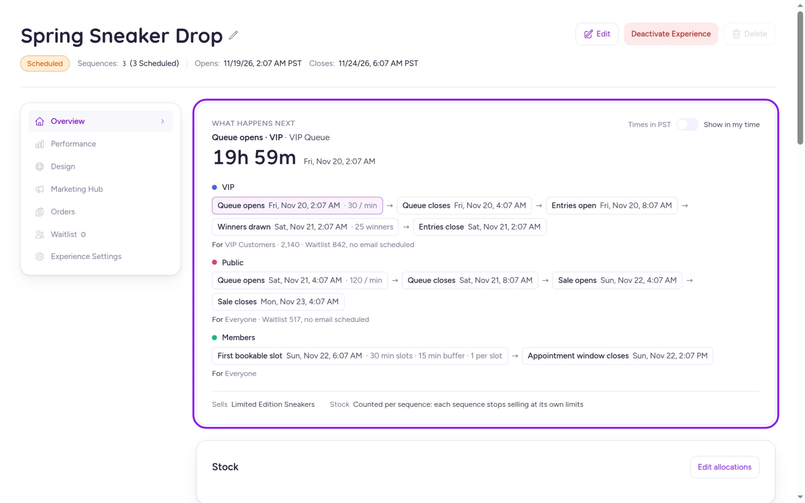
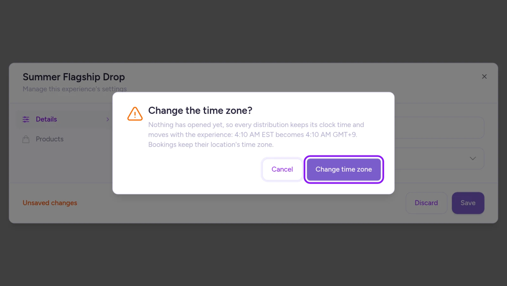

An experience is the drop you are running: the products on offer, the time zone, and every way customers can get in. The **Create Experience** wizard builds it in one pass. When you finish, Fanfare creates the experience, its first sequence and its first distribution together.

## Before you start

- Create the products you want to sell. See [Add products](/guide/create/products). Appointments are the exception: products are optional for them.
- For appointments, you need the Growth plan or above. In-person appointments also need a location: see [Locations and opening hours](/guide/create/locations). Online appointments need none.
- For an auction, your checkout must be able to charge the winning bid.

## Create the experience

1. Open **Experiences** and select **Create Experience**. When you have no experiences yet, the list also offers **Create Queue**, **Create Draw**, **Create Auction** and **Create Appointment** cards, which start the wizard with that type already chosen.
2. On **Experience type**, select a card: **Queue**, **Draw**, **Auction**, **Appointment** or **Timed Release**. The wizard moves to the next step on its own. A card your plan does not include is greyed out. Hover over it or tab to it to see "Available on" followed by the plan that has it, with a link to upgrade. On Starter, that is **Appointment**, which needs Growth or above. **Auction** can instead show "Needs a checkout that charges the winning bid", a lock that upgrading does not lift. If you follow a link to a type your plan does not include, the wizard opens on this step with a message saying which plan you need.
3. On **Configure Experience**, pick your products, up to 10. If the products mix stock that Fanfare manages with stock that Shopify manages, **Next** does not move you on, and the validation summary says why: see [Manage stock](/guide/create/stock).
4. Enter an **Experience Name**. You use it to find the drop in the admin, and customers see it in the emails and texts Fanfare sends them, such as waitlist confirmations and payment-window messages.
5. Set **Time Zone** first, then **Opens At** and **Closes At**. A draw also asks for a **Draw date**, and an auction for **Settles**. An appointment asks for **First bookable slot** in place of **Opens At**, and under **Location** whether it is online or at a location you pick.

   <Warning>
     **Opens At** starts at the next minute and **Closes At** seven days after that. An opening up to five minutes in the past is still accepted. If you select **Create experience** without changing them, the drop opens almost at once, and there is no separate publish step to stop it. Set the opening time before you go on.
   </Warning>

   <Note>
     Changing **Time Zone** after you have picked times keeps the same moments and changes the clock times shown. For example, 10:00 in New York becomes 07:00 when you switch to Los Angeles. Set the time zone before the times.
   </Note>

6. Select **Next** and complete the steps that follow. Which ones appear depends on the type and the products:
   - **Stock**: for every type except Appointment, once you have picked a product. Set how many units of each size this drop can sell. See [Allocate stock to a drop](/guide/create/stock-allocation).
   - **Product assignment**: only for a draw with two or more products. It decides whether winners choose their product or are assigned one. See [Add and gate sequences](/guide/create/sequences).
   - **Queue Configuration**, **Draw Configuration**, **Auction Configuration** or **Appointment Configuration**: the settings for your type. See [Set up a queue](/guide/create/queue), [Set up a draw](/guide/create/draw), [Set up an auction](/guide/create/auction) or [Set up appointments](/guide/create/appointment). A timed release has no configuration step.
   - **Payment**: queues and draws only. It sets how and when customers pay. See [Admission and the payment window](/concepts/admission-and-payment) and the type page.
   - **Access**: choose who can enter: **Anyone, after signing in**, **Anyone, as a guest** (queues, draws and timed releases only), or the members of an audience you pick. You can also turn on **Shared access code**. See [Add and gate sequences](/guide/create/sequences).
7. On **Review & launch**, check each row. **Edit** on a row takes you back to its step. When everything is right, select **Create experience**.

<Frame caption="Set the time zone before you pick the opening and closing times.">
  
</Frame>

The step header on **Review & launch** says you can still tweak anything after publishing. Some things lock:

- Products cannot be changed while any sequence is live, has had entrants, or still has customers inside their payment window, even after the drop closes.
- Stock allocations are fixed while the drop is live.
- Once a distribution has opened, its opening time can only move earlier.
- Deactivate is final.

[What locks, and when](/concepts/what-locks-when) has the full list.

<Frame caption="Edit on any row takes you back to that step.">
  
</Frame>

## What creating makes

Selecting **Create experience** makes one experience, one sequence named after it at priority P1, and one distribution of the type you chose. You land on the experience's **Overview**. There is no publish step: the experience is **Scheduled**, or **Live** if its opening time has already come. See [Experiences](/concepts/experiences) for what each status means.

A sequence is one way in to an experience. Any sequence you add later ranks after this one, because priority follows creation order and cannot be changed in the admin. See [Sequences and routing](/concepts/sequences).

## If you leave the wizard part way

The wizard saves your progress in this browser tab as you go. It is not saved to your account, so another tab or device cannot see it, and closing the tab loses it.

- When you come back to the wizard in the same tab, it shows "We restored the experience you were setting up." Select **Start over** to clear it, or **Dismiss** to hide the message and carry on.
- If you open a link to create a different type while a draft with entries is in progress, the wizard asks which you want. **Continue** keeps your draft and ignores the link. **Start new** starts the type from the link. A draft where you have only picked a type is replaced by the link without asking.
- **Cancel** deletes the draft and returns you to the list.

Going back to **Experience type** and choosing a different card discards the configuration you set for the previous type. Choosing the same card again keeps it.

## Check it after creating

The header of the experience shows its status chip, a line such as "Sequences: 1 (1 Scheduled)", and its **Opens** and **Closes** times in the experience's time zone.

You do not enter the experience's **Opens** and **Closes** directly. Fanfare works them out from its distributions: the earliest opening and the latest close. See [Experiences](/concepts/experiences).

The **What happens next** card on the **Overview** shows the next moment with a countdown, and one row of moments per sequence, in the time zone it names after "Times in". When your own time zone differs, **Show in my time** converts the times.

<Frame caption="What happens next shows the next moment for every sequence.">
  
</Frame>

## Change it later

Select **Edit** in the experience's header, or **Experience Settings** in its side navigation. The settings have **Details** and **Products** sections, plus **Stock** when the experience has products and is not appointments only.

In **Details**, change the **Name** (or click the name in the header and edit it in place) and the **Time Zone**. When you save a new time zone, Fanfare asks "Change the time zone?" and says which of two things will happen:

- If nothing in the experience has opened yet, every queue, draw, auction and timed release keeps its clock time and moves with the experience. A 10:00 opening stays at 10:00 in the new zone, which is a different moment.
- If anything has opened, nothing moves: every time keeps its moment, and only the clock times shown change.

Select **Change time zone** to confirm. If Fanfare cannot keep the clock times, for example because a moved time would already have passed, nothing is saved. Experience Settings shows why, with a **Keep the same moment instead** button. Appointments are never moved, online or at a location: their window, time zone and bookings stay as they are. Deactivated distributions are not moved either.

<Frame caption="Before anything opens, a time zone change keeps the clock times.">
  
</Frame>

In **Products**, add or remove products, up to 10. Products lock in the cases listed under [Create the experience](#create-the-experience). A product that still holds units in this experience cannot be removed: Fanfare shows "can't be removed: it still holds" its units, with a button to keep the product and **Open Stock**. Before the drop opens, set its sizes to 0 on **Stock**, save, and then remove it. Once the drop is live or has ended, allocations can't be changed, so that product stays.

In **Stock**, set units per size: see [Allocate stock to a drop](/guide/create/stock-allocation).

## Settings reference

| Setting | What it does | Default | Can you change it once it is live? |
| --- | --- | --- | --- |
| Products | What the experience sells, up to 10. At least one, except for appointments. | None | No. Products are locked while any sequence is live, has had entrants, or has payment windows still open. |
| **Experience Name** (**Name** in Experience Settings) | How you find the experience in the admin. Customers see it in the emails and texts Fanfare sends. The first sequence takes the same name. | Empty | Yes, at any time. |
| **Time Zone** | The zone every time in the experience is shown in. | Your organisation's time zone, which you set in your organisation settings | Yes. Once anything has opened, the change only relabels the times. |
| **Opens At** | When the first distribution opens. | The next minute | Not in Experience Settings. It becomes the first distribution's opening, which you change on the distribution. Once it has opened, it can only move earlier. |
| **Closes At** | When the first distribution closes. | Seven days after **Opens At** | Not in Experience Settings. Change it on the distribution. |

## Find an experience

**Experiences** lists every experience, 20 to a page. Search needs at least two characters; anything shorter shows the whole list. You can sort by **Name** or **Created**. The strip above the list, "Live now and opening in the next 14 days", gives quick links to what is running or about to. **Edit** in a row's menu opens the experience; it does not open the settings.

## On Shopify

- The Fanfare app in Shopify does not offer **Appointment**, and a resumed draft of an appointment cannot move past **Experience type**. When you have no experiences yet, the list offers **Create Timed Release** in place of **Create Appointment**, and a type your plan does not include links to an upgrade.
- You pick products with Shopify's product picker. See [Products from Shopify](/guide/shopify/products).
- You can start from a product in Shopify admin: the wizard opens with that product attached and the name set to the product title followed by "experience". See [Fanfare inside Shopify admin](/guide/shopify/in-shopify-admin).
- **Auction** stays locked until your store's checkout reports that it can charge the winning bid.
- Saving can succeed while Fanfare fails to protect some products on your store. A message that stays on screen names those products. See [Checkout protection](/guide/shopify/checkout-protection).

## Troubleshooting

<AccordionGroup>
  <Accordion title="Next doesn't move on from Configure Experience">
    The validation summary on the step lists what is missing. Common causes: no product is picked (every type except Appointment needs one); **Opens At** is more than five minutes in the past ("This time has passed. Choose a time from now on."); **Closes At** is not after **Opens At**; the products mix stock that Fanfare manages with stock that Shopify manages; or your checkout cannot sell one of the products you picked. Fix each item the summary lists, then select **Next** again.
  </Accordion>
  <Accordion title="A type card is locked">
    A plan-locked card needs the plan it names: upgrade, or choose another type. An **Auction** card showing "Needs a checkout that charges the winning bid" is locked by your checkout, and upgrading does not lift it. See [Plans and what they unlock](/guide/start/plans).
  </Accordion>
  <Accordion title="I can't remove a product">
    Products stay locked while a sequence is live, has had entrants, or has payment windows still open, which can continue after it closes. A product that still holds units here can only be removed before the drop opens: see [Change it later](#change-it-later).
  </Accordion>
</AccordionGroup>

## Related

<CardGroup>
  <Card title="Experiences" href="/concepts/experiences">
    What an experience is, its status chips, and why there is no launch step.
  </Card>
  <Card title="Add and gate sequences" href="/guide/create/sequences">
    Add more ways in, with their own audience, access code and stock.
  </Card>
  <Card title="Allocate stock to a drop" href="/guide/create/stock-allocation">
    Set units per size and per sequence.
  </Card>
  <Card title="What locks, and when" href="/concepts/what-locks-when">
    What you can still change before, during and after a drop.
  </Card>
  <Card title="Stop a drop" href="/guide/drop/deactivate">
    Deactivate and Delete.
  </Card>
</CardGroup>
