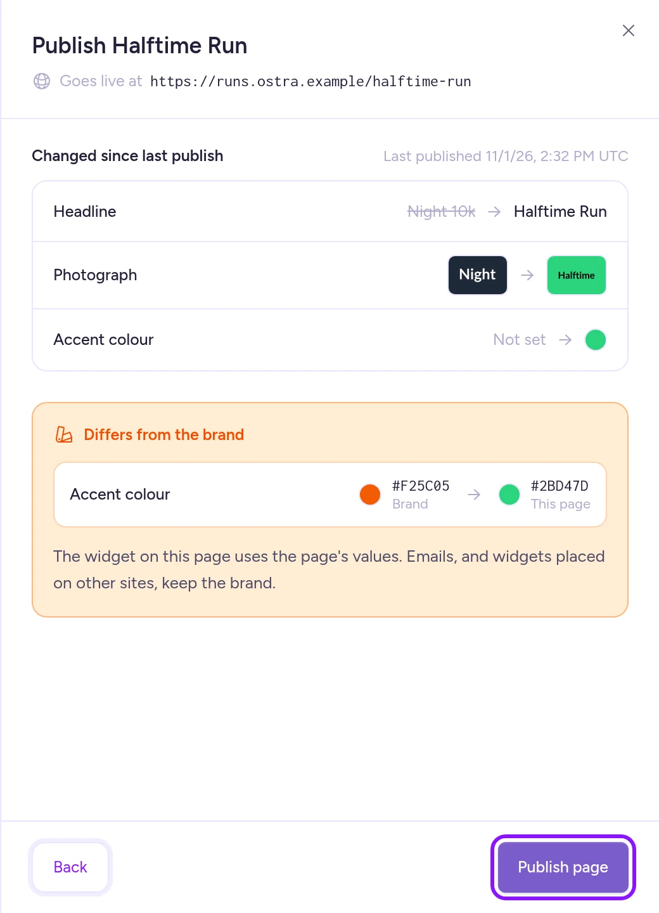

A hosted page gives your drop a dedicated, shareable landing page served by Fanfare—ready to link from announcements, audience invites, and social posts. Hosted pages are optional: you can also run any experience using only the embedded widget on your own website (see [Run it on your own site](/guide/create/your-own-site)). Each experience can have one hosted page.

<Info>
  Available on Growth and above. On Starter, the page editor opens read-only and publishing actions require an upgrade.
</Info>

Every change you make in the page editor saves to a draft—customers won't see updates until you publish (with a few live-linked exceptions noted under [Things to know before you go live](#things-to-know-before-you-go-live)).

<Frame caption="Page edits stay in draft until you publish, and archiving is the only way to take a published page down.">
  
</Frame>

## Before you start

- Your organization is on Growth or above.
- You're an organization admin in the Fanfare admin. Team members can view and preview pages, but creating, editing, publishing, and archiving require an admin.
- Start from one of Fanfare's built-in starters, or from a published organization template you built in [Templates and widget designs](/guide/create/templates).

<Warning>
  Hosted pages only work with **Fanfare checkout**. If your **Checkout processor** is **External** (including Shopify checkout or your own store's checkout), shoppers admitted on a hosted page won't see a checkout button and won't be able to purchase. Embed the widget on your own site instead—see [Run it on your own site](/guide/create/your-own-site) or [Storefront setup](/guide/shopify/storefront-setup) on Shopify. Compare both options in [Checkout options](/concepts/checkout-options).
</Warning>

## Create the page

1. Go to **Experiences**, open your experience, and select **Design**.
2. On the **Page** card, choose how to start:
   - **Create Page** copies your organization's default page template directly into the experience (shown when a default template is set).
   - **Choose a template** lets you preview and pick a published organization template or a Fanfare starter (**Minimal**, **Lab**, **Poster**, or **Editorial**), then confirm with **Use template** or **Start from starter**.
3. Fanfare creates your page as a draft.

{/* image: guide-create-hosted-page-template-picker */}

<Warning>
  Name your experience how you want the URL to read before creating the page. Fanfare generates the page URL automatically from the experience name plus a short random suffix, and locks it permanently the first time you publish—renaming the experience afterward won't change the URL.
</Warning>

## Edit content and styles

### Content

1. On the **Page** card, select **Edit page** to open the full-screen editor.
2. Fill in your copy and media on the **Content** tab.
   - Linked fields display *"From [source]"* (such as your product name or experience open time) and pull their values automatically.
   - Select **Sync from sources** to refresh all linked fields with the latest data, or **Unlink** to freeze a field's current value. Editing and saving a linked field also unlinks it.
3. Select **Save**. If any field has a validation issue, hover over **Save** to see which fields need fixing.

The preview beside the fields shows your last saved draft, not unsaved edits.

### Style

If your template includes style controls, open the **Style** tab to customize page-level colors (Fanfare's starters use their built-in template fonts). Fields marked **Brand · Primary** inherit your organization's **Primary** brand color automatically, while fields marked **Template default** keep the template's color.

Your experience's **Design** tab summarizes any custom styles the page sets for itself right below the preview. See [Set your brand](/guide/create/brand) and [Brand, templates, and designs](/concepts/design) for how colors cascade.

## Add interactive blocks

Blocks add interactive features to your page, such as the entry widget, countdowns, live status badges, or customer polls.

1. Open the **Blocks** tab in the page editor to see each layout region in your template.
2. Select **Add block** inside a region and choose a block. Each region lists only compatible blocks—larger areas support **Customer Poll** or the **Fanfare Widget**, while inline slots support **Live Status** or **Countdown**.
3. Configure **Region**, **Order**, and the block's settings, then select **Save**.

| Setting | What it controls | Default | Updates when live? |
| --- | --- | --- | --- |
| **Region** | The template area where the block appears. | The region you added it to | Yes, on next publish |
| **Order** | Display order within the region (whole number, 1 or higher). | Last in the region (1 if empty) | Yes, on next publish |
| **Question** (Customer Poll) | Poll prompt (required, up to 200 characters). | None | Yes, on next publish; existing votes are kept |
| **Options** (Customer Poll) | 2 to 10 choices. Each needs a unique **Option ID** (letters, numbers, underscores; up to 64 characters) and an **Option label** (up to 120 characters). | None | Yes, on next publish. Votes stay tied to each **Option ID**—new options start at 0, and votes for removed options remain in the total without showing. |

Each page supports up to 10 blocks and one entry widget (subject to a combined block-settings size limit).

Once a poll is published, its **Live state** panel displays live vote counts and lets organization admins **Close poll**, **Reopen poll**, or **Reset poll**. These actions take effect immediately without republishing—**Reset poll** clears all counts back to zero and allows previous voters to vote again, and can't be undone.

<Note>
  Removing a block that's already published discards its collected data on the next publish. Adding a new block later starts fresh.
</Note>

## Preview your draft

On the experience's **Design** tab, select **Preview** on the **Delivery status** card to open **Draft preview**. Any required field that isn't ready yet is filled with placeholder content and flagged in a banner. Preview links expire after 5 minutes—select **Refresh** anytime for a fresh link.

## Publish the page

<Steps>
  <Step title="Open the publish sheet">
    Save your latest draft in the editor, then select **Publish…** on the **Delivery status** card.
  </Step>
  <Step title="Review what's going live">
    Check each section of the publish sheet:
    - **Fill these in to publish:** Required fields that must be completed before publishing.
    - **Still empty:** Optional starter fields (such as dates, quantities, location, or rules)—empty fields stay hidden on the live page.
    - **Changed since last publish:** Summary of updates since your last publish.
    - **Differs from the brand:** Page-level style values overriding your brand.
  </Step>
  <Step title="Publish">
    Select **Publish page**. Fanfare confirms with **Page published**.
  </Step>
</Steps>

<Frame caption="Review required fields, changes, and brand overrides on the publish sheet before going live.">
  
</Frame>

If your page still contains sample content from a starter, Fanfare prompts you before publishing:

- **Publish with sample text?:** Select **Publish anyway** if you're happy with the starter wording, or **Keep editing**.
- **Replace the starter's sample facts:** Sample dates, quantities, locations, or rules never publish as yours. Update them with your own details, or select **Clear all sample facts** to remove them and publish (if starter wording is also listed under **Starter wording you can keep**, check **Publish this wording as it is** first).

<Warning>
  Publishing updates to an already-live page freezes shortly before any distribution opens until it closes (or shortly after opening if there's no close time). To push an urgent change mid-drop, type `PUBLISH` in **Publishing is frozen** and select **Override freeze and publish**—this updates the page customers are viewing right away. Your first publish is never frozen, and saving drafts always works. See [Brand, templates, and designs](/concepts/design) for exact freeze windows.
</Warning>

<Frame caption="Republishing during a drop requires typing PUBLISH to override the freeze.">
  
</Frame>

## Check delivery and share the link

After publishing, the **Delivery status** card tracks rollout to Fanfare's edge servers:

| Status | What it means |
| --- | --- |
| **Not published yet** | The page hasn't been published yet. |
| **Delivery pending** | Queued for delivery to the edge. |
| **Delivering to the edge…** | Currently rolling out to edge servers. |
| **Live at the edge** | Your latest published version is live for customers. |
| **The last publish attempt failed** | The latest publish didn't complete (your previously published page may still be serving). |

Once published, the **Page** card shows **Live at** with your URL, a copy button, and a button to open it in a new tab. The URL uses your organization's **Experience Subdomain** from [Organization settings](/guide/account/organization).

<Warning>
  Publish your hosted page before announcements or social posts go out so their links work—and check your sequence's **Invite email** settings first. If a gated sequence opens within about 2 days and your postal address is set, its audience invite can go out shortly after you publish; turn off **Send this invite** first if you don't want that. See [Invites, waitlist and access-code sends](/guide/create/invites-and-waitlist) and [Announcements](/guide/create/announcements).
</Warning>

{/* image: guide-create-hosted-page-design-tab */}

## Switch or reset the page design

- **Switch templates:** On the **Page** card, select **Change template**, pick a new template or starter, and confirm **Switch design**. Only your draft changes, and your draft's blocks are replaced by the new template's blocks. Review linked fields before publishing to make sure nothing cleared unexpectedly.
- **Reset to template:** If your page started from a published organization template, open the **Page** card's actions menu (`…`) and select **Reset to template → Reset** to rebuild your draft from the latest template version (this replaces your draft's blocks).
- **Manage unused designs:** Previous customized designs for this experience move to **Unused designs** (unedited template copies are cleaned up automatically). From there you can select **Use again**, **Save as organization template** (creates a Draft template in Design Studio), or permanently **Delete** them.

## Take the page down

Hosted pages don't have an unpublish button. To take a page offline while the experience continues, archive it:

1. On the **Page** card, open the actions menu (`…`) and select **Archive page**.
2. If the page has ever been published, type `ARCHIVE` and select **Archive page**.

<Warning>
  Archiving takes your page offline within about a minute—visitors see a not-found page—and can't be undone. Creating a new page for the experience later generates a brand-new URL, so any links you already shared stay broken.
</Warning>

{/* image: guide-create-hosted-page-archive */}

## When the drop ends

Even after every distribution closes, your URL continues serving the published page until you archive it, deactivate a distribution, or delete the experience. If you deactivate the experience—or even a single sequence or distribution—or delete the experience, visitors see a branded ended or canceled screen instead (including for anything else in the experience that's still running), with a link to the **Website** configured in your organization settings. See [Stop a drop](/guide/drop/deactivate) and [What your customers see](/guide/drop/what-customers-see).

## Things to know before you go live

- **Some updates go live without publishing:** Linked fields (product details, experience name and times, organization details) refresh automatically after their source changes, sometimes after a brief delay. Brand updates, **Experience colours**, and widget design changes also update live pages right away. See [Set your brand](/guide/create/brand) and [Templates and widget designs](/guide/create/templates).
- **No third-party scripts:** Custom tracking tags and pixels can't run on Fanfare-hosted pages.
- **Embedding in an iframe:** To display a hosted page inside an iframe on another website, add that domain under **Settings → Embedding**. See [API keys and embedding](/guide/account/developer).
- **Downgrading to Starter:** Published pages continue serving customers. You can still preview, archive, and close or reopen live polls, while editing and republishing require Growth or above.

## On Shopify

- Any Shopify staff member who can open the Fanfare app can create, edit, publish, override freezes on, and archive hosted pages—admin-only restrictions don't apply in the Shopify app.
- For products imported from Shopify, **Delivery status** lets you know if Fanfare is still copying the product image from Shopify (or if the image copy failed).

## Troubleshooting

<AccordionGroup>
  <Accordion title="This page was changed somewhere else">
    Another tab or teammate saved a newer version of the draft after you opened the editor. Reload the page to pull the latest draft, then reapply your edit.
  </Accordion>
  <Accordion title="Live at shows only /slug instead of the full URL">
    The page couldn't load your organization's subdomain. Reload the page—if it persists, contact Fanfare support.
  </Accordion>
  <Accordion title="The countdown label names the wrong drop type">
    Pages created from earlier starter versions can include static countdown wording like *"Draw opens in"*. Update **Countdown label before opening** and **Countdown label while open** on the **Content** tab, save, and publish.
  </Accordion>
</AccordionGroup>

## Related

<CardGroup>
  <Card title="Brand, templates, and designs" href="/concepts/design">
    How brand, templates, and page overrides layer together.
  </Card>
  <Card title="Templates and widget designs" href="/guide/create/templates">
    Build reusable page templates, set defaults, and style widgets.
  </Card>
  <Card title="Run it on your own site" href="/guide/create/your-own-site">
    Embed the Fanfare widget directly on your own website.
  </Card>
  <Card title="What your customers see" href="/guide/drop/what-customers-see">
    Every customer screen and message across the drop lifecycle.
  </Card>
</CardGroup>
