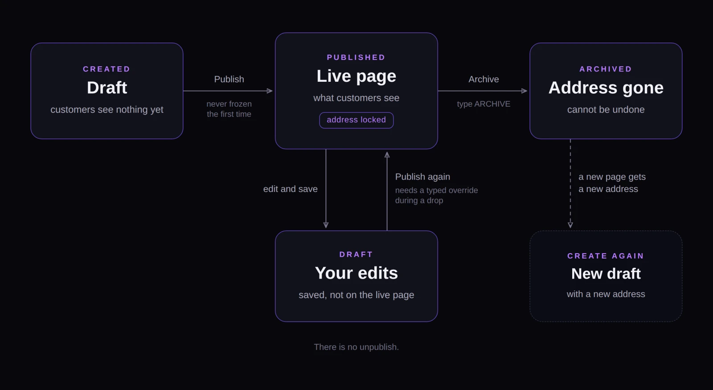
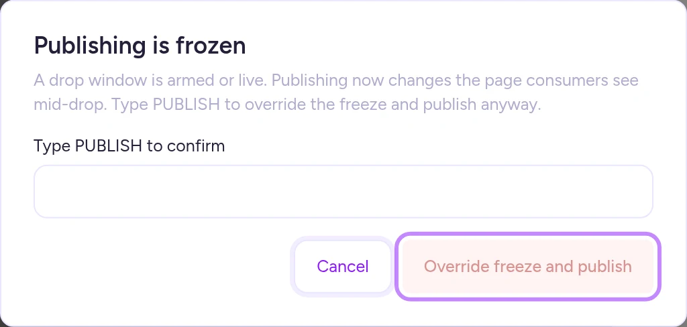

A hosted page is a web page Fanfare serves for one experience, at an address you can share in announcements, invites and social posts. It is optional: an experience can run with only the widget on your own site (see [Run it on your own site](/guide/create/your-own-site)). Each experience has at most one hosted page.

<Info>Available on Growth and above.</Info>

On Starter, **Create Page**, **Choose a template**, **Change template**, **Use again**, **Reset to template** and **Publish…** are disabled with an upgrade prompt, and the page editor opens read-only.

Everything you change goes to a draft. Customers see nothing new until you publish, with the exceptions listed under [Things to know before you go live](#things-to-know-before-you-go-live).

<Frame caption="Edits go to a draft until you publish, and archiving is the only way to take the page down.">
  
</Frame>

## Before you start

- Your organisation is on Growth or above.
- In the Fanfare admin, you are an organisation admin. Members can open the page, preview it and open the publish sheet, but cannot create, change, save, publish or archive it.
- You can start from one of Fanfare's starters, or from an organisation template set up in [Templates and widget designs](/guide/create/templates).

<Warning>
  A hosted page cannot hand customers to a checkout outside Fanfare. If your **Checkout processor** is **External**, the setting used with Shopify checkout and with your own store's checkout, customers who are let in on the hosted page see no checkout button and cannot buy there. Run the drop on your own site instead: see [Run it on your own site](/guide/create/your-own-site), or [Storefront setup](/guide/shopify/storefront-setup) on Shopify. [Checkout options](/concepts/checkout-options) explains the two processors.
</Warning>

## Create the page

1. Open **Experiences**, select the experience, then open **Design**.
2. On the **Page** card, choose how to start:
   - **Create Page** copies your organisation's default template into this experience. It shows only when a default is set.
   - **Choose a template** lets you pick a published organisation template or a starter: Minimal, Lab, Poster or Editorial. Selecting one previews it; **Use template** or **Start from starter** creates the page.
3. The page is created as a draft.

{/* image: guide-create-hosted-page-template-picker */}

<Warning>
  You cannot choose or edit the page address. Fanfare sets it when the page is created, from the experience name plus a short random ending, and it locks the first time you publish. Renaming the experience later does not change it. Name the experience as you want the address to read before creating the page.
</Warning>

## Edit the content

1. On the **Page** card, select **Edit page**. The editor opens full screen.
2. On the **Content** tab, fill in the fields. Some fields are linked: they show "From" and the source, such as the product name or the experience's open time, and fill themselves from it. **Sync from sources** pulls the latest values into every linked field. **Unlink** keeps the current value and stops following the source. Editing a linked field's value and saving also unlinks it.
3. Select **Save**. **Save** stays unavailable while a field is invalid, and its tooltip names the fields to fix.

The canvas beside the fields shows your last save, not unsaved edits.

## Style the page

On the **Style** tab (shown when the page's template has style settings), set this page's own colours; Fanfare's starters offer no font settings. An unset field marked **Brand · Primary** follows your brand's **Primary**, so a later brand change reaches it. One marked **Template default** keeps the template's colour. On the **Design** tab, the line under the page preview lists the fields the page sets itself. The brand is set in [Set your brand](/guide/create/brand); how the layers combine is in [Brand, templates and designs](/concepts/design).

## Add blocks

Blocks are the interactive parts of the page, such as the entry widget or a poll.

1. In the editor, open the **Blocks** tab. It lists one section per region of the page's template.
2. In a region, select **Add block** and choose one. Each region offers only the blocks that fit it: larger areas take Customer Poll or the Fanfare Widget, smaller inline spots take Live Status or Countdown.
3. Set **Region** and **Order**, fill in the block's settings, then **Save**.

| Setting | What it does | Default | Can you change it once it is live? |
| --- | --- | --- | --- |
| **Region** | The area of the template the block sits in. | The region you added it to | Yes, at the next publish |
| **Order** | The block's position in its region. A whole number, 1 or more. | After the blocks already in that region (1 in an empty region). Moving a block to another region puts it last there. | Yes, at the next publish |
| **Question** (Customer Poll) | The poll's question. Required, up to 200 characters. | None | Yes, at the next publish. Votes already cast are kept. |
| **Options** (Customer Poll) | The answers customers choose from: 2 to 10. Each needs an **Option ID** (a short unique code of letters, numbers and underscores, up to 64 characters) and an **Option label** (the text customers see, up to 120 characters). | None | Yes, at the next publish. Votes stay with their **Option ID**: a new option starts at zero, and votes for a removed option still count in the total but are no longer shown. |

A page holds at most 10 blocks and one entry widget, and the settings of all its blocks together have a size limit. Once a poll is on the live page, its **Live state** panel shows the vote counts and, for organisation admins, **Close poll**, **Reopen poll** and **Reset poll**. These change the live poll straight away, without a publish. **Reset poll** sets every count back to zero and lets customers who already voted vote again. It cannot be undone. A poll added since the last publish shows its live state after the next publish.

<Note>
  Removing a block that is already on the live page abandons what it collected. The block leaves the live page at the next publish, and adding it again starts a fresh one with nothing carried over.
</Note>

## Preview

On the **Design** tab, the **Delivery status** card has a **Preview** button. It opens **Draft preview**, showing your saved draft. Any field the draft cannot publish yet is filled with example content, and a notice names those fields. The preview link lasts 5 minutes; select **Refresh** for a new one.

## Publish

1. On the **Delivery status** card, select **Publish…**. It is available when the card says "Unpublished draft changes". In the editor, save your changes first.
2. Read the publish sheet:
   - **Fill these in to publish** lists fields that must be filled first. **Publish page** stays disabled until they are.
   - **Still empty** lists starter details you have not filled in yet, such as dates, quantities, place or rules. An empty field does not show on the page, and you can still publish.
   - **Changed since last publish** lists what this publish changes.
   - **Differs from the brand** lists the style values this page sets for itself.
3. Select **Publish page**. You see "Page published".

<Frame caption="The publish sheet shows what will change before you publish.">
  
</Frame>

Publishing can stop to ask about starter content:

- **Publish with sample text?**: the page still has a starter's sample wording. Select **Publish anyway** to publish it, or **Keep editing**.
- **Replace the starter's sample facts**: the page still states the starter's sample dates, quantities, place or rules. Sample facts never publish as yours: edit them, or select **Clear all sample facts**, which clears them, saves and publishes. A required fact asks for your own text instead. If the dialogue also lists **Starter wording you can keep**, tick **Publish this wording as it is** first.

<Warning>
  From shortly before any distribution in the experience opens until it closes (or, for a distribution with no close time, until shortly after it opens), republishing a page that is already live is frozen. **Publishing is frozen** asks you to type PUBLISH and select **Override freeze and publish**, and what you publish then changes the page customers are looking at mid-drop. Saving the draft still works, and a page's first publish is never frozen. The exact window is in [Brand, templates and designs](/concepts/design).
</Warning>

<Frame caption="During a drop, republishing needs a typed override.">
  
</Frame>

## Check delivery and share the link

After you publish, the **Delivery status** card tracks your page going out to the servers that show it to customers ("the edge"):

| Badge | Meaning |
| --- | --- |
| **Not published yet** | The page has never been published. |
| **Delivery pending** | The publish is waiting to go out. |
| **Delivering to the edge…** | The publish is on its way to the servers that show your page. |
| **Live at the edge** | The published version is out. |
| **The last publish attempt failed** | The last publish did not go out. This describes the last attempt, not whether the page is serving. |

There is no retry button.

Once published, the **Page** card shows **Live at** with the page address, a button to copy it and one to open the page in a new tab. The address starts with your organisation's **Experience Subdomain**, set in [Organisation settings](/guide/account/organization).

Invites and social posts link to the published page, so publish before they go out: see [Invites, waitlist and access-code sends](/guide/create/invites-and-waitlist) and [Announcements](/guide/create/announcements).

{/* image: guide-create-hosted-page-design-tab */}

## Change the design

1. On the **Page** card, select **Change template**, pick a template or starter, then select **Use template** or **Start from starter**.
2. In **Switch this page's design?**, select **Switch design**.

Only the draft changes. Switching replaces the draft's blocks with the new design's. The dialogue says the current design moves to **Unused designs**, but a copy of an organisation template that you never edited is removed instead. After a switch, check linked fields before you publish: a field that had a value can publish empty.

If the page's design was copied from an organisation template that is still published, you can start the draft again from it: open the **Page** card's actions menu (…), select **Reset to template**, then **Reset**. This also replaces the draft's blocks. Pages started from a starter do not offer this.

**Unused designs** lists designs copied for this experience that the page no longer uses. For each one:

- **Use again** points the draft back at it.
- **Save as organization template** creates a draft organisation template, which you then publish in Design Studio before it appears in pickers.
- **Delete** removes it. This cannot be undone.

## Take the page down

There is no unpublish. To take the page down while the experience carries on, archive it.

1. On the **Page** card, open the actions menu (…) and select **Archive page**.
2. If the page has ever been published, type ARCHIVE to confirm, then select **Archive page**.

<Warning>
  Archiving a published page takes its address down within about a minute: anyone following the link then sees a page saying the drop couldn't be found. It cannot be undone. If you create a page for the experience again, it gets a new address, so every link you have already shared stays dead.
</Warning>

{/* image: guide-create-hosted-page-archive */}

## When the drop is over

Once you deactivate the experience, or any one of its sequences or distributions, or delete the experience, its published page's address shows a page in your brand saying the drop has ended or was cancelled, including for anything still running, with a link to the **Website** in your organisation settings when you have set one. See [Stop a drop](/guide/drop/deactivate) and [What your customers see](/guide/drop/what-customers-see).

Until then, the address keeps serving your published page, even after every distribution has closed.

## Things to know before you go live

- The live page can change without a publish. Linked values (product name, description and image; experience name and times; organisation details) are refreshed on the live page after their source changes, sometimes after a delay. Brand changes restyle it too.
- Experience colours change the live page as soon as they are saved, without a publish. See [Set your brand](/guide/create/brand).
- Changing this experience's widget design changes the widget on the live page straight away. See [Templates and widget designs](/guide/create/templates).
- Third-party tags and tracking pixels cannot run on hosted pages.
- To show the page inside an iframe on another site, list that site under **Embedding**. See [API keys and embedding](/guide/account/developer).
- After a downgrade to Starter, a published page keeps serving. You can still preview and archive it and close or reopen its polls, but not edit or publish it.

## On Shopify

- There is no admin-only restriction on the hosted page: every staff member who can open the Fanfare app can create the page, change its template, save the draft, publish it and archive it.
- For a product brought in from Shopify, the **Delivery status** card can say "The product image is being copied from Shopify. The page shows it once the copy is ready." or "The product image couldn't be copied from Shopify, so the page can't show it yet."

## Troubleshooting

<AccordionGroup>
  <Accordion title="This page was changed somewhere else">
    The page's draft was saved somewhere else (another tab or another admin) after you opened it. Reload to pick up the latest version, then make your change again.
  </Accordion>
  <Accordion title="Live at shows only /slug">
    The page could not load your organisation's address, so the card shows only the end of it. Reload the page; if it persists, contact Fanfare support.
  </Accordion>
  <Accordion title="The page names the wrong distribution">
    A page started from an early version of a starter can carry a countdown label that names a distribution type, such as "Draw opens in". It is ordinary text on the page: change **Countdown label before opening** and **Countdown label while open** on the **Content** tab, save, and publish.
  </Accordion>
</AccordionGroup>

## Related

<CardGroup>
  <Card title="Brand, templates and designs" href="/concepts/design">
    What the brand, templates and page each control.
  </Card>
  <Card title="Templates and widget designs" href="/guide/create/templates">
    Organisation page templates, the default, and widget designs.
  </Card>
  <Card title="Run it on your own site" href="/guide/create/your-own-site">
    Use the widget on a page you own.
  </Card>
  <Card title="What your customers see" href="/guide/drop/what-customers-see">
    The stages and messages customers meet on the page.
  </Card>
</CardGroup>
