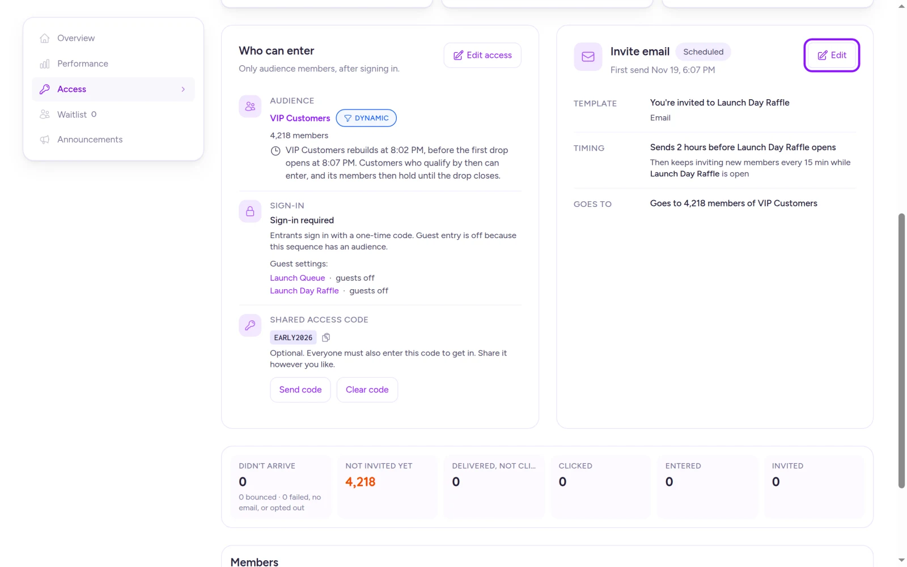
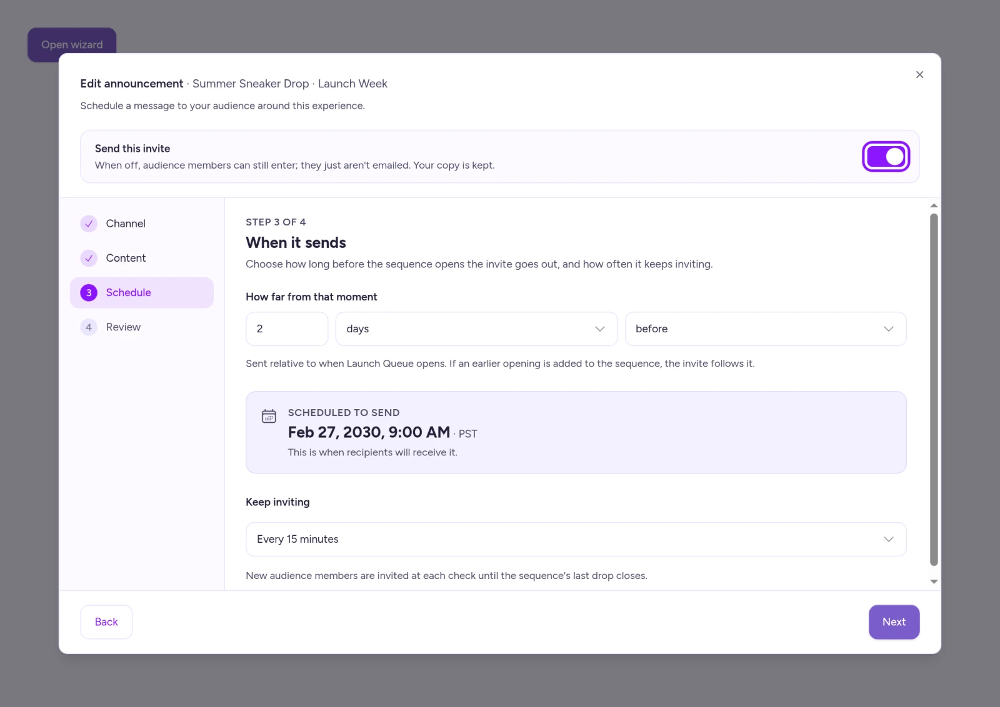
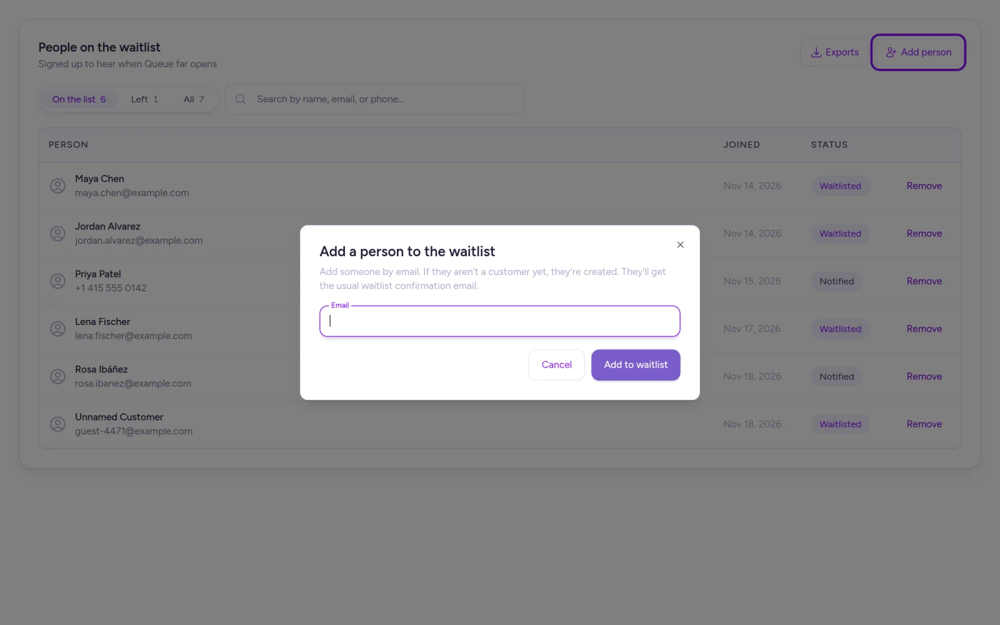

Fanfare sends some messages without your scheduling them. A sequence is one way in to an experience, and each sequence can email its audience an invite, message its waitlist before each opening, and send its access code to the waitlist when you ask. To schedule your own emails, texts and posts, see [Announcements](/guide/create/announcements).

| Send | Who gets it | When | Can you edit it? | Can you turn it off? |
| --- | --- | --- | --- | --- |
| Invite email | The sequence's audience | 2 days before the sequence opens (about 30 minutes after set-up if it opens sooner), then to anyone new to the audience | Yes: wording, timing, how often it keeps inviting | Yes, with **Send this invite** |
| Waitlist "opens soon" message | Everyone on the sequence's waitlist | 5 minutes before each opening | No | No |
| Access-code send | Everyone on the sequence's waitlist | Straight away, when you select **Send code** | No | It only goes when you send it |

Waitlists, the "opens soon" message and access-code sends work on every plan. Invites go only to sequences with an audience. Creating and editing audiences needs Growth or above, though the built-in customer segments can be chosen on any plan: see [Build audiences](/guide/create/audiences) and [Plans](/guide/start/plans).

## Before you start

- The experience has at least one sequence, and the sequence has a distribution with an opening time.
- For an invite, the sequence has an audience ([Add and gate sequences](/guide/create/sequences)), your hosted page is published and your postal address is saved: see [What the invite needs to send](#what-the-invite-needs-to-send).
- To send the access code, the sequence has a **Shared access code** ([Add and gate sequences](/guide/create/sequences)).

## Where to find them

Open **Experiences**, select the experience, then select the sequence.

- **Access** tab: the **Invite email** card, its progress and members, and **Send code**.
- **Waitlist** tab: the people on the sequence's waitlist.
- The experience's **Marketing Hub** also lists each sequence's invite.

## The invite email

Fanfare sets up an invite email once the sequence has both an audience and a distribution with an opening time, whichever you add second. It goes to the audience's members and invites them to enter. Each person is invited once. An invite is always an email, so members with no email address are skipped, as are those who unsubscribed from your marketing email. Until you change it, it reads:

- Headline (the email subject): "You're invited"
- Body: "You're on the list for early access. Use the button below to enter."
- Button: "Enter now", linking to your experience page.

If the sequence also has a **Shared access code**, the invite includes it, as "Use code" followed by the code.

### When the invite goes out

By default the first invite goes 2 days before the sequence's earliest opening. If the sequence opens in less than about 2 days, or is already open, when the invite is set up, the invite goes to the whole audience about 30 minutes after you save, with no further step from you. Turn it off in those 30 minutes if you do not want it sent. Until the first invite has gone out, adding an opening that is earlier than the current one moves the invite to follow it.

After the first invite, Fanfare keeps checking the audience every 15 minutes and invites anyone new to it, until the sequence's last distribution ends. A distribution with no end time keeps it inviting for as long as that distribution is live. If you change the sequence's audience, the next invites go to the members of the new audience.

<Frame caption="The invite card shows what the invite says, when it sends and who it goes to.">
  
</Frame>

### Change or turn off the invite

1. On the sequence's **Access** tab, select **Edit** on the **Invite email** card. You can also select the invite in the experience's **Marketing Hub** and select **Edit**.
2. The editor opens on its review step. Select the content step in the step list to change the **Headline**, **Body** or **Button label**.
3. Under **When it sends**, choose how long before the sequence opens the first invite goes out. It must be at or before the opening.
4. Under **Keep inviting**, choose how often Fanfare checks for new audience members.
5. To stop the invite, turn off **Send this invite** at the top of the editor. It takes effect straight away, without saving. When it is off, audience members can still enter; they are not emailed, and your wording is kept.
6. Save your other changes.

<Note>
  Timing is fixed once the first invite has gone out.
</Note>

<Frame caption="Turn off Send this invite to stop the invite without losing your wording.">
  
</Frame>

| Setting | What it does | Default | Can you change it after the first invite goes out? |
| --- | --- | --- | --- |
| **Headline**, **Body**, **Button label** | The invite's wording. The headline is the email subject. | "You're invited", the body above, "Enter now" | Yes |
| **When it sends** | How long before the sequence opens the first invite goes. | 2 days before | No |
| **Keep inviting** | How often new audience members are invited: **Every 15 minutes**, **Every 30 minutes**, **Every hour** or **Don't keep inviting**. | **Every 15 minutes** | Yes |
| **Send this invite** | Whether the invite is emailed at all. | On | Yes |

You cannot delete an invite, only turn it off. A turned-off invite stays off even if you change the audience. Removing the sequence's audience stops the invite. If no invite has gone out yet, your changes to it are discarded: adding an audience later sets up a new invite with the default wording and timing.

Deactivating a distribution takes it out of the invite's timing. Before the first invite, the invite moves to the sequence's next distribution that is open or yet to open, and is not sent if there is none. After it, inviting stops when the last of the sequence's remaining distributions ends. Deactivating the sequence stops its invite.

### What the invite needs to send

- **A published hosted page.** The invite's button links to your experience page. Without one, the **Invite email** card shows **Needs link** and the invite does not go. See [Build and publish the hosted page](/guide/create/hosted-page).
- **A postal address** in **Settings → Email Sender**. Marketing email must show it. See [Sender identity and sending domain](/guide/create/email-sender).

### Follow invite delivery

The **Access** tab shows how the invite is doing: **Invited**, **Didn't arrive**, **Not invited yet**, **Delivered, not clicked**, **Clicked** and **Entered**. The **Members** list shows each person in the audience; filter it by **Everyone** or any of those states except **Invited**, or search across all your customers. Select a person to see every invite sent to them and what happened to it. When invites bounce or fail, the **Access** tab's label shows a count, such as "3 didn't arrive". For delivery figures across the whole drop, see [Read your results](/guide/learn/performance).

## The waitlist "opens soon" message

Every sequence has a waitlist, except one that runs only appointments. How customers join is on [Waitlists](/concepts/waitlists). Fanfare messages everyone on the waitlist 5 minutes before each distribution in the sequence opens. You do not set this up, and you cannot edit or turn it off.

- Each customer gets one message, by email or by text. Fanfare uses your organisation's **Default Messaging Channel** (**Settings → Organization**, **Messaging** tab), and falls back to the other channel when a customer cannot be reached on that one.
- The email's subject is the distribution's name followed by "opens soon". Its body reads the same, then "You're on the waitlist — don't miss it."
- No message is sent for appointments, or for a distribution that is already open when you create it.
- If you deactivate or delete the distribution, its message is not sent. See [Stop a drop](/guide/drop/deactivate).

The message is not in the **Marketing Hub**. It is listed on the sequence's **Announcements** tab, and the experience's **Overview** shows it as a **Waitlist email** moment in the **What happens next** card.

<Warning>
  If the sequence has a **Shared access code**, the "opens soon" message includes the code, by email and by text, for everyone on the waitlist. If the code must reach only people you choose, do not rely on it alone: gate the sequence with an audience as well.
</Warning>

<Warning>
  Customers who get the message by email see the distribution's name in the subject and the body. A working name such as "Queue 2" reaches them as "Queue 2 opens soon". Name each distribution as you want customers to read it when you set it up. See [Distributions](/concepts/distributions/overview).
</Warning>

## Manage the waitlist

The sequence's **Waitlist** tab lists everyone who has signed up, with their **Status** and when they **Joined**. Filter by **On the list** (the default), **Left** or **All**, or search by name, email or phone. The tab is not shown for a sequence that has only appointments.

The experience's own **Waitlist** page shows everyone across all its sequences, but it is read-only. Add, remove and export people from each sequence's **Waitlist** tab.

### Add someone

1. On the sequence's **Waitlist** tab, select **Add person**.
2. Enter their **Email**. If they are not a customer yet, Fanfare creates them.
3. Select **Add to waitlist**.

Fanfare refuses to add someone who has already reached the order limit for this experience.

<Note>
  People you add with **Add person** get the usual waitlist confirmation, by email or text depending on your default messaging channel. Customers who join the waitlist themselves get no confirmation message, so do not promise one. See [Waitlists](/concepts/waitlists).
</Note>

### Remove someone

Select **Remove** on their row, then **Remove** to confirm. They are not told. After you add or remove someone, the list takes a moment to update.

### Export the list

Select **Exports**, then **New export**. Fanfare prepares CSV files of everyone on the waitlist; you can leave the page while it runs and come back to **Download** them.

<Frame caption="Add people to a sequence's waitlist by email.">
  
</Frame>

## Send the access code to the waitlist

If the sequence has a **Shared access code**, you can send it to everyone on the waitlist in one go, at a time you choose. Access codes are not case-sensitive.

1. On the sequence's **Access** tab, find the **Shared access code** row and select **Send code**.
2. Read the confirmation, "Send the access code to everyone on the waitlist?", and select **Send code**.

Fanfare confirms with "Sending to up to" and the number of waitlist members.

<Warning>
  Sending the code cannot be undone. It goes straight away to everyone on the waitlist at that moment, the people the **On the list** filter shows. "Up to" means some may not receive it: a customer Fanfare has no way to reach is skipped, and if the code is cleared while the send is going out, the rest are not sent. To stop the code working, change it. Clearing it instead removes the code gate, so customers can enter without one. See [Add and gate sequences](/guide/create/sequences).
</Warning>

Each customer gets one message, by email or by text, chosen the same way as the "opens soon" message. The email reads "Here is your access code for", then your sequence's name, then the code and a button to the page where it is entered, so give the sequence a name you are happy for customers to read.

A sequence with only appointments has no one on its waitlist, so a send there is always refused. The send can also be refused for these reasons:

| Message | What to do |
| --- | --- |
| "No one is on the waitlist yet" | Wait for sign-ups, or add people on the **Waitlist** tab. |
| "A code send is already in progress" | Wait for the current send to finish. |
| "Too many send attempts — try again in a minute" | Wait a minute and try again. |
| "The access code was removed since this page loaded — set a code and try again" | Someone cleared the code. Set a code, then send again. |

<Frame caption="Sending the code goes to everyone on the waitlist at once.">
  
</Frame>

What customers see when they join a waitlist or enter a code is on [What your customers see](/guide/drop/what-customers-see).

## Troubleshooting

<AccordionGroup>
  <Accordion title="The invite card shows 'Needs link'">
    Publish the hosted page and check that your organisation's drop-page address is active. See [Build and publish the hosted page](/guide/create/hosted-page).
  </Accordion>
  <Accordion title="The invite's row in the Marketing Hub says 'Didn't send'">
    Read the reason after "Didn't send". If your postal address is not set, add it under **Settings → Email Sender**. A row that reads "Needs an experience page link" means the hosted page is not published, or your organisation's drop-page address is not active. Once you fix the cause, the invite tries again by itself, within its **Keep inviting** interval (15 minutes if that is off). You do not need to save it again.
  </Accordion>
  <Accordion title="Send code is greyed out">
    The sequence needs a shared access code. Set a code with **Edit access** on the **Access** tab; see [Add and gate sequences](/guide/create/sequences).
  </Accordion>
  <Accordion title="'Already on the waitlist' when adding someone">
    That email address is already on this sequence's waitlist.
  </Accordion>
  <Accordion title="A customer says they never got a waitlist confirmation">
    Customers who join the waitlist themselves get no confirmation message. They are still on the list: check the **Waitlist** tab.
  </Accordion>
</AccordionGroup>

## Related

<CardGroup>
  <Card title="Add and gate sequences" href="/guide/create/sequences">
    Choose an audience and set, generate or clear the shared access code.
  </Card>
  <Card title="Waitlists" href="/concepts/waitlists">
    How customers join a waitlist, and when sign-ups close.
  </Card>
  <Card title="Announcements" href="/guide/create/announcements">
    Schedule your own emails, texts and posts to the audience or waitlist.
  </Card>
  <Card title="Sender identity and sending domain" href="/guide/create/email-sender">
    Your postal address, From address and sending domain.
  </Card>
  <Card title="Audiences and access codes" href="/concepts/audiences">
    Who may enter a sequence.
  </Card>
  <Card title="What your customers see" href="/guide/drop/what-customers-see">
    The messages and screens customers meet at each stage.
  </Card>
</CardGroup>
