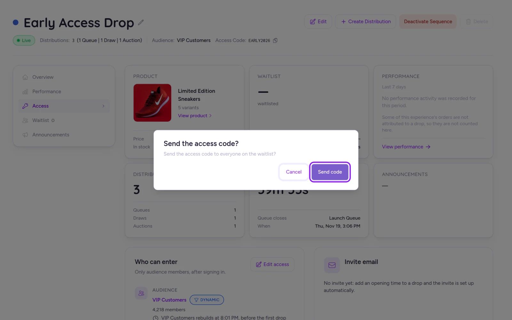

Beyond the announcements you schedule yourself, Fanfare handles three sequence-level sends automatically or on demand: emailing gated audience members an invite, alerting waitlist sign-ups right before doors open, and blasting a shared access code to your waitlist whenever you're ready. To schedule custom emails, texts, and social posts, see [Announcements](/guide/create/announcements).

| Send | Who receives it | Timing | Editable? | Can turn off? |
| --- | --- | --- | --- | --- |
| **Invite email** | Sequence's audience | 2 days before the sequence opens (~30 minutes after setup if it opens sooner), then continuously to new audience members | Yes (copy, timing, check interval) | Yes, via **Send this invite** |
| **Waitlist "opens soon" alert** | Everyone on the sequence's waitlist | 5 minutes before each distribution opens | No | No |
| **Access-code send** | Everyone on the sequence's waitlist | Immediately when you select **Send code** | No | Manual trigger only |

Waitlists, "opens soon" alerts, and access-code sends work on every plan. Audience invites apply to any sequence with an audience—built-in customer segments work on all plans, while creating custom audiences requires Growth or above. See [Build audiences](/guide/create/audiences) and [Plans and what they unlock](/guide/start/plans).

## Before you start

- Your experience has a sequence with at least one scheduled distribution.
- **For audience invites:** The sequence has an audience ([Add and gate sequences](/guide/create/sequences)), your hosted page is published, and your postal address is saved (see [What the invite needs to send](#what-the-invite-needs-to-send)).
- **For access-code sends:** The sequence has a **Shared access code** configured ([Add and gate sequences](/guide/create/sequences)).

## Where to manage them

Open **Experiences**, select your experience, and click the sequence:

- **Access tab:** Manage the **Invite email**, monitor delivery metrics, inspect individual audience members, and trigger **Send code**.
- **Waitlist tab:** View, add, remove, and export people on that sequence's waitlist.
- **Marketing Hub (on the experience):** Lists each sequence's invite alongside your scheduled announcements.

## Audience invite emails

As soon as a sequence has both an audience and a distribution with an open time, Fanfare automatically prepares an invite email so eligible members know how to enter. Invites are email-only—each member receives it once, and anyone without an email address or who unsubscribed from marketing email is skipped.

Default copy (customizable anytime):

- **Headline (email subject):** *"You're invited"*
- **Body:** *"You're on the list for early access. Use the button below to enter."*
- **Button:** *"Enter now"* (links to your hosted page)

If the sequence also has a **Shared access code**, the invite includes it automatically (*"Use code [code]"*).

### When invites send

By default, Fanfare sends the first wave **2 days before** the sequence's earliest opening. Until that first wave goes out, adding an earlier distribution automatically shifts the invite earlier to match.

<Warning>
  If your sequence opens in less than about 2 days (or is already open) when the invite becomes ready—including right when you publish your hosted page—Fanfare automatically sends the invite to the entire audience about 30 minutes later. Review the **Invite email** card or turn off **Send this invite** before publishing if you don't want it to go out right away.
</Warning>

After the initial send, Fanfare checks the audience every 15 minutes and emails any newly added members until the sequence's last distribution ends (or indefinitely if a distribution has no close time). If you swap the sequence's audience, subsequent checks invite members of the new audience.

<Frame caption="Check invite wording, timing, audience coverage, and delivery progress on the sequence's Access tab.">
  
</Frame>

### Customize or turn off the invite

1. On the sequence's **Access** tab, select **Edit** on the **Invite email** card (or open it from the experience's **Marketing Hub**).
2. Select the content step to customize the **Headline**, **Body**, or **Button label**.
3. Under **When it sends**, pick how far before opening the initial invite should go out (must be at or before the opening).
4. Under **Keep inviting**, choose how often Fanfare checks for new audience members.
5. To pause emailing without deleting your wording, toggle off **Send this invite** at the top—this takes effect immediately. Audience members can still enter the drop even while invites are off.
6. Select **Save** to keep your other edits.

<Note>
  Once the first invite wave has gone out, **When it sends** locks—you can still edit copy, change the **Keep inviting** interval, or toggle **Send this invite** off.
</Note>

<Frame caption="Toggle Send this invite off to stop audience invite emails while preserving your custom copy.">
  
</Frame>

| Setting | What it controls | Default | Editable after first send? |
| --- | --- | --- | --- |
| **Headline**, **Body**, **Button label** | Invite email subject, body copy, and CTA button text. | *"You're invited"*, default body, *"Enter now"* | Yes |
| **When it sends** | Lead time before sequence opens. | 2 days before | No |
| **Keep inviting** | How often Fanfare invites newly added audience members (**Every 15 minutes**, **Every 30 minutes**, **Every hour**, or **Don't keep inviting**). | **Every 15 minutes** | Yes |
| **Send this invite** | Turns invite emails on or off. | On | Yes |

Invites can't be deleted—toggle **Send this invite** off instead (it stays off even if you swap the audience). Removing the audience stops invites entirely; if none have gone out yet, your custom edits reset if you attach a new audience later. Deactivating a distribution removes it from invite timing (stopping invites if no open or upcoming distributions remain), and deactivating the sequence stops invites immediately.

### What the invite needs to send

- **A published hosted page:** The invite's CTA links to your hosted page. Until it's published (with an active drop-page subdomain), the **Invite email** card shows **Needs link** and holds off sending. See [Build and publish the hosted page](/guide/create/hosted-page).
- **A saved postal address:** Required on all marketing emails under **Settings → Email Sender**. See [Sender identity and sending domain](/guide/create/email-sender).

### Track invite delivery

The **Access** tab breaks down invite progress across **Invited**, **Didn't arrive**, **Not invited yet**, **Delivered, not clicked**, **Clicked**, and **Entered**. Use the **Members** list to filter by status or search across customers, and select any person to inspect their full invite history. If any emails bounce or fail, the **Access** tab flags the count (for example, *"3 didn't arrive"*). For drop-wide engagement metrics, see [Read your results](/guide/learn/performance).

## Waitlist "opens soon" alerts

Every sequence (except appointment-only sequences) includes a waitlist automatically—see [Waitlists](/concepts/waitlists) for how customers join. Five minutes before each distribution in the sequence opens, Fanfare automatically notifies everyone on the waitlist. This alert can't be edited or turned off.

- **Channel:** Each customer receives one message—email or SMS—based on your **Default Messaging Channel** (**Settings → Organization → Messaging**), automatically falling back to the other channel if they're unreachable on the default.
- **Content:** The email subject reads *"[Distribution name] opens soon"* followed by *"You're on the waitlist — don't miss it."*
- **Exceptions:** Not sent for appointments, distributions already open at creation, or deactivated/deleted distributions ([Stop a drop](/guide/drop/deactivate)).
- **Where it appears:** Listed on the sequence's **Announcements** tab and shown as a **Waitlist email** milestone under **What happens next** on the experience **Overview** (not in **Marketing Hub**).

<Warning>
  If a sequence uses a **Shared access code**, the "opens soon" alert includes that code for everyone on the waitlist (via email and SMS). If only selected shoppers should get in, gate the sequence with an audience in addition to—or instead of—an access code.
</Warning>

<Warning>
  The "opens soon" email displays your exact distribution name in the subject and body (e.g., *"Queue 2 opens soon"*). Give every distribution a clean, customer-facing name when setting it up. See [Distributions](/concepts/distributions/overview).
</Warning>

## Manage your waitlist

Open a sequence's **Waitlist** tab to see everyone signed up along with their **Status** and **Joined** date. Filter by **On the list** (default), **Left**, or **All**, or search by name, email, or phone. (The experience-level **Waitlist** page shows a read-only roll-up across all sequences—manage members from each sequence's own **Waitlist** tab.)

- **Add someone:** Select **Add person**, enter their **Email** (Fanfare creates a customer record if needed), and click **Add to waitlist**. Anyone who has already reached the experience's order limit can't be added.
  <Note>
    Customers added manually via **Add person** receive a waitlist confirmation via your default messaging channel. Customers who join the waitlist themselves don't receive a confirmation email or text—keep that in mind when writing your drop copy. See [Waitlists](/concepts/waitlists).
  </Note>
- **Remove someone:** Select **Remove** on their row and confirm. They aren't notified, and the list updates after a moment.
- **Export as CSV:** Select **Exports → New export**. Fanfare generates CSV files in the background—you can navigate away and come back to **Download** them when ready.

<Frame caption="Search, filter, export, or manually add people to a sequence's waitlist by email.">
  
</Frame>

## Send a shared access code to the waitlist

When a sequence has a **Shared access code** (codes aren't case-sensitive), you can blast it to everyone currently on the waitlist whenever you choose:

1. On the sequence's **Access** tab, find **Shared access code** and select **Send code**.
2. Confirm **Send the access code to everyone on the waitlist?** by clicking **Send code**.

Fanfare confirms with *"Sending to up to [count]"* waitlist members.

<Warning>
  Sending an access code goes out immediately to everyone currently **On the list** and can't be undone. Customers with no reachable contact channel are skipped, and clearing the code mid-send halts remaining messages. If you ever need to invalidate a sent code, **change** it rather than clearing it—clearing the code removes the gate entirely and opens entry without a code. See [Add and gate sequences](/guide/create/sequences).
</Warning>

Each customer receives one email or SMS using your default messaging channel (with automatic fallback). The email reads *"Here is your access code for [sequence name]"* with the code and a button to your drop page—so make sure your sequence name is customer-ready.

Waitlist code sends aren't available on appointment-only sequences. If a send is blocked, check the message:

| Message | Next step |
| --- | --- |
| *"No one is on the waitlist yet"* | Wait for sign-ups or add members on the **Waitlist** tab first. |
| *"A code send is already in progress"* | Wait for the active blast to complete. |
| *"Too many send attempts — try again in a minute"* | Wait one minute and retry. |
| *"The access code was removed since this page loaded — set a code and try again"* | Set a new code via **Edit access**, then send again. |

<Frame caption="Send a shared access code to everyone currently on your sequence's waitlist in one step.">
  
</Frame>

To see what shoppers experience when joining waitlists or entering codes, read [What your customers see](/guide/drop/what-customers-see).

## Troubleshooting

<AccordionGroup>
  <Accordion title="The invite card shows Needs link">
    Publish your experience's hosted page and confirm your organization's drop-page subdomain is active. See [Build and publish the hosted page](/guide/create/hosted-page).
  </Accordion>
  <Accordion title="The invite shows Didn't send in the Marketing Hub">
    Check the reason on the row: add your business postal address under **Settings → Email Sender**, or publish your hosted page if it says *"Needs an experience page link"*. Once fixed, Fanfare retries automatically on the next **Keep inviting** interval (or within 15 minutes if **Keep inviting** is off)—no need to re-save.
  </Accordion>
  <Accordion title="Send code is disabled">
    The sequence doesn't have a shared access code yet. Select **Edit access** on the **Access** tab to set one—see [Add and gate sequences](/guide/create/sequences).
  </Accordion>
  <Accordion title="I see 'Already on the waitlist' when adding someone">
    That email address is already signed up for this sequence's waitlist.
  </Accordion>
  <Accordion title="A customer says they never got a waitlist confirmation">
    Self-serve waitlist sign-ups don't trigger a confirmation email or text. Verify they're listed on the sequence's **Waitlist** tab—they'll still receive the automatic "opens soon" alert 5 minutes before doors open.
  </Accordion>
</AccordionGroup>

## Related

<CardGroup>
  <Card title="Add and gate sequences" href="/guide/create/sequences">
    Attach audiences and configure shared access codes for sequences.
  </Card>
  <Card title="Waitlists" href="/concepts/waitlists">
    How customers join waitlists and when sign-ups close.
  </Card>
  <Card title="Announcements" href="/guide/create/announcements">
    Schedule custom emails, SMS texts, and social posts around your drop.
  </Card>
  <Card title="Sender identity and sending domain" href="/guide/create/email-sender">
    Set your postal address, sender name, and custom sending domain.
  </Card>
  <Card title="Audiences and access codes" href="/concepts/audiences">
    Understand how gating controls who can enter each sequence.
  </Card>
  <Card title="What your customers see" href="/guide/drop/what-customers-see">
    Preview every customer screen and message across a drop.
  </Card>
</CardGroup>
