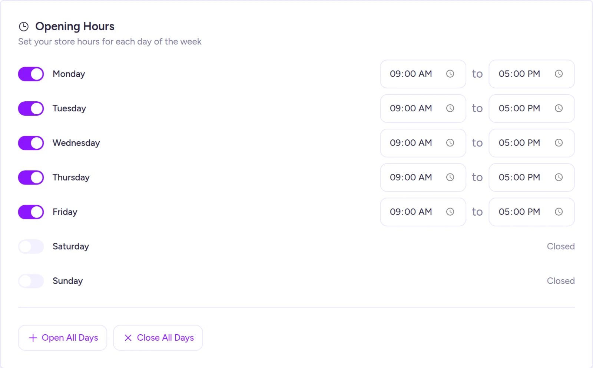

A location represents any physical store, venue, or studio where you host in-person appointments. When you tie an appointment to a location, Fanfare builds its bookable slots directly from that location's weekly opening hours and time zone.

Locations are available on every plan, though appointments themselves require Growth or above. See [Set up appointments](/guide/create/appointment).

## Before you start

- Have each location's street address, local time zone, and weekly hours ready.
- Set any seasonal or special hours up front—once a customer books a slot at a location, its opening hours and time zone lock until every active booking ends or is canceled.

{/* image: guide-create-locations-list */}

## Create a location

<Steps>
  <Step title="Enter basic details">
    In the sidebar, go to **Locations → Create Location**. Under **Basic Information**, enter a **Location Name**. **Handle** fills in automatically (lowercase letters, numbers, and hyphens) and must be unique across your locations—customize it if you have multiple stores with the same name. Optionally pick a **Location Type** (default **Store**) and **Status** (default **Active**).
  </Step>
  <Step title="Add the address and verify the map pin">
    Under **Address Information**, set **Country** first if the store is outside your organization's default country—address search only suggests matches in the selected country. Pick a suggestion from the search box to fill in the address and place a pin, or use **Or enter manually** (**Street Address**, **City**, and **Postal Code** are required, plus **State** for some countries).

    Under **Location Preview**, click the map or drag the pin if you want to fine-tune its position.
  </Step>
  <Step title="Set weekly opening hours">
    Under **Opening Hours**, every day defaults to **09:00–17:00**. Toggle off any closed days and adjust open/close times for open days, or use **Open All Days** / **Close All Days** to update the whole week at once.
  </Step>
  <Step title="Confirm the time zone and save">
    Optionally add a **Phone Number** and **Email Address** under **Contact Information**, plus a **Description** and **Capacity** under **Additional Details**.

    Verify **Timezone** under **Additional Details** (defaults to your organization's time zone, or Pacific time if none is set), then select **Create Location**.
  </Step>
</Steps>

<Note>
  **Always double-check Timezone for stores in another region.** Entering an address doesn't update **Timezone** automatically. Opening hours, bookable slots, and customer booking notifications all use the location's time zone—regardless of the experience or appointment's time zone.
</Note>

<Note>
  **One continuous shift per day:** Locations support a single opening interval each day—you can't add midday breaks, holidays, or one-off closures. Entering a close time earlier than or equal to the open time wraps past midnight into the next day (for example, `17:00` to `09:00` creates a 16-hour overnight window, and `09:00` to `09:00` creates a 24-hour window).
</Note>

<Frame caption="Opening hours default to 09:00–17:00 every day—toggle off any days the location is closed.">
  
</Frame>

### Location settings

Several fields on the form act as organizational labels and don't change how appointments behave:

| Setting | What it does | Default | Editable while bookings stand? |
| --- | --- | --- | --- |
| **Location Name** | Shown in the admin, the appointment picker, the booking widget, and customer emails/texts (alongside the street address). | Required | Yes |
| **Handle** | Unique identifier displayed as `@handle` on the location card. | Generated from name | Yes |
| **Location Type** | Label (`Store`, `Venue`, `Pop-up`, `Warehouse`, or `Office`) controlling only the card icon and map pin color. | `Store` | Yes |
| **Status** | Label (`Active`, `Inactive`, or `Temporary`). Doesn't hide the location from appointments or pause its slots. | `Active` | Yes |
| **Address** and **Country** | Store address and map pin position. | Organization's country | Yes |
| **Opening Hours** | Weekly schedule used to generate appointment slots. | 09:00–17:00 daily | **No** |
| **Timezone** | Time zone used for opening hours and appointment slots. | Organization's time zone | **No** |
| **Capacity** | Reference label only—doesn't cap bookings (each appointment sets its own **Max capacity per slot**). | Empty | Yes |
| **Phone Number**, **Email Address**, **Description** | Internal contact details and notes in the admin. | Empty | Yes |

Your default country and time zone come from [Organization settings](/guide/account/organization).

## Find a location

On **Locations**, you can search by whole words matching a location's name, description, city, or state (partial words and street addresses don't match). Narrow results with **All Types** and **All Statuses**—note that **Temporary** locations appear only under **All Statuses** because the status filter lists `Active` and `Inactive`.

Switch between the card grid and map view using the view toggle (locations without a map pin won't appear on the map). Select **View** on any card—or click a pin—to open the location.

## Edit a location

1. On **Locations**, select **View** on the location card.
2. Update any fields you need, then select **Save** (or **Discard** to cancel).

You can also rename a location inline by clicking its title at the top of the page—that change saves immediately without clicking **Save**.

<Warning>
  **Active bookings lock hours, time zone, and deletion.** While any customer holds a booking at an appointment using this location, **Opening Hours**, **Timezone**, and **Delete** are locked. Wait for those bookings to finish, or cancel them (individually or by deactivating the appointment) before making changes.
</Warning>

<Warning>
  **Changes go live immediately.** Locations have no draft or publish state—saving changes to hours, time zone, or address immediately rebuilds appointment slots and updates what customers see.
</Warning>

<Frame caption="While any booking stands at a location, opening hours and time zone lock until it ends or is canceled.">
  
</Frame>

### Reading the location overview

The header on a location's page displays its type, status, address, map pin, and four summary metrics:

- **Today's Appointments:** Bookings *created* today at this location (not slots scheduled for today). **All time** counts active bookings that haven't been checked in or canceled.
- **Active Experiences:** Total experiences tied to this location, including drafts and ended experiences.
- **Hours & Timezone:** Today's hours (based on your browser's clock) and the location's time zone.
- **Capacity:** The capacity label you entered.

{/* image: guide-create-locations-detail */}

## Delete a location

1. Open the location's page (you can't delete from the list or map).
2. Select **Delete**, then confirm **Delete** in the dialog. This can't be undone.

Fanfare blocks deleting a location while any booking stands on it.

<Warning>
  **Reassign appointments before deleting.** If a location has no active bookings, Fanfare lets you delete it even while an appointment still points to it. Shoppers will continue seeing fallback 09:00–17:00 slots in the appointment's time zone, but every attempt to book or reschedule will fail—and a deleted location can't be restored. Check **Active Experiences** on the location page and move every linked appointment to another location or **Online** before deleting.
</Warning>

See [Set up appointments](/guide/create/appointment) to connect a location to an appointment, and [Appointment](/concepts/distributions/appointment) for how slots are generated from opening hours.

## On Shopify

Locations work the same way in the Shopify app (and **Home** includes a **Create Location** quick action before your first experience). Keep in mind that appointments aren't available in the Shopify app, and appointments are currently the only feature that uses Fanfare locations.

A Fanfare location is separate from your Shopify inventory locations.

## Troubleshooting

<AccordionGroup>
  <Accordion title="No address suggestions appear">
    Address search only looks inside the selected **Country**. Check **Country** under **Address Information**, or enter the address under **Or enter manually**.
  </Accordion>
  <Accordion title="Delete is grayed out">
    Active bookings are standing on this location—the banner above **Opening Hours** shows how many. Wait until those slots finish, or cancel them, then try again.
  </Accordion>
  <Accordion title="A location is missing from the appointment picker">
    The location picker lists your first 100 locations alphabetically. If you have more than 100 locations, ones later in the alphabet won't appear in the dropdown.
  </Accordion>
  <Accordion title="A name change reverted after I saved">
    If you rename a location inline at the top of the page and then save edits in the form below without reloading, the form overwrites the inline rename with the previous name. Reload the page after renaming inline before editing other fields.
  </Accordion>
</AccordionGroup>

## Related

<CardGroup>
  <Card title="Set up appointments" href="/guide/create/appointment">
    Link an appointment to a physical location or run it online.
  </Card>
  <Card title="Appointment" href="/concepts/distributions/appointment">
    How bookable slots are generated from opening hours.
  </Card>
  <Card title="Organization settings" href="/guide/account/organization">
    Set the default country and time zone new locations inherit.
  </Card>
</CardGroup>
