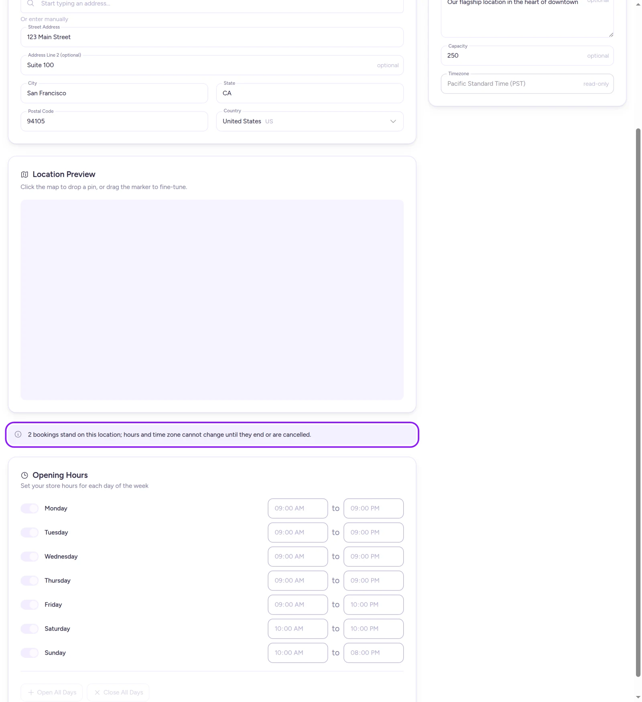

A location is a place where an appointment runs: a store, venue or studio with an address, a time zone and weekly opening hours. When an appointment is tied to a location, its slots are cut from that location's opening hours, in that location's time zone. Appointments are the only feature that uses a location, so add your locations when you are about to run in-store appointments, and set their hours before you open bookings.

Locations are available on every plan. Appointments need Growth or above: see [Set up appointments](/guide/create/appointment).

## Before you start

- Know each store's address, its time zone, and its regular weekly hours.
- Decide any seasonal hours now. Once a customer books a slot at a location, you cannot change its hours or time zone until that booking ends or is cancelled.

{/* image: guide-create-locations-list */}

## Create a location

1. In the sidebar, select **Locations**, then **Create Location**.
2. Under **Basic Information**, enter the **Location Name**. **Handle** fills in from the name; you can edit it. It uses lowercase letters, numbers and hyphens, and must be different for each location, so give a second store with the same name its own handle. Choose a **Location Type** (default **Store**) and a **Status** (default **Active**).
3. Under **Address Information**, start typing the address in the search box and pick a suggestion. This fills in the address fields and places a pin on the map. Suggestions come only from the selected **Country**, so set the country first if your store is abroad. To type the address yourself, use the fields under **Or enter manually**: **Street Address**, **City** and **Postal Code** are required, and **State** is required for some countries.
4. Under **Location Preview**, check the pin. Click the map to drop a pin, or drag the marker to move it.
5. Under **Opening Hours**, set the hours for each day. Every day starts open from 09:00 to 17:00. Use each day's switch to mark it closed, and set the from and to times for open days. **Open All Days** and **Close All Days** change every day at once.
6. Optionally, add a **Phone Number** and **Email Address** under **Contact Information**, and a **Description** and **Capacity** under **Additional Details**.
7. Check the **Timezone** under **Additional Details**. It starts as your organisation's time zone (Pacific time if none is set).
8. Select **Create Location**. The button is available once every required field is valid. You land on the new location's page.

<Note>
  Set **Timezone** to the store's own time zone. A location's opening hours, the slots of any appointment there, and the times in its booking messages are all read in the location's time zone, whatever time zone the experience or appointment uses. Choosing an address does not set the time zone for you, so a store in a different zone from your organisation needs this changed by hand.
</Note>

<Note>
  Each day has one opening interval. You cannot add a lunch break, a holiday or a one-off closed date. If you enter a close time earlier than or the same as the open time, Fanfare accepts it and reads it as running past midnight into the next day, so a typo such as 17:00 to 09:00 becomes a 16-hour overnight window, and 09:00 to 09:00 a 24-hour one.
</Note>

<Frame caption="Opening hours start at 09:00 to 17:00 every day; switch off the days the store is closed.">
  
</Frame>

The following settings are on the form. Several of them are labels only: they do not change how appointments behave.

| Setting | What it does | Default | Can you change it once bookings stand? |
| --- | --- | --- | --- |
| **Location Name** | The name shown in the Fanfare admin, in the appointment's location picker, and to customers in the booking widget and in appointment emails and texts, which also show the street address. | None (required) | Yes |
| **Handle** | A short identifier shown as @handle on the card. | Filled in from the name | Yes |
| **Location Type** | A label: Store, Venue, Pop-up, Warehouse or Office. It sets the icon and map colour only. | Store | Yes |
| **Status** | A label: Active, Inactive or Temporary. It does not hide the location from the appointment picker or stop its slots. | Active | Yes |
| Address and **Country** | Where the store is, and where its map pin sits. | Country: your organisation's | Yes |
| **Opening Hours** | The hours appointment slots at this location are cut from. | 09:00 to 17:00 every day | No |
| **Timezone** | The time zone the hours and slots are read in. | Your organisation's time zone | No |
| **Capacity** | A label. It does not limit bookings; each appointment sets its own **Max capacity per slot**. | Empty | Yes |
| **Phone Number**, **Email Address**, **Description** | Contact details and notes shown in the Fanfare admin. | Empty | Yes |

Your organisation's time zone and country are set in [Organisation settings](/guide/account/organization).

## Find a location

On **Locations**, search with whole words from the location's name, description, city or state. A partial word such as "Soh" finds nothing, and a street address does not find the location. Narrow the list with the type filter (**All Types**) and the status filter (**All Statuses**). The status filter offers Active and Inactive only, so Temporary locations appear only under **All Statuses**. The view toggle switches between the card list and a map. A location with no map pin does not appear on the map. Select **View** on a card, or a point on the map, to open the location.

## Edit a location

1. On **Locations**, select **View** on the location's card.
2. Change the fields you need. A bar appears with **Save** and **Discard**.
3. Select **Save**. You return to the list.

To rename a location, you can also click its name at the top of its page and edit it there. That change saves on its own, without **Save**.

<Warning>
  While any customer holds a booking at an appointment at this location, **Opening Hours** and **Timezone** are disabled, and the page says: "2 bookings stand on this location; hours and time zone cannot change until they end or are cancelled." **Delete** is greyed out too, with no explanation on the button. The only way out is to wait until those bookings have ended, or to cancel them, either one at a time or all at once by deactivating the appointment. Set seasonal hours before you open appointments.
</Warning>

<Warning>
  Saved changes to hours, time zone or address reach customers at once. Appointment slots are rebuilt from the location's current hours; there is no draft or publish step for a location.
</Warning>

<Frame caption="While a booking stands, hours and time zone are locked.">
  
</Frame>

### What the location's page shows

The top of a location's page shows its type and status, its address, a map of its pin, and four figures:

- **Today's Appointments** counts bookings made today at this location, not appointments taking place today. Its **All time** figure counts bookings at this location that are still in the booked state, so cancelled bookings and bookings already checked in are left out.
- **Active Experiences** counts experiences with an appointment at this location, including draft and ended ones.
- **Hours & Timezone** shows the opening hours for today as your computer's clock reads it, and the location's time zone.
- **Capacity** shows the label you entered.

{/* image: guide-create-locations-detail */}

## Delete a location

1. Open the location's page. You cannot delete from the list or the map.
2. Select **Delete**.
3. The dialogue says: "Are you sure you want to delete this location? This action cannot be undone." Select **Delete** to confirm.

Fanfare refuses to delete a location while bookings stand on it.

<Warning>
  Fanfare lets you delete a location that an appointment still uses, as long as no bookings stand there. Customers still see slots for that appointment, at 09:00 to 17:00 every day in the appointment's own time zone, but every attempt to book or reschedule one fails, and you cannot restore the location. Before you delete a location, open each appointment that uses it and, under **Location**, choose another location or **Online**. **Active Experiences** on the location's page shows how many experiences have an appointment there.
</Warning>

Choosing a location for an appointment, Online versus a physical location, and the appointment's own booking lock are covered in [Set up appointments](/guide/create/appointment). How slots are built from opening hours is explained in [Appointment](/concepts/distributions/appointment).

## On Shopify

Locations work the same way in the Fanfare app in Shopify. While you have no experiences yet, **Home** also offers **Create Location** as a quick action.

Appointments are not offered in the Fanfare app in Shopify, and appointments are the only feature that uses a location.

A Fanfare location is not a Shopify inventory location.

## Troubleshooting

<AccordionGroup>
  <Accordion title="No address suggestions appear">
    Suggestions come only from the selected **Country**. Check the country under **Address Information**, or enter the address under **Or enter manually**.
  </Accordion>
  <Accordion title="Delete is greyed out">
    Bookings stand on this location. The notice above **Opening Hours** shows how many. Wait until they have ended, or cancel them, then delete.
  </Accordion>
  <Accordion title="A location is missing from the appointment's location picker">
    The picker lists only your first 100 locations in alphabetical order, so with more than 100 locations, those later in the alphabet do not appear.
  </Accordion>
  <Accordion title="A name change was undone after I saved">
    If you rename a location at the top of its page and then save other changes in the form, the form saves the old name back. Reload the page after renaming, before you change anything else.
  </Accordion>
</AccordionGroup>

## Related

<CardGroup>
  <Card title="Set up appointments" href="/guide/create/appointment">
    Tie an appointment to a location or run it online.
  </Card>
  <Card title="Appointment" href="/concepts/distributions/appointment">
    How appointment slots are built.
  </Card>
  <Card title="Organisation settings" href="/guide/account/organization">
    The time zone and country new locations start with.
  </Card>
</CardGroup>
